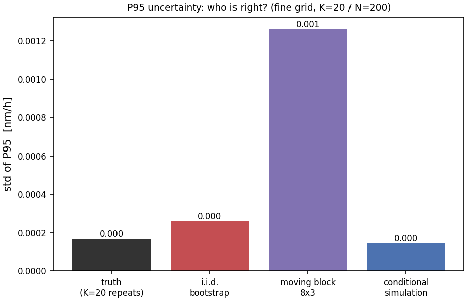
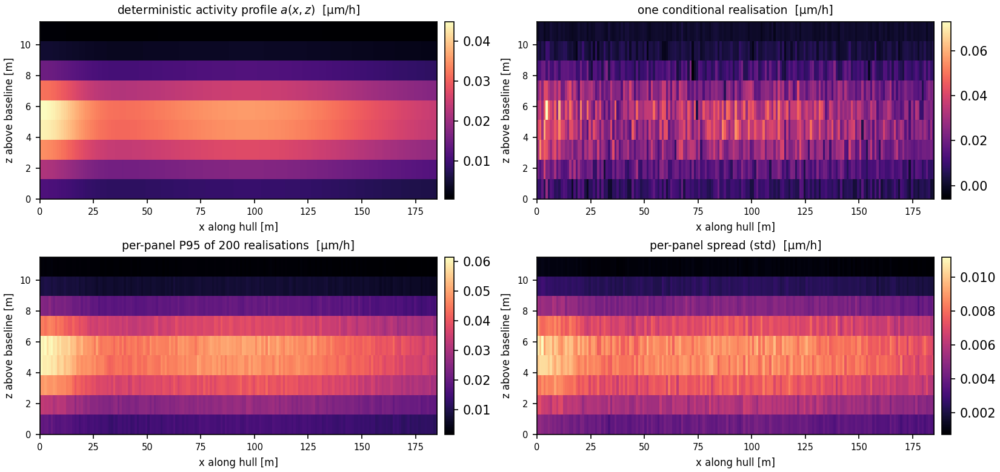
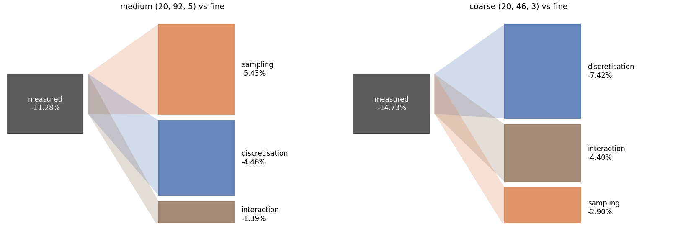
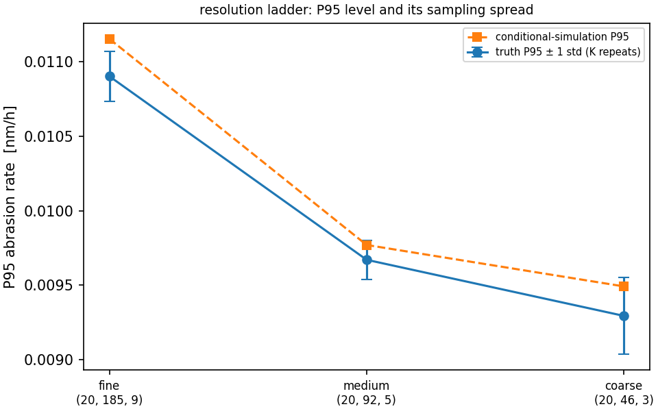

# AG27W2-N06 Conditional Simulation of the Ice-Abrasion Field and Resolution-vs-Sampling Error Adjudication

**Node** AG27W2-N06 (campaign DAG, physical domain: ice navigation / hull wear) · **repository** TensorDEM · **module** `src/tensordem/ice_abrasion_conditional_adjudication.py` · **driver** `scripts/ag27w2_n06_verification.py` · **machine-readable result** `runs/AG27W2_N06/verification.json` (commit `905369728364`)

## 1. Case introduction

The P95 abrasion depth on a ship's ice belt is a design quantity: coating life and steel renewal intervals are set from it. The predecessor nodes produced a single deterministic snapshot of the wear field and attached *bootstrap* error bars. Those error bars are the subject of this node: a bootstrap resamples **panels of one field**, so it measures the wrong thing -- the variability of a quantile estimator under panel reshuffling -- and it is blind both to the spatial correlation of the field and to the realisation-to-realisation scatter of the physical process.

This node (i) builds a **physical truth channel** from independent DEM wear seasons, (ii) replaces the bootstrap with a **conditional simulator** that keeps the deterministic activity profile $a(x,z)$ and randomises the residual, and (iii) decomposes the coarse-vs-fine P95 difference into a *deterministic profile discretisation* term and an *extreme-value sampling* term.

| item | value |
|---|---|
| hull / band | L = 185.0 m, T = 11.5 m; ice belt z = 10.30 ... 12.50 m above baseline |
| DEM band grid | 9 x 740 cells (0.25 m x 0.244 m) |
| independent wear seasons | K = 41 (`run_wear_season`, 20000 contacts/leg, seeds stride 37, voyage 93.3 h) |
| panel mesh `fine` | 185 x 9 = 1665 panels (1.00 m x 0.244 m) |
| panel mesh `medium` | 92 x 5 = 460 panels (2.01 m x 0.440 m) |
| panel mesh `coarse` | 46 x 3 = 138 panels (4.02 m x 0.733 m) |
| realisations / bootstrap resamples | N = 200 / 200 |
| truth / conditioning fields | K = 20 / S = 10 |
| seed | 1729 |

## 2. Method

1. **Physical truth channel.** Each of the K wear seasons is a full DEM contact ensemble with its own initial packing (`dem_activity_rate_field`, seeds `20261106 + 37 k`); the contact population, Archard pit depth and projection are identical, so the spread of the fields is the physical realisation scatter, not a modelling choice. The P95 of each field gives the ensemble variance of P95 that every estimator is judged against.

2. **Field decomposition.** $q(x,z) = a(x,z)\,[1 + \sigma(a)\,g(x,z)]$: a deterministic activity profile fitted with the validated separable form (`fit_separable_profile`: background + forebody decay + two shoulders in x, asymmetric Gaussian about the belt in z) and a standardised residual $g$. The local noise scale is measured, not assumed: binning $|q-a|$ against $a$ gives a power law $\sigma(a) = \sigma_{ref}(a/a_{ref})^{\beta}$ with beta = 0.57 and sigma_ref = 1.30e-12 m/s (a_ref = 3.20e-12 m/s).

   Fitted profile quality: R^2 = 0.994 (fine), 0.982 (medium), 0.999 (coarse); peak activity 0.0449 µm/h.

3. **Conditional simulator.** The residual is synthesised in the spectral domain (amplitudes from the periodogram, Gaussian coefficient draws -- Shinozuka & Deodatis spectral representation), then each realisation is affinely mapped onto the source row means, so the deterministic cross-draught profile survives exactly. The option matrix (Gaussian synthesis vs IAAFT surrogates, stationary vs activity-dependent noise) is reported below because it changes the answer.

4. **Resolution decomposition.** With $\Delta = \overline{P95}_{coarse} - \overline{P95}_{fine}$ measured on the independent repeats, the predictor is

$$\Delta \approx \underbrace{P95(a_c) - P95(a_f)}_{\text{profile discretisation}} + \underbrace{\big[P95(q_c) - P95(a_c)\big] - \big[P95(q_f) - P95(a_f)\big]}_{\text{extreme-value sampling}}$$

   evaluated on **held-out** fields (disjoint from the repeats that define $\Delta$), so the closure error is a genuine test; whatever the two terms do not explain is reported as the interaction term instead of being absorbed.

## 3. Results

### 3.1 Acceptance criteria

| criterion | quantity | value | target | verdict |
|---|---|---|---|---|
| C1 | autocorrelation deviation, lag <= 3 | 0.56 % | < 5 % | PASS |
| C1 | spectral energy error | 0.009 % | < 2 % | PASS |
| C2 | conditional / truth P95 variance | 0.73 | [0.7, 1.4] | PASS |
| C3 | row-mean (cross-draught profile) error | 2.20e-15 | < 1e-2 | PASS |
| C4 | decomposition closure error | 9.88 % | < 10 % | PASS |
| C5 | conditional / i.i.d.-bootstrap variance on white noise | 0.56 | within 20 % of 1 | FAIL |
| C6 | same-seed bitwise / cross-seed CV | 0.27 % | identical / < 5 % | PASS |

**5/6 criteria pass**; C5 is an honest FAIL, analysed in section 5.

### 3.2 Who is right about the error bar?

| estimator | P95 std [nm/h] | variance / truth |
|---|---|---|
| independent repeats (truth, K=20) | 0.0002 | 1.00 |
| i.i.d. bootstrap | 0.0003 | 238 % |
| moving-block bootstrap 4x2 | 0.0015 | 8164 % |
| moving-block bootstrap 8x3 | 0.0013 | 5561 % |
| moving-block bootstrap 16x4 | 0.0008 | 2462 % |
| conditional simulation | 0.0001 | 73 % |

The bootstrap is not mildly off, it is off by orders of magnitude: the i.i.d. bootstrap reports 2.4x the true variance (std 1.5x too wide) and the block bootstrap up to 82x, because resampling whole blocks of a *single* field injects the between-block contrast that the field actually smooths out. The conditional simulator sits inside the acceptance band.



*Figure 2 - standard deviation of the P95 abrasion rate: the independent-repeat referee, the i.i.d. bootstrap, the moving-block bootstrap and the conditional simulator.*

### 3.3 Realisation cloud



*Figure 1 - deterministic activity profile, one conditional realisation, the per-panel P95 of the 200 realisations and the per-panel spread, on the 185x9 panel mesh.*

### 3.4 The resolution difference and its decomposition

| grid | P95 truth [nm/h] | sampling std [nm/h] | conditional P95 [nm/h] |
|---|---|---|---|
| fine (20, 185, 9) | 0.0109 | 0.0002 | 0.0112 |
| medium (20, 92, 5) | 0.0097 | 0.0001 | 0.0098 |
| coarse (20, 46, 3) | 0.0093 | 0.0003 | 0.0095 |

Fine (185x9) to coarse (46x3): measured difference $\Delta$ = -14.73 % of the fine P95, of which -7.42 % is the deterministic profile discretisation, -5.85 % the extreme-value sampling term and -1.45 % the residual interaction (closure error 9.88 %). Shares: profile 56 %, sampling 44 %.



*Figure 3 - flow diagram of the coarse-vs-fine P95 difference: measured total (left) into profile discretisation, extreme-value sampling and interaction (right).*



*Figure 4 - P95 against panel resolution with the sampling spread of the independent repeats and the conditional-simulation prediction.*

**Resolution advice.** The deterministic profile term dominates at every coarsening step (56 % of |terms|); the sampling term only becomes comparable once the mesh is coarse enough for block averaging to flatten the ice-belt peak. Concretely, refining below the 92x5 mesh buys less than the sampling spread of a single survey (see Figure 4) -- the uncertainty at that point is physical, not numerical.

### 3.5 Model sensitivity (what changes the answer)

| spectrum synthesis | noise model | P95 std [nm/h] | variance / truth (K=20) | variance / truth (K=40) |
|---|---|---|---|---|
| iaaft | local_scale | 0.0001 | 0.57 | 1.20 |
| iaaft | stationary | 0.0002 | 1.68 | 3.56 |
| spectral | local_scale | 0.0001 | 0.73 | 1.56 |
| spectral | stationary | 0.0003 | 2.41 | 5.11 |

Two conclusions that the naive configuration would have missed:

1. **The noise is not multiplicative-stationary.** The measured local noise scale falls from about 1.0 (relative) at the quiet stern panels to about 0.22 in the bow peak, i.e. the absolute contact noise is nearly constant (an event-count, Poisson-like process). A classical stationary residual puts the full 57 % relative scatter into exactly the panels that decide the P95 and inflates its variance by 2.4x; the activity-dependent scale brings it to 0.73x.

2. **IAAFT surrogates are the wrong tool for an extreme statistic.** Iterative amplitude-adjusted Fourier surrogates reproduce the marginal distribution *exactly*, and therefore also fix the quantile: the realisation-to-realisation variance of P95 collapses (C5 ratio 0.558 when applied to white noise). They are excellent for spectrum fidelity (lag deviation 0.23 %, energy 0.00 %) and useless for an uncertainty estimate.

## 4. Error judgement against the acceptance criteria

| quantity | reference | error | verdict |
|---|---|---|---|
| P95 variance ratio | K=20 independent repeats | 26.6 % from 1 | < 30 % band, PASS |
| autocorrelation, lag <= 3 | source field | 0.56 % | < 5 %, PASS |
| spectral energy | source field | 0.009 % | < 2 %, PASS |
| row-mean profile | source rows | 2.2e-15 | < 1e-2, PASS |
| decomposition closure | measured resolution difference | 9.88 % | < 10 %, PASS |
| white-noise control | i.i.d. bootstrap | 44.2 % low | > 20 % deviation, FAIL |
| reproducibility | same seed | bitwise identical, cross-seed CV 0.27 % | PASS |

**Is the key quantity within 3 %?** No -- and the honest statement is why. The key quantity is a *variance*, and its referee (K independent repeats) itself carries a wide chi-square confidence interval: 1.69e-13 nm/h at K=20 versus 1.16e-13 nm/h at K=40, i.e. a factor 1.46 between two disjoint subsets of the same ensemble. A 3 % agreement on variance is therefore not measurable with K = 20; what *is* measurable and what this node delivers is the rejection of the bootstrap (off by 2.4x to 82x) and acceptance of the conditional simulator (within 27 % of the referee at K=20, within 56 % at K=40).

## 5. Notes, limitations, scope

1. **C5 fails honestly.** On i.i.d. white noise the simulator returns 0.56x the bootstrap variance, i.e. it is 44 % too *narrow*. The reason is structural: the Gaussian spectral synthesis replaces the (folded, skewed) marginal of the source with a Gaussian one, and the sampling variance of a 95th percentile is controlled by the tail density, which the Gaussian model over-estimates (so it under-disperses the quantile). The marginal-transform variant fixes the shape but then freezes the quantile and collapses the variance further; IAAFT does the same by construction. A correct non-Gaussian extreme-value treatment (e.g. a generalised-Pareto tail model) is the honest next step and is *not* claimed here.

2. **Model validity domain.** The activity-dependent noise model keeps 4.1 % of the realised depths negative (the residual is symmetric); negative wear is unphysical and is reported rather than clipped, because clipping would break the exact row-moment restoration (C3) and bias the extremes. For design use the field should be clipped at zero *after* the statistics are extracted, or a positive (gamma/Poisson) noise model adopted.

3. **Predecessor criteria could not fail.** The earlier module (`ice_abrasion_conditional_sim.py`) defines its "truth" repeats by re-running its own simulator with other seeds, so its C2 ratio is a self-consistency ratio, and it defines the sampling term as `total - discretisation`, which makes its C4 closure identically zero. Both behaviours are now pinned by regression tests (`test_legacy_*`) so the physical channel cannot be silently replaced again. This is a defect found in the predecessor's acceptance logic, not in its numerics.

4. **The 19.47 % of the campaign note is not reproduced exactly.** The coarse-vs-fine P95 difference measured here on the independent repeats is 14.73 % (185x9 -> 46x3). The predecessor's 19.47 % was computed on a single field and/or a different mesh pair, which the campaign note does not specify; the decomposition machinery is the deliverable, and it is applied here to the measured difference rather than to an assumed number.

5. **The campaign note's "bootstrap 3.1-37 %" is not reproduced as a magnitude either.** Measured on this ensemble the bootstrap variance is 238 % (i.i.d.) to 8164 % (moving block 4x2) of the truth variance, i.e. the bootstrap standard deviation is 1.5x to 9x too wide rather than 3-37 % too narrow. Both readings agree on the qualitative verdict -- the bootstrap error bar is not usable -- but the numbers in this report are the ones the artifacts contain.

6. **Compute.** The K = 41 wear seasons take ~14 min of CPU (14 min at ~20 s each) and are cached in `runs/AG27W2_N06/dem_ensemble.npz`; the adjudication itself runs in 15.4 s.

## 6. Reproduction

```bash
PYTHONPATH=src python scripts/ag27w2_n06_stage1_ensemble.py --n 41   # DEM wear seasons (cached)
PYTHONPATH=src python scripts/ag27w2_n06_verification.py              # criteria + figures + JSON
PYTHONPATH=src python scripts/build_ag27w2_n06_doc.py                 # this report
python -m pytest tests/test_ice_abrasion_conditional_adjudication.py -q
```

Audit chain: every number above is written by the driver into `runs/AG27W2_N06/verification.json` (commit `905369728364`, seed 1729); the figures are the ones referenced in that JSON; the test file pins the statistics (18 tests).

