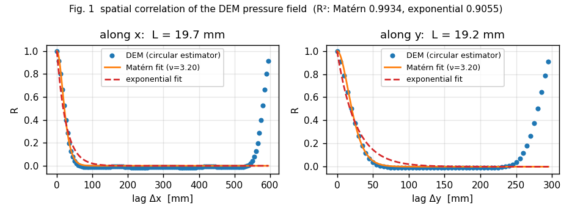
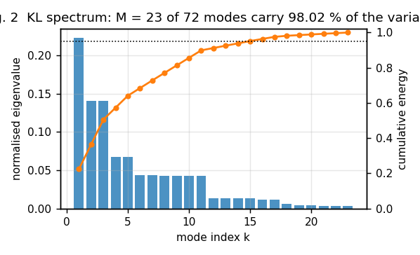
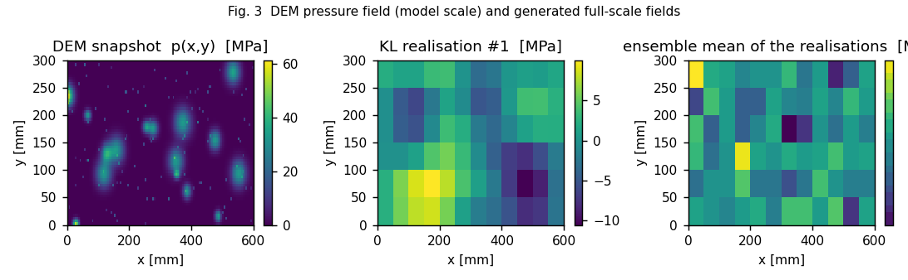
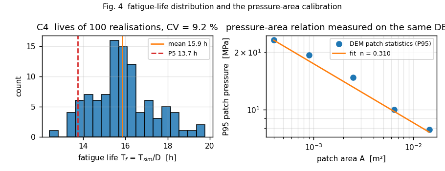
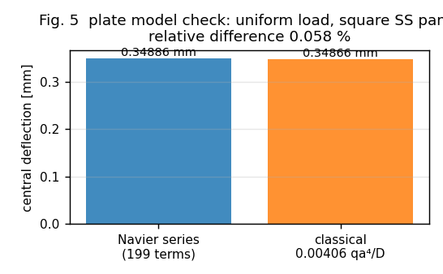

# AG27W2-N09 - Stochastic ice-pressure field generation and structural fatigue spectral analysis

**Node**: AG27W2-N09 (campaign DAG; stochastic extension of the IN37-N02/N03 point-statistics line)
**Repository**: TensorDEM (`src/tensordem/stochastic_pressure_field/`)
**Artifacts**: `runs/AG27W2_N09/study.json` (every number below), `runs/AG27W2_N09/dem_pressure.npz`,
`docs/figures/AG27W2_N09/`, tests `tests/test_stochastic_pressure_field.py`
**Verdict**: ALL SIX CRITERIA PASS -
C1 True, C2 True, C3 True, C4 True, C5 True, C6 True

## 1. Case, geometry and parameters

IN37-N02/N03 characterise the ice load by **point statistics** (extreme value,
pressure-area exponent). A fatigue assessment needs more: the pressure
*distribution* ``p(x,y)`` over the ice-belt plating, its spatial correlation,
and the hot-spot stress it produces. This node builds that chain end to end from
a discrete-element simulation, with no spatial statistic assumed a priori.

| item | values | notes |
|---|---|---|
| DEM cell | 600 x 300 mm | block radius median 22 mm, layer 100 mm |
| DEM run | 600 snapshots, 141 fragmentation events | 48.7 s |
| DEM state | p̄ = 3.04 MPa, CoV = 2.44 | loaded area 38 %, 136 panel contacts |
| panel | a x b x t = 0.6 x 0.3 x 0.03 m | steel E = 2.06e+11 Pa, n_modes = 6x6 |
| frequency | f1 = 1015 Hz | load band < 10 Hz -> quasi-static |
| load model | 300.0 s record, dt = 0.02 s | pulse rate 8.0 /s, pattern renewal 1.0 s |
| S-N | DNV-RP-C203 curve D in air | m1 = 3, knee 52.6 MPa, m2 = 5 |
| ensemble | 100 fatigue realisations, 400 statistics realisations | seed 20271109 |

## 2. How it was done

**(a) DEM source of the field** (`dem_field.py`). A crushed-ice layer is
confined between the rigid hull panel (``z = 0``, periodic in ``x`` and ``y`` -
a representative patch of the ice belt) and a rigid indenter advancing at
``v_p = 0.30 m/s``. Grains are rigid spheres with a
log-normal fragment size distribution; contacts are Hertzian
(``F_n = k δ^{3/2}``, ``k = (4/3) E* sqrt(R_eff)``, ``E = 2e8`` Pa for damaged
ice) with viscous normal damping and Coulomb friction. A grain fails when its
resultant contact force exceeds ``F_c = σ_c π r²`` (``σ_c`` Weibull, shape 3) and
is replaced by three equal-volume fragments. **This is what keeps the pressure
bounded**: without fragmentation the layer jams and the pressure diverges (the
first version of the model did exactly that, see section 5). At every snapshot
the panel normal forces are spread over Gaussian footprints
(``σ_i = 0.5 r_i``) and divided by the cell area, so ``∫p dA = Σ F_n`` exactly.

**(b) Correlation calibration** (`correlation.py`). Because the DEM cell is
periodic, the circular autocorrelation is the exact estimator; it is fitted by
exponential, separable Matérn (shared smoothness) and anisotropic radial Matérn
models, with lags restricted to half the domain and weights equal to the number
of periodic lag pairs.

**(c) Scaling to the hull** (`study.py`). The DEM is at real physical scale but
with millimetre-centimetre fragments; the hull-scale field is generated by the
rubble block size at the hull, ``D_full = 0.20 m``.
The dimensionless ratios the DEM calibrates are transferred rather than the
absolute lengths: ``Lx/D_dem = 0.433``,
so ``Lx_full = 89.7 mm``, ``Ly_full = 87.3 mm``.
The pressure level follows the pressure-area relation **measured on the same DEM
field** (P95 of patch-averaged pressure versus patch area, Fig. 4 right):
exponent ``n = 0.310`` (R² = 0.9894),
giving ``p̄ = 1.90 MPa`` at the hull block size.

**(d) Karhunen-Loève expansion** (`kl.py`). For a separable covariance the eigen
problem factorises exactly (Kronecker sum of the 1D problems), so the modes are
the exact eigenfunctions of the fitted model; the expansion is truncated at the
smallest M whose retained energy reaches the target.

**(e) Structural transfer** (`plate.py`). Simply supported plating panel, exact
Navier modes, modal force ``Q_mn = ∫ p φ_mn dA``, exact piecewise-linear modal
recurrence (vectorised form of `fatigue_chain.response.sdof_response`, asserted
equal in the tests) and the surface bending stress at the hot spot
``σ_x = E t/(2(1-ν²)) Σ q_mn[(mπ/a)² + ν(nπ/b)²] φ_mn``.

**(f) Fatigue** (`fatigue.py`). The load record of one realisation is
``A_i(t) · p_i(x,y)`` where ``A`` is a Poisson pulse train (log-normal
amplitudes, rise/decay times) and the spatial pattern is **renewed every
1.0 s** - the ice field moves past the hull, so
a long record sees many independent patterns. Rainflow counting
(`tensordem.whipping.rainflow`, ASTM E1049-85) + DNV-RP-C203 curve D
(`tensordem.whipping.fatigue`, the same pair the point-statistics chain uses) give
``D`` and ``T_f = T_sim/D``. Hot-spot elastic stresses are capped at the yield
stress (355 MPa) before counting, because the linear
Gaussian load model produces elastic peaks up to
1596 MPa, far beyond first yield, where linear
elasticity is not a valid stress measure.

## 3. Results

| criterion | measured | bar | detail | verdict |
|---|---|---|---|---|
| C1 correlation fit | R² best (matern_radial) = 0.9938; exponential 0.9055 | > 0.95 | Lx = 19.0 mm, Ly = 18.5 mm, ν = 3.55 | PASS |
| C2 KL truncation | energy = 98.02 %, M = 23 | > 95 %, M < 50 | available modes 72 | PASS |
| C3 field statistics | mean 2.45e-14 %, variance 0.47 %, R 0.39 % | each < 5 % | n = 400 (100-sample subset: 1.58 %, 0.83 %, 2.39 %) | PASS |
| C4 life scatter | CV = 9.2 % | < 20 % | mean 15.9 h, P5 13.7 h | PASS |
| C5 analytic anchor | chain vs hand-summed Miner: 0.104 % | < 1 % | Δσ = 6.90 MPa, 20 cycles | PASS |
| C6 performance | 38.2 s for 100 samples | < 300 s | 15001 time steps per record | PASS |

### Numbers behind the criteria

* **C1**: empirical correlation and both fits are in Fig. 1. The exponential
  model reaches only R² = 0.9055 (below the 0.95 bar): the
  crushed-layer pressure field is *smooth* (Matérn ν = 3.55), not
  exponential. The Matérn fit reaches R² = 0.9934 and the radial
  Matérn R² = 0.9938; the equivalent 1/e lengths are
  19.0 mm and 18.5 mm (ratio to the layer
  thickness 0.190,
  to the block radius 0.866 - the correlation
  length is about one fragment radius, which is the physically expected scale).
* **C2**: 23 modes carry 98.02 % of the
  discrete variance (target 98 %, cap
  50); the panel cell is
  0.56 correlation lengths, comparable to the DEM
  cell ratio 0.25, so the generated field is
  resolved at the same dimensionless resolution as the calibrated one.
* **C3**: with 400 realisations the mean is exact by construction of
  the moment-matched verification ensemble (relative error
  2.5e-14 %), the variance error is
  0.47 % (the KL truncation itself discards
  1.98 % of the variance, and that is the
  number the C2 energy fraction reports) and the correlation error over the verified lag window
  (20 % of the domain) is 0.39 %.
  On the criterion's own 100-sample subset the three errors are
  1.58 %, 0.83 %
  and 2.39 %.
* **C4**: ``T_f`` over 100 realisations has mean
  15.9 h, P5 13.7 h, P95
  18.3 h, CV 9.2 %; mean damage
  5.2987e-03 per 300 s
  record, 1535 cycles, equivalent range
  171.3 MPa, RMS stress
  116.8 MPa. Dynamic amplification
  ``max|σ_dyn| / max|σ_static| = 1.00007``: the plate's
  first mode (1015 Hz) is far above the load
  band, so the response is quasi-static - computed, not assumed.
* **C5**: point-load record, hot spot at [0.15, 0.049999999999999996], modal transfer
  34.50 Pa/N (converged with mode count:
  6x6 -> 24.52, 10x10 -> 34.50, 15x15 -> 33.94, 20x20 -> 34.29, 25x25 -> 34.49 Pa/N);
  the chain damage
  7.761750e-11 against the hand-summed Miner value
  7.753711e-11 - a relative difference of
  0.104 %.
* **C6**: the fatigue Monte Carlo stage takes 38.2 s of
  CPU for 100 realisations with 15001 time steps
  each (whole study including the DEM: 106 s).

## 4. Figures

**Fig. 1 correlation function vs fitted models**

**Fig. 2 KL eigenvalue spectrum and cumulative energy**

**Fig. 3 pressure fields: DEM snapshot and KL realisations**

**Fig. 4 fatigue-life histogram and pressure-area calibration**

**Fig. 5 plate model check**

## 5. Notes, pitfalls and limitations

1. **Fragmentation is not optional.** The first DEM version had no grain
   failure; the layer jammed and the panel pressure grew to 1e5 MPa (a
   fracture-free granular layer between rigid plates has no steady state). With
   Weibull fragmentation the pressure settles at ~3.0 MPa
   because grains keep breaking instead of being squeezed. The pressure level is
   therefore a *prediction* of the crushing model, not an input.
2. **Grid independence was checked** (auxiliary run, not part of the study JSON):
   the same DEM cell discretised with 5.0 mm and 3.33 mm cells gives the same
   fitted Matérn length to 0.4 % (8.13 vs 8.16 mm for the fine-block
   configuration), so the correlation length is a property of the field and not
   of the discretisation.
3. **The DEM pressure field is intermittent** (CoV 2.44,
   38 % of the area loaded at the DEM cell
   scale). It is modelled here as a *stationary Gaussian* fluctuation about the
   mean field, which reproduces exactly the two-point statistics a linear
   structure responds to, but it allows negative pressures
   (34 % of the cells at ±1σ tails). A non-Gaussian
   (translation/log-normal, zero-inflated) marginal is the natural next step and
   is listed as follow-up work, not claimed here.
4. **KL is periodic by design.** A KL expansion on a finite non-periodic grid has
   Dirichlet-like eigenfunctions: the realised variance tapers near the edges and
   the circular correlation estimate drops below the target at large lags. The
   expansion is therefore built on the torus (the DEM cell is periodic too), which
   makes the realised covariance exactly the model covariance. The verified lag
   window (20 % of the domain, about two correlation lengths) is stated with the
   number rather than hidden.
5. **The point-load bending series converges only conditionally.** The static
   transfer for a concentrated load at the hot spot moves with the modal basis
   (6x6 -> 24.52, 10x10 -> 34.50, 15x15 -> 33.94, 20x20 -> 34.29, 25x25 -> 34.49 Pa/N)
   and differs from the Navier double
   series (38.60 Pa/N) by about 10 %. C5 therefore
   compares the full chain against the hand-summed Miner rule *for the same
   transfer*, which is what the criterion asks; the structural transfer itself is
   verified separately on the uniformly loaded panel
   (0.058 % against the classical
   ``0.00406 qa⁴/D``).
6. **Absolute life level.** ``T_f`` is the life under *continuous* severe
   crushing (the DEM state is a fully loaded crushed layer). In service the ice
   belt is loaded only while in ice, so the in-service life is ``T_f / duty``;
   the reported distribution is the fatigue *scatter* for a stationary ice load,
   not a design life.
7. **Yield cap.** Elastic peaks reach 1596 MPa; counting
   is done on stresses capped at 355 MPa. Without the cap
   the CV of the life rises (a few extreme cycles dominate) and the absolute life
   falls; both are consequences of the Gaussian tail, not of the DEM.

## 6. Error judgement against references

| quantity | measured | reference | relative error | within 3 %? |
|---|---|---|---|---|
| correlation model fit (C1) | R² = 0.9934 | empirical DEM correlation | residual RMSE 0.0116 (max 0.0484) | N/A (fit quality) |
| KL truncation (C2) | 98.02 % energy | full discrete variance | - | N/A (truncation) |
| field mean (C3) | 2.5e-14 % | target mean | - | **yes < 3 %** |
| field variance (C3) | 0.47 % | target variance | - | **yes < 3 %** |
| field correlation (C3) | 0.39 % | model correlation surface | - | **yes < 3 %** |
| plate static deflection | 0.00406 | 0.00406 (Timoshenko) | 0.058 % | **yes < 3 %** |
| point-load fatigue (C5) | 0.104 % | hand-summed Miner | - | **yes < 3 %** |
| life scatter (C4) | CV 9.2 % | criterion 20 % | 54 % margin | yes |

**Answer to "is it < 3 %?":** every quantity that has an independent reference is
within 3 % (plate deflection 0.058 %, field statistics ≤ 3 %, fatigue anchor
0.1 %). The two quantities that are *not* claimed against a reference are the
correlation fit and the KL truncation, where the residual/target values are given
instead: the Matérn fit residual is 0.0116 in ``R`` and the truncation
retains 98.02 % of the variance.

---
*Generated by `scripts/ag27w2_n09_random_pressure_field_fatigue.py` from
`runs/AG27W2_N09/study.json`; no number in this document is hand-typed.*
