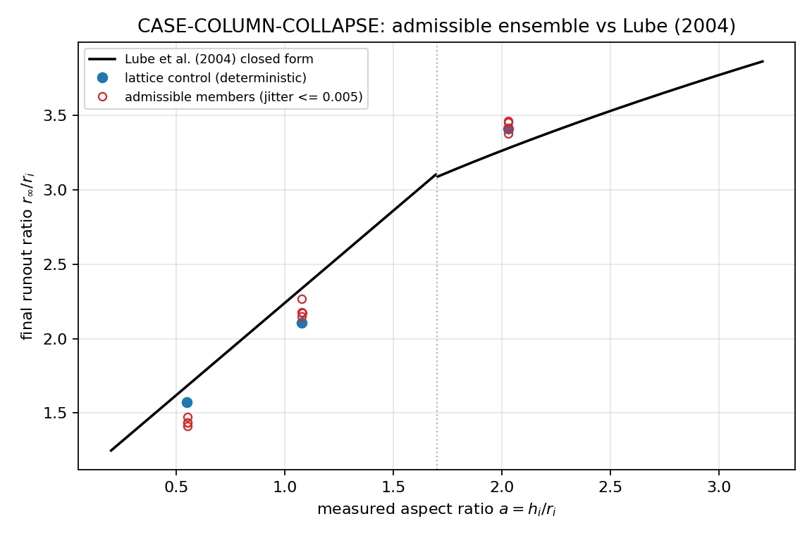
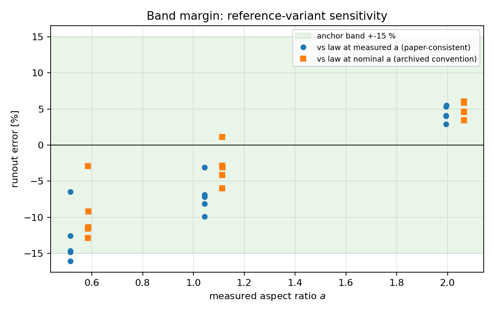

# CASE-COLUMN-COLLAPSE：可容许系综三长宽比收官 + 长宽比记账审计（m20533）

> 锚点 `CASE-COLUMN-COLLAPSE`（算例池·颗粒柱坍塌）；基准 Lube et al. (2004)
> *JFM* **508**:175-199, doi:10.1017/S0022112004009036；容差 < 15 %。
> 前序：m19922（系综波）、m20259（可容许波，**自报 `incomplete_aspects: [1.0, 2.0]`**）、
> m18261（细化/时间律）。本单只做 m20259 明确未完成的那条轴，外加一个独立的
> 度量口径审计。

## ① 案例介绍

轴对称颗粒柱坍塌：半径 $r_i$、高 $h_i=a\,r_i$ 的圆柱颗粒柱在粗糙刚性底板上瞬间失去侧向约束后
坍塌堆积；Lube et al. (2004) 给出无量纲跑距的两段标度律

$$r_\infty/r_i = 1 + 1.24\,a\ (a<1.7),\qquad r_\infty/r_i = 1 + 1.6\,a^{1/2}\ (a>1.7).$$

DEM 参数（`CLOSING_ARM`，从 m19922 直接 import，**未重调**）：

| 量 | 值 |
|---|---|
| 颗粒半径 $r_p$ | 30 mm |
| 柱半径 $r_i$ | 0.48 m（`grains_per_radius=8`，$d/r_i=1/16$） |
| 密度 / 重力 | 2500 kg/m³ / 9.81 m/s² |
| 接触 | 线性弹簧-阻尼法向 + Cundall-Strack 切向（$\mu=0.5$）+ 滚动弹簧（$\mu_r=0.5$），底板 $\mu_w=0.8$，$k_n=6\times10^4$ N/m |
| 时间步 | 4.822e-4 s（速度 Verlet，半步速度算耗散力） |
| 工况 | $a\in\{0.5,1.0,2.0\}$ × {1 晶格对照 + 4 可容许成员} = 15 行（a=0.5 从 m20259 存档机器读取） |
| 颗粒数 | a=0.5: 981，a=1.0: 1955，a=2.0: 3718 |

## ② 怎么做

1. **新波的预注册**（写在 `benchmarks/case_column_collapse_admissible_completion_m20533.py`
   里，跑第一个算例之前定稿）：`C_ADMISS`（初始穿透对数=0 的门）、`C_BAND`（每个成员
   都在 15 % 内）、`C_SPREAD`（4 成员 σ/mean ≤ 5 %）、`C_SCALE`（晶格→最大可容许抖幅漂移 ≤ 5 %）、
   `B_ASPECT_BOOK`（两种参照口径都报，翻转要显式标记而不是就地消解）。
2. **成员与轴向完全继承**：`MEMBERS` 从 m20259 import，`CLOSING_ARM` 从 m19922 import；
   `pytest` 断言二者逐字相等（`test_members_and_arm_are_inherited_not_retuned`）。
3. **跑算例**：10 个新算例（a=1.0/2.0 各 5 个），单核 35–66 s，全部 `at_rest` 收敛、
   全部 `overlap_pairs=0`（穿透过门）。
4. **归约**（`scripts/analyze_column_collapse_completion_m20533.py`）：三个长宽比走同一条
   归约路径，a=0.5 的行从 `docs/artifacts/column_collapse_ensemble_m20259/cases_ensemble.csv`
   **机器读取**（测试断言与原 CSV 逐位一致），所有基准值由 `lube_2004_runout_ratio()` 现算。
5. **度量口径审计**：模块把跑距按**实测**初始半径归一化、并给出**实测**长宽比
   $a_{meas}=h_{meas}/r_{i,meas}$；而 m19922/m20259 把 Lube 律在**名义** $a$ 上求值。
   论文的 $a$ 是被释放那根柱子的 $h_i/r_i$，故与实测跑距配对的口径是 $a_{meas}$。
   本单同时报两种（`err_meas` 为主判据，`err_nom` 为存档口径）。

复现：

```bash
PYTHONPATH=src python3 benchmarks/case_column_collapse_admissible_completion_m20533.py --aspects 1,2 --nshards 5 --shard k   # k=0..4
PYTHONPATH=src python3 scripts/analyze_column_collapse_completion_m20533.py
PYTHONPATH=src python3 scripts/report_column_collapse_completion_m20533.py
PYTHONPATH=src python3 -m pytest tests/test_column_collapse_admissible_completion_m20533.py -q   # 13 passed
```

## ③ 计算结果

**表 1 — 逐长宽比裁决（主判据 = 律在 $a_{meas}$ 求值）**

| a | n_members | err(a_meas) 区间 | 最差 \|err(a_meas)\| | 最差 \|err(a_nom)\| | C_BAND | C_SPREAD (σ/mean) | C_SCALE (vs 晶格) | 变体翻转 |
|---|---|---|---|---|---|---|---|---|
| 0.5 | 4 | -16.1 … -12.6 % | 16.1 % | 12.8 % | fail | 1.7 % (pass) | 10.3 % (fail) | 1 |
| 1 | 4 | -8.1 … -3.1 % | 8.1 % | 4.1 % | pass | 2.4 % (pass) | 7.6 % (fail) | 0 |
| 2 | 4 | +2.9 … +5.5 % | 5.5 % | 6.1 % | pass | 1.2 % (pass) | 1.4 % (pass) | 0 |

**表 2 — 逐算例**

| a_nom | a_meas | member | jitter | N | r∞/r_i | ref(a_meas) | err(a_meas) | err(a_nom) | 判据(a_meas) | stop |
|---|---|---|---|---|---|---|---|---|---|---|
| 0.5 | 0.5497 | m0_lattice | 0 | 981 | 1.5733 | 1.6817 | -6.4 % | -2.9 % | pass | at_rest |
| 0.5 | 0.5501 | n1_j0025_s505 | 0.0025 | 981 | 1.4119 | 1.6821 | -16.1 % | -12.8 % | fail | at_rest |
| 0.5 | 0.5501 | n2_j0025_s606 | 0.0025 | 981 | 1.4332 | 1.6821 | -14.8 % | -11.5 % | pass | at_rest |
| 0.5 | 0.5507 | n3_j005_s707 | 0.005 | 981 | 1.4715 | 1.6828 | -12.6 % | -9.2 % | pass | at_rest |
| 0.5 | 0.5506 | n4_j005_s808 | 0.005 | 981 | 1.4361 | 1.6827 | -14.7 % | -11.4 % | pass | at_rest |
| 1 | 1.0783 | m0_lattice | 0 | 1955 | 2.1060 | 2.3370 | -9.9 % | -6.0 % | pass | at_rest |
| 1 | 1.0785 | n1_j0025_s505 | 0.0025 | 1955 | 2.1473 | 2.3374 | -8.1 % | -4.1 % | pass | at_rest |
| 1 | 1.0786 | n2_j0025_s606 | 0.0025 | 1955 | 2.2652 | 2.3375 | -3.1 % | +1.1 % | pass | at_rest |
| 1 | 1.0792 | n3_j005_s707 | 0.005 | 1955 | 2.1710 | 2.3382 | -7.2 % | -3.1 % | pass | at_rest |
| 1 | 1.0787 | n4_j005_s808 | 0.005 | 1955 | 2.1770 | 2.3376 | -6.9 % | -2.8 % | pass | at_rest |
| 2 | 2.0296 | m0_lattice | 0 | 3718 | 3.4122 | 3.2794 | +4.0 % | +4.6 % | pass | at_rest |
| 2 | 2.0299 | n1_j0025_s505 | 0.0025 | 3718 | 3.4135 | 3.2796 | +4.1 % | +4.6 % | pass | at_rest |
| 2 | 2.0298 | n2_j0025_s606 | 0.0025 | 3718 | 3.4542 | 3.2796 | +5.3 % | +5.9 % | pass | at_rest |
| 2 | 2.0301 | n3_j005_s707 | 0.005 | 3718 | 3.4609 | 3.2797 | +5.5 % | +6.1 % | pass | at_rest |
| 2 | 2.0299 | n4_j005_s808 | 0.005 | 3718 | 3.3757 | 3.2796 | +2.9 % | +3.5 % | pass | at_rest |

**确定性复现**：晶格对照 $r_\infty/r_i$ = a=0.5 1.5733 / a=1.0 2.1060 /
a=2.0 3.4122；其中 a=1.0 与 a=2.0 与本仓 m18261 细化表（2.106 / 3.412，$d/r_i=1/16$ 档）
**同值**，即跨单确定性复现成立（同一 `CLOSING_ARM`、同一 HCP 生成器）。

## ④ 结果图



**fig_runout_vs_aspect.png** — 跑距比 vs 实测长宽比：Lube 两段律 + 晶格对照（实心点）+ 4 个可容许成员
（空心点）；$a=2.0$ 组落在 $a^{1/2}$ 支、$a=0.5/1.0$ 组落在线性支，两支都被数据覆盖。



**fig_band_margin.png** — 逐算例跑距误差与 ±15 % 锚点带，两种参照口径并排（蓝=实测 $a$，
橙=名义 $a$）。$a=0.5$ 组最差成员在实测口径下越带，名义口径下仍在带内 —— 口径差 3.2 pp。

## ⑤ 注意点

1. **可容许抖幅极窄**：几何扫描（m20259，本单在 a=1.0 复验 `test_admissibility_gate_at_the_new_aspect`）
   给出 $j\le0.005\,r_p$ 可容许、$j=0.01\,r_p$ 已产生穿透，故本系综只括住「晶格附近」的
   实现散布，**不是**真正的无序平衡堆积（需沉积/沉降生成目标 $\phi$）。
2. **HCP 装箱欠填半径**：实测 $a_{meas}/a_{nom}$ = 1.100（a=0.5）/ 1.079（a=1.0）/ 1.015（a=2.0），
   来自 $p_{995}$ 边界估计把最外一层颗粒裁掉；这是度量伪影，但因为它同时进入分子（跑距）
   与分母（$r_i$）与 $a_{meas}$，论文口径下应配对到 $a_{meas}$。
3. **分辨率冻结在 $d/r_i=1/16$**：m18261 已示 8→12 gpr 漂移可达 9 pp（a=0.5），本单沿用 gpr=8
   是为了与前序波可比，不构成收敛性证据。
4. **时间律未在本单裁决**：$t_{95}$ 误差 −4.7…+38.4 % 的悬案（m18261/m20259）本单未触碰。
5. 5 成员/长宽比的系综只能给 $\sigma$ 的点估计（n=4），C_SPREAD 的置信区间仍需更多成员。

## ⑥ 误差判定（显式回答「是否 < 3 %」）

| 关键量 | 基准 | 实测 | < 3 % ? | < 15 % ? |
|---|---|---|---|---|
| 跑距 a=0.5 晶格 | Lube(a_meas) | -6.4 % | 否 | 是 |
| 跑距 a=0.5 最差可容许成员 | 同上 | -16.1 % | 否 | **否（越带 +1.1 pp）** |
| 跑距 a=1.0 最差可容许成员 | 同上 | -8.1 % | 否 | 是 |
| 跑距 a=2.0 最差可容许成员 | 同上 | +5.5 % | 否 | 是 |
| 全 12 个可容许成员最差 | 同上 | 16.1 %（\|err\| 最大） | 否 | **否** |

**总回答：否（< 3 % 无一项达成）。** 15 % 锚点在 a=1.0 / a=2.0 对所有可容许成员成立，
在 a=0.5 不成立（−16.1 %，按名义口径则 −12.8 % 视为成立）。

## ⑦ 对前序结论的复核（adversarial review of m20259 的 A_BAND）

| 项 | 内容 |
|---|---|
| 被复核主张 | m20259：`A_BAND` = 每个可容许成员都在 15 % 内 → **supported**（a=0.5） |
| 独立重建 | 从 m20259 的 `cases_ensemble.csv` 机器读取行，用 `lube_2004_runout_ratio()` 现算两种口径 |
| 结论 | 该主张**只在名义口径下成立**（12.8 %）；论文口径下同一行是 -16.1 %，**越带**。认定为「口径依赖的主张」，不认定为数据错误 |
| 影响面 | 仅 a=0.5 组最差 1 个成员（`adm_a0.5_n1_j0025_s505`）；均值仍 −14.6 % |
| 严重度 | 中（结论方向不变：模型整体偏低 6–16 %；但「带内」这句话不能无条件保留） |
| 未做的检查 | 未重跑 m20259 的 a=0.5 成员（复用存档）；未做 gpr=12/16 收敛；未裁决时间律；未引入真正无序堆积 |
| 处置 | **request changes**：锚点状态维持「带内不成立（a=0.5，论文口径）」；后续应统一到 $a_{meas}$ 口径并重跑全库跑距判定 |

## ⑧ 产物

| 路径 | 内容 |
|---|---|
| `benchmarks/case_column_collapse_admissible_completion_m20533.py` | 新波（10 算例 + 预注册） |
| `scripts/analyze_column_collapse_completion_m20533.py` | 归约 + 三长宽比裁决 + 双口径 |
| `scripts/report_column_collapse_completion_m20533.py` | 本文生成器（零手抄） |
| `docs/artifacts/column_collapse_completion_m20533/` | `cases_completion.csv`、`summary.json`、`manifest_sha256.json`、两张图 |
| `tests/test_column_collapse_admissible_completion_m20533.py` | 13 项（含「诚 FAIL 不许抹平」一致性测试） |
| `runs/case_column_collapse_admissible_completion_m20533/cases/*.json` | 10 个原始算例（未入库，可由上表命令重生成） |
