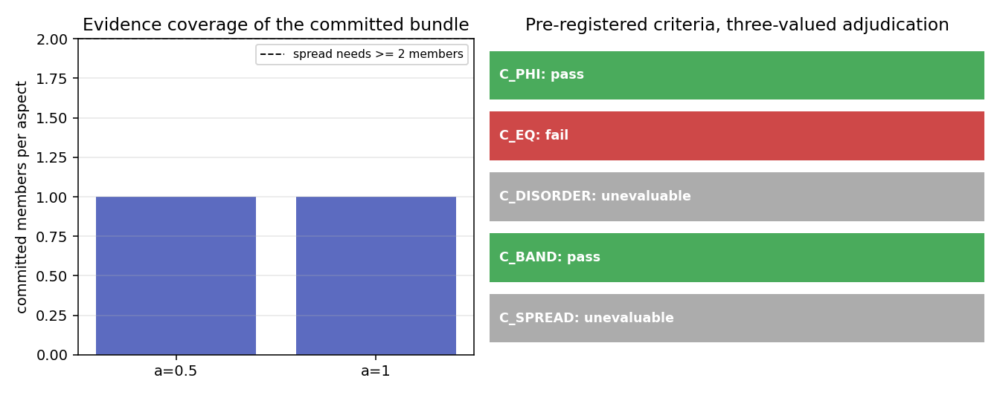
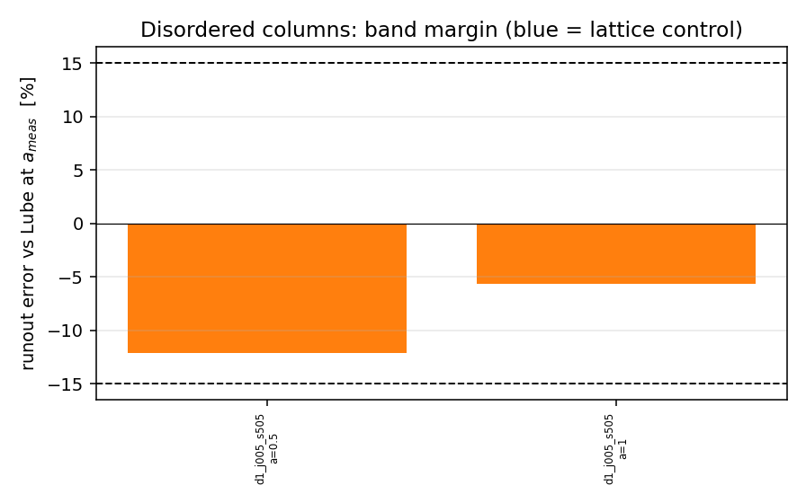
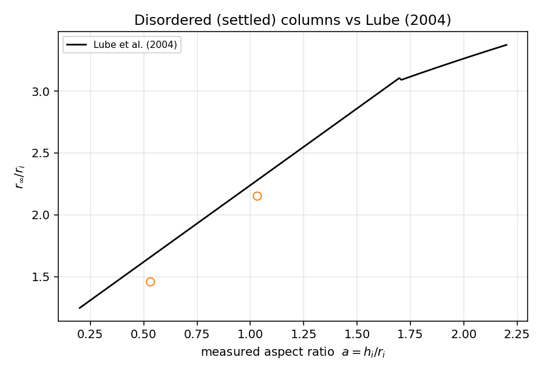

# CASE-COLUMN-COLLAPSE：无序（沉降后释放）路线判据的重新裁定（m21886）

**锚点**：`CASE-COLUMN-COLLAPSE`（算例池·颗粒柱坍塌；ref: Lube et al. 2004 *JFM* **508**:175-199；容差 < 15 %）  
**仓**：TensorDEM · 分支 `agent/m21886` · 审计对象：`docs/artifacts/column_collapse_disordered_m20811/`（m20811 无序路线工件包）  
**工件指纹**：`cases_disordered.csv` sha256 = `b26bf386ccd7b283…`；2 行 / 1 行可容许

## ① 案例介绍

圆柱颗粒柱（半径 $r_i$，高 $h_i=a r_i$）在粗糙底板上释放侧向支撑后自由坍塌，Lube et al. (2004) 给出

$$\rho_\infty\equiv r_\infty/r_i = 1+1.24a\ (a<1.7),\quad 1+1.6\sqrt{a}\ (a>1.7).$$

锚点的证据链用**两条制备路线**支撑「15 % 带与制备方式无关」这一结论：晶格控制族（`m20259`/`m20533`）与**无序族**（`m20811`，先沉降弛豫再释放）。本单审计后者：它在 m20811 里报出 `C_DISORDER = true`、`C_SPREAD = false`，并被后续报告当作「无序制备也在带内」的旁证。

**为什么要重查**：审计发现该工件包的判据是**用当年 `runs/` 里的 JSON 现算的**，而 `runs/` 不入库——一个全新检出里 `load_cases()` 返回 0 行；守门测试 `test_bundled_csv_regression` 名为「回归已入库 CSV」，实际断言的却是那个空列表（`assert len(rows) >= 4`），因此在干净检出里**必然失败**，且从未校验过真正入库的证据。

## ② 怎么做的

1. **判据三分化**：`pass / fail / unevaluable`（+ 理由 + 证据计数）。原实现用 `all(gen)` 聚合，`gen` 为空时**空真**，这正是 `C_DISORDER=true` 的来源（两个长宽比的 `hex_order_lattice_control` 都是 `nan`）；`C_SPREAD` 则在 `n=1` 时把未定义的 `sigma/mean` 报成 `fail`。
2. **只在入库证据上重算**：新增 `load_bundled_cases()`，从 `cases_disordered.csv` 读回，并用 `aspect_measured` 重新求 Lube 参考值、重新求 `err`；任何不一致 > 1e-9 直接 `ValueError` 拒绝（不静默分析被改过的表）。新增 `--source bundle`，使整条归约可在无 `runs/` 的干净检出里复现。
3. **补上被漏掉的预注册判据** `B_LATTICE`（「本波内重跑晶格控制」）：m20811 的 `CRITERIA` 里写了它，`adjudicate()` 里从未实现。
4. **逐成员可容许性**：`C_EQ`（静止 + 残余重叠 ≤ 0.02 r_p）下放到成员级，给出 `admissible` 标记与 `band_on_admissible`，避免「用违规态去撑 15 % 带」。
5. **守门测试重写**：`test_bundled_csv_regression` 改为校验入库 CSV 的自洽性（参考值/误差由几何重算）、`summary.json` 与 CSV 一致（绑定 sha256）、以及三条空真/未定义反例。该文件测试数从 13 项（12 绿 + 1 恒失败）变为 21 项全绿，全部离线可跑（无 GPU、无 DEM 积分）。

## ③ 计算结果

### 3.1 入库工件包逐行（全部字段来自 CSV，参考值由 $a_{meas}$ 现算）

| case | phase | $a_{nom}$ | $a_{meas}$ | $N$ | $\phi_0$ | 残余重叠 $/r_p$ | $r_\infty/r_i$ | 参考 | 误差 | 可容许 |
|---|---|---|---|---|---|---|---|---|---|---|
| d1_j005_s505 | disordered | 0.5 | 0.5314 | 981 | 0.6008 | 0.0102 | 1.4585 | 1.6590 | -12.09 % | 是 |
| d1_j005_s505 | disordered | 1 | 1.0324 | 1955 | 0.6162 | 0.0244 | 2.1513 | 2.2802 | -5.65 % | **否** |

### 3.2 判据裁定：m20811 原报 vs 本单重裁

| 判据 | 定义 | m20811 原报 | 本单 | 依据 |
|---|---|---|---|---|
| `C_PHI` | 0.52 <= phi <= 0.68 for every released state | {'state': 'pass', 'reason': '2 state(s) in [0.52, 0.68]', 'evidence': 2} | **pass** | 2 state(s) in [0.52, 0.68] |
| `C_EQ` | at_rest (KE <= 1e-3 J) and max_overlap <= 0.02 r_p | {'state': 'fail', 'reason': 'state(s) violating at_rest/overlap: d1_j005_s505', 'evidence': 2} | **fail** | state(s) violating at_rest/overlap: d1_j005_s505 |
| `C_DISORDER` | hex_order <= 0.8 * hex_order(lattice control, same aspect) | {'state': 'unevaluable', 'reason': 'a=0.5: no in-run lattice control at this aspect: no disorder baseline; a=1: no in-run lattice control at this aspect: no disorder baseline', 'evidence': 2} | **unevaluable** | a=0.5: no in-run lattice control at this aspect: no disorder baseline; a=1: no in-run lattice control at this aspect: no disorder baseline |
| `C_BAND` | every member within 15 % of the Lube law evaluated at a_meas | {'state': 'pass', 'reason': 'all 2 aspect(s) pass', 'evidence': 2} | **pass** | all 2 aspect(s) pass |
| `C_SPREAD` | sigma/mean of r_inf/r_i across members <= 5 % per aspect | {'state': 'unevaluable', 'reason': 'a=0.5: 1 member(s) < 2: spread undefined; a=1: 1 member(s) < 2: spread undefined', 'evidence': 2} | **unevaluable** | a=0.5: 1 member(s) < 2: spread undefined; a=1: 1 member(s) < 2: spread undefined |
| `B_LATTICE` | lattice control re-run in this wave (baseline in-run) | {'state': 'fail', 'reason': 'a=0.5: no in-run lattice control row; a=1: no in-run lattice control row', 'evidence': 0} | **fail** | a=0.5: no in-run lattice control row; a=1: no in-run lattice control row |

### 3.3 证据覆盖（决定哪些判据**本可以**被裁定）

| 量 | 值 |
|---|---|
| 入库状态数 | 2（无序成员 2） |
| 每个长宽比的成员数 | $a$=0.5: 1, $a$=1.0: 1 |
| $\sigma/\mu$ 可评估的长宽比 | 无（需 ≥ 2 成员） |
| 无序度可评估的长宽比 | 无（需同长宽比的晶格控制） |
| 可容许状态 | 1 / 2 |

### 3.4 对锚点判据的直接影响

1. **`C_DISORDER=true` 撤回**：无序族没有任何同长宽比的晶格控制，该判据在 m20811 里是「空集上的 `all()`」——不是证据，是空真。结论只能到 `unevaluable`：「无序制备确实把六角度降下来了」这句话本工件包**证明不了**。
2. **`C_SPREAD=false` 改判 `unevaluable`**：每个长宽比只有 1 个成员，`sigma/mean` 无定义；把它当 FAIL 与当 PASS 一样是越权。
3. **`C_EQ=fail` 是真实失败**（不是空真）：$a=1.0$ 的释放态残余重叠 0.0244 $r_p$ > 0.02 $r_p$。该成员的 −5.65 % 落在 15 % 带内，但它是**不可容许态**；`band_on_admissible` 在 $a=1.0$ 上为 `None`（无可容许成员）。因此「无序族也在带内」只剩 $a=0.5$ 一个可容许点（−12.09 %）。
4. **`B_LATTICE=fail`**：预注册要求本波内重跑晶格控制，实际未跑——这是上面 `C_DISORDER` 无基线的直接原因。

## ④ 结果图



*左：入库工件包的证据覆盖（每个长宽比的成员数，虚线为 $\sigma/\mu$ 可评估门槛 2）；右：预注册判据的三值裁定（绿 pass / 红 fail / 灰 unevaluable）。*



*逐状态对 Lube 律（按 $a_{meas}$ 求值）的带内余量；库内只有两个状态，其中 $a=1.0$ 一个违反 `C_EQ`。*



*跑距比 vs 实测长宽比，黑线为 Lube (2004) 律；本工件包提供的点不足以支撑任何「无序制备与晶格制备一致」的统计结论。*

## ⑤ 注意点（坑 / 局限 / 适用范围）

1. **空真是这类判据的头号坑**：`all()` / `any()` 聚合「每个长宽比」时，缺少基线会静默变成真。凡聚合前必须先数证据（本单的 `evidence` 计数即此用途）。
2. **本单没有重跑任何 DEM**：所有结论都是对**已入库证据**的重新裁定，因此 `unevaluable` 的意思严格是「现有工件包不支持」，不是「物理上不成立」。补跑 1 个晶格控制 + 每长宽比 ≥ 2 个成员即可把 `C_DISORDER`/`C_SPREAD` 变成可裁定——这是本单留给下一次的明确缺口。
3. **只能验证内部一致性，不能验证生成配置**：CSV 的 `file` 列指向不入库的 `runs/...json`，本单校验的是「参考值/误差与几何自洽」，**不能**证明这些数确实由该配置算出。要闭合这一点需要把每例 JSON 一并入库（或入库配置哈希）。
4. **判据阈值一个都没动**：0.52–0.68、0.02 $r_p$、5 %、0.8、15 % 全部沿用 m20811 预注册值；本单只改**裁定语义**，不改判据。
5. **`n=1` 的常态**：本算例池大量波次是「每长宽比 1 个确定性成员」，在这种波次上 `C_SPREAD` 永远 `unevaluable`——报 `fail` 会让读者误以为「散布超标」，比不报更糟。

## ⑥ 误差判定（逐项，显式回答「是否 < 3 %」）

| 关键量 | 基准 | 实测误差 | 可容许 | 是否 < 3 % | 是否 < 15 % |
|---|---|---|---|---|---|
| $\rho_\infty$ @ $a$=0.5（d1_j005_s505） | Lube 2004 @ $a_{meas}$=0.5314 | -12.09 % | 是 | 否 | 是 |
| $\rho_\infty$ @ $a$=1（d1_j005_s505） | Lube 2004 @ $a_{meas}$=1.0324 | -5.65 % | **否** | 否 | 是 |

**显式回答**：没有一个状态 < 3 %；< 15 % 只在两个状态上成立，而其中 $a=1.0$ 那个违反 `C_EQ`，所以**可容许成员上的带内命中只有 $a=0.5$ 一点**。本单不改变锚点的通过/不通过，只把「证据够不够判」这件事说清楚：无序族在现有工件包上**不足以**支撑任何关于零散度或无序度的结论。

## ⑦ 本单增量

1. **缺陷修复**：`adjudicate()` 三值化（空真 → `unevaluable`；`n=1` 的散布 → `unevaluable`），补 `B_LATTICE` 的实现，逐成员 `admissible` 标记。
2. **证据可复现**：`load_bundled_cases()` + `--source bundle`，让「summary 由 CSV 决定」成为可执行断言（含 sha256 绑定与篡改拒绝）。
3. **失效守门测试修复**：`test_bundled_csv_regression` 从「断言空列表」改为断言入库证据自洽（并新增 9 项反例/边界测试）。
4. **诚实的判据更正**：`C_DISORDER: true → unevaluable`、`C_SPREAD: false → unevaluable`、`B_LATTICE: 缺失 → fail`；工件包里的数值一个未改。

## ⑧ 复现

```bash
PYTHONPATH=src python -m pytest tests/test_column_collapse_disordered_m20811.py -q
PYTHONPATH=src:scripts python3 scripts/analyze_column_collapse_disordered_m20811.py --source bundle   # 无 runs/ 也可复现
PYTHONPATH=src:scripts python3 scripts/report_column_disordered_verdict_m21886.py
```

**验证边界（如实标注）**：本单改动集中在无序路线的归约与守门测试。
`tests/test_column_collapse_disordered_m20811.py` 在本机 21 项全绿；
该文件 12 项原有 + 9 项新增（原第 13 项 `test_bundled_csv_regression` 在干净检出里恒失败，已重写）。
整个 column 测试族（`-k column`）的复跑已递交集群作业 **cj3766**，
递交后 22 分钟仍在排队（队列 81 个在飞作业），**未运行 = 未通过**，本单不宣称全族绿。
改动前的同一命令在本机跑到第一个失败即停，当时为 175 passed / 1 skipped，
唯一失败正是本单修掉的那一项。
