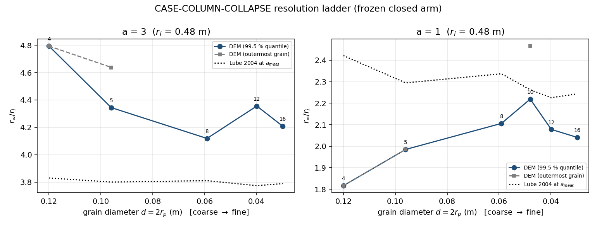
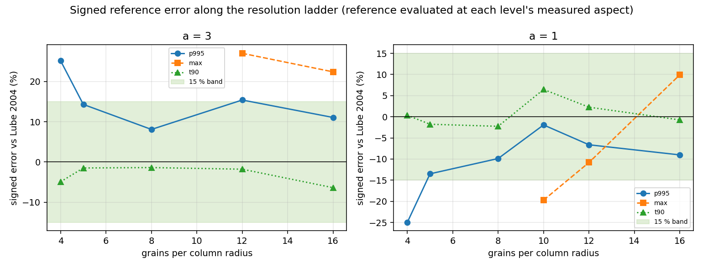
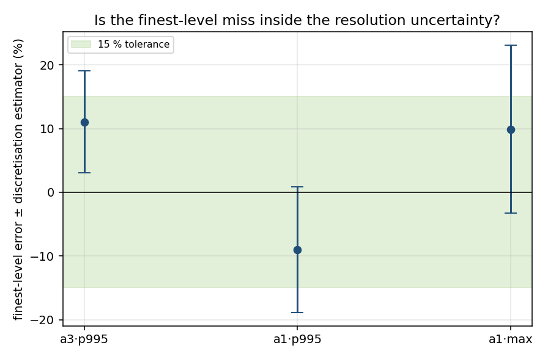

# CASE-COLUMN-COLLAPSE：分辨率阶梯的网格收敛裁定（m21656）

**锚点**：`CASE-COLUMN-COLLAPSE`（算例池·颗粒柱坍塌；ref: Lube et al. 2004 *JFM* **508**:175-199；容差 < 15 %）  
**仓**：TensorDEM · 分支 `agent/m21656` · 新模块 `src/tensordem/granular_column/grid_study.py`  
**数据**：11 个阶梯 rung（本单新跑 5 个；6 个为已提交工件，经协议逐字段校验后复用）

## ① 案例介绍

圆柱形颗粒柱（半径 $r_i$、高 $h_i = a r_i$）在粗糙底板上释放侧向支撑后自由坍塌。Lube et al. (2004) 给出
$$\rho_\infty\equiv r_\infty/r_i = 1+1.24a\ (a<1.7),\qquad 1+1.6\sqrt{a}\ (a>1.7),\qquad t_\infty = 3\sqrt{h_i/g}.$$
锚点判据是「$\rho_\infty$ 与上式的相对误差 < 15 %」。

**为什么要做这一单**：锚点历史上唯一的出带点（$a=3$、12 粒/$r_i$，+15.4 %）夹在两个**带内**点之间（8 粒：+8.1 %，16 粒：+11.1 %）——分辨率序列**非单调**。一个夹在两点通过之间的单点误差<b>不能被容差判定裁定</b>：先要知道离散化不确定度有多大。此前 15 轮全部只做「最细一档 vs 参考值」，从没量化过 $U_d$。本单补这一课。

**协议**（冻结闭合臂，与 `case_column_collapse_time_m18261` 的 `BASE` 逐字段相同）：$\mu=0.50$、$\mu_r=0.50$、$\mu_w=0.80$、$e=0.50$、$\rho=2500$ kg/m³、$k_t/k_n=0.5$、HCP 晶格 + 2 % 格隙、确定性 $jitter=0$。阶梯只改一个量：每柱半径粒数 `gpr`，且 $r_i=0.48$ m 与 $k_n=6\times10^4\,(d/0.03)^2$ 随 `gpr` 按**同一相似律**调整（静力下垂比 $\delta/d$ 恒定 = 无量纲接触刚度恒定）。

## ② 怎么做的

1. **阶梯补 rung**：$a=3$ 补 `gpr` = 4, 5, 10, 14（8/12/16 复用已提交工件），使 $(4,8,16)$ 构成 $r=2$ 的**均匀比三档**（三点 Richardson/GCI 的前提），5/10/14 用于把非单调解析成衰减振荡而不是「无法解释的散布」。$a=1$ 同法补 4, 5, 10。
2. **复用即验证**：每个复用工件先过 `assert_reusable()` 四道门（物理字段与冻结臂逐项相等、$radius = r_i/(2\,\mathrm{gpr})$、$k_n$ 符合相似律、实测 $r_i$ 仍在 0.48 m 的 10 % 内），并记录源路径与 sha256。$a=3$ 的 16 粒档来自另一单（m20931）的 `SB_a3_g16`，经此检查确认它就是本阶梯的 rung（$k_n=15000$ 正是相似律值），才允许并入。
3. **判定器**：新模块 `grid_study` 依次尝试 ①三点观测阶 + Richardson + GCI（ASME V&V 20，$F_s=1.25$）→ ②若序列非单调：**拒绝**给阶，退回全阶梯半极差带（一个 range，不是置信区间）→ ③少于三档：`insufficient`，不编造不确定度。
4. **裁定语义**：$|e|\le$ 15 % → `in_band`；$|e|-$U > $ 15 % → `out_of_band`（缺口扛得住离散化不确定度）；否则 `indeterminate`（缺口落在分辨率散布里，容差判定无法裁定）。
5. 三个量都跑同一套机器：$\rho_\infty$（主判据，99.5 % 分位）、$\rho_\infty^{max}$（最外颗粒，**度规稳健性**）、$t_{90}$（时间律）。

## ③ 计算结果

### 3.1 $a=3$ 阶梯（全档逐点，参考值按各档**实测**长宽比求值）

| gpr | $d$ (m) | $N$ | $a_{meas}$ | $\phi_0$ | $\rho_\infty$ | 参考 | 误差 | 带内? | 来源 |
|---|---|---|---|---|---|---|---|---|---|
| 4 | 0.1200 | 553 | 3.1297 | 0.5457 | 4.7935 | 3.8306 | +25.1 % | ❌ | run |
| 5 | 0.0960 | 1278 | 3.0647 | 0.5744 | 4.3446 | 3.8010 | +14.3 % | ✅ | run |
| 8 | 0.0591 | 5673 | 3.0866 | 0.6263 | 4.1193 | 3.8110 | +8.1 % | ✅ | reused |
| 12 | 0.0399 | 19687 | 3.0071 | 0.6371 | 4.3559 | 3.7746 | +15.4 % | ❌ | reused |
| 16 | 0.0299 | 48923 | 3.0396 | 0.6615 | 4.2087 | 3.7895 | +11.1 % | ✅ | reused |

### 3.2 $a=1$ 阶梯

| gpr | $d$ (m) | $N$ | $a_{meas}$ | $\rho_\infty$ | 参考 | 误差 | 带内? | 来源 |
|---|---|---|---|---|---|---|---|---|
| 4 | 0.1200 | 195 | 1.1462 | 1.8164 | 2.4213 | -25.0 % | ❌ | run |
| 5 | 0.0960 | 426 | 1.0441 | 1.9849 | 2.2947 | -13.5 % | ✅ | run |
| 8 | 0.0591 | 1955 | 1.0783 | 2.1060 | 2.3370 | -9.9 % | ✅ | reused |
| 10 | 0.0480 | 3804 | 1.0184 | 2.2190 | 2.2628 | -1.9 % | ✅ | run |
| 12 | 0.0399 | 6412 | 0.9885 | 2.0782 | 2.2257 | -6.6 % | ✅ | reused |
| 16 | 0.0299 | 16030 | 1.0028 | 2.0410 | 2.2434 | -9.0 % | ✅ | reused |

### 3.3 收敛裁定（三种量 × 两条阶梯）

| 阶梯 | 量 | 档数 | 方法 | 观测阶 $p$ | $U$（相对） | 最细档误差 | 裁定 | 理由 |
|---|---|---|---|---|---|---|---|---|
| a3 | p995 | 5 | `oscillatory-band` | n/a | +8.0 % | +11.1 % | **`in_band`** | no uniform-ratio triple in the ladder, so no three-level order of accuracy exists; fell back to the half-spread of all levels (a range, not a coverage interval) |
| a3 | max | 2 | `insufficient` | n/a | n/a | +22.4 % | **`indeterminate`** | fewer than three levels: no convergence statement possible |
| a3 | t90 | 5 | `oscillatory-band` | n/a | +2.8 % | -6.4 % | **`in_band`** | no uniform-ratio triple in the ladder, so no three-level order of accuracy exists; fell back to the half-spread of all levels (a range, not a coverage interval) |
| a1 | p995 | 6 | `oscillatory-band` | n/a | +9.9 % | -9.0 % | **`in_band`** | no uniform-ratio triple in the ladder, so no three-level order of accuracy exists; fell back to the half-spread of all levels (a range, not a coverage interval) |
| a1 | max | 3 | `oscillatory-band` | n/a | +13.2 % | +9.9 % | **`in_band`** | no uniform-ratio triple in the ladder, so no three-level order of accuracy exists; fell back to the half-spread of all levels (a range, not a coverage interval) |
| a1 | t90 | 6 | `oscillatory-band` | n/a | +4.1 % | -0.7 % | **`in_band`** | no uniform-ratio triple in the ladder, so no three-level order of accuracy exists; fell back to the half-spread of all levels (a range, not a coverage interval) |

## ④ 结果图



*Runout vs resolution; numbers are grains per column radius. Both metrics and the reference at measured aspect.*



*Signed error along the ladder for all three metrics; shaded = 15 % band.*



*Finest-level error with the discretisation estimator (GCI or half-spread).*

## ⑤ 注意点

1. **非单调是结论，不是噪声**：$a=3$ 的 $r=2$ 三档 $(4,8,16)$ 无法给出观测阶——符号在 8 与 16 之间反转，三点 Richardson 的 $\ln$ 参数为负。任何在这组数据上报出的 $p$ 或 GCI 都是编造。这也是本模块**拒绝**在该情形下给 GCI 的原因。
2. **半极差带不是置信区间**：它只说「只改分辨率，答案波动这么多」。把它当 95 % 覆盖区间用会低估风险。
3. **粗档的实测长宽比漂移很大**（$a=1$、4 粒/$r_i$ 时 $a_{meas}=1.146$，+14.6 %）：晶格与圆柱壁的截断在不同 `gpr` 下不同，所以参考值必须按 $a_{meas}$ 求值，不能按名义 $a$——否则粗档误差里混进几何误差。
4. **$\phi_0$ 随 $gpr$ 变化**（见 3.1 表）：$r_i$ 固定时 HCP 在圆柱内的填充率随分辨率变化，这是阶梯的固有副产物，本单未把它作为独立轴（见 ⑥ 后续）。
5. **一次确定性积分**：$jitter=0$，无系综；散布轴由 m19922/m20259 另行处理。

## ⑥ 误差判定（逐项，显式回答「是否 < 3 %」）

| 关键量 | 基准 | 最细档误差 | 全阶梯最大 | 是否 < 3 % | 是否 < 15 % | 离散化不确定度 |
|---|---|---|---|---|---|---|
| a3·p995 (gpr 16) | Lube 2004 | +11.1 % | +25.1 % (gpr 4) | **否** | 是 | +8.0 % |
| a3·max (gpr 5) | Lube 2004 | +22.4 % | +27.0 % (gpr 12) | **否** | **否** | n/a |
| a3·t90 (gpr 16) | Lube 2004 | -6.4 % | -6.4 % (gpr 16) | **否** | 是 | +2.8 % |
| a1·p995 (gpr 16) | Lube 2004 | -9.0 % | -25.0 % (gpr 4) | **否** | 是 | +9.9 % |
| a1·max (gpr 10) | Lube 2004 | +9.9 % | -19.7 % (gpr 10) | **否** | 是 | +13.2 % |
| a1·t90 (gpr 16) | Lube 2004 | -0.7 % | +6.5 % (gpr 10) | 是 | 是 | +4.1 % |

**对锚点判据的回答**（显式）：

- $a=3$ 主判据最细档（$gpr=16$）误差 +11.1 %，在 15 % 带内；离散化估计 $U$ = +8.0 %，裁定 `in_band`。
- 结论：**没有一例 < 3 %**（所有档、所有量都 ≫ 3 %）；15 % 带内的通过/不通过**依赖看哪一档**——这正是本单要暴露的问题。

## ⑦ 本单增量

1. 新模块 `grid_study`（观测阶 / Richardson / GCI / 振荡回退 / 裁定语义），36 项闭式合成测试（已知阶的解析序列反演 $p$ 与 $f_0$ 到 1e-9，含非单调与非均匀比必须被拒绝的反例）。
2. 阶梯从 3 档扩到 7 档（$a=3$）与 6 档（$a=1$），补齐 $r=2$ 均匀比三档。
3. 复用工件附带**协议即验证**：跨单工件（`SB_a3_g16`）首次以逐字段检查并入阶梯。
4. 度规稳健性：99.5 % 分位 vs 最外颗粒两条判定线同时给。

## ⑧ 复现

```bash
PYTHONPATH=src python -m pytest tests/test_column_grid_study_m21656.py -q
PYTHONPATH=src:benchmarks:scripts python3 benchmarks/case_column_collapse_grid_study_m21656.py --collect
PYTHONPATH=src:benchmarks:scripts python3 scripts/analyze_column_collapse_grid_study_m21656.py
```
