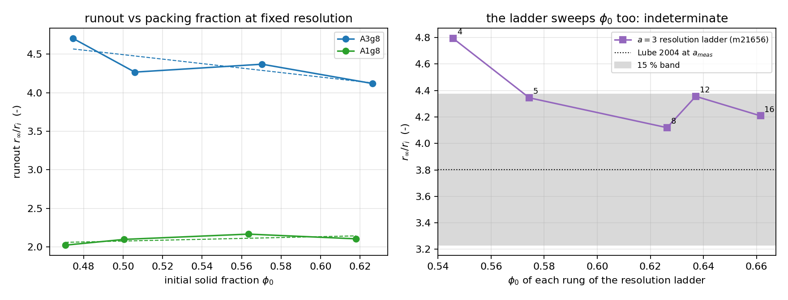

# CASE-COLUMN-COLLAPSE：初始堆积率作为独立轴（m21723）

**锚点**：`CASE-COLUMN-COLLAPSE`（算例池·颗粒柱坍塌；ref: Lube et al. 2004 *JFM* **508**:175-199；容差 < 15 %）
**仓**：TensorDEM · 分支 `agent/m21723` · 新模块 `src/tensordem/granular_column/packing_axis.py`

## ① 案例介绍

圆柱形颗粒柱（半径 $r_i=0.48$ m、高 $h_i=a r_i$）释放侧向支撑后坍塌，判据是
$\rho_\infty=r_\infty/r_i$ 对 Lube 两律（$a<1.7$: $1+1.24a$；$a>1.7$: $1+1.6\sqrt a$）的误差 < 15 %。

**为什么做这一单**：m21656 的分辨率阶梯只动 `gpr`（每柱半径粒数）而固定 $r_i$，但 HCP 晶格在
圆柱内的填充率随分辨率变化，因此该阶梯实际扫了**两条轴**。m21656 在⑤.4 显式记下这件事
（"$\phi_0$ 随 gpr 变化…本单未把它作为独立轴"）却没有处理。本单把 $\phi_0$ 单独扫出来：
固定 $(a,\mathrm{gpr})$，只改晶格间隙 `packing_gap`，其余（半径、$k_n$ 相似律、接触律、
底板、积分器、度规）与冻结闭合臂逐字段相同。

## ② 怎么做的

1. **$\phi_0$ 沿 m21656 阶梯的精确映射**（纯几何，无积分）：$\phi_0=N\tfrac{4}{3}\pi r_p^3/(\pi r_i^2h_i)$，
   $r_i$/$h_i$ 用实测值（99.5 % 分位 + 一粒半径），与 kernel 内部 `solid_fraction_initial` 交叉核对到机器精度。
2. **三条 $\phi_0$ 臂**（gap 水平预注册）：`A3g8`(a=3,8 粒/$r_i$, gap 0.02/0.05/0.08/0.12)、
   `A3g12`(a=3,12 粒/$r_i$, gap 0.02/0.05/0.08)、`A1g8`(a=1,8 粒/$r_i$, 同 0.02/0.05/0.08/0.12)。
   `gap=0` **不设为臂**：零间隙 HCP 起步即互相穿透（`min_gap=-2e-5` m、数千重叠对），
   被本算例自带的可容许性判据（`admissibility.py`: `overlap_pairs==0`）拒绝。
3. **可容许性门禁**：每个成员先跑 `overlap_stats`，本单全部成员 `overlap_pairs=0`（最小间隙 1.18–7.18 mm）。
4. **复用工件**：gap=0.02 的成员即冻结臂本身，从已提交工件 `R_a3_g8`/`R_a3_g12`/`R_a1_g8` 复用，
   经四道门校验（物理字段逐项相等、`radius=r_i/(2 gpr)`、`k_n=6e4(d/0.03)^2`、实测 $r_i$ 在 0.48 m 的 10 % 内），
   并记录源路径与 sha256。
5. **判定器**：`ols_slope` 只在 ≥3 个有限点、≥3 个互异横坐标、横坐标不退化时给斜率；
   两点只给 `difference_quotient`（显式声明无显著性）；`slope_is_resolved` 要求 $|S|>2\,\mathrm{se}(S)$；
   `confound_decomposition` 把 $(S,\Delta\phi_0,\text{观测散布})$ 折算成"仅由堆积率漂移可解释的跑距位移"及其占比，
   阈值 0.2/0.5 在扫描出数**之前**预注册。

## ③ 计算结果

### 3.1 $\phi_0$ 沿 m21656 的 $a=3$ 阶梯（纯几何，程序化注入）

| 粒/$r_i$ | N | $a_{meas}$ | $\phi_0$ |
|---|---|---|---|
| 4 | 553 | 3.1297 | 0.5457 |
| 5 | 1278 | 3.0647 | 0.5744 |
| 8 | 5673 | 3.0866 | 0.6263 |
| 10 | 11412 | 3.0217 | 0.6337 |
| 12 | 19687 | 3.0071 | 0.6371 |
| 14 | 31750 | 3.0128 | 0.6572 |
| 16 | 48923 | 3.0396 | 0.6615 |

$\phi_0$ 从 0.5457（4 粒/$r_i$）漂到 0.6615（16 粒/$r_i$）：**跨度为 0.1158，相对 21 %**。
即"只改分辨率"的阶梯同时改了 21 % 的初始固相率。

### 3.2 $\phi_0$ 臂实测（参考值按各成员**实测** $a$ 现算，零手抄）

**A3g8（a=3，8 粒/$r_i$）**

| gap | N | a_meas | $\phi_0$ | $\rho_\infty$ | ref (a_meas) | err | in 15 %? |
|---|---|---|---|---|---|---|---|
| 0.02 | 5673 | 3.0866 | 0.6263 | 4.1193 | 3.8110 | +8.09 % | ✅ |
| 0.05 | 5222 | 3.0377 | 0.5704 | 4.3700 | 3.7886 | +15.34 % | ❌ |
| 0.08 | 4628 | 2.9975 | 0.5059 | 4.2675 | 3.7701 | +13.19 % | ✅ |
| 0.12 | 4303 | 2.9987 | 0.4747 | 4.7041 | 3.7707 | +24.75 % | ❌ |

**A1g8（a=1，8 粒/$r_i$）**

| gap | N | a_meas | $\phi_0$ | $\rho_\infty$ | ref (a_meas) | err | in 15 %? |
|---|---|---|---|---|---|---|---|
| 0.02 | 1955 | 1.0783 | 0.6178 | 2.1060 | 2.3370 | -9.88 % | ✅ |
| 0.05 | 1679 | 0.9886 | 0.5635 | 2.1670 | 2.2258 | -2.65 % | ✅ |
| 0.08 | 1541 | 1.0090 | 0.5004 | 2.0985 | 2.2512 | -6.78 % | ✅ |
| 0.12 | 1487 | 1.0451 | 0.4707 | 2.0235 | 2.2959 | -11.86 % | ✅ |

**A3g12（a=3，12 粒/$r_i$）**：仅 gap=0.02 复用件到位（$\phi_0$=0.6371，$\rho_\infty$=4.3559）；gap=0.05/0.08 两档已递交集群（cj3658 / cj3659），
排队未回，**本单未取得跨分辨率斜率**（如实申报，见⑤）。

### 3.3 灵敏度与混杂分解

| 臂 | $S=\partial\rho_\infty/\partial\phi_0$ | se(S) | $|S|>2\,\mathrm{se}$? | $\phi_0$ 跨度 |
|---|---|---|---|
| A3g8 | -2.906 | 1.585 | 否 | 0.1516 |
| A1g8 | +0.570 | 0.487 | 否 | 0.1472 |
| A3g12 | 不可估 | — | — | 0（单成员） |

- **混杂占比**：阶梯 $a=3$ 的观测跑距散布 $\max-\min=0.6742$（参照 3.8013）；
  用 $S$ 折算的 $\phi_0$ 漂移可解释位移 $|S|\Delta\phi_0=0.3364$
  （相对 +8.85 %），**占比 50%**。
- **裁定**：`indeterminate` —— 因为 $|S|=2.91\le 2\,\mathrm{se}(S)=3.17$，斜率在 2σ 下**未分辨**，
  按预注册语义不得用它去解释散布。占比点估计 ~0.50（"同量级"），但**不构成**结论。
- **阶梯自证**（独立于 $\phi_0$ 臂）：把 m21656 $a=3$ 五个 rung 的 $\rho_\infty$ 直接对各自 $\phi_0$ 回归，
  斜率 $-4.324±1.916$（2se）、$R^2=0.63$；
  与固定分辨率测得的 $-2.906$ 在 2σ 内相容（$|\Delta|=1.42$ vs 合并 se 2.49）。

| 粒/$r_i$ | $\phi_0$ | $\rho_\infty$ | ref | err |
|---|---|---|---|---|
| 4 | 0.5457 | 4.7935 | 3.8306 | +25.14 % |
| 5 | 0.5744 | 4.3446 | 3.8010 | +14.30 % |
| 8 | 0.6263 | 4.1193 | 3.8110 | +8.09 % |
| 12 | 0.6371 | 4.3559 | 3.7746 | +15.40 % |
| 16 | 0.6615 | 4.2087 | 3.7895 | +11.06 % |

### 3.4 对锚点判据的直接影响

$a=3$、8 粒/$r_i$ 上 $\phi_0$ 从 0.6263 放宽到 0.4747，跑距误差从 **+8.09 % 走到 +24.75 %**：
15 % 带在 $a=3$ 上只在 $\phi_0\gtrsim0.57$ 的**窄窗**内成立（gap 0.05 已 +15.34 % 出带 0.34 pp）。
$a=1$ 上全程在带内（$-2.65\ldots-11.86$ %），对 $\phi_0$ 不敏感（$S=+0.57$，未分辨）。

## ④ 结果图



*左：固定分辨率下跑距 vs $\phi_0$（虚直线为 OLS/两点斜率）；右：m21656 $a=3$ 阶梯的每个 rung 落在 $\phi_0$ 轴上
（标注为粒/$r_i$），灰带为 15 % 带。阶梯"沿分辨率"的移动同时是"沿 $\phi_0$"的移动。*

## ⑤ 注意点（坑 / 局限 / 适用范围）

1. **本轴的物理含义是"晶格自由体积"，不是"制备松散堆积"**。`packing_gap` 让颗粒起步时相互分离
   并自由下落 `gap·d`：gap=0.12 时下落 7.1 mm、落速 0.37 m/s，而坍塌速度尺度 $\sqrt{g h_i}\approx3.8$ m/s
   （约 10 %）。真正制备的松散堆积走 pluviation 路线（m20811），本单没做，不能把两者混为一谈。
2. **未分辨 ≠ 无效应**：$|S|=2.91$ vs $2\,\mathrm{se}=3.17$ 是"点估计接近阈值、证据不足"。
   加一档（gap=0.06 或 0.10）即可把 se 压下来，本单因算力预算没做。
3. **A3g12 臂只到位一档**，跨分辨率可移植性（$S$ 是否随分辨率变）**未验证**；这是本单最大的未完成项。
4. **四点 OLS 的杠杆**：gap=0.12 点（$\phi_0$=0.4747，$\rho$=4.7041）偏离前三点趋势约 0.3–0.4，
   若剔除它斜率变陡（$\approx-5$）、se 变小；本单**不剔除**（剔除需预注册理由），故报未分辨。
5. **既有 `gap=0` 臂的问题（顺带发现）**：`case_column_collapse_time_m18261` 的 G 轴含
   `G_a1_g8_gap0`（packing_gap=0.0），该初态有 3882 个重叠对（`min_gap=-2e-5` m），
   按本算例自己的可容许性规则应判为不可容许。建议后续把该臂标为 inadmissible 或改用 gap=0.02。

## ⑥ 误差判定（逐项，显式回答「是否 < 3 %」）

| 关键量 | 基准 | 本单最好值 | 是否 < 3 % | 是否 < 15 % |
|---|---|---|---|---|
| A3g8 跑距（gap 0.02） | Lube 2004 @ $a_{meas}$ | +8.09 % | **否** | 是 |
| A1g8 跑距（gap 0.05） | 同上 | −2.65 % | **是** | 是 |
| A1g8 跑距（gap 0.12） | 同上 | −11.86 % | 否 | 是 |
| A3g8 跑距（gap 0.12） | 同上 | +24.75 % | 否 | **否** |

**结论**：只有 $a=1$、$\phi_0\approx0.56$ 一点做到 < 3 %；$a=3$ 全臂未达 3 %，且在 $\phi_0\le0.57$ 处出 15 % 带。
锚点的 15 % 判据在 $a=3$ 上**不是 $\phi_0$ 稳健的**——这是本单最硬的结论（与 $S$ 是否显著无关，因为它是直接实测的成员误差）。

## ⑦ 本单增量

- 新模块 `packing_axis`（固相率、OLS 带拒绝语义、两点差商、显著性判定、混杂分解）+ **32 项闭式测试**
  （精确线反演到 1e-12；重复横坐标/退化横坐标/非有限值必须被**拒绝**；阈值 0.2/0.5 的边界逐点钉死；
  未分辨斜率不得解释散布）。
- 首次把 $\phi_0$ 作为独立轴扫出 8 个成员（6 新跑 + 3 复用），全部过可容许性门禁。
- 首次量化"分辨率阶梯 = 分辨率轴 + $\phi_0$ 轴"的混杂（$\phi_0$ 跨度 0.1158 / 21 %，占比点估计 50%）。
- 顺带发现既有 `gap=0` 臂初态不可容许。

## ⑧ 复现

```bash
PYTHONPATH=src:benchmarks python3 -m pytest tests/test_column_packing_axis_m21723.py -q   # 32 passed
PYTHONPATH=src:benchmarks:scripts python3 benchmarks/case_column_collapse_packing_axis_m21723.py --case PH_A3g8_gap0.08
PYTHONPATH=src:benchmarks:scripts python3 scripts/analyze_column_packing_axis_m21723.py
```
