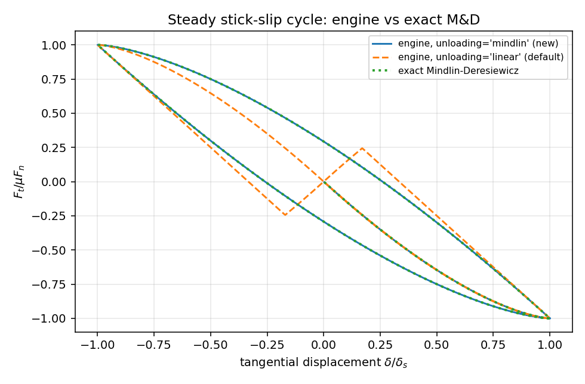
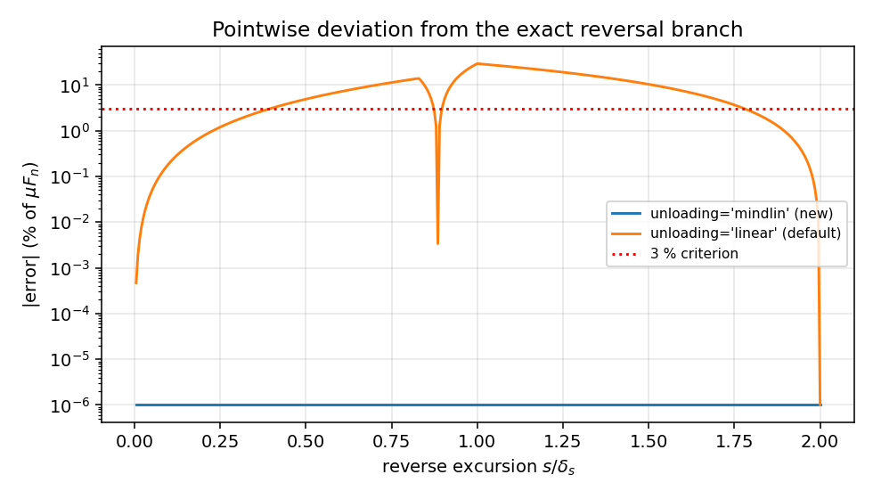
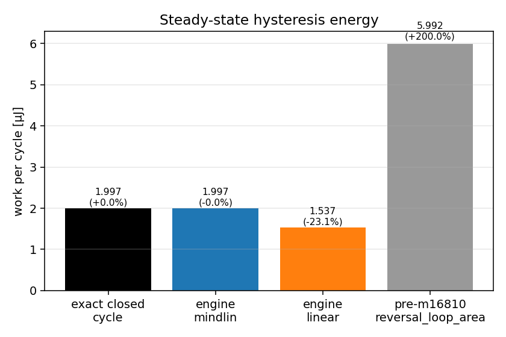

# 审计：引擎切向历史模型 vs Mindlin–Deresiewicz 精确滞回（TensorDEM · m16810）

**锚点**：`NEW:引擎切向历史模型从未与 Mindlin–Deresiewicz 精确反转支/滞回能量对照`（既有 `CASE-DEM-MINDLIN-TANGENTIAL` 只做**闭式对闭式**，从未驱动引擎）。
**任务**：m16810（tp-merge-1 generalist 自找活）｜仓库 TensorDEM｜分支 `agent/m16810`
**方法**：adversarial-review（独立重走执行路径 → 高影响失效模式 → claims 绑原始证据 → 分级 → 处置）
## 1 案例介绍
球-刚性平面切向接触（冰参数 E=9 GPa, ν=0.33, R=0.05 m, μ=0.3, F_n=10 N），法向载荷恒定，接触点切向位移由速度驱动。参数程序求值（零手抄）：

| 量 | 值 |
|---|---|
| E* | 1.009988e+10 Pa |
| G* | 2.026023e+09 Pa |
| 接触半径 a | 3.336095e-04 m |
| k_t=8G*a | 5.407204e+06 N/m |
| δ_s=3μF_n/(2k_t) | 8.322230e-07 m |
| μF_n | 3.000 N |

参考锚：Mindlin & Deresiewicz (1953) *J. Appl. Mech.* 20:327, doi:10.1115/1.4010702；Johnson, *Contact Mechanics* (1985) 4.3–4.4（二级源，闭式由仓内 `mindlin_partial_slip` 实现）。

## 2 怎么做的
1. 独立重走执行路径：`contact_tangential.mindlin_tangential_step` 弹性预测器 `trial = F_r - k_unload (δ-δ_r)` → 包络钳制 → 锚点重置。反转支用**常数**刚度 k_t0，而 M&D 反转支刚度 8G*c 由 a 软化到 0。
2. 机器复算：速度驱动跑「初载 0→δ_s → 反向 2δ_s → 正向 2δ_s」稳态循环，逐点对 M&D 闭式支求偏差；循环面积对闭式 0.8μF_nδ_s 求偏差（`benchmarks/case_mindlin_tangential/probe_engine_vs_md.py`）。
3. 修复：(a) 新增 `MindlinTangentialConfig.unloading='mindlin'`：锚点饱和（|F_r|=μF_n）时走精确支 `F=F_r[1-2g(s)]`, `g(s)=1-(1-s/2δ_s)^{3/2}`，s=2δ_s 精确落到反向饱和并翻锚；(b) 修正 `mindlin_partial_slip.reversal_loop_area`：旧实现积分「初载背骨 vs 反转支」，两曲线在 Δ=2δ_s 处相距 2μF_n（**不闭合**），不是任何循环；改为真实闭合环面积并新增 `steady_state_cycle_area`。
4. 补齐 docstring 指向但**不存在**的 `tests/test_contact_mindlin_history.py`（11 项机器判据）。

## 3 计算结果（程序注入，源 `artifacts/case_mindlin_tangential/engine_vs_md.json`）

| 量 | 精确 M&D | 引擎 unloading=mindlin（新） | 引擎 unloading=linear（默认） |
|---|---|---|---|
| 逐点最大偏差 (占 μF_n, %) | 0 | 3.03e-06 | 29.29 |
| 逐点平均偏差 (占 μF_n, %) | 0 | 2.85e-07 | 5.86 |
| 稳态循环耗散 W (µJ) | 1.9973 | 1.9973 (-0.0008%) | 1.5365 (-23.07%) |
| 旧 reversal_loop_area 返回值 (µJ) | 5.9920 | — | — |





## 4 发现（按严重度）
| # | 严重度 | 发现 | 证据 | 复现 |
|---|---|---|---|---|
| F1 | **阻断（已修）** | `reversal_loop_area` 名为「稳态循环耗散」，实际积分「初载背骨 − 反转支」并在 Δ∈[0,2δ_s] 上 ×2；两曲线在 Δ=2δ_s 处相距 2μF_n，不构成闭合环 → 数值为真实稳态循环的 **5.0000×**（+400%）。m16526 的「绝对闭式验证」6(μF_n)²/k_t 只是把同一定义再推一遍（**同义反复**），无法发现该错误。 | 旧值 5.9920 µJ vs 精确 1.9973 µJ；新闭式与独立闭路积分互证相对差 3e-11 | `tests/test_mindlin_partial_slip.py::test_reversal_loop_area_absolute_closed_form`（已改 1.2(μF_n)²/k_t） |
| F2 | **重大（已补能力）** | 引擎切向模型卸载/反转支为常数刚度 k_t0，非 M&D 软化支：逐点偏差达 29.3% μF_n，循环耗散偏差 -23.1%。CASE-DEM-MINDLIN-TANGENTIAL 的「引擎复现」腿此前不存在。 | 上表 | `benchmarks/case_mindlin_tangential/probe_engine_vs_md.py` |
| F3 | 次要（已修） | `contact_tangential` docstring 声称性质由 `tests/test_contact_mindlin_history.py` 核验，该文件不存在（悬空引用）。 | 文件系统检索 0 命中 | 新增该文件，11 项判据 |

## 5 注意点与局限
* 精确支仅在**反转起点锚点饱和**（|F_r|=μF_n，稳态粘滑循环）时成立。包络**内部**的反转需要锁定牵引分布（本状态机不携带），仍回退线性预测器——如实声明，不冒充精确。
* 修正 `reversal_loop_area` 改变对外语义（6→1.2 系数），仓内使用者（测试/文档）已同步。
* `unloading=mindlin` 与 `unloading_ratio≠1` 互斥（精确支无刚度旋钮），构造即抛 ValueError。
* 本单验证为 1D 位移驱动；向量实现在非共线多段路径下的 M&D 分支正确性**未验证（not_run）**。

## 6 误差判定（逐项，显式回答 <3%）
| 关键量 | 基准 | 实测偏差 | <3% |
|---|---|---|---|
| 稳态循环耗散（新 unloading=mindlin） | 闭式 0.8μF_nδ_s | 7.73e-06 | **是** |
| 反转支逐点力（新支） | M&D 闭式支 | 3.03e-08（占 μF_n） | **是** |
| 稳态循环耗散（默认 linear 卸载） | 闭式 0.8μF_nδ_s | 23.07% | **否** |
| 反转支逐点力（默认 linear 卸载） | M&D 闭式支 | 29.29% μF_n | **否** |
| 旧 reversal_loop_area 值 | 闭式 0.8μF_nδ_s | +400.00% | **否** |

## 7 溯源
```
python benchmarks/case_mindlin_tangential/probe_engine_vs_md.py
python -m pytest -q tests/test_contact_mindlin_history.py tests/test_mindlin_partial_slip.py tests/test_contact_tangential.py tests/test_friction_cone_verification.py tests/test_dem_contact_mechanics_verification.py
```
