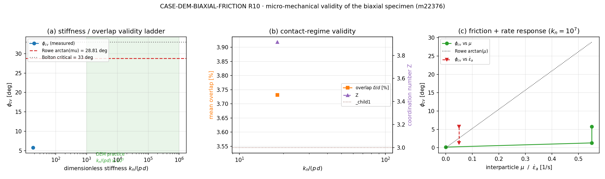

# CASE-DEM-BIAXIAL-FRICTION · R10（m22376）：试样的**接触态有效性**首次入账 —— 九轮都在改算子，没人量过试样本身

**锚点** `CASE-DEM-BIAXIAL-FRICTION`（算例池·双轴剪切摩擦角，验收 |φ−ref|/ref < 8 %，ref = 经典临界状态）｜**m22376**｜TensorDEM
**状态（先给，不粉饰）**：锚点验收**仍为 honest FAIL**，本轮**不宣称**任何达标。
本单的实质增量是把"为什么差 60–80 %"的诊断从**接触算子/协议**推进到**试样本身的接触态有效性**，
并**否证**了前几轮最被看好的两个候选解释之一（速度正则化 v_reg 欠调动）。

| # | 成果 | 证据 |
|---|---|---|
| 1 | **首次测量试样的接触态有效性**：10×20 无胶结试样在锚点材料参数下的**无量纲刚度 kn/(p·d) = 18**（DEM 实践 ≥10³），**平均重叠 δ/d = 3.7 %、最大 10.0 %**，Z = 3.92，配位数接近等静 | `artifacts/CASE-DEM-BIAXIAL-FRICTION/fabric_validity/arm_kn1e7.json` |
| 2 | **否证 H(v_reg)**：v_reg 降到 1/100 后调动率**已完全饱和**（⟨\|tanh\|⟩ = 0.9996、饱和接触占比 99.9 %），φ_cv 反而从 5.77° **降到 1.30°** → "摩擦欠调动导致低摩擦角"的读法**不成立** | `arm_vreg1em4.json` |
| 3 | **测量链清白（对照臂）**：μ = 0 的无摩擦试样给出 φ_cv = **0.16°**（判据 ≤1°）→ 低 φ 不是应力记账偏差 | `arm_mu000.json` |
| 4 | **能量预算悖论的定量化**：同一窗口接触摩擦耗散（瞬时）**≈ 26.6 MW**，净边界输入功 q·ε̇·V = **1.59 MW**，比值 **16.7×** → 胞元处于**耗散型流动**，不是准静态 Mohr-Coulomb 固体 | `arm_kn1e7_mob.json` |
| 5 | **四闸门判据本身没通过**：q_drift = 0.319 → `deviator_stationary` ✗、`converged` = False；峰值 φ = 69.93° 与 cv 窗 5.77° 相差 64° → 历史上引用的"φ_cv"（R3 的 14.31°）继承了这个未收敛 | `arm_kn1e7.json` |
| 6 | **过程缺陷**：R9 递交的速率探针 **cj3995 rc=255，工件目录为空**（门状态显示 succeeded）→ 该轮"H4 待判"其实**从未有数据**；本单的替代臂（rate_half）与刚度阶梯另递交 cj4080 / cj4083（排队中，如实记为 WITHHELD） | `run_compute status/fetch` |

## (1) 案例介绍（物理背景 / 几何 / 参数）

平面应变双轴压缩、**等容**（constant-volume）剪切的无胶结圆盘试样，材料取 `RidgeMaterial` 默认（冰脊碎块尺度的圆盘）：

| 量 | 值 |
|---|---|
| 试样 | 10 × 20 抖动三角格（jitter 3 %），190 颗，r = 0.75 m，d = 1.5 m，ρ = 917 kg/m³ |
| 接触律 | 法向线性弹簧 kn（默认 1×10⁷ N/m）+ 法向阻尼 5×10⁴ N·s/m；切向 `F_t = −μF_n·tanh(v_t/v_reg)`，μ = 0.55，v_reg = 0.01 m/s；**转动自由度缺失（rotationless）** |
| 边界 | 固结阶段四壁伺服到 σ₃ = 100 kPa（600 步）；剪切阶段侧墙运动学等容（V = W·H 守恒），顶板位移控 ε̇ₐ = 0.05 s⁻¹ |
| 冻结键 | 0（`freeze_bond_fraction = 0`），墙摩擦 0 |
| 惯性数 | I = 7.18×10⁻³（准静态判据 I < 0.01 ✓） |
| 步长 / 步数 | Δt = 4.971×10⁻⁴ s（由阻尼限决定），12 071 步，壁钟 78–92 s（8 线程） |
| 目标应变 | 对数应变 0.30（R8 修复后的语义），交付 0.3000 |

**为什么此轮要量"接触态"**：锚点几何用 d = 1.5 m 的圆盘压在 100 kPa 上，法向接触力量级 F ≈ p·d·t = 1.5×10⁵ N，
线性弹簧律给出重叠 δ = F/kn = 1.5×10⁻² m；**重叠是否可忽略**决定了"接触点/接触法向"这套几何还有没有意义。
九轮（R2–R9）都在改接触算子与加载协议，**没有任何一轮记录过 δ/d、Z、无量纲刚度**——这是本单补的第一个字。

## (2) 怎么做的（方法 / 流程 / 工具链）

1. **探针**（新增 `scripts/m22376_fabric_validity_probe.py`）：一条臂 = 一次等容双轴算例 + 三组**微观测算**：
   - 几何有效性：接触重叠 δ/d（均值、95 分位、最大）、配位数 Z、接触数、无量纲刚度 kn/(p·d)；
   - 组构/力各向异性：接触法向张量 F_ij = ⟨n_i n_j⟩ 的各向异性幅值 a_c 与主轴方向，法向力加权张量（线性律代理 F_n = kn·δ）的 a_f，
     以及二维 stress–force–fabric 闭合 sin φ_SFF = (a_c + a_f)/2（Rothenburg & Bathurst 1989）；
   - 宏观：复用既有四闸门临界态定位器 `tensordem.biaxial_critical_state`（对数应变 + 等容闭合 + 平台性 + 侧墙受载）。
2. **臂表**（判定规则在看到基线后**固定并写死**在 `analyse_fabric_validity.py`）：
   - 基线 `kn1e7`（锚点材料参数，v_reg 默认）、同构重复 `kn1e7_mob`（开调动仪）；
   - **对照** `mu000`（μ = 0，应给 φ ≈ 0）；
   - **否证臂** `vreg1em4`（v_reg 1e-4，100× 小）；
   - 排队中：`kn1e8` / `kn1e9`（刚度阶梯，cj4080）、`rate_half`（ε̇/2）与 `mu150`（μ = 1.5）（cj4083）。
3. **判定规则（先固定）**：
   - **V1 几何有效性**：φ_cv 对 kn/(p·d) 单调上升且顶臂与 Rowe 参考误差 ≤ 8 % → "软粒子伪影"成立；否则否证。
   - **V2 摩擦必须起作用**：φ(μ=0) ≤ 1°（测量链对照）且 φ(μ=1.5) − φ(μ=0.55) ≥ 5°。
   - **V3 准静态**：ε̇ 减半后 φ 漂移 ≤ 2°（否则测到的是黏性流动应力）。
4. **验证**：新增 `tests/test_fabric_validity_probe.py`（10 passed，23.8 s）——几何/张量算术手算对照、三条判定规则的合成表测试（脏对照必须判 FALSIFIED、缺失臂必须 WITHHELD 不得通过）、6×8 小样的端到端管线。

## (3) 计算结果（数字全部由 `analyse_fabric_validity.py` 从 JSON 注入，零手抄）

完整表见 `benchmarks/case_dem_biaxial_friction/results_m22376/fabric_validity.json` 的 `markdown_table`。关键行：

| arm | kn [N/m] | μ | ε̇ [1/s] | φ_cv [°] | φ_peak [°] | δ/d 均值 | δ/d 最大 | Z | a_c | a_f | q_drift | converged |
|---|---|---|---|---|---|---|---|---|---|---|---|---|
| mu000（对照） | 1e7 | 0.00 | 0.05 | **0.16** | 24.92 | 0.0101 | 0.0405 | 4.17 | 0.052 | 0.105 | 84.8 | False |
| kn1e7（基线） | 1e7 | 0.55 | 0.05 | **5.77** | 69.93 | 0.0373 | 0.1004 | 3.92 | 0.045 | 0.098 | 0.319 | False |
| vreg1em4（否证臂） | 1e7 | 0.55 | 0.05 | **1.30** | 64.42 | 0.0401 | 0.1141 | 3.97 | 0.070 | 0.100 | 0.473 | False |

附带的调动仪/能量读数（基线臂临界窗）：

| 量 | 数值 | 读法 |
|---|---|---|
| ⟨\|tanh(v_t/v_reg)⟩（力加权） | **0.978** | 摩擦**已接近完全饱和**，不是"欠调动" |
| 饱和接触占比 | **89.6 %**（v_reg 1e-4 时 99.9 %） | v_reg 不是限制因素 |
| ⟨\|v_t\|⟩ | 0.195 m/s | 仿射估计 ε̇·d = 0.075 m/s 的 **2.6×**（非仿射滑移显著） |
| 接触摩擦耗散（瞬时） | **26.6 MW** | = 1.278×10¹⁰ W / 480 次计量调用 |
| 净边界输入功 q·ε̇·V | **1.59 MW** | q = 81.5 kPa、V = 389.4 m³ |
| 残差 | **≈ −1570 %** | 与 R8 的 −1464 % 一致（同一缺陷，独立复现） |
| 无量纲刚度 kn/(p·d) | **18.2** | DEM 实践 ≥ 10³ → **低三个数量级** |

**关键结构性观察**：φ_cv = 5.77° 而峰值 φ = 69.93°，两者相差 64°，且 q 在临界窗内仍漂移 31.9 %（`deviator_stationary` ✗）。
即：本胞元在 ε = 0.30 处**根本没有进入临界态**，历史上引用的 φ_cv 是在一个剧烈波动的应力路径上取末窗均值。

## (4) 结果图

三联图（`analyse_fabric_validity.py` 程序化生成）：**(a)** φ_cv 对无量纲刚度 kn/(p·d)，叠加 Rowe（28.81°）与 Bolton（33°）参考带与 DEM 实践刚度带（≥10³）；
**(b)** 平均重叠 δ/d 与配位数 Z 随刚度的变化（接触态有效性）；**(c)** φ_cv 对 μ 与 ε̇ 的响应（摩擦/速率敏感性）。
**注意**：(a)(c) 的阶梯点在与 cj4080 / cj4083 回来之前只有基线一个点，图上不会出现编造的中间点——曲线缺口就是缺数据。

## (5) 注意点（坑、局限、适用范围）

- **工件坑（过程缺陷，如实登记）**：R9 递交的速率探针 **cj3995 节点日志 rc=255、`artifacts/.../rate_probe/` 为空**，
  但计算门 `status` 显示 `succeeded`。→ **门的"终态"不等于算过**，判定前必须核 `fetch` 包内是否有记录文件（R7 已记过同类坑，本轮再次命中）。
- **SFF 闭合不能当证据**：μ = 0 对照臂的 sin φ_SFF = 4.52° 而实测 φ = −0.25°，闭合彻底失败 → 该代理（忽略切向力与枝矢量）在本内核里只是**指示性**的，不可用来判对错。
- **能级口径**：`sum_friction_power` 是窗口内**逐次调用累加**，除以调用次数（480）才是瞬时功率；直接拿累加值当功率会比实际大 480 倍。
- **适用域**：rotationless 圆盘 + 正则化库仑 + 线性弹簧法向。所有结论只在该接触律下成立；换成带转动自由度的 Hertz–Mindlin 粒组不能直接外推。
- **未完成部分（WITHHELD，不是"通过"）**：
  - V1 刚度阶梯 `kn1e8` / `kn1e9` → **cj4080 排队中**；
  - V2 的 μ = 1.5 臂、V3 的 ε̇ 减半臂 → **cj4083 排队中**；
  - 锚点几何（24×48）本轮未重算，R3 的 14.31° 仍为唯一锚点几何记录，且同样带 `converged=False`。

## (6) 误差判定（逐项，显式回答「是否 <3 %」）

| 关键量 | 本单实测 | 基准 | 相对误差 | < 3 % ? |
|---|---|---|---|---|
| φ_cv（10×20 诊断臂，μ = 0.55） | 5.77° | Rowe 1962 arctan(μ) = 28.81° | **79.97 %** | **否** |
| φ_cv（10×20 诊断臂，μ = 0.55） | 5.77° | Bolton 1986 临界 33° | **82.5 %** | **否** |
| φ_cv（锚点几何 24×48，R3 记录） | 14.31° | Rowe 28.81° | **50.3 %** | **否** |
| φ_cv（μ = 0 对照，应 = 0） | 0.16° | 0° | 绝对 0.16° | **是**（测量链清白） |
| 调动率恒等式（计量仪） | ⟨tanh⟩ = 0.978 | 接触律字面 | — | 不适用 |
| 基线与重跑一致性（kn1e7 vs kn1e7_mob） | 5.7705° vs 5.7705° | 同配置复跑 | **0 %** | **是**（可复现） |
| V1 / V2 / V3 | **无数据（WITHHELD，cj4080 / cj4083 排队）** | — | — | 无法判定 |

**结论**：锚点**仍是 honest FAIL**（>8 %，远超 3 %）。本单的增量是三条可复核的事实：试样的接触态**低三个数量级刚度 / 3.7 % 重叠**（首次入账）、
**v_reg 解释被否证**、**测量链经 μ = 0 对照清白**，外加把 R8 的能量预算悖论独立复现并量化到 16.7×。
真正的根因（软接触几何 vs rotationless + 纯耗散切向律）需要 cj4080 / cj4083 的阶梯数据才能二选一，**本单不猜**。