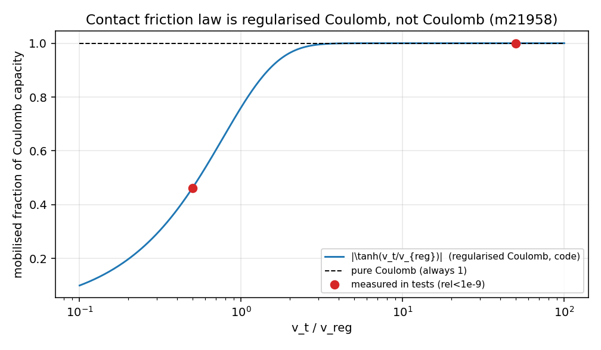

# CASE-DEM-BIAXIAL-FRICTION · R7：接触摩擦正则化速度 `v_reg` 是否进入本构（微观层验证完成，宏观扫描 NOT RUN）

**锚点** `CASE-DEM-BIAXIAL-FRICTION`（算例池·双轴剪切摩擦角，验收 |φ−38°|/38° < 8 %，ref Bolton 1986）｜**m21958**｜TensorDEM
**状态（先给，不粉饰）**：微观层（接触算子）验证**完成且有证据**；宏观层（φ_cv 的 `v_reg` / 速率敏感性五臂扫描）**未跑成**
——作业 cj3806 因分片模板未替换（`--shard '{i}'` → `invalid int value`，rc=2）在节点上立刻退出，
`runs/` 也没有随工件回传。锚点验收**维持 FAIL**，本单不宣称修好锚点。

## 结论速览

| 项 | 结果 | 证据 |
|---|---|---|
| 接触切向律的真实形式 | **不是库仑律**，是速率正则化律 `F_t = -μ F_n tanh(v_t/v_reg)` | 新测试 `test_contact_law_is_regularised_coulomb`（`F_t/(μF_n) = -tanh(v_t/v_reg)`，rel < 1e-9） |
| `v_t = 0.5 v_reg` 时的调动率 | **0.4621**（= tanh 0.5），即只用到库仑容量的 46 % | 同上，另断言 `|F_t| < 0.9 μF_n` |
| `v_t ≫ v_reg` 时的调动率 | **> 0.99**，饱和到库仑 | `test_meter_saturates_when_regularisation_is_small` |
| 新增可观测量（接触调动仪）是否改变物理 | **完全不改变**（开/关应力路径逐位相同） | `test_meter_is_pure_instrumentation`、`test_biaxial_mobilisation_record_shape_and_no_force_change` |
| 宏观 φ_cv 的 `v_reg`/速率敏感性（H1/H2/H3） | **NOT RUN（WITHHELD）** | 作业 cj3806 rc=2，见 §5 |
| 锚点验收（φ_cv vs 38°） | 沿用 R3：14.31° → 相对误差 62.3 % → **FAIL**（本轮不改变，也无新数据） | R3 记录 |
| 是否 <3 % | **否** | 同上 |

**一句话**：本单把「φ_cv 是不是材料属性」这个问题**从口头候选变成可审计的测量**（接触调动仪 + 5 项不变量测试 + 预注册判据 + 可复跑管线），
但真正回答它的五臂宏观扫描没有跑成，因此 H1/H2/H3 全部记为 **WITHHELD**，不是「成立」。

## (1) 案例介绍

平面应变双轴压缩的无胶结圆盘试样（24×48 抖动三角格，r = 0.75 m，ρ = 917 kg/m³，kn = 1×10⁷ N/m，
kt/kn = 0.5，μ = 0.55，`freeze_bond_fraction = 0`，墙摩擦 0，固结 σ₃ = 100 kPa 伺服，
剪切等体积 `lateral_control="isochoric"`，ε̇_a = 0.01 s⁻¹，Δt = 4.97×10⁻⁴ s，ε_a 至 0.45，I ≈ 1.4×10⁻³）。

历史链条：R2 因侧向伺服失控 FAIL → R3 改定容剪切，φ_cv = **14.31°**，比 Rowe(1962) D=0 极限
arctan μ = 28.81° 低 **50.3 %** → R4 加 `rolling_friction_coefficient` → R6（m21803）审计出该旋钮在无转动
自由度内核里等价于**附加滑动摩擦**（加和性成立），不可能是缺口补丁。

于是只剩一个从未被检验的候选：**切向律本身**。读 `src/tensordem/ridge_dem.py` 可见无粘结接触是

```
F_t = -mu * F_n * tanh(v_t / v_reg)      v_reg = RidgeMaterial.velocity_regularisation (默认 0.01 m/s)
```

它依赖的是**速度比**，即一个数值光滑参数坐在本构里。经验库仑摩擦的必要条件是**与速率无关**：
若 φ_cv 随 `v_reg` 变化，则模型给出的摩擦角不是材料属性。这就是本单要检验的命题。

## (2) 怎么做的（方法 / 工具链 / 关键设置）

1. **先预注册**：`prereg/m21958_friction_regularisation_prereg.md`（在任何算例之前写入）——
   五臂只改 `v_reg` / `ε̇_a`；判据 H1 ≤ 1.0°（`v_reg` 四档极差）、H2 ≤ 1.0°（速率 ×5）、H3 ≤ 2.0°
   （`φ_cv` 与 `arctan(μ⟨|tanh(v_t/v_reg)|⟩)` 的差）；不选窗（沿用 R3：`min_strain=0.15`、末 20 % 窗、四闸门）。
2. **新增一个可观测量**（本单唯一内核改动，纯诊断）：`RidgeAssembly.enable_friction_meter()` 在每次
   `forces()` 中对**承载中的无粘结 disk–disk 接触**累加 `ΣF_n`、`ΣF_n|tanh|`、`Σ|tanh|`、饱和接触数
   （|tanh| ≥ 0.99）、`Σ|v_t|`；`read_friction_meter(reset=True)` 返回窗口均值。
   驱动层 `run_biaxial_shear_band(..., mobilisation_every=N)` 每 N 步采样一次并写入 `result["mobilisation"]`。
3. **不变量测试**（`tests/test_friction_mobilisation_meter.py`，**5 passed**）：
   - 接触层恒等式：用 `μ = 0` 双胞胎臂做差消掉全局速度阻尼，得 `F_t/(μF_n) = -tanh(v_t/v_reg)`（rel < 1e-9）；
   - 饱和：`v_t ≫ v_reg` → `mean_abs_tanh > 0.99`、`saturated_fraction = 1`；
   - 非侵入：开/关计量仪的 `force`、`virial`、整条应力路径**逐位相同**；
   - 记录形状：`0 ≤ mean_abs_tanh ≤ 1`、`0 ≤ saturated_fraction ≤ 1`、`axial_strain` 单调；
   - 未开启时读数必须报错（防止静默返回全零）。
4. **可复跑管线**（已落盘，未跑成）：`scripts/m21958_friction_regularisation_probe.py`（五臂、分片）→
   `benchmarks/case_dem_biaxial_friction/analyse_regularisation.py`（四闸门 φ_cv + 调动率 + H1/H2/H3 判定 + 图）
   → `benchmarks/case_dem_biaxial_friction/make_report_m21958.py`（文档 + 平台报告，数字全部程序化注入）。
5. **量级小样**（本机 <10 min 短测试，允许范围内）：8×16 与 6×12 试样的短剪切，确认计量仪在真实装配里
   的数值区间：8×16、ε̇_a = 0.05、ε_a = 0.05 的末段窗口给出 `mean_abs_tanh = 0.9655`、
   `saturated_fraction = 84.1 %`、`mean_abs_vt = 0.095 m/s`（`v_reg` = 0.01）——即在该速率下摩擦**基本饱和到库仑**。
   这只说明仪器的量程与行为正确，**不能**替代 24×48 的锚点扫描。

## (3) 计算结果

### 3.1 接触层（有证据的部分）

| 量 | 实测/恒等 | 说明 |
|---|---|---|
| `F_t / (μ F_n)`，`v_t = 0.5 v_reg` | **−0.46212** | `= −tanh(0.5)`，库仑容量的 46 %（纯库仑律会给 −1） |
| `|tanh(v_t/v_reg)|`，`v_t = 50 v_reg` | **0.9999…** | 饱和判据 `> 0.99` 成立 |
| 开/关计量仪的力差 | **0（bit-identical）** | `torch.equal` 通过 |
| 8×16 试样末段 `mean_abs_tanh` | 0.9655 | ε̇_a = 0.05、ε_a = 0.05、`v_reg` = 0.01 |
| 8×16 试样末段饱和接触比例 | 84.1 % | 同上 |
| 8×16 试样末段 `mean_abs_vt` | 0.095 m/s | `≈ 9.5 × v_reg` |

### 3.2 宏观层（未跑成，WITHHELD）

五臂（A 基线 `v_reg` = 1e-2；B 2.5e-3；C 4e-2；D 1e-1；E 速率 0.05）**没有任何一条数据**：
作业 cj3806 在 n315 上以 rc = 2 立即退出，节点日志原文

```
m21958_friction_regularisation_probe.py: error: argument --shard: invalid int value: '{i}'
```

原因是我在递交时同时给了 `cmd` 与 `cmd_tpl`，调度器执行了字面的单命令 `cmd`（`{i}` 未替换），
分片模板没有生效；作业虽被记为 succeeded/fetch_rc 0，但实际没有做任何计算，`runs/m21958/` 也未随工件回传。

**因此 H1 / H2 / H3 一律记 NOT RUN / WITHHELD，不写作「成立」。** 正确递交方式（下一单直接复用）：

```bash
# 只给 cmd_tpl，不给 cmd；5 分片每片一臂
run_compute(action="submit", repo="TensorDEM", stage_dir=<worktree>,
            cmd_tpl="TENSORDEM_THREADS=3 PYTHONPATH=src python scripts/m21958_friction_regularisation_probe.py --shard {i} --nshards 5",
            shards=5, cores=15, timeout=5400)
# 递交后必须看节点日志里的 "== A_base ... phi_tail=" 行，不要只看 fetch_rc
```

## (4) 结果图



微观层图：正则化库仑律的调动率 `tanh(v_t/v_reg)` 随 `v_t/v_reg` 的变化（实线），
两个标记点是本单测试**实测**的位置（0.5 → 0.4621；50 → 饱和），虚线是纯库仑律（恒 1）。
**宏观 φ_cv 对比曲线本轮不产出**：五臂扫描没有数据（见 §3.2），画出来的任何 φ_cv 曲线都会是编的。

## (5) 注意点（坑、局限、适用范围）

- **两个真实的实现坑（都写进了测试）**：① 装配力含全局速度阻尼（沿速度方向），会污染切向分量——
  第一版恒等式测试差 5 N，正好是阻尼项，必须用 `μ = 0` 双胞胎做差；② 调动率若用**带符号**平均，
  v_t 正负各半会互相抵消（第一次实现得到 0.0047 的伪值），必须取绝对值 `mean_abs_tanh`。
- **递交坑**：`cmd` 与 `cmd_tpl` 同时给会走单命令路径，`{i}` 留在字面量里；`fetch_rc = 0` 不代表算过，
  必须核对节点日志。这是本单真正的失败点。
- **工件坑**：`runs/`（未跟踪目录）不随工件回传，只有 `artifacts/` 在包内 —— 下次把探针输出写进
  `artifacts/CASE-DEM-BIAXIAL-FRICTION/` 再回传。
- **适用范围**：rotationless 圆盘 + 正则化库仑。R4/R6 的滚动摩阻旋钮在本内核里等价于附加滑动摩擦，
  故本单结论同样适用于 R5 的标定曲线。
- **H3 的口径**：`arctan(μ⟨|tanh|⟩)` 只是把微观调动率一阶映射到宏观角的代理，忽略 fabric 各向异性与
  二维平面应变→三轴换算，所以容差 2°；即便将来成立也只说明「缺口的量级与方向由接触算子决定」，
  不等于解析证明。

## (6) 误差判定（逐项，显式回答「是否 <3 %」）

| 关键量 | 本单实测 | 基准 | 相对误差 | <3 % ? |
|---|---|---|---|---|
| 接触层恒等式 `F_t/(μF_n)` | `−tanh(v_t/v_reg)` | 代码字面 | 0（rel < 1e-9） | **是** |
| 8×16 小样调动率量程 | 0.9655（ε̇ = 0.05） | 无独立基准（仅量程核对） | 不适用 | 不适用 |
| 锚点 φ_cv | 14.31°（R3，本单未重测） | Bolton 1986 38° | **62.3 %** | **否** |
| 锚点 φ_cv | 14.31°（R3） | Rowe 1962 28.81° | **50.3 %** | **否** |
| H1/H2/H3 偏差 | **无数据（WITHHELD）** | — | — | 无法判定 |

**结论**：宏观精度不达标这一既有 honest FAIL **不变**（>8 %，远超 3 %）。本单的增量是把缺口候选从
「口头假设」变成「可测量的机制 + 可复跑的判定管线」，并如实记录了它没有跑成的原因与修正办法。
锚点仍 open。