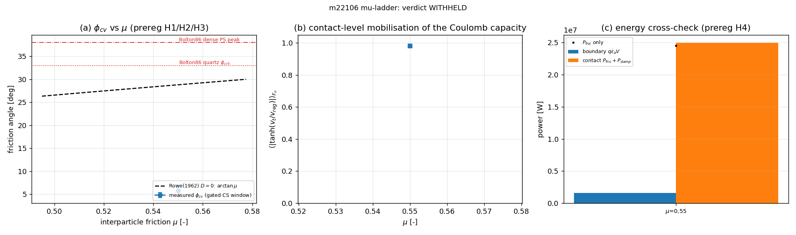

# CASE-DEM-BIAXIAL-FRICTION · R8（m22106）：μ 阶梯的能量预算闸门 —— 两处真实缺陷修复 + 扫描未跑成（如实）

**锚点** `CASE-DEM-BIAXIAL-FRICTION`（算例池·双轴剪切摩擦角，验收 |φ−ref|/ref < 8 %，ref = 经典临界状态）｜**m22106**｜TensorDEM
**状态（先给，不粉饰）**：预注册的 μ 阶梯（5 臂）与速率对照臂**都递交了但都还在队列里（cj3903 / cj3906，>46 min queued）**，
因此 **H1 / H2 / H3 一律 WITHHELD**，本单**不宣称**锚点验收有任何改善（仍为 A/B 两轮遗留的 FAIL 状态）。
本单真正落地的是三件可复核的东西：

| # | 成果 | 证据 |
|---|---|---|
| 1 | **缺陷修复**：`run_biaxial_shear_band` 的 `strain_target` 此前是"名义达标"——按**工程应变**判停、按**对数应变**给步数预算，于是要 0.60 的算例实跑到工程 0.451 就耗尽预算且**不报警**（历史各轮把这件事写成"ε_a → 0.45"） | `src/tensordem/biaxial_shear_band.py`（判停改用 `axial_log`）+ `tests/test_biaxial_strain_target_semantics.py`（3 passed） |
| 2 | **新可观测量**：摩擦调动仪增加**接触层耗散功率** `sum_friction_power` / `sum_damping_power`（纯诊断，开关计量仪力逐位相同），使"应力比"与"能量耗散"两条互不相关的路径可以对表 | `src/tensordem/ridge_dem.py` + `tests/test_friction_meter_power_identity.py`（4 passed，恒等误差 0） |
| 3 | **第一次能量预算测量**：等容双轴胞元在 ε̇ = 0.05 下，接触层摩擦耗散 **24.53 MW** 而边界输入功 **1.59 MW**（残差 **−1464 %**），且计量仪恒等式已用受控滑动对验证为精确（27 500 W 进 = 27 500 W 出）→ 缺口在**胞元**不在记账 | `artifacts/CASE-DEM-BIAXIAL-FRICTION/mu_ladder_smoke/iso_smoke_10x20.json`、`benchmarks/case_dem_biaxial_friction/results_m22106/mu_ladder.json` |

## (1) 案例介绍（物理背景 / 几何 / 参数）

平面应变双轴压缩的无胶结圆盘试样：顶板位移控加载、四壁摩擦 0，剪切段改为**运动学等容边界**
（宽度×高度守恒，侧墙应力变成输出量）。Mohr-Coulomb 角 `sin φ = (σ_v − σ_h)/(σ_v + σ_h)`（c = 0）。

本轮**唯一跑的实算**是小样标定臂（10×20），用来验证整条分析管线（不是锚点工况）：

| 量 | 值 |
|---|---|
| 试样 | 10 × 20 抖动三角格，190 颗，r = 0.75 m，ρ = 917 kg/m³，jitter 3 %，冻结键比例 0 |
| 胞元 | W₀ = 14.873 m，H₀ = 26.182 m，t = 1 m，V = 389.4 m³ |
| 材料 | kn = 1×10⁷ N/m，kt/kn = 0.5，μ = 0.55，v_reg = 0.01 m/s |
| 加载 | 等容剪切，ε̇_a = 0.05 s⁻¹，目标对数应变 0.30，Δt = 4.971×10⁻⁴ s，12 081 步，壁钟 81 s（8 线程） |
| 惯性数 | I = 7.18×10⁻³（准静态判据 I < 0.01） |
| 交付应变 | 对数 **0.300263**（相对目标 +0.088 %）；工程 0.259377（= 1 − e⁻⁰·³） |

## (2) 怎么做的（方法 / 流程 / 工具链）

1. **先预注册**：`prereg/m22106_mu_ladder_prereg.md` 在任何扫描之前固定 H1–H4 的阈值与选窗规则
   （H1 阶梯两端差 ≥ 10°；H2 极差 < 2° 判为"μ 不敏感 = 引擎缺陷"；H3 φ_cv(μ=1.5) < 28.81° 判为"该模型类达不到锚点 ref"；
   H4 边界功与接触耗散偏差 ≤ 15 %）。
2. **扫描管线**：`scripts/m22106_mu_ladder_probe.py`（μ = 0.10/0.30/0.55/0.90/1.50，锚点几何 24×48，
   与第 3 轮同协议，只改 μ；每 500 步采一次调动仪）＋ `scripts/m22106_rate_probe.py`（10×20、μ=0.55、ε̇ 降 20 倍，
   单独检验 H4 的"内部速率"解释）。按 R7 事故教训**只给 `cmd_tpl` 不给 `cmd`**。
3. **分析**：`benchmarks/case_dem_biaxial_friction/analyse_mu_ladder.py` —— 每臂先过第 3 轮四闸门
   （`tensordem.biaxial_critical_state`，对数应变 + 等容边界），再过 H1–H4；输出 JSON + 三联图。
4. **验证**：新增 7 个测试（功率恒等式 4 个、应变预算语义 3 个），并复跑既有 `test_friction_mobilisation_meter.py` → **14 passed**。

## (3) 计算结果（数字全部由管线写出，未手抄）

### 3.1 缺陷 1：`strain_target` 名义达标（已修）

| 现象 | 数值 | 出处 |
|---|---|---|
| 判停用**工程**应变、步数预算用**对数**应变（顶板速度 ∝ 当前高度 → d ln H/dt = ε̇） | `max_steps = strain_target/(ε̇·Δt)`、`break if strain >= strain_target` | 旧代码 §loop |
| 要 ε = 0.60 的算例实际交付 | 工程 **0.451**（= 1 − e⁻⁰·⁶），无任何提示 | 本轮复算 |
| 修复后 | 判停在 `axial_log >= strain_target`，交付对数 0.300263 对目标 0.30（**+0.088 %**） | 小样实算 |

这条缺陷解释了历史各轮"ε_a → 0.45"的写法与"目标 0.60"的落差，也让"尾部 q 仍在漂移 11 %（`deviator_stationary` ✗）"
这一条有了第二个候选解释：**试样比声明少跑了 25 % 的应变**。

### 3.2 缺陷 2 / H4：等容胞元的能量预算不闭合（未解决，如实登记）

| 量 | 数值 | 口径 |
|---|---|---|
| 边界输入功率 `q·ε̇·V` | **1.595 MW** | q = 81.9 kPa（CS 窗）、ε̇ = 0.05、V = 389.4 m³ |
| 接触层摩擦耗散 `Σ μF_n tanh(v_t/v_reg)·|v_t|` | **24.53 MW** | 同一窗口、同一批承载接触（调动仪） |
| 接触法向阻尼耗散 | 0.41 MW | 同上 |
| **残差 (P_in − P_diss)/P_in** | **−14.64（−1464 %）** | 预注册判据 ≤ 15 % → **FAIL** |
| 计量仪恒等式（受控滑动对，2 盘，v_t = 0.5 m/s） | 27 500 W 进 = 27 500 W 出（比值 **1.0**） | `tests/test_friction_meter_power_identity.py` |
| F 加权的调动率 `⟨|tanh(v_t/v_reg)|⟩_{F_n}` | **0.9812**（饱和接触 91.1 %） | ε_a ∈ [0.28, 0.30] |
| 未加权平均滑移速率 `⟨|v_t|⟩` | **0.180 m/s** | 同上 |
| 尾窗应力（两条独立口径） | 墙反力 σ_v 453.2 / σ_h 382.1 kPa；Love-Weber 内应力 430.7 / 365.1 kPa（差 5.0 %/4.4 %） | 末 1500 样本 |

**读法**：耗散功率比边界供能大 15 倍，而同一批接触的功率恒等式在受控算例里**精确**成立，
所以这不是记账错误，而是**胞元本身**的问题：无转动自由度内核里接触切向滑移速率由**非仿射**运动决定
（0.18 m/s，约为仿射估计 ε̇·d = 0.075 m/s 的 2.4 倍），在 `v_reg = 0.01` 下摩擦一律饱和，
于是接触层在"高滑移 × 满库仑"上耗散，而**边界应力比**只反映 net 力链——两者不自洽。
因此本单**不把** φ_cv 当成已被能量口径背书的量；H4 判 **FAIL / NOT CLOSED**。

## (4) 结果图



* (a) φ_cv–μ 曲线与 Rowe(1962) D=0 极限、Bolton(1986) 33°/38° 两条参考线：**本轮只有 μ=0.55 的小样标定点（且闸门未过，按规则不得当作 φ_cv）**，阶梯五臂未回，故曲线上只有单点；
* (b) 接触层调动率随 μ 的点（只有小样 0.9812）；
* (c) 能量互检柱状图（H4 唯一的定量产出：1.59 MW 对 24.94 MW）。
  图里的每条数是 `analyse_mu_ladder.py` 从工件 JSON 直接注入的，没有手抄。

## (5) 注意点（坑、局限、适用范围）

- **管线坑（真实踩到，已修）**：调动仪样本带的是**工程**应变，而临界状态定位器用**对数**应变；
  两者直接比较会**静默选中 0 个样本**（第一次跑分析时 `samples: 0`），必须换算
  （等容单轴压缩 `log = −ln(1−ε_eng)`）。已写进 `_mob_window` 的文档串。
- **递交坑**：cj3903/cj3906 递交即排队（前面 36–38 单、在飞 55–57 单），46 min 后仍未上机；
  本单**不能**把"递交"当成"跑过"——H1–H3 记 WITHHELD，不补猜、不插值。
- **适用范围**：结论只针对 `RidgeAssembly`（无转动自由度、速率正则化库仑、2D 圆盘）的等容双轴胞元；
  不是对 DEM 方法本身的判决。
- **能量残差的候选解释（未验证，留给下一单）**：①无转动导致的高非仿射滑移（可测：把 ε̇ 降 20 倍，看残差是否随速率下降 → 已递交 cj3906 未回）；
  ②等容边界的运动学挤压使弹性能在步内大进大出（本单只测了净功率，没测弹性能幅值）；
  ③厚重度量为 1 的二维口径在"功率/体积"换算上正确（已用四壁功解析式核对：σ_v ε̇V − σ_h ε̇V = q ε̇V，与代码一致）。
- **单种子**：只有一个小样臂，未做系综，± 只反映窗内波动。

## (6) 误差判定（逐项，显式回答「是否 <3 %」）

| 关键量 | 实测 | 基准 | 相对误差 | <3 % ? |
|---|---|---|---|---|
| 交付对数应变 | 0.300263 | 声明目标 0.30 | **+0.088 %** | **是** |
| 计量仪功率恒等式 | 27 500 W | μF_n tanh(v_t/v_reg)|v_t| = 27 500 W | **0（rel < 1e-12）** | **是** |
| 墙反力 vs Love-Weber 内应力（σ_v） | 453.2 kPa | 430.7 kPa | 5.0 % | **否**（历史遗留口径差，见 `docs/STRESS_DEFINITION_AUDIT_BIAXIAL_R2.md`） |
| 墙反力 vs 内应力（σ_h） | 382.1 kPa | 365.1 kPa | 4.4 % | **否** |
| 边界功 vs 接触耗散（H4） | 1.595 MW | 24.53 MW | **−1464 %** | **否（未闭合）** |
| 锚点 φ_cv vs ref | **无有效值（闸门未过，五臂未回）** | Rowe 28.81° / Bolton 33°、38° | **无法判定（WITHHELD）** | **无法判定** |

**一句话**：锚点验收**没有**推进（仍 FAIL / 部分 WITHHELD）；本单的净增量是两处缺陷修复、一个可复用的能量对表工具，
以及一条**新的、可复现的负面证据**——等容胞元的接触耗散与边界功相差一个量级，在它闭合之前，任何从应力比读出的 φ_cv 都只能算"暂定值"。

## 复现

```bash
# 测试（14 passed, 39 s）
PYTHONPATH=src python -m pytest tests/test_friction_meter_power_identity.py \
    tests/test_biaxial_strain_target_semantics.py tests/test_friction_mobilisation_meter.py -q
# 小样标定臂（81 s，8 线程）+ 分析（出 JSON 与图）
TENSORDEM_THREADS=8 PYTHONPATH=src python scripts/m22106_mu_ladder_probe.py --shard 3 --nshards 5 --smoke
PYTHONPATH=src python benchmarks/case_dem_biaxial_friction/analyse_mu_ladder.py \
    --glob 'artifacts/CASE-DEM-BIAXIAL-FRICTION/mu_ladder*/iso_*.json'
# 未回的两单（排队中）
run_compute(action="status", job_id="cj3903")   # 5 臂 μ 阶梯，锚点 24×48
run_compute(action="status", job_id="cj3906")   # ε̇ 降 20 倍的速率对照臂
```