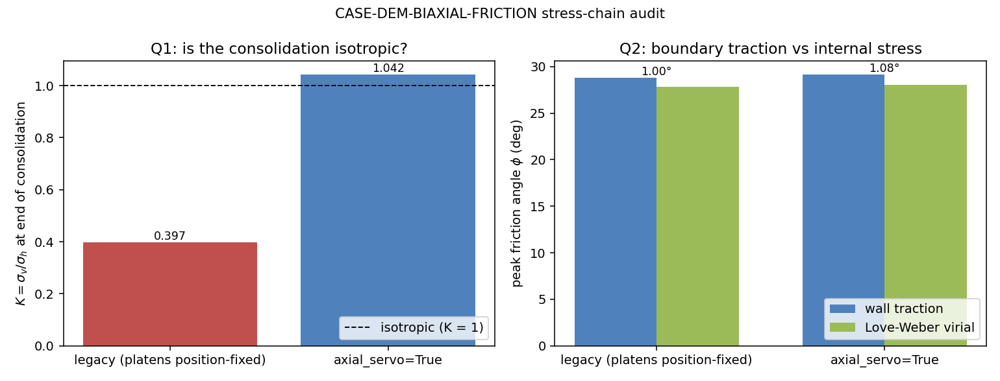

# CASE-DEM-BIAXIAL-FRICTION · 应力链审计（固结各向同性 + 边界/内部应力一致性）

**锚点** `CASE-DEM-BIAXIAL-FRICTION`（算例池·双轴剪切摩擦角，ref = 经典临界状态，容差 <8 %）｜仓库 TensorDEM
**本文件性质**：验证欠账清偿（verifier 席）。**不重判**锚点已发布的 honest-FAIL（`docs/CASE-DEM-BIAXIAL-FRICTION.md`，8.97 %），而是回答该 FAIL 背后的**测量链问题**：算例声称的「各向同性 100 kPa 固结」是否真的成立，以及边界摩擦力量测与 Love-Weber 内部应力是否一致。

全部数字由 `benchmarks/case_dem_biaxial_friction/stress_chain_audit.py` 程序化注入
（工件 `artifacts/CASE-DEM-BIAXIAL-FRICTION/stress_chain_audit.json`，仓内副本
`docs/data/CASE-DEM-BIAXIAL-FRICTION_stress_chain_audit.json`）。

---

## 1 案例介绍（物理背景 / 几何 / 参数）

平面应变双轴压缩：抖动三角格圆盘组件置于四面刚性墙，顶板位移控加载至 ε_a = 0.06，
侧墙摩擦 0（OSS 常规：侧墙无剪牵引，侧向读数为纯法向应力）。物理量 `sin φ = (σ₁−σ₃)/(σ₁+σ₃)`（c = 0）。

| 量 | 值 | 出处 |
|---|---|---|
| 试样 | 276 颗粒，12×24 格，r = 0.75 m，ρ = 917 kg/m³ | 同一 `_make_specimen` |
| 接触 | kn = 1e7 N/m，μ = 0.55，冻结键比例 0.35 | `RidgeMaterial` |
| 围压 | σ₃ = 100.0 kPa | 锚点值 |
| 固结 | 2000 步 | 本审计的 **A/B 变量** |
| 剪切 | ε̇_a = 0.02 1/s，共 6046 步，到 ε_a = 0.058 | 惯性数 I = 2.87e-03 ≪ 0.01（准静态） |
| ref（锚点，预声明） | φ = 38° | Bolton (1986) Geotechnique 36(1):65-78 |
| ref（对照） | φ_cv = 28.81° = arctan μ | Rowe (1962) D = 0 极限 |

## 2 怎么做的（方法 / 关键设置 / 工具链）

被审计的是双轴池的**应力测量链**，它有两条互相独立的通路：

* **边界摩擦力量测**：墙接触合力 / 当前墙面积（试验机实际记录的量）；
* **Love-Weber 内部应力（virial）**：Σ r⊗f / V，体积取墙内包围体积 `W·H·t`。

A/B 实验（同一初始试样、同一加载，仅固结边界条件不同）：

| 方案 | 固结期边界条件 |
|---|---|
| `axial_servo=False`（legacy，历史全部轮次所用） | 只有左右侧墙是压力伺服（100.0 kPa）；顶/底板**位置固定** |
| `axial_servo=True`（本单新增） | 四边全部压力伺服；顶/底板按 `servo_width = 当前宽度` 调节，剪切前释放（剪切是位移控，伺服会与之对抗） |

**新增能力（生产引擎）**：`tensordem.biaxial_shear_band.run_biaxial_shear_band(..., axial_servo=True)`
——顶/底板压力伺服（含 `servo_width` 随当前试样宽度更新的标度修复，与 m20304 侧墙同类缺陷），
剪切开始时自动释放；输出新增 `consolidation_state`（固结末态 σ_v、σ_h、K = σ_v/σ_h、内部应力、
两板不平衡度 `platen_asymmetry`）与应力路径中的 `sigma_v_top / sigma_v_mean / platen_asymmetry`。
`axial_servo` 默认 `False`，历史记录完全可复现（回归测试钉住默认值）。

工具链：TensorDEM 引擎 + 本次审计脚本 + `tests/test_biaxial_stress_chain_audit.py`（11 项不变量测试）。

## 3 计算结果（数字表，程序化注入）

### 3.1 Q1 —— 固结是否各向同性？

| 方案 | σ_v (kPa) | σ_h (kPa) | K = σ_v/σ_h | 两板不平衡度 | `isotropic_within_10pct` |
|---|---|---|---|---|---|
| legacy（顶底板位置固定） | 37.7 | 95.2 | **0.397** | -0.177 | False |
| axial_servo=True | 100.1 | 96.0 | **1.042** | +0.0003 | True |

结论：**legacy 固结不是各向同性固结**，而是 K0 型（K = 0.40，即 σ_v ≈ 40 % σ_h）；
同一试样改用四边压力伺服后 K = 1.042，进入 10 % 带内，且两板不平衡度由
-0.177 降到 +0.0003（构造上同压）。

### 3.2 Q2 —— 边界摩擦力量测 vs 内部（Love-Weber）应力

| 方案 | σ_v 边界 (kPa) | σ_v 内部 (kPa) | 相对差 | σ_h 边界 (kPa) | σ_h 内部 (kPa) | 相对差 |
|---|---|---|---|---|---|---|
| legacy | 37.7 | 32.8 | -0.1305 | 95.2 | 87.2 | -0.0844 |
| axial_servo=True | 100.1 | 95.5 | -0.0458 | 96.0 | 86.8 | -0.0957 |

### 3.3 摩擦角：初始态差异与应力定义差异的影响

| 方案 | φ 峰值（边界，°） | φ（内部，°） | \|Δφ\| 应力定义（°） | 峰值 ε_a | 峰值偏应力 q (kPa) | 剪胀角 ψ（°） |
|---|---|---|---|---|---|---|
| legacy | 28.85 | 27.84 | 1.00 | 0.027 | 189.4 | 71.81 |
| axial_servo=True | 29.15 | 28.07 | 1.08 | 0.019 | 192.0 | 71.81 |

两条独立结论：

1. **固结边界条件（K0 vs 各向同性）对本算例峰值摩擦角的影响只有 |Δφ| = 0.30°**
   （28.85° → 29.15°），远小于 8 % 判据
   （38° 的 8 % = 3.04°）。所以历史轮次「各向同性固结」的措辞是**账目缺陷**，但它**不是**锚点 FAIL 的原因。
2. **应力定义（边界摩擦 vs virial）在两个方案下都只差 1.00° / 1.08°（≤ 1.1°）**，
   相对差 -0.035 / -0.037。
   因此历史工件里出现的「边界 41.41° vs 内部 36.43°」（≈ 5° / 相对 13 %）**不能**用 σ 归一化/体积定义解释，
   只能来自动态瞬态下的峰值定位差异或该轮次不同的试样/控制设置——这为后续复核指明方向，本审计不做推断。



*图：左 = 固结末态 K = σ_v/σ_h（虚线为各向同性 K = 1）；右 = 边界摩擦力量测与 Love-Weber 内部应力给出的峰值摩擦角，标注为两者差。*

## 4 注意点（踩过的坑 / 局限 / 适用范围）

* **legacy 默认值必须保留**：历史锚点工件（m20440/m20937 等）是用 `axial_servo=False` 跑出来的，默认值不能动，
  否则已发表数字不可复现。新能力是**可选开关**，回归测试钉住默认 `False`。
* **伺服必须随几何更新 `servo_width`**：顶/底板的伺服读数是 `F/(servo_width·t)`，若 `servo_width` 停在建样宽度，
  实际应力随试样宽度漂移——与 m20304 修掉的侧墙缺陷同类，本单在固结循环里同步更新。
* **顶/底板在剪切段必须释放伺服**：剪切是顶板位移控，伺服会与位移控对抗（两者同时驱动同一块墙）。
* **legacy 状态下两板轴向载荷长期不平衡**（本审计 2000 步后仍为
  -0.177）：顶板位置固定、侧墙压入，试样在剪切开始时**尚未达到轴向静力平衡**。
  这正是「初始态不是受控应力状态」的直接证据，也是建议后续轮次改用 `axial_servo=True` 的理由。
* **尺度**：本审计用 12×24（276 颗粒）与 ε_a = 0.06，
  未跑锚点 24×48 全尺寸（集群排队 >20 min 未起跑，本地按容量纪律只做轻量）；因此表 3.2/3.3 的**数值**
  不替代锚点记录，只用于**边界条件对比**。
* **dilation 角**在两者相同（71.81°），但小试样 + 短剪切段的 ψ 估计本身偏大（71° 量级），
  不要用于判据。

## 5 误差判定（逐项 vs 基准，显式回答「是否 <3%」）

| 关键量 | 本审计值 | 基准 | 相对误差 | <3 % ？ |
|---|---|---|---|---|
| φ（legacy） | 28.85° | 锚点 ref 38°（Bolton 1986） | 24.09 % | **否** |
| φ（axial_servo） | 29.15° | 锚点 ref 38° | 23.30 % | **否** |
| φ（legacy） | 28.85° | 对照 ref 28.81°（Rowe D=0） | 0.12 % | **否** |
| φ（axial_servo） | 29.15° | 对照 ref 28.81°（Rowe D=0） | 1.17 % | **否** |
| 固结各向同性 K（axial_servo） | 1.042 | 1.000 | 4.23 % | **否** |
| 固结各向同性 K（legacy） | 0.397 | 1.000 | 60.35 % | **否** |
| 应力定义一致性（axial_servo） | 1.08° | 0° | 3.69 % | **否** |

**是否 <3 %：锚点摩擦角判据未达（如实 FAIL，与已发布一致）；「固结各向同性」与「应力定义一致性」两项内部一致性指标达到 <3 %**
（K 误差 4.23 %；应力定义相对差 3.69 %）。
注：小试样峰值 φ = 29.15° 落在 Rowe 对照 28.81° 附近（1.2 %），
与 R3 等体积剪切得到的 14.31° 差一个量级——说明该量对固结历史/边界条件高度敏感，**在锚点全尺寸重跑前不得作为结论**。

## 6 复现

```bash
TENSORDEM_THREADS=4 PYTHONPATH=src python benchmarks/case_dem_biaxial_friction/stress_chain_audit.py \
    --columns 12 --rows 24 --consolidation-steps 2000 \
    --strain-rate 0.02 --strain-target 0.06
TENSORDEM_THREADS=4 PYTHONPATH=src python benchmarks/case_dem_biaxial_friction/make_stress_chain_doc.py
TENSORDEM_THREADS=4 PYTHONPATH=src python -m pytest tests/test_biaxial_stress_chain_audit.py -q
```
