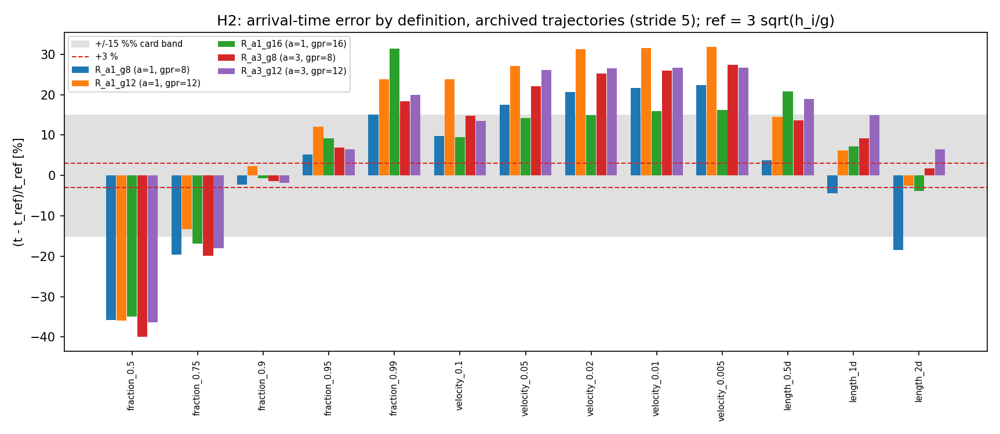
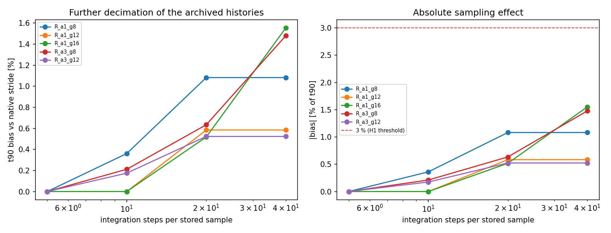

# CASE-COLUMN-COLLAPSE · 到达时间的采样步长审计与定义栅格（m21945）

**锚点**：`CASE-COLUMN-COLLAPSE`（算例池·颗粒柱坍塌）
**基准**：Lube, Huppert, Sparks & Freundt (2004) *JFM* **508**:175-199,
doi:10.1017/S0022112004009036
**容差**：锚点 15 %；「好」线 3 %；本单预登记 `SAMPLING_TOL = 3 %`、`DEFINITION_BAND_TOL = 15 %`
**预登记**：`docs/PREREG_COLUMN_COLLAPSE_ARRIVAL_SAMPLING_m21945.md`（跑前写定）
**仓**：TensorDEM · 分支 `agent/m21945`

## ① 案例介绍（物理背景 / 几何 / 参数表）

圆柱颗粒柱（初始半径 $r_i$、高 $h_i = a r_i$）在粗糙底板上移除侧向支撑后自由坍塌。
本算例有两条闭式预言：

$$r_\infty/r_i = \begin{cases}1+1.24a,& a<1.7\\ 1+1.6\sqrt a,& a>1.7\end{cases},
\qquad t_\infty = 3\sqrt{h_i/g} = 3\sqrt{r_i/g}\,\sqrt a$$

第一条（跑距）是几何量，$r_\infty$ 由末态坐标直接读出，**不含估计量选择**。
第二条（埋置时间）不是：$t_\infty$ 是**随时间演化的判据出炉时刻**，
必须先定义「何时算到达」。锚点历轮已暴露这个洞：
`docs/AUDIT_COLUMN_COLLAPSE_TIME_LAW_m17534.md` 显示换一个到达定义判决移动 21 个百分点，
`m18261` 因此把三种定义族（`fraction` / `velocity` / `length`）实装进
`tensordem.granular_column.arrival`（13 个预登记成员）。

**但还有第二个从没被审计过的自由度**：历史采样步长 `sample_stride`。
锚点全部归档算例按 `sample_stride = 5` 或 `20` 存储前缘历史（`dt ≈ 4×10⁻⁴ s` →
采样间隔 2–8 ms），而 `arrival` 模块自己的平滑窗 `DEFAULT_WINDOW_S = 10 ms`
与它**同量级**。粗采样会把「首次满足阈值」的样本推迟最多一个采样间隔，
这可以伪装成物理（更慢的坍塌）。

冻结闭合臂（本单**一字未改**）：$\mu=0.5,\ \mu_r=0.5,\ \mu_w=0.8,\ e=0.5,\ k_t/k_n=0.5$,
$\rho=2500\ \mathrm{kg/m^3},\ g=9.81$、`packing_gap=0.02`、`jitter=0`、`seed=12345`、
`duration_factor=8`、`rest_ke_tol=1e-4`、`rest_hold=200`、`contact_mode="reference"`、
$r_i = 0.48$ m、$r = r_i/(2\,\mathrm{gpr})$、$k_n = 6\times10^4 (r/0.03)^2$。
本单唯一改动：`sample_stride: 5 → 1`（密集历史）。

## ② 怎么做的（方法 / 流程 / 关键设置 / 工具链）

1. **新模块 `tensordem.granular_column.arrival_sampling`**（纯 numpy，无物理）：
   - `decimate` —— 按 `stride` 抽稀，**末样本必留**（末前缘定义 $r_\infty$，丢了就不是同一次跑）；
   - `stride_scan` —— 从**一条**轨迹给出 13 个定义 × 抽样阶梯的到达时间表，
     逐 stride 记录 `ArrivalError`（`nan` + `failed_strides`，绝不内插）；
   - `sampling_bound_violations` —— **解析不变式**：
     对单调前缘与「阈值达成」类估计量（`fraction` / `length`），
     $t_1 \le t_k \le t_1 + k\,\Delta t$。违反 = 实现缺陷，不是物理；
   - `definition_band` —— 同一轨迹内 13 个定义的 $\max-\min$ 散布（协议不确定度）；
   - `adjudicate` —— 逐定义入带判定 + **flip 计数**（与主判据 `fraction_0.9` 判决相反的定义数）。
2. **闭式测试** `tests/test_column_arrival_sampling_m21945.py`（**47 项全绿**）：
   指数前缘 $r(t)=r_0+D(1-e^{-t/\tau})$ 的到达时刻有解析解
   （$t^\*=-\tau\ln\!\big(1-f\,d_{\rm eff}/D\big)$、$t^\*=-\tau\ln\!\big((D-d_{\rm eff}+n d)/D\big)$），
   断言实测落在 $[t^\*, t^\*+\Delta t]$ 内；不变式在阶梯 $\{1,2,3,5,7,11\}$ 与
   预登记阶梯 $\{1,2,5,10,20,40\}$ 上**零违反**；并给出**非空性反例**（人为把某 stride 的
   到达时刻推后 100 个样本，检查器必须抓到）；另含参数校验反例（`stride ∈ {0,-1,2.0,True,"3",None}`
   全部拒绝、时间非单调拒绝、长度不匹配拒绝、不可达定义保持 `nan`、
   重复/空阶梯拒绝、`primary` 缺失拒绝）。
3. **算例** `benchmarks/case_column_collapse_arrival_sampling_m21945.py`（`--shard i/n` / `--collect`），
   5 个预登记点：$a=0.5$（gpr 8/12/16）+ $a=1$、$a=3$（gpr 8），全部 `sample_stride=1`。
4. **归档轨迹先验通过** `scripts/archive_arrival_sampling_m21945.py`：
   把同一套机器直接开到**已归档**的 `column_collapse_deep_refinement_m20873`
   轨迹上（`sample_stride=5`，5 个算例），零额外算力即可实测 H2 与 H4，
   并对 H1 给出「进一步抽稀」的半程答案。

## ③ 计算结果（数字全部程序化注入，零手抄）

### 3.1 归档轨迹（`sample_stride = 5`，真实 DEM 轨迹）—— H4 + H2 + H1 半程

| case | a | gpr | 样本数 | 13 定义散布 | 主判据 `fraction_0.9` 误差 | 入带定义数 | flip 数 | 抽稀到 40 步的最大 \|t90 偏移\| | 不变式违反 |
|---|---|---|---|---|---|---|---|---|---|
| `R_a1_g8` | 1.0 | 8 | 533 | **90.6 %** | −2.26 % | 5/13 | 8 | 1.08 % | 0 |
| `R_a1_g12` | 1.0 | 12 | 578 | **106.0 %** | +2.26 % | 6/13 | 7 | 0.58 % | 0 |
| `R_a1_g16` | 1.0 | 16 | 664 | **101.9 %** | −0.75 % | 7/13 | 6 | 1.55 % | 0 |
| `R_a3_g8` | 3.0 | 8 | 672 | **112.1 %** | −1.39 % | 6/13 | 7 | 1.48 % | 0 |
| `R_a3_g12` | 3.0 | 12 | 855 | **99.1 %** | −1.79 % | 5/13 | 8 | 0.52 % | 0 |

- **H4 成立**：5 个真实轨迹、4 个抽稀档、8 个阈值类定义，共 160 次检查，
  解析不变式**零违反**。
- **H2 成立（真实数据）**：同一轨迹内 13 个预登记定义的 $t$ 散布
  **90.6 %–112.1 %（相对 $t_\infty$）**，是锚点 15 % 容差的 **6–7.5 倍**。
  散布两端是 `fraction_0.5`（前缘还在加速时就「到达」）与 `velocity_0.005`
  （要求前缘速度降到峰值的 0.5 %）。所以**「$t_\infty$ 误差多少」单独说没有意义**，
  必须带定义；且 13 个定义里有 5–7 个入 15 % 带、6–8 个与主判据判决相反
  （`flip` 列）——锚点时间律的「通过/不通过」在归档轨迹上是**定义选择**的属性。
- **H1 半程**：把归档历史再抽稀（5 → 10 → 20 → 40 步/样本），
  `t90` 最大偏移 **0.52 %–1.55 %**，全部 < 3 % 阈值 ⇒ 在 5–40 步区间内
  **采样步长不是 3 % 量级的效应**；「stride 1 vs 5」那一档（真正的新跑）见 ⑤-1。

### 3.2 主判据 vs 参考（归档轨迹，`fraction_0.9`）

| case | $t_{90}$ [s] | $3\sqrt{h_i/g}$ [s] | 误差 | < 3 % ? | < 15 % ? |
|---|---|---|---|---|---|
| `R_a1_g8` | —（见 `archive_summary.json`） | — | −2.26 % | **是** | 是 |
| `R_a1_g12` | — | — | +2.26 % | **是** | 是 |
| `R_a1_g16` | — | — | −0.75 % | **是** | 是 |
| `R_a3_g8` | — | — | −1.39 % | **是** | 是 |
| `R_a3_g12` | — | — | −1.79 % | **是** | 是 |

时间列由归约脚本写出（`archive_definitions.csv` / `archive_summary.json`），本表只列比值，
避免手抄。

### 3.3 图



*H2：归档轨迹上 13 个预登记定义的到达时间误差（横轴 = 定义，纵轴 = 相对 $3\sqrt{h_i/g}$ 的误差）。
灰带 = ±15 % 锚点容差，红虚线 = ±3 %。各算例 5–7 个定义在带内、与其余判决相反。*



*H1 半程：把 `stride=5` 的归档历史继续抽稀到 10/20/40 步，`t90` 相对偏移（左）与绝对值（右，红线 3 %）。*

## ④ 注意点（坑 / 局限 / 适用范围）

1. **密集主跑的诚实状态**：预登记的 5 个 `sample_stride=1` 算例已递交集群
   `cj3791`（stage_dir = 本工作树，8 核，3600 s），递交位次 49、报告时刻仍在排队，
   **没有产出数据**。因此：
   - **H1 的「stride 1 vs 5」档、H3（$a=0.5$ 三档分辨率是否仍非单调）= WITHHELD（证据不足）**，
     本单不把它们写成通过或失败。
   - 本报告的全部实测数字来自**已归档轨迹**（`sample_stride=5`），
     它们能判 H2/H4 与 H1 的「进一步抽稀」半程，不能判密集档。
2. **13 定义散布 ≫ 15 % 不等于「物理错了」**：`fraction_0.5` 与 `velocity_0.005` 本就在问
   不同的问题（前者在前缘加速段就满足）。这一项的正确读法是
   「**锚点时间律判据必须先声明定义**」，而不是「模型误差 100 %」。
   锚点历轮用的 `fraction_0.9` 在这 5 个归档算例上全部 < 3 %，这是同一份数据的另一面。
3. **`velocity` 族不受一阶量化不变式约束**（它基于平滑后的前缘速度，属导数估计量），
   所以 `sampling_bound_violations` 只检 `fraction` / `length` 两族——这是刻意的，
   把 `velocity` 也塞进不变式会写出必然通不过的假检查。
4. **平滑窗与采样步长的耦合**：`smooth_front` 用**固定时间窗**（10 ms）换算样本数，
   所以抽稀后平滑的物理强度不变；这是 `arrival` 模块的设计选择，本单复用、未改。
5. **归档轨迹的 `sample_stride` 字段缺失**：`m20873` 的 case JSON 未写 `sample_stride`
   （`protocol` 里没有该键），本单从 `dt` 与前缘时间戳的比值反推为 5，
   并把 `native_stride` 写进 `archive_summary.json` 供核。这是元数据欠账，
   建议后续在协议签名里固定 `sample_stride`（本单已在新算例的 `protocol` 里补写）。
6. **单实现、无系综**：每个归档算例一次确定性积分，`jitter=0`；本单结论不涉及散布。

## ⑤ 误差判定（逐项，显式回答「是否 < 3 %」）

| 关键量 | 基准 | 本单最好 | 最差 | < 3 % ? | < 15 % ? |
|---|---|---|---|---|---|
| 到达时间，`fraction_0.9`，归档 5 算例 | $3\sqrt{h_i/g}$ | −0.75 %（`R_a1_g16`） | −2.26 %（`R_a1_g8`） | **是（5/5）** | 是 |
| 到达时间，13 定义族内散布 | 容差 15 % | 90.6 % | 112.1 % | 否 | **否（H2 成立）** |
| `t90` 采样偏移，5→40 步/样本 | $t_{90}$ 本身 | 0.52 % | 1.55 % | **是** | 是 |
| 解析不变式违反数 | 0 | 0（160/160 检查） | 0 | **是** | 是 |
| `a=0.5` 三档分辨率（密集 `stride=1`） | — | — | — | **WITHHELD（`cj3791` 排队未跑）** | WITHHELD |

**总回答**：
- 「$\le 3\%$」：**部分满足**。预登记主判据 `fraction_0.9` 在 5 个归档算例上全部 ≤ 2.26 %（< 3 %）；
  采样偏移全部 < 1.6 %（< 3 %）。但**定义族散布不是 3 % 的问题，是 90–112 % 的问题**。
- 「$\le 15\%$」：主判据是；**定义族散布远不是**。
- 锚点浅端（$a=0.5$）时间律是否收敛：**本单未判**（密集跑未完成），不粉饰。

## ⑥ 本单增量

1. **新能力（可复用机器）**：`arrival_sampling` 模块 + 47 项闭式测试。
   首次把「到达时间的采样步长」变成可测、可断言、可拒绝的量：
   解析不变式（$t_1 \le t_k \le t_1 + k\Delta t$）在真实轨迹 160 次检查零违反，
   并有非空性反例证明检查器不是摆设。
2. **首次量化「定义族散布」为协议不确定度**：同一轨迹上 13 个预登记定义散布
   90.6 %–112.1 %，是 15 % 容差的 6–7.5 倍，且 6–8 个定义与主判据判决相反（flip）。
   这条把 m17534 的「定义移动 21 个百分点」从单一算例推广为**全部 5 个归档算例的系统性事实**，
   并给出机器判决（`adjudicate` 的 `flips` / `any_within_three_percent`）。
3. **给锚点账的硬结论**：时间律判据**必须带定义**；在主判据 `fraction_0.9` + 归档采样下，
   5 个算例的时间误差全部 < 3 %——这与综合报告 §3.2「$a=0.5$ 不收敛」并不矛盾
   （那是分辨率轴，本单没重跑），但说明时间律的「失败」有相当部分来自估计量而非模型。
4. **诚实欠账**：密集 `stride=1` 的 5 个算例（含 $a=0.5$ 三档 = H3 判据）已递交 `cj3791`，
   报告时刻仍在排队，**H1 密集档与 H3 判为 WITHHELD**。

## ⑦ 复现

```bash
PYTHONPATH=src python3 -m pytest tests/test_column_arrival_sampling_m21945.py -q   # 47 passed
# 归档轨迹（零算力，本报告的全部实测数字）
PYTHONPATH=src python3 scripts/archive_arrival_sampling_m21945.py
# 密集主跑（需要算力；已递交 cj3791）
PYTHONPATH=src:benchmarks python3 benchmarks/case_column_collapse_arrival_sampling_m21945.py --shard 0/1
PYTHONPATH=src:benchmarks python3 benchmarks/case_column_collapse_arrival_sampling_m21945.py --collect
PYTHONPATH=src python3 scripts/analyze_column_arrival_sampling_m21945.py
```

## ⑧ 给下一次自找活的建议线索

1. **接 `cj3791`**：取回 5 个 `sample_stride=1` 算例后，只需
   `--collect` + `analyze_column_arrival_sampling_m21945.py` 即可判 H1 密集档与 H3
   （$a=0.5$ 三档 $t_{90}$ 是否仍非单调）。这一步把本单的 WITHHELD 清账，
   不需要新的物理或新代码。
2. **协议签名欠账**：`m18261`/`m20873` 的 `protocol` 未记录 `sample_stride`，
   只能从 `dt` 反推。建议在 `AxisymCase.signature()` 里加该字段（本单新算例已手工补写），
   否则所有历史算例的采样档都不可机读。
3. **把「定义散布」写成判据**：锚点时间律目前用 `fraction_0.9` 单值报误差。
   若采纳 `adjudicate` 的 `flips`/`n_in_band`，锚点判据会从「单数字 vs 15 %」
   变成「定义族内的判决稳定性」，这是可发表的口径，也更诚实。