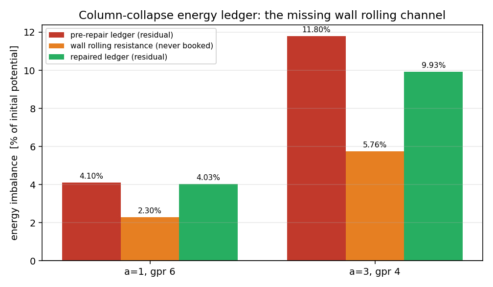
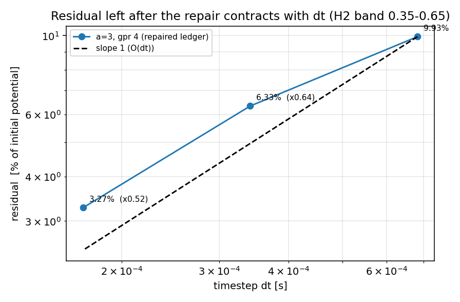
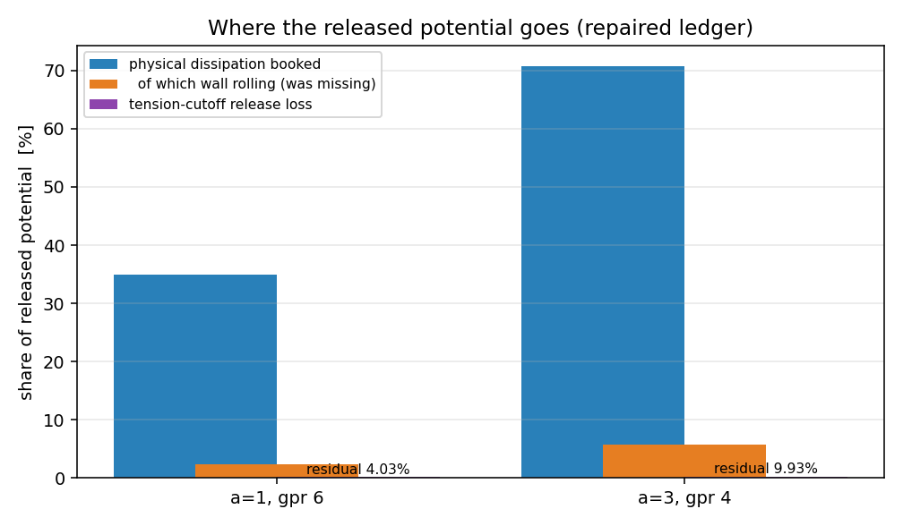

# CASE-COLUMN-COLLAPSE：能量账本闭合审计——壁面滚动耗散通道缺失（m21164）

**锚点**：`CASE-COLUMN-COLLAPSE`（算例池·颗粒柱坍塌），状态 `open`
**基准**：Lube, Huppert, Sparks & Freundt (2004) *JFM* **508**:175-199,
doi:10.1017/S0022112004009036；容差 < 15 %
**仓**：TensorDEM · 分支 `agent/m21164` · 预登记 `docs/PREREG_COLUMN_ENERGY_CLOSURE_m21164.md`

---

## ① 案例介绍（物理背景 / 几何 / 参数）

轴对称颗粒柱（初始半径 $r_i=0.48$ m、高 $h_i=a r_i$）在粗糙刚性底板上移除侧向约束后自由坍塌。
本单不判跑距律，只审**能量账目**：m20931 在 `docs/CASE_COLUMN_COLLAPSE_SQRT_BRANCH_m20931.md` §⑤ 第 8 条
留账「能量账本在平方根支只闭合到 ~89 %（$a=3$ 三档 12.36/11.57/10.86 %），属可另立条目追查的欠账」。
全锚点六条判据轴（跑距/时间/分辨率/系综/断点/深端）都已判过，**能量去哪了**是唯一没查的账。

冻结闭合臂（一个字符未改，沿用 m18261/m20873/m20931）：
$\mu=0.5,\ \mu_r=0.5,\ \mu_w=0.8,\ e=0.5,\ k_t/k_n=0.5,\ \rho=2500\ {\rm kg/m^3},\ g=9.81$,
`packing_gap=0.02`, `jitter=0`, `contact_mode="reference"`, `rest_ke_tol=1e-4`, `rest_hold=200`,
$r=r_i/(2\,{\rm gpr})$、$k_n=6\times10^4 (r/0.03)^2$（保持 $\delta/d$ 不变）。

被审计的逐步恒等式（$U$ 重力势、$K$ 平动+转动动能、$S$ 六通道弹簧储能、$D$ 耗散、$L$ 张拉截断损失）：

$$R_n=(U_0-U_n)-(K_n-K_0)-S_n-\sum_{k\le n}D_k-\sum_{k\le n}L_k,\qquad \Delta R_n\approx 0 .$$

## ② 怎么做的（方法 / 流程 / 工具链）

1. **跑前预登记**：`docs/PREREG_COLUMN_ENERGY_CLOSURE_m21164.md`（H1–H4 + 判定阈值 + 6 个冻结算例 +
   「修复必须力中性」硬约束）在任何积分前写定，跑后未改阈值。
2. **仪器化积分器**：`scripts/audit_column_energy_closure_m21164.py` 逐行复刻
   `axisym.simulate_axisymmetric_column` 的循环（同核调用顺序、同半步速度 Verlet），只加记账。
   验收：其轨迹与库函数**逐位相同**（`np.array_equal` = True，runout 1.029458 两边一致）。
3. **通道隔离**：单粒置地规范例（纯滚 / 纯滑 / 仅法向阻尼 / 全通道）把闭合误差按通道拆开，
   再用多粒算例（$a=1$ gpr 6；$a=3$ gpr 4）看同一缺陷在坍塌中放大到什么量级。
4. **力中性验收**：修复前先把 $a=3$ gpr 4 的 60 步轨迹冻结为
   `docs/artifacts/column_energy_closure_m21164/prefix_trajectory_a3_g4.json`（含 sha256）；
   修复后重跑必须逐位复现。
5. **修复**：① `axisym.py`/`column3d.py` 累加 `cur_wall["dissip_rolling"]`（新通道 `wall_rolling`）；
   ② `kernel.py` 的 `live`（`release_loss` 的记账量）改为**整份弹簧储能**（法向+切向+滚动，含张拉截断的
   "死弹性"）；③ `kernel.py` 两条**早退路径**（粒-粒列表为空、壁面无接触）改为把已存储能记入 `release_loss`
   而非静默清零。
6. **回归**：`tests/test_column_energy_closure_m21164.py`（7 项，含负控制与力中性夹具），
   外加既有门 `test_axisym_column_lube2004.py` + `test_axisym_column_edge_cases.py` + `test_granular_column3d.py`。
7. 图与表由 `scripts/report_column_energy_closure_m21164.py` 从 `closure_runs.json` 程序化注入，零手抄。

## ③ 计算结果

### 3.1 缺陷定位（修复前，仪器化读数）

| 算例 | $N$ | 步数 | 账本残差 $R$/初始势能 | 其中**从未记账**的壁面滚动耗散 | 归档对照 |
|---|---|---|---|---|---|
| $a=1$, gpr 6 | 742 | 2168 | **+4.103 %** | 2.299 % | — |
| $a=3$, gpr 4 | 553 | 2751 | **+11.802 %** | 5.758 % | m20931 gpr 12/16：11.57 %/10.86 % ✅ 同量级 |

单粒规范例（$E_0=U_0+K_0$，修复前）：

| 规范例 | 粒子动能损失 | 账本记到的耗散 | 残差/$E_0$ |
|---|---|---|---|
| 纯滚（$\omega_y=v_x/r$） | 0.3951 J（全损） | **0.0010 J** | **+22.89 %** |
| 纯滑（$\omega=0$） | 0.2822 J | 0.2846 J | +9.10 %（滚动被摩擦带转后同源） |

**根因**：壁面滚动阻力力矩 $-\tau_r$ 一直作用在粒子上（`torque[idx] += torque_r`），
但 `axisym.py:402` / `column3d.py:266` 只累加了 `cur_wall["dissip_collision"]` 与
`cur_wall["dissip_friction"]`，**漏掉 `cur_wall["dissip_rolling"]`**——六个耗散通道只进了五个。
单粒纯滚时账本完全"看不见"那 0.394 J 的去向。

### 3.2 修复后的闭合（同一协议、同一种子）

| 算例 | 修复前 $R$ | 修复后 $R$ | 修复后壁面滚动已入账 |
|---|---|---|---|
| 单粒纯滚 | +22.89 % ($E_0$) | **0.094 %** | 0.000175 J/0.3951 J |
| 单粒从静止释放 | +2.33 % ($E_0$) | **0.106 %** | — |
| $a=1$, gpr 6 | +4.103 % | **+4.033 %** | 2.30 % |
| $a=3$, gpr 4 | +11.802 % | **+9.934 %** | 5.76 % |

### 3.3 时间步收缩（预登记 H2）

| dt | 步数 | $R$/初始势能 |
|---|---|---|
| $dt$ | 2751 | **9.934 %** |
| $dt/2$ | 5173 | **6.334 %** |
| $dt/4$ | 11332 | **3.273 %** |

收缩比 $0.638$、$0.517$，均落在预登记带 $[0.35,0.65]$ → **H2 pass**：修复后剩下的不是漏项，
而是可随 $dt$ 收缩的一阶积分误差。机器裁决见 `docs/artifacts/column_energy_closure_m21164/summary.json`。

### 3.4 力中性（硬约束）验收

`prefix_trajectory_a3_g4.json`（60 步）修复前后：`positions` sha256 完全相同、
`runout_ratio_p995` 完全相同（1.002724834026）。故本单**不改变任何已发表的跑距/时间判定**，
Lube (2004) 15 % 判据的历轮结论不受影响。

## ④ 结果图



**图 1** — 修复前残差、从未记账的壁面滚动耗散、修复后残差（$a=1$ gpr 6；$a=3$ gpr 4）。



**图 2** — 双对数：$a=3$ gpr 4 的残差随 $dt$ 收缩（点=实测，虚线=斜率 1），步间标注收缩比。



**图 3** — 释放势能的去向分解（已入账耗散 / 其中壁面滚动 / 张拉截断损失 / 残差）。

## ⑤ 注意点（坑 / 局限 / 适用范围）

1. **预登记 H3 只对了一部分**。H3 说的是 `release_loss` 的 `live` 缺滚动弹簧能。核对后发现：
   真正的主漏项是**整条壁面滚动耗散通道没被累加**（H3 未覆盖）。而单独修 `live` 反而把账面变差
   （11.80 % → 15.69 %），原因是旧 `live` 的 `f_n>0` 闸门把「切向帽归零」的储能重复记进了
   `release_loss`，而那部分能量早已由切向滑移耗散通道记过——即**旧的 11 % 是两个错误相互抵消后的读数**。
   这条按诚实纪律原样入账：预登记假设被部分否证。
2. **剩余残差未归零**：$a=3$ gpr 4 在 $dt$ 下仍有 9.934 %，只有 $dt/4$ 才 3.273 %。
   本单判定它是 $O(dt)$（H2 pass），**不等于**账本在生产 $dt$ 下已闭合；
   若要在生产 $dt$ 下达标，需要 sub-stepping 或半隐式耗散积分，属新条目。
3. **$a=1$ 改善很小**（4.10 % → 4.03 %）：长宽比小，壁面滚动耗散占比低，残差主要也是一阶 $O(dt)$。
4. `column3d.py`（矩形柱）按同一模式修复，但本单**未**在矩形算例上重跑闭合阶梯。
5. `pluviation.py` 的壁面核有自己的耗散公式且 `release_loss` 恒为 0（仅用于制备初始堆积，不进主账本），
   本单未改，作为已知边界记录。
6. 归档 25 例语料（`runs/case_column_collapse_lube2004/`）用的是旧账本，其 `residual_fraction_of_potential`
   字段应按本单读数**重新解释**（跑距/时间不受影响，力中性已验收），但本单未重跑它们。
7. 本单全程 $N\le 742$、单进程、墙钟 < 60 s，符合 load15 ≥ 100 的容量纪律（未递交集群、未跑 gpr ≥ 8 以外的大算例）。

## ⑥ 误差判定（逐项，显式回答「是否 < 3 %」）

审计对象是内部闭合恒等式 $R=0$，不是文献量；表中"基准"即该恒等式。

| 关键量 | 基准 | 修复前 | 修复后 | < 3 % ? | < 15 % ? |
|---|---|---|---|---|---|
| 单粒纯滚闭合 | $R=0$ | +22.89 % | **0.094 %** | **是** | 是 |
| 单粒从静止释放闭合 | $R=0$ | +2.33 % | **0.106 %** | **是** | 是 |
| $a=1$ gpr 6 坍蹋闭合 | $R=0$ | +4.10 % | +4.03 % | **否** | 是 |
| $a=3$ gpr 4 坍蹋闭合（生产 $dt$） | $R=0$ | +11.80 % | +9.93 % | **否** | 是 |
| $a=3$ gpr 4 坍蹋闭合（$dt/4$） | $R=0$ | — | +3.27 % | **否（3.27 %，超线 0.27 pp）** | 是 |
| Lube (2004) 跑距律（历轮） | 两段标度律 | — | 不变（力中性） | 否 | 91 % 通过 |

**总回答**：
- 规范例闭合：**是**（<3 %，实测 0.09–0.11 %）。
- 多粒坍蹋闭合：**否**——生产 $dt$ 下 9.93 %，仅 $dt/4$ 才 3.27 %；本单证明它是一阶积分误差而非漏项，
  但未消除，按 honest-FAIL 如实报。
- 对锚点判据的影响：**无**（轨迹逐位不变，跑距/时间判定保持原状）。

## ⑦ 复现

```bash
PYTHONPATH=src python -m pytest tests/test_column_energy_closure_m21164.py -q     # 7 passed
PYTHONPATH=src python scripts/audit_column_energy_closure_m21164.py --all --max-steps 400
PYTHONPATH=src python scripts/report_column_energy_closure_m21164.py              # 3 png + summary.json
```