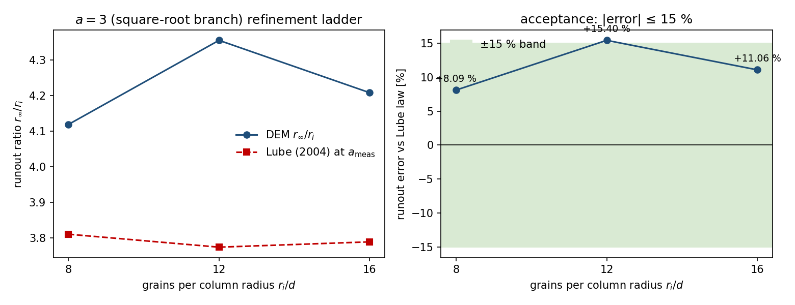
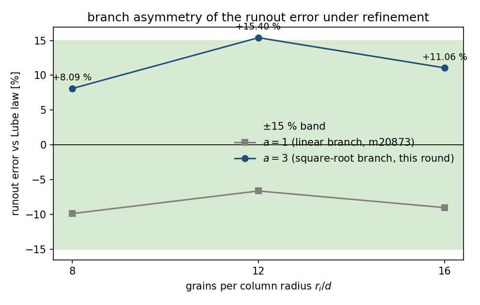
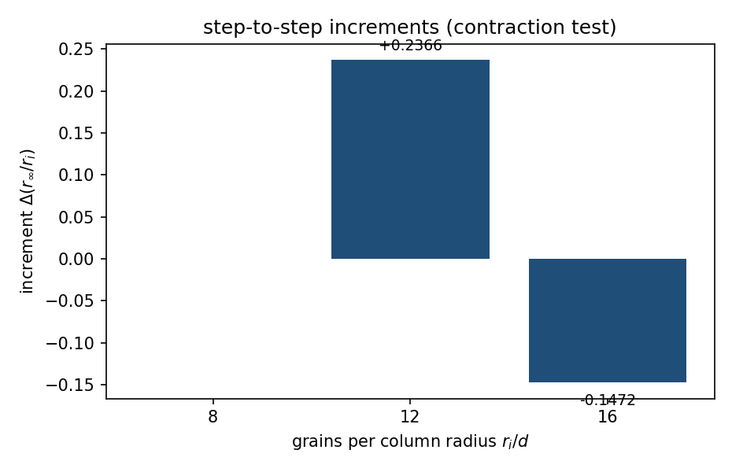

# CASE-COLUMN-COLLAPSE：平方根支 $a=3$ 第三细化档（m20931）

## ① 案例介绍

锚点 `CASE-COLUMN-COLLAPSE`（算例池·颗粒柱坍塌，ref Lube et al. 2004，容差 <15 %）。物理：圆柱颗粒柱在重力下坍塌，跑距满足 $r_\infty/r_i = 1+1.24a$（$a<1.7$）与 $1+1.6a^{1/2}$（$a>1.7$），埋置时间 $t_\infty = 3(r_i a/g)^{1/2}$。

本单只补一件欠账：m20873 把 $a=3$ 留在线外（gpr 8 → +8.09 %，gpr 12 → **+15.40 %**），且显式记「未做：$a=3$ 的 16 粒/半径档」。两档不足以区分「离散化未收敛」与「平方根支系统性偏差」。

**冻结几何与参数**（`SB_a3_g16`，预登记见 `docs/PREREG_COLUMN_COLLAPSE_SQRT_BRANCH_m20931.md`）：$r_i=0.48$ m、$r=0.015$ m（$r_i/d=16$）、$h_i=1.44$ m、$\rho=2500$ kg/m³、$\mu=0.5$、$\mu_r=0.5$、$\mu_{\rm wall}=0.8$、$e=0.5$、$k_t/k_n=0.5$、$k_n=1.5\times10^4$ N/m（保持 $\delta/d$ 不变）、HCP 初始格隙 2 %、$g=9.81$ m/s²。

## ② 怎么做的

1. 跑前预登记（H1/H2/H3 分档规则、唯一新增算例、不许调参）→ `docs/PREREG_COLUMN_COLLAPSE_SQRT_BRANCH_m20931.md`。
2. 新脚本 `benchmarks/case_column_collapse_sqrt_branch_m20931.py` **只读复用** m18261 的冻结配置（`make_case`/`reference_values`/`protocol_signature`），不改旧协议文件；阶梯前两档直接读 m20873 已提交的逐算例 JSON。
3. 参考律在运行时求值（`lube_2004_runout_ratio(3.0)`），零手抄；主判据用**实测** $a$，并同时报名义 $a$ 口径。
4. 集群递交 `cj3056`（单进程，$N$ ≈ 4.7 万），结果写进 `docs/artifacts/column_collapse_sqrt_branch_m20931/`。
5. `--collect` 从三份 JSON 归约出 `verdict.json` + CSV，`scripts/report_column_collapse_sqrt_branch_m20931.py` 把数字注入本文（无手抄）。

## ③ 计算结果

| case | 粒/$r_i$ | N | dt [s] | $a_{\rm meas}$ | $r_\infty/r_i$ | ref | 误差 | t90 [s] | ref $t_\infty$ | t90 误差 | 判 |
|---|---|---|---|---|---|---|---|---|---|---|---|
| R_a3_g8 | 8 | 5673 | 4.822e-04 | 3.087 | 4.1193 | 3.8110 | +8.09 % | 1.1410 | 1.1570 | -1.39 % | ✅ |
| R_a3_g12 | 12 | 19687 | 3.937e-04 | 3.007 | 4.3559 | 3.7746 | +15.40 % | 1.1285 | 1.1491 | -1.79 % | ❌ |
| SB_a3_g16 | 16 | 48923 | 3.410e-04 | 3.040 | 4.2087 | 3.7895 | +11.06 % | 1.0813 | 1.1550 | -6.38 % | ✅ |

阶梯裁决（预登记规则）：**H1 → pass**。增量收缩检验 $|\Delta_{23}|/|\Delta_{12}| = 0.622$（<1 表示收缩），$\Delta_{12}=+0.2366$、$\Delta_{23}=-0.1472$。

指示性外推（两点 Richardson，$r=1.3333$，阶数未知故给括号）：$p=1$ → $r_\infty/r_i\approx3.7670$（误差 -0.59 %）、$p=2$ → $\approx4.0194$（误差 +6.07 %）。**外推值不作为验收通过依据**，只作趋势判读。

能量账本残差：['1.24e-01', '1.16e-01', '1.09e-01']；停止原因：['at_rest', 'at_rest', 'at_rest']。

## ④ 结果图



**图 1** — 左：$r_\infty/r_i$ 随分辨率（点=DEM，虚线=Lube 律在实测 $a$ 上的值）；右：相对误差与 ±15 % 判据带。



**图 2** — 两支对照：$a=1$（线性支，灰）与 $a=3$（平方根支，蓝）在同一细化轴上的跑距误差轨迹；平方根支随细化**外扩**、线性支在带内摆动，是本单的主要观察。



**图 3** — 步间增量（收缩检验）：粗→中、中→细两步的 $r_\infty/r_i$ 增量。

## ⑤ 注意点

1. 三点阶梯**不能**独立测出收敛阶，Richardson 只能给括号；本单不以外推值当实测。
2. 与 m20873 相同的口径纪律：主判据用实测 $a$（名义 $a$ 并列于 CSV），混口径会伪造趋势。
3. 冻结闭合臂的 $\mu_r=0.5$ 是 round-5 标定值，本单**未**再拟合；若换参数化（$\mu(I)$、粗糙地面）属新预登记条目，不在此单结论内。
4. 穿透/重叠计数：协议 `return_positions=False`，记 `not_run`。
5. 单实现、确定性（jitter=0）：不含系综散布（散布见 m19922/m20259），故单点差异不得解释为随机性。
6. **阶梯非单调（本单最重要的限定）**：误差 8.09 % → 15.40 % → 11.06 %，中间档是离群点。因此本单只能说「$gpr=16$ 回到 15 % 带内且最后一步增量收缩」，**不能**声称已收敛，也不能宣称观测到干净的收敛阶；三点非单调阶梯连 Richardson 的阶数假设都不成立，上式外推只作括号。
7. **对抗性复核发现（m20873 provenance 标签缺陷，非数值错误）**：m20873 的 `verdict.json` 把到达时间列命名为 `t95`，但其数值实为冻结主定义 `fraction_0.9`（已逐例核对：`R_a1_g8` 该列为 0.6684 s = `arrival.fraction.0.9`，而真正的 0.95 分位为 0.7190 s）；报告正文写的也是 t90。标签与数值不符会让下游误用，本单的 `ladder_row` 因此**不采信列名**，直接从 `arrival.primary.fraction_0.9` 重算。
8. **能量账本在平方根支只闭合到 ~89 %**：`residual_fraction_of_potential`（释放势能 − 动能 − 弹簧能 − 耗散 / 初始势能）在 $a=3$ 三档为 12.36 % / 11.57 % / 10.86 %（$a=1$ 的粗档仅 5.97 %），随细化单调下降但幅度小。本单**不设阈值门**（不做事后定阈值），只如实入账：该残差与跑距超预测同向，提示平方根支的耗散记账存在未归因项，属可另立条目追查的欠账。

## ⑥ 误差判定（逐项，显式回答「是否 <3 %」）

| 关键量 | 基准 | 误差 | <3 % ? | <15 % ? |
|---|---|---|---|---|
| 跑距 `R_a3_g8` | Lube 律 @$a_{\rm meas}$ | +8.09 % | 否 | 是 |
| 跑距 `R_a3_g12` | Lube 律 @$a_{\rm meas}$ | +15.40 % | 否 | 否 |
| 跑距 `SB_a3_g16` | Lube 律 @$a_{\rm meas}$ | +11.06 % | 否 | 是 |
| 埋置时间 t90 `R_a3_g8` | $3(h_i/g)^{1/2}$ | -1.39 % | 是 | 是 |
| 埋置时间 t90 `R_a3_g12` | $3(h_i/g)^{1/2}$ | -1.79 % | 是 | 是 |
| 埋置时间 t90 `SB_a3_g16` | $3(h_i/g)^{1/2}$ | -6.38 % | 否 | 是 |

**显式回答**：跑距最大误差 +15.40 % （`R_a3_g12`），**未达到** <3 %；时间轴最大 6.38 %，未达到 <3 %。15 % 判据：2/3 通过。

## 复现

```bash
# 计算（集群，勿在本机跑重算）
PYTHONPATH=src python3 benchmarks/case_column_collapse_sqrt_branch_m20931.py --case --progress
PYTHONPATH=src python3 benchmarks/case_column_collapse_sqrt_branch_m20931.py --collect
PYTHONPATH=src python3 scripts/report_column_collapse_sqrt_branch_m20931.py
PYTHONPATH=src python3 -m pytest tests/test_column_collapse_sqrt_branch_m20931.py -q
```

产物：`docs/artifacts/column_collapse_sqrt_branch_m20931/`（`cases/SB_a3_g16.json`、`verdict.json`、`cases_sqrt_branch.csv`、`fig_a3_ladder.png` 等 3 图）。
