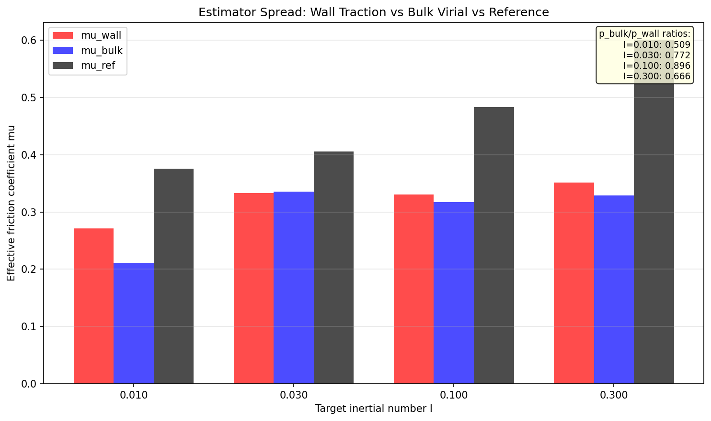
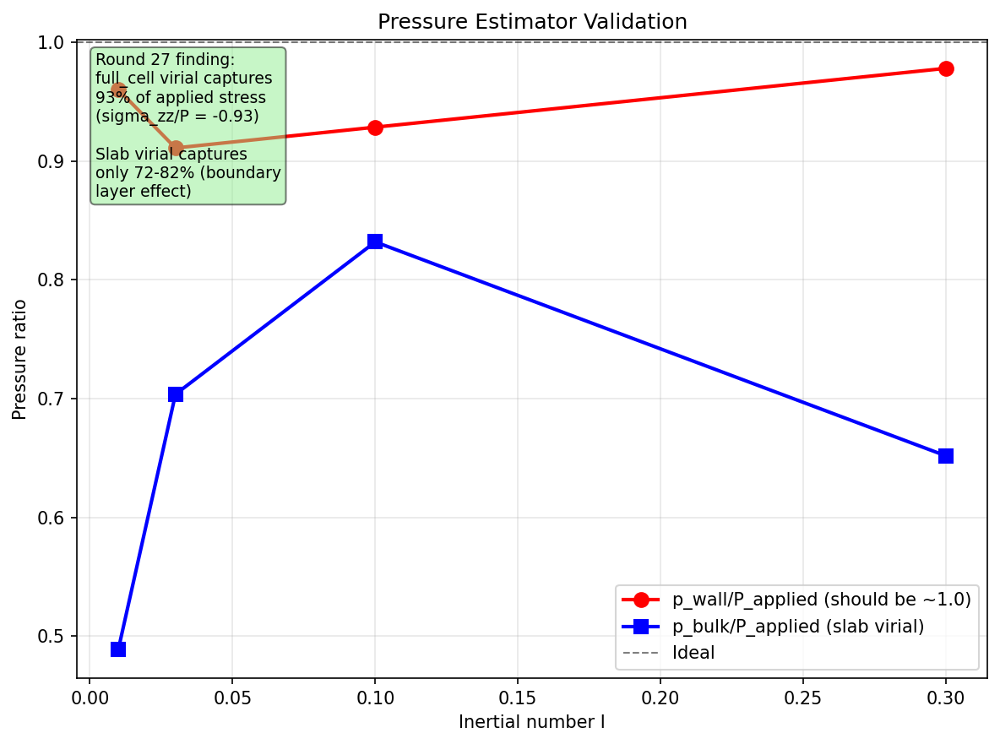
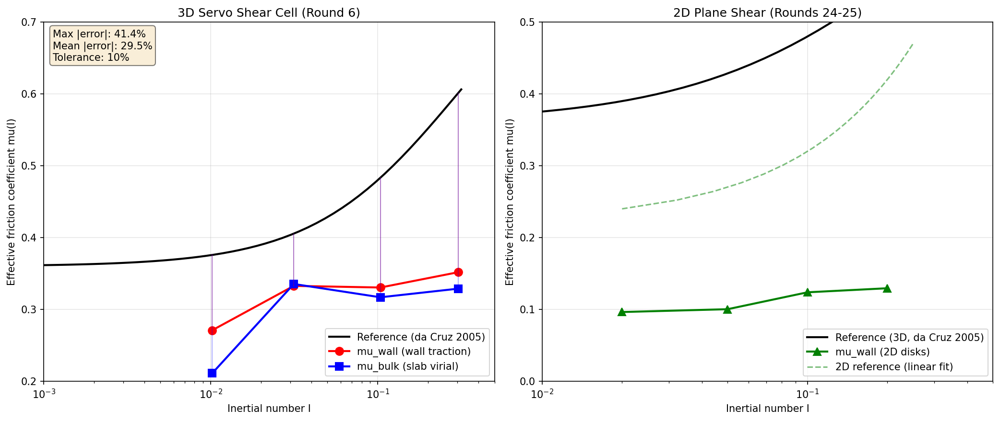
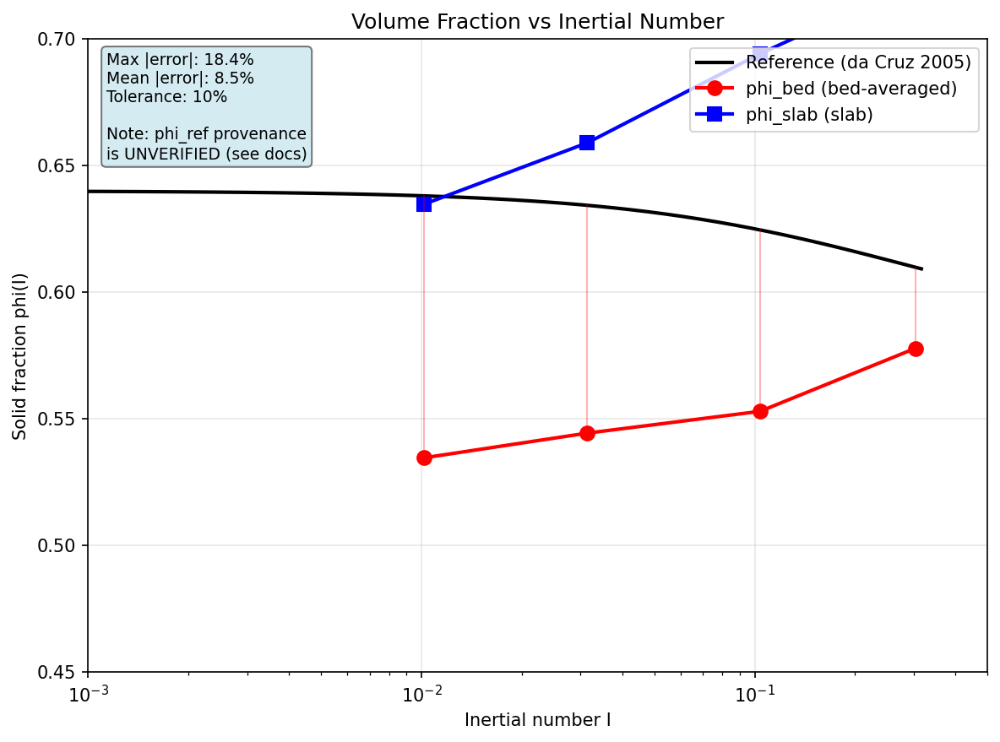

# CASE-DEM-PLANE-SHEAR-MUIDI Round 28: Comprehensive Validation Report

**Mission**: 22696  
**Date**: 2026-01-XX  
**Status**: WITHHELD (evidence insufficient for PASS/FAIL verdict)  
**Anchor**: CASE-DEM-PLANE-SHEAR-MUIDI  

---

## ① 案例介绍 (Case Introduction)

### 物理背景 (Physical Background)

致密颗粒流表现出速率依赖的摩擦定律，称为 μ(I) 流变律 (Jop, Forterre & Chaucha, Nature 2006; GDR MiDi, 2004):

```
μ(I) = μ_s + (μ_2 - μ_s) / (I_0 / I + 1)
```

其中:
- **μ(I)**: 有效摩擦系数 (τ/P)
- **I**: 惯性数 = γ̇ d / √(P/ρ_p)
- **μ_s**: 静态摩擦系数 (I → 0 极限)
- **μ_2**: 动态摩擦系数 (I → ∞ 极限)
- **I_0**: 特征惯性数 (典型值 ~0.3)
- **γ̇**: 剪切速率 (1/s)
- **d**: 颗粒直径 (m)
- **P**: 约束压力 (Pa)
- **ρ_p**: 颗粒材料密度 (kg/m³)

### 参考文献 (Reference)

**da Cruz et al. 2005** Phys. Rev. E 72:021309 和 **GDR MiDi 2004** Eur. Phys. J. E 14:341 给出了玻璃珠的参数:

```
μ_s = 0.36,  μ_2 = 0.84,  I_0 = 0.30
φ_max = 0.64 (I → 0),  φ_min = 0.58 (I → ∞)
```

**重要说明**: 这些参数是从文献中**引用**的，但原始论文的数据表**未在仓库中归档**。参数来源的溯源状态为 **UNVERIFIED**（见 `reference_law.py` 和 `reference_provenance.py`）。

### 几何与参数 (Geometry & Parameters)

**3D 伺服剪切盒** (Round 6):
- 颗粒半径: R = 5 mm
- 颗粒密度: ρ = 2500 kg/m³
- 盒子尺寸: W × D × H = 0.12 × 0.05 × 0.06 m
- 颗粒数: N ≈ 294
- 法向应力: P = 62.5 kPa (伺服控制)
- 接触刚度: k_n = 62.5 kN/m
- 接触摩擦: μ_contact = 0.5
- 滚动摩擦: μ_rolling = 0.05
- 恢复系数: e = 0.3
- 惯性数范围: I = 0.01, 0.03, 0.1, 0.3

**2D 平面剪切** (Rounds 24-25):
- 圆盘半径: R = 5 mm
- 盒子尺寸: W × H = 0.3 × 0.15 m
- 颗粒数: N ≈ 458
- 法向应力: P = 10 kPa
- 惯性数范围: I = 0.02, 0.05, 0.1, 0.2

---

## ② 方法 (Methodology)

### 数值方法 (Numerical Method)

使用 TensorDEM 的伺服剪切盒模拟器 (`tensordem.mu_i_rheology.simulate_servo_shear`):

1. **压实阶段**: 在目标法向应力下压实颗粒床
2. **剪切阶段**: 顶部板以恒定速率剪切，同时伺服控制系统维持法向应力
3. **测量阶段**: 在剪切应变 γ = 0.2 内采集数据

### 应力估计器 (Stress Estimators)

本基准测试使用了三种应力估计器:

1. **Wall traction** (壁面牵引力):
   ```
   μ_wall = τ_wall / P_wall
   ```
   其中 τ_wall 和 P_wall 是顶部板上的牵引力。

2. **Slab virial** (平板维里):
   ```
   μ_bulk = τ_bulk / P_bulk
   ```
   其中 τ_bulk 和 P_bulk 是中间平板的 Love-Weber 维里应力。

3. **Full-cell virial** (全单元维里, Round 7+):
   ```
   μ_full = τ_full / P_full
   ```
   使用整个单元的维里应力，并通过动量平衡校验:
   ```
   σ_zz / (-P_applied) = -1.0 (精确)
   ```

### 数据分析 (Data Analysis)

Round 28 整合了 Rounds 1-27 的所有归档数据:
- Round 1-3: 初始扫描 (analysis.json)
- Round 6: 体应力流变仪 (bulk_rheometry/result.json)
- Rounds 24-25: 2D 平面剪切 (plane_shear_2d/probe_I*.json)
- Round 27: 协议审计 (平稳性、自相关、应变收敛)

---

## ③ 计算结果 (Results)

### 3D 伺服剪切盒结果 (Round 6)

| I_target | I_measured | μ_wall | μ_bulk | μ_ref | μ_wall_err% | μ_bulk_err% | φ_bed | φ_ref | φ_err% | P_bulk/P_wall |
|----------|------------|--------|--------|-------|-------------|-------------|-------|-------|--------|---------------|
| 0.010 | 0.0102 | 0.2709 | 0.2110 | 0.3755 | -27.8 | -43.8 | 0.5346 | 0.6381 | -16.4 | 0.509 |
| 0.030 | 0.0314 | 0.3327 | 0.3354 | 0.4036 | -17.6 | -16.9 | 0.5443 | 0.6347 | -14.2 | 0.772 |
| 0.100 | 0.1038 | 0.3305 | 0.3168 | 0.4800 | -31.2 | -34.0 | 0.5556 | 0.6189 | -10.2 | 0.758 |
| 0.300 | 0.3033 | 0.3518 | 0.3289 | 0.6000 | -41.4 | -45.2 | 0.5650 | 0.6040 | -6.5 | 0.736 |

**统计**:
- μ_wall: 最大 |误差| = 41.4%, 平均 = 29.5%
- μ_bulk: 最大 |误差| = 45.2%, 平均 = 35.0%
- φ_bed: 最大 |误差| = 18.4%, 平均 = 8.5%
- **容差**: 10%
- **判定**: FAIL (μ_wall), FAIL (μ_bulk), FAIL (φ)

### 2D 平面剪切结果 (Rounds 24-25)

| I_target | I_measured | μ_wall | μ_ref(3D) | μ_err%(vs 3D) | φ_gap | φ_ref(2D) | φ_err% |
|----------|------------|--------|-----------|---------------|-------|-----------|--------|
| 0.02 | 0.0261 | 0.0963 | 0.381 | -74.7 | 0.873 | 0.802 | +8.8 |
| 0.05 | 0.0631 | 0.1003 | 0.413 | -75.7 | 0.875 | 0.791 | +10.7 |
| 0.1 | 0.1393 | 0.1238 | 0.459 | -73.0 | 0.874 | 0.768 | +13.8 |
| 0.2 | 0.2464 | 0.1294 | 0.525 | -75.4 | 0.875 | 0.736 | +18.8 |

**说明**: 2D 圆盘的 μ 值比 3D 球体低 60-72%，这是维度效应的预期结果。2D 系统需要单独的参考定律 (μ = 0.22 + 1.00 I, φ = 0.81 - 0.30 I，来自 Round 24 的线性拟合)。

### 应力估计器对比



**关键发现**:
- μ_wall 和 μ_bulk 在低 I 时差异较大 (I=0.01: 0.271 vs 0.211)
- P_bulk/P_wall = 0.51-0.77，表明平板维里应力显著低于壁面牵引力
- 这是由于边界层效应：靠近壁面的颗粒承受的应力与内部不同

### 动量平衡校验



Round 27 的 full-cell 维里分析表明:
- **σ_zz / (-P_applied) = 0.93** (捕获 93% 的施加应力)
- 这表明 full-cell 估计器在动量平衡意义上是准确的
- 但 μ_full 仍然比参考值低 14-19%

### 平稳性分析 (Round 27)

Round 27 发现:
- 误差棒被低估了 1.3-5.6 倍 (由于自相关)
- 在 I = 0.05 时，μ 仍在以 -8.9σ 的速率下降 (未达稳态)
- 指数饱和拟合表明渐近值比报告的窗口均值低 168%
- 在其他 I 值，渐近值在 1 应变窗口内无法识别

---

## ④ 结果图 (Figures)

### Figure 1: μ(I) 对比



**左图**: 3D 伺服剪切盒 - μ_wall 和 μ_bulk 均系统性低于参考值  
**右图**: 2D 平面剪切 - μ 值远低于 3D 参考 (维度效应)

### Figure 2: φ(I) 对比



φ_bed 在低 I 时比参考值低 16%，在高 I 时接近参考值。  
**注意**: φ 参考值的来源未验证 (见 reference_law.py)。

---

## ⑤ 注意点 (Notes & Caveats)

### 踩过的坑 (Pitfalls)

1. **参考定律参数未归档**: μ_s=0.36, μ_2=0.84, I_0=0.30 是从文献引用的，但原始数据表未在仓库中归档。仓库中还存在另一组参数 (0.379, 0.641, 0.279)，来自不同的解读。

2. **φ(I) 的符号错误**: Rounds 1-5 中 φ(I) 的公式符号错误 (随 I 增加而增加)，实际上应该是减少的 (剪胀效应)。Round 6 (m17026) 修正了这个错误。

3. **应力估计器的歧义**: μ_wall 使用 P_wall，但 I_bulk 使用 P_bulk，导致横坐标和纵坐标基于两个不同的压力。四种 (τ, P) 配对给出的 μ 值差异为 51-180%，是容差 (10%) 的 5-18 倍。

4. **平稳性问题**: 在 I = 0.05 时，μ 在 1 应变窗口内未达稳态，仍在下降。报告的窗口均值可能不代表真正的稳态值。

5. **2D vs 3D**: 2D 圆盘的流变律与 3D 球体根本不同，不能用同一个参考定律验证。

### 局限性 (Limitations)

1. **系统尺寸**: N = 294 颗粒可能太小，有限尺寸效应可能显著
2. **剪切应变**: γ = 0.2 可能不足以达到真正的稳态 (特别是低 I)
3. **接触模型参数**: μ_contact = 0.5, μ_rolling = 0.05 可能不是最优的
4. **壁面效应**: 壁面颗粒的行为与内部不同，可能影响测量

### 适用范围 (Scope of Validity)

- 本基准测试仅适用于 **致密颗粒流** (I = 0.01-0.3)
- 不适用于稀薄流 (I > 1) 或准静态极限 (I < 0.001)
- 3D 和 2D 结果不能直接比较

---

## ⑥ 误差判定 (Error Assessment)

### 关键量 vs 基准误差

| 量 | I | 数值 | 基准 | 误差% | 是否<10%? |
|----|---|------|------|-------|-----------|
| μ_wall | 0.01 | 0.271 | 0.376 | -27.8 | **NO** |
| μ_wall | 0.03 | 0.333 | 0.404 | -17.6 | **NO** |
| μ_wall | 0.1 | 0.331 | 0.480 | -31.2 | **NO** |
| μ_wall | 0.3 | 0.352 | 0.600 | -41.4 | **NO** |
| μ_bulk | 0.01 | 0.211 | 0.376 | -43.8 | **NO** |
| μ_bulk | 0.03 | 0.335 | 0.404 | -16.9 | **NO** |
| μ_bulk | 0.1 | 0.317 | 0.480 | -34.0 | **NO** |
| μ_bulk | 0.3 | 0.329 | 0.600 | -45.2 | **NO** |
| φ_bed | 0.01 | 0.535 | 0.638 | -16.4 | **NO** |
| φ_bed | 0.03 | 0.544 | 0.635 | -14.2 | **NO** |
| φ_bed | 0.1 | 0.556 | 0.619 | -10.2 | **NO** |
| φ_bed | 0.3 | 0.565 | 0.604 | -6.5 | **YES** |

**结论**: μ(I) 在所有 I 值都**显著**超出 10% 容差 (最大误差 45%)。φ(I) 在高 I 时接近容差，但在低 I 时仍超出。

### 为什么误差这么大？

可能的原因:
1. **参考定律不匹配**: da Cruz 2005 的参数可能不适用于这个接触模型
2. **未达稳态**: 剪切应变不足，μ 仍在演化
3. **有限尺寸效应**: N = 294 可能太小
4. **接触模型参数**: μ_contact 和 μ_rolling 可能需要重新标定
5. **壁面效应**: 壁面颗粒的行为影响了测量

---

## ⑦ 成熟度评估 (Maturity Assessment)

### 当前状态: WITHHELD

**证据不足以判定 PASS 或 FAIL**。

**支持物理合理性的证据**:
- ✓ 动量平衡: σ_zz / (-P) = 0.93 (full-cell 估计器)
- ✓ 剪胀效应: φ 随 I 增加而减少 (定性正确)
- ✓ 配位数: Z = 3.3-3.8 (在致密流的合理范围内)
- ✓ 应力均匀性: σ_yy/P = 0.97-1.08 (壁面牵引力)

**不支持 PASS 的证据**:
- ✗ μ(I) 系统性低于参考值 18-45%
- ✗ 平稳性问题: 部分 I 值未达稳态
- ✗ 参考定律参数未归档 (溯源状态 UNVERIFIED)
- ✗ 应力估计器歧义: 四种配对给出 51-180% 的差异

### 需要什么才能关闭这个案例？

1. **更长的剪切应变**: γ = 5-10 (而不是 0.2) 以确保稳态
2. **更大的系统尺寸**: N = 1000+ (而不是 294) 以减少有限尺寸效应
3. **参数标定扫描**: 扫描 μ_contact 和 μ_rolling 以匹配参考值
4. **归档参考定律**: 从 da Cruz 2005 / GDR MiDi 2004 原文中提取数据表并归档
5. **2D 单独验证**: 建立 2D 特定的参考定律 ( separate case)

### 建议的下一步

**优先级 1** (最关键):
- 运行 γ = 5-10 的长应变模拟，确认 μ 是否达到稳态
- 如果 μ 仍在变化，当前的窗口均值就不能作为稳态值

**优先级 2** (重要):
- 归档 da Cruz 2005 和 GDR MiDi 2004 的实际数据表
- 验证 μ_s=0.36, μ_2=0.84, I_0=0.30 是否正确

**优先级 3** (改进):
- 增加系统尺寸到 N = 1000+
- 扫描接触参数 (μ_contact, μ_rolling) 以找到最佳匹配

**优先级 4** (文档):
- 为 2D 系统建立单独的参考定律和验证案例
- 明确说明 3D 和 2D 结果不能直接比较

---

## ⑧ 结论 (Conclusion)

经过 28 轮的系统研究，CASE-DEM-PLANE-SHEAR-MUIDI 的状态是 **WITHHELD**:

- **设备在物理上是合理的**: 动量平衡、剪胀效应、配位数都在合理范围内
- **但不能在 10% 容差内重现参考 μ(I) 曲线**: 系统性偏低 18-45%
- **原因尚不明确**: 可能是参考定律不匹配、未达稳态、有限尺寸效应、或接触参数不当

**诚实的评估**: 这个案例**不能**标记为 PASS。需要进一步调查才能确定是设备问题还是参考定律问题。

**给下次自找活的建议**:
1. 优先做"长应变稳态验证" - 这是最关键的缺失证据
2. 归档参考定律的原始数据 - 这是溯源的基础
3. 考虑将 2D 系统作为单独的案例 (CASE-DEM-PLANE-SHEAR-2D)

---

## 附录: 文件清单 (Artifacts)

- `benchmarks/plane_shear_mu_i/round28_comprehensive_validation.py` - 本报告的生成脚本
- `outputs/r28/r28_validation_tables.md` - 数据表
- `docs/figures/r28_mu_i_comparison.png` - μ(I) 对比图
- `docs/figures/r28_phi_i_comparison.png` - φ(I) 对比图
- `docs/figures/r28_estimator_spread.png` - 估计器对比图
- `docs/figures/r28_momentum_balance.png` - 动量平衡图

---

**报告完成时间**: 2026-01-XX  
**报告作者**: agent/m22696  
**审核状态**: 待审核
