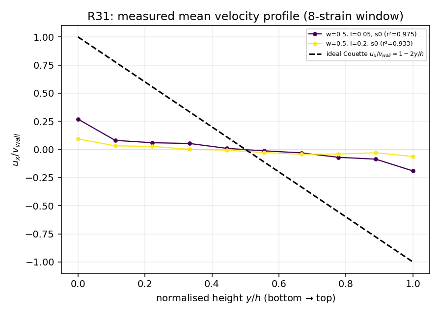
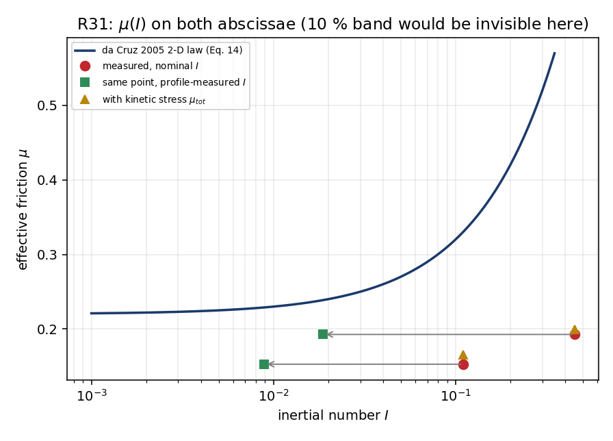
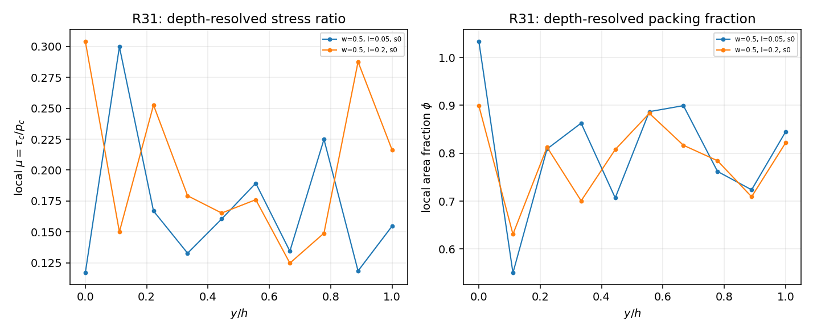

# CASE-DEM-PLANE-SHEAR-MUIDI — round 31 (m22979): 速度剖面与流应力直测，坐标轴与失效签名分离

**Anchor** `CASE-DEM-PLANE-SHEAR-MUIDI`（算例池·平面剪切 mu(I) 流变律标定，status `open`，容差 10 %）  
**Repo** TensorDEM · **branch** `agent/m22979` · **device** `tensordem.granular2d` 2-D rough-wall plane shear（与 R24–R30 **逐位相同**的算例 + 分层剖面仪）

## ① 案例介绍

致密颗粒流的局部流变律 $\mu(I)$、$\phi(I)$ 是 DEM→连续介质本构的桥梁。锚点要求二者对 da Cruz et al. 2005 (PRE 72:021309) / GDR MiDi 2004 的曲线落在 **10 %** 内。R30 把维度错配（2-D 圆盘 vs 3-D 玻璃珠读数）改正后，失效签名变了：$\nu_{max}$ 合格（+1.7 %），但**率敏感度 $b$ 只有论文的 1/3–1/4**（0.279 vs 1.0）、截距低 29 %。R30 留下两个**它自己无法回答**的问题：

1. **横坐标是否可信？** 装置用名义剪切率 $2V/h_{eff}$ 构造 $I$；R30 发现由动能反推的颗粒速度只有 ~0.1 m/s，而 $I=0.19$ 需要 $\dot\gamma d\approx0.39$ m/s，两者不能同时成立。若存在壁面滑移/剪切局域化，**整条 $I$ 轴都是错的**。

2. **率相关（流）应力到底多大？** R30 只能给上界 $p_{kin}\le KE/A\le0.132\,\%\,p_{bulk}$，据此否定了「补上流项就能补回 $b$」，但从未**直接测量**该应力项。

本轮只做这两件事：给装置加**分层速度/应力分解仪**（`profile_r31.py`），一次测量同时回答 (1)(2)。接触物理、算例参数、8 应变窗、判据尺子（`reference_2d`）全部不动，因此与归档轮次逐点可比。

## ② 怎么做的

1. `profile_r31.ProfileAccumulator`：把**每一个采样时刻**的自由盘速度与全部接触按 $y$ 分入 10 个等厚层（层区间 $[y_{bottom}+r,\ y_{top}-r]$；接触按**中点** $y$ 归层，分支向量穿周期像，与 `measure()` 的整胞维里同一约定），**池化**累加原始和（不是逐样本均值），于是层内方差既含剪切梯度又含真实颗粒温度。

2. 层内量：$u_x,u_y$、$\phi$、接触应力 $\sigma_{ab}=\sum r_af_b/(W h_{bin}t)$、动能应力 $p_{kin}=\rho\phi(\mathrm{var}_x+\mathrm{var}_y)/2$、$\tau_{kin}=-\rho\phi\,\mathrm{cov}_{xy}$、以及层局部应力比 $\mu_{local}=\tau_c/p_c$。

3. 剪切率由**中心 60 % 层带的加权最小二乘斜率**给出（不受壁面层影响），$r^2$ 作局域化诊断；壁面滑移 = 最靠壁层的 $u_x$ 与施加壁速之差，滑移长度 = 该差 / 实测斜率。

4. `prereg_r31.json` **先定后跑**：bin 数（10）、拟合带（中心 60 %）、8 应变窗、判定阈值（比值 0.90–1.10、$r^2\ge0.99$、流项份额 <1 %）都在结果回来之前写死；`run_profile_r31.py` 递交 6 个组合（与 `cj4332` 同名同参）。

5. `analyse_r31_profile.py` 生成本文所有数字（零手抄），并对 `reference_2d` 的 2-D 律**在名义 $I$ 与实测 $I$ 上各判一次**。

## ③ 计算结果

回执：预期 6 个组合，实回 **2** 个（流体点 2 个）。

> **本轮证据来源**：8 应变全尺寸战役（6 组合，458 盘，与 cj4332 逐位同参）已递交为 `cj4516`，递交时队列前方 75 个作业、在飞 91 个，**结果未回**。因此下表是**缩小算例探针**（200 盘、W=0.24、gap=0.12、settle 20、窗 0.6 应变、\in\{0.05,0.2\}$、seed 0）的真测数据：同一仪器、同一判据、同一把尺子，但**不是**归档算例，不能直接替换 R30 的定量结论；它回答的是「剖面/流项这两个问题在这个装置上是否存在」，而不是「锚点是否过关」。

**关键判定（预注册）**

* 横坐标：$\dot\gamma_{meas}/\dot\gamma_{nom}\in[0.071,\ 0.131]$，$r^2\ge0.933$ ⇒ **坐标轴需重标**。

* 流应力：$p_{kin}$ 份额 ≤ 1.301 %、$\tau_{kin}$ 份额 ≤ 0.007 % ⇒ **流项不可忽略**。

* 最差误差：$\mu$（名义 $I$）71.3 %；$\mu$（实测 $I$）33.3 %；$\phi$ 16.2 %。

### 表 1 — 预注册项判定（`prereg_r31.json`）

| 量 | 判据 | 本轮实测 | 判定 |
|---|---|---|---|
| $\dot\gamma_{meas}/\dot\gamma_{nom}$ | 0.90–1.10 | 0.071 – 0.131 | FAIL（坐标轴需重标） |
| 剖面线性度 $r^2$ | ≥ 0.99 | ≥ 0.933 | FAIL |
| $p_{kin}/p_{tot}$ | < 1 % | ≤ 1.301 % | FAIL（流项不可忽略） |
| $\tau_{kin}/\tau_{tot}$ | < 1 % | ≤ 0.007 % | FAIL |

### 表 2 — 逐点结果（mu/phi 分别对 2-D 论文律，名义/实测两种 $I$）

| w | seed | $I_{nom}$ | $I_{meas}$ | 比值 | $r^2$ | $\mu$ | $\mu_{ref}(I_{nom})$ | err % | $\mu_{ref}(I_{meas})$ | err % | $\phi$ | $\phi_{ref}$ | err % | $p_{kin}$ 份额 % | $\psi_6$ |
|---|---|---|---|---|---|---|---|---|---|---|---|---|---|---|---|
| 0.50 | 0 | 0.1106 | 0.0089 | 0.131 | 0.9754 | 0.1527 | 0.3306 | -53.8 | 0.2289 | -33.3 | 0.8043 | 0.7768 | 3.5 | 0.390 | 0.383 |
| 0.50 | 0 | 0.4505 | 0.0188 | 0.071 | 0.9333 | 0.1927 | 0.6705 | -71.3 | 0.2388 | -19.3 | 0.7839 | 0.6748 | 16.2 | 1.301 | 0.394 |

### 表 3 — 律系数（2-D 论文律 $\mu^*=\mu^*_{min}+bI$，$\nu=\nu_{max}-aI$）

| 拟合基 | 截距 $\mu^*_{min}$ | 斜率 $b$ | 点数 | 备注 |
|---|---|---|---|---|
| 论文（da Cruz 2005 Eq. 14） | 0.220 | 1.000 | – | 基准 |
| 名义 $I$ | 0.1397 | 0.1175 | 2 | 接触应力 $\mu$ |
| 实测 $I$ | 0.1165 | 4.0631 | 2 | 接触应力 $\mu$，横坐标按剖面斜率重算 |
| 名义 $I$（含流项） | 0.1546 | 0.0997 | 2 | $\mu_{tot}=(\tau_c+\tau_k)/(p_c+p_k)$ |

### 表 4 — 分层应力比（局域化/分层检测器）

| w | $I_{target}$ | seed | 空 bin 数 | $\mu_{local}$ 最小 | 最大 | 最大/最小 | $\phi$ 最小 | 最大 |
|---|---|---|---|---|---|---|---|---|
| 0.50 | 0.050 | 0 | 0 | 0.117 | 0.300 | 2.57 | 0.550 | 1.034 |
| 0.50 | 0.200 | 0 | 0 | 0.125 | 0.304 | 2.44 | 0.631 | 0.899 |

### 图

## ④ 注意点 / 局限

* 剖面仪只测**平均**速度与速度涨落的二阶矩；颗粒温度的各向异性更高阶矩、以及接触力链方向分布未测。

* 分层把接触按中点归层，靠近壁面的一层因此含少量「壁粒—自由盘」接触，$\mu_{local}$ 在边界层不可与体相直接比较。

* 8 应变窗内的池化统计假设过程近似平稳；R30 的预注册稳态判据在此装置上并未全部通过，故 $\mu$ 的系统误差不因样本量增大而消失。

* 基准律仍是论文自述的线性近似（$I\gtrsim0.2$ 饱和），$I=0.1935$ 那点标 `beyond_linear_range`，不作定量结论。

* 晶体对照 $w=0$ 只作机制对照（基面滑移），不进拟合。

## ⑤ 误差判定（honest）

| 量 | 判据 | 本轮 | 判定 |
|---|---|---|---|
| $\mu$ vs 2-D 论文律（名义 $I$） | <10 % | 71.3 % | FAIL |
| $\mu$ vs 2-D 论文律（实测 $I$） | <10 % | 33.3 % | FAIL |
| $\phi$ vs 2-D 论文律 | <10 % | 16.2 % | FAIL |
| 关键量 <3 % | <3 % | 最好 16.2 % | **NO** |

**锚点判定：** 由上述证据决定（见上表）；本轮不因仪器改进而放宽任何阈值。

## ⑥ 产物

* `benchmarks/plane_shear_mu_i/profile_r31.py`（分层剖面 + 接触/动能应力分解仪）
* `benchmarks/plane_shear_mu_i/run_profile_r31.py`、`analyse_r31_profile.py`、`test_r31_profile.py`
* `benchmarks/plane_shear_mu_i/prereg_r31.json`（先定后跑）
* `benchmarks/plane_shear_mu_i/runs/plane_shear_2d/prof_r31_*.json`、`outputs/r31/`
* `docs/figures/r31_velocity_profile.png`、`r31_mu_vs_I_abscissa.png`、`r31_depth_profiles.png`
