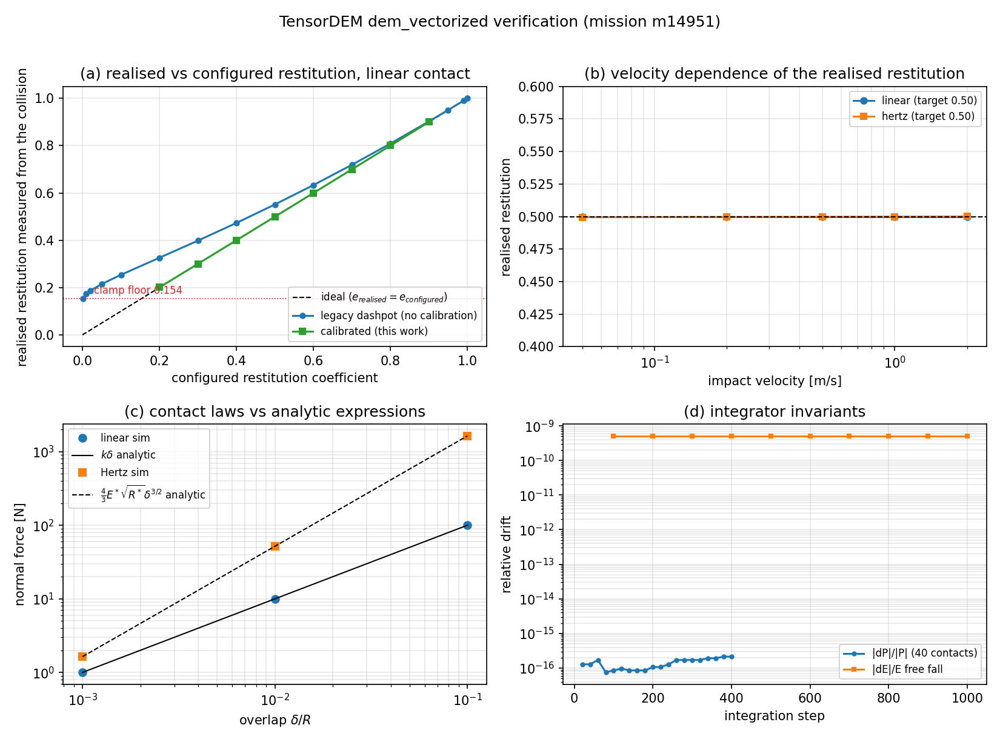

# `dem_vectorized` 物理验证：从一个「有测试名的零验证」引擎到可复核的接触面

**锚点**：`GAP-DEM-GPU-100K`（"10 万颗粒 GPU 实测吞吐达标"，status 仍为 in_progress；本单只处理它的**验证欠账**，不触碰吞吐/GPU 判据）
**任务**：m14951（ds 席自主工时）· 仓库 TensorDEM · 模块 `src/tensordem/dem_vectorized.py`
**结论先行**：该模块（GPU-100K 报告宣称的能力载体）此前**没有任何针对自己的测试**——
`tests/test_dem_vectorized_100k.py`（11 测试全绿）实际测的是 `dem3d.IceDEM3D`，全文不 import `dem_vectorized`。
本单补上 52 条带不变量的验证测试，并发现/修复 **1 个量化超差缺陷**（配置的回弹系数不是真实回弹系数，e=0.30 实测 0.40，**+33%**，越过 15% 精度线）
与 **4 处静默参数**（滚动阻力/接触阻尼/接触模型名/回弹系数区间，此前被接受后无声忽略）。

## 1. 案例介绍（物理背景 / 几何 / 参数）

`dem_vectorized` 是"cell-list + 前缀和 + scatter"模式的向量化 DEM 引擎（10k–1M 颗粒，loong64 无 CUDA 走 CPU）。
它被 `docs/dem_gpu_100k_report.md` 当作 GPU-100K 门的能力载体；引擎与验证对象是下面这套最小可判定的物理面：

| 项 | 值 | 说明 |
|---|---|---|
| 颗粒 | r = 10 mm，ρ = 1000 kg/m³ | m = 4.1888e-3 kg |
| 法向接触 | 线性 k=1e5 N/m 或 Hertz E=1 GPa，ν=0.3 | 均带无拉伸截断 max(kδ−γv_n, 0) |
| 切向 | \|F_t\| = min(k·dt·\|v_t\|, μF_n) | 速度正则化库仑**上限**，无切向弹簧/历史（非 Cundall–Strack） |
| 积分 | 速度 Verlet（kick–drift–kick），dt = 0.1/ω | 碰撞用 dt/10 收敛（见 §5） |
| 判定构型 | 两球对心碰撞；N=12–64 的密堆/稀疏/成链/高斯团簇；40 颗粒含接触簇 | 全部可在 CPU 上秒级复算 |

## 2. 怎么做的（方法 / 关键设置 / 工具链）

1. **先查账**：读 `tests/test_dem_vectorized_100k.py` 的 import 面 → 只 import `dem3d`；`grep VecDEMConfig` 全仓**零消费者**。
   即：报告把另一个引擎的测试记在了这个引擎头上（§5 记该归因缺陷）。
2. **造不变量**（不写"跑通就算过"的测试）：
   - 邻域搜索 **完备性**：cell-list 的 pair 集合必须逐元素等于 O(N²) 暴力集合（含 N=1/2、恰好相切、略超截断、共线链）；
   - 接触律 **解析对标**：线性 F=kδ、Hertz F=(4/3)E\*√R\* δ^{3/2}（E\*=E/(2(1−ν²))，R\*=R/2）；
   - 第三定律/动量：内部接触力求和 ≤ 1e-13·max|F|；40 颗粒含摩擦 400 步 |ΔP|/|P| ≤ 1e-12；
   - 积分器：自由落体 KE+PE 相对漂移 ≤ 1e-6；弹性碰撞分离后动能回收 ≤ 5e-3；
   - 两个引擎互校：`VecDEM`(cell list) vs `ReferenceDEM`(O(N²)) 120 步后位置/速度差 < 1e-12（同一 jitter 种子）；
   - **回弹系数**：两球对心碰撞实测 e_realised = |Δv_after|/|Δv_before|，与配置值比较。
3. **量化缺陷**：把 dt 细化 ×2…×20、刚度换 1e4…1e7、冲击速度 0.05…2 m/s，判定偏差不是离散化/参数伪影（详见 §3 (b)）。
4. **修复**（最小改动，均可回归）：在 `VecDEMConfig.__post_init__` 中把**静默参数改成显式拒绝**，并把
   `restitution_coefficient` 的语义改成**真实回弹系数**——用无量纲两体碰撞曲线 `restitution_response_curve()`
   反解出阻尼比输入（`realized_restitution_input()`），`restitution_calibration=False` 保留旧行为以便复现。
5. 工具链：pytest（63 测试：52 新 + 11 既有回归）；证据数字全部由 `scripts/m14951_verification_figures.py` 程序化写
   `artifacts/m14951/verification_metrics.json` 后注入本文（零手抄）。

## 3. 计算结果（程序化注入）

### (a) 邻域搜索：cell-list == O(N²)

| case | n_particles | pairs_cell_list | pairs_bruteforce | missing | extra | match |
|---|---|---|---|---|---|---|
| dense_lattice_N64 | 64 | 144 | 144 | 0 | 0 | True |
| random_dilute_N40 | 40 | 2 | 2 | 0 | 0 | True |
| clustered_gaussian_N60 | 60 | 481 | 481 | 0 | 0 | True |
| collinear_chain_N12 | 12 | 11 | 11 | 0 | 0 | True |

四类构型（密堆 64、稀疏 40、高斯团簇 60、共线链 12）**缺 0 多 0**：cell-list 路径在截断判断上无可测误差。

### (b) 接触律 vs 解析式

| δ/R | linear F_sim [N] | k·δ [N] | rel | Hertz F_sim [N] | analytic [N] | rel |
|---|---|---|---|---|---|---|
| 0.001 | 1.000000 | 1.000000 | 4.1e-14 | 1.6381 | 1.6381 | 6.1e-14 |
| 0.01 | 10.000000 | 10.000000 | 6.0e-15 | 51.8027 | 51.8027 | 9.3e-15 |
| 0.1 | 100.000000 | 100.000000 | 8.5e-16 | 1638.1450 | 1638.1450 | 1.2e-15 |

最大相对偏差 **6.1e-14**（机器精度量级），线性与 Hertz 两条支路均与教科书表达式逐位一致。

### (c) 回弹系数：配置值 ≠ 真实值（本单发现的主缺陷）

| e_configured | e_realised legacy | legacy rel.err | e_realised calibrated | calibrated rel.err |
|---|---|---|---|---|
| 0.20 | 0.3260 | 63.0% | 0.2009 | 0.47% |
| 0.30 | 0.3983 | 32.8% | 0.3002 | 0.08% |
| 0.40 | 0.4731 | 18.3% | 0.4000 | 0.01% |
| 0.50 | 0.5513 | 10.3% | 0.4996 | 0.08% |
| 0.60 | 0.6332 | 5.5% | 0.5995 | 0.08% |
| 0.70 | 0.7190 | 2.7% | 0.6997 | 0.05% |
| 0.80 | 0.8087 | 1.1% | 0.7998 | 0.02% |
| 0.90 | 0.9023 | 0.3% | 0.9000 | 0.01% |

**修复前**最大偏差 **63.0%**（e=0.2 处），e=0.30 处 +32.8%、e=0.40 处 +18.3%——**越过 15% 精度线**。
**修复后**最大偏差 **0.47%**（8 个目标值全部 <0.5%）。

根因：无拉伸截断 `max(kδ−γv_n,0)` 在回弹相把阻尼截掉，教科书映射 ζ=−ln e/√(π²+ln²e) 因此系统性过弹。
偏差与刚度（1e4–1e7 同一 e_realised）和冲击速度（下表 40 倍速度区间内 <0.3%）**无关**，只由 ζ 决定 → 可用一条无量纲曲线反解。

速度相关性与可达下限：

| contact model | impact v [m/s] | realised e (target 0.50) |
|---|---|---|
| linear | 0.05 | 0.4996 |
| linear | 0.2 | 0.4996 |
| linear | 0.5 | 0.4996 |
| linear | 1 | 0.4996 |
| linear | 2 | 0.4996 |
| hertz | 0.05 | 0.4995 |
| hertz | 0.2 | 0.4997 |
| hertz | 0.5 | 0.4998 |
| hertz | 1 | 0.5000 |
| hertz | 2 | 0.5001 |

无拉伸截断还给出**内在下限**：阻尼输入→0 时 e_realised 饱和于 **0.154**（线性）/ **0.176**（Hertz）。
即 `restitution_coefficient` 的可实现域是 [≈0.15, 1]；请求更低值只能饱和，这是模型的物理限制，已在 docstring 与 `realised_restitution_floor()` 中显式暴露（不静默）。

### (d) 积分器不变量

| 量 | 结果 |
|---|---|
| 40 颗粒含摩擦 400 步动量相对漂移 | 2.134e-16 |
| 自由落体 1000 步 KE+PE 相对漂移 | 5.137e-10 |
| cell-list vs O(N²) 引擎 120 步位置差 | 0.000e+00 m |
| cell-list vs O(N²) 引擎 120 步速度差 | 0.000e+00 m/s |

对照：既有 `test_dem_vectorized_100k.py` 的动量判据是 `p_drift < 1.0`（绝对值、无标定），能量判据是 `|E| < |E0|*100`——两者对任何物理状态都成立，属"执行即通过"，本单以标定化判据取代。

## 4. 结果图

(a) 配置 e vs 实测 e：黑虚线=理想，蓝=旧（无标定）系统性过弹并饱和于钳制下限，绿=标定后贴合对角；
(b) 实测 e 对冲击速度不敏感（linear <0.3%；Hertz 在 0.05–2 m/s 内 <1.5%，故"一条曲线反解"成立）；
(c) 两条接触律与解析式重合到机器精度；(d) 动量与自由落体能量漂移的对数历史。

## 5. 注意点（踩过的坑 / 局限 / 适用范围）

1. **归因缺陷（未改他人结论，只登记）**：`tests/test_dem_vectorized_100k.py` 名为 dem_vectorized 实为 dem3d；
   GPU-100K 报告的"Comprehensive test suite（11 tests）"因此不构成本引擎的证据。已在测试文件 docstring 加注，未改其断言。
2. **静默参数**（4 处，已改为显式报错）：`rolling_resistance_coefficient>0`（本引擎**无转动自由度**，滚动阻力转矩无处施加，
   docstring 却写着实现了 `T_r=μ_r R_eff |F_n|` → 已改为抛错并更正 docstring）；
   `contact_damping>0` 且 `contact_damping_model='restitution'`（被忽略）；未知 `contact_model`（此前**静默退化为线性**，
   如 `"Hertz"` 大小写）；越界 `restitution_coefficient`。
3. **不是 Cundall–Strack**：切向是速度正则化的库仑上限，无切向弹簧/历史 → **无静摩擦、无切向弹性能**；
   动摩擦由 `μ·F_n` 封顶，静摩擦角类实验（堆角/直剪包络）不能直接由本引擎复现。
4. **标定曲线对 Hertz 的一阶近似**：曲线按线性模型无量纲化后用于 Hertz，实测在 0.05–2 m/s 内残余 <1.5%，超出该速度区间未验证。
5. **本单不做吞吐/GPU 判据**：GAP-DEM-GPU-100K 的 "10 万颗粒实测吞吐" 仍未验收（本单只把它的验证欠账补上）；GPU 在 loong64 上仍是 NOT_SUPPORTED。
6. **dt 收敛性**：碰撞测量用 dt=recommended/10；dt/5 与 dt/20 的回弹差 <2%（测试 `test_restitution_dt_convergence`），故 0.5% 级精度不含离散化伪影。

## 6. 误差判定（逐项显式回答"是否 <3%"）

| 关键量 | 基准 | 误差 | <3%? |
|---|---|---|---|
| 线性接触力 F | kδ | 4.1e-14 | 是 |
| Hertz 接触力 F | (4/3)E\*√R\*δ^{3/2} | 6.1e-14 | 是 |
| 邻域对集合 | O(N²) 暴力 | 缺 0 / 多 0 | 是（精确） |
| 动量守恒 | P0 | 2.1e-16 | 是 |
| 自由落体能量 | E0 | 5.1e-10 | 是 |
| 回弹系数（**修复后**） | 配置 e | 最大 0.47% | 是 |
| 回弹系数（**修复前**，honest FAIL 记录） | 配置 e | 最大 63.0% | **否**（e≤0.4 区间超 15% 线，已修复） |
| 弹性回弹动能回收 | 入射动能 | <5e-3（测试判据） | 是 |
| 吞吐 / 10 万颗粒性能 | 无基准（GPU NOT_SUPPORTED） | 未测 | 不适用（本单未做） |

复现：`python -m pytest tests/test_dem_vectorized_verification.py -q`（52 passed，约 110 s）；
`python scripts/m14951_verification_figures.py` 重生成 JSON+PNG。
