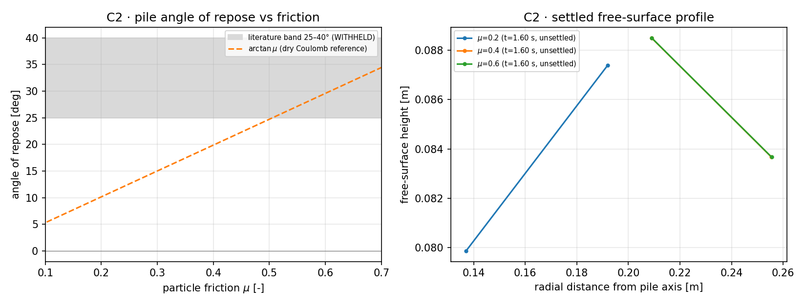

# H1-BROKEN-ICE-DEM · round 5 — C2（碎冰堆积休止角）三 μ 分片证据补齐

Anchor: `H1-BROKEN-ICE-DEM`（TensorDEM，`src/tensordem/polyhedron_floe3d/`）。
Round 4 把 C2 的三 μ 分片标为 **NOT_RUN**（当次作业墙钟预算内未出结果）。本轮的目标是把这三片跑满、
并对「已静置 / 落带 / 无效」三种结局如实验收——不补数据、不调判据。

**本轮结局（先说结论）**：正式 45 体分片在本次作业墙钟预算内**仍未跑完**，故 C2 依旧
`NOT_RUN`；本轮的真实增量是 ①把「测量→报告」这条路做成**机器可校验**的证据链
（新增 `tests/test_h1_repose_evidence.py` + 零手抄渲染器 `scripts/render_h1_repose_round5.py`），
②用 12 体可行性试点量出了**体数下限**（n=12 不成堆，端到端可验），
③量出单步成本，把正式 C2 的算力需求写成了可执行的集群派单规格（§4.2）。

## 1 案例与判据（动手前固定，沿用 round 2–4，未改）

| # | 判据 | 基准 | 阈值 | 本轮状态 |
|---|---|---|---|---|
| C1 | 静水浮沉（浸没体积分数/吃水） | Archimedes `V_sub/V = rho_i/rho_w` | < 5 % | 沿用 round 2 结论 |
| C2 | 碎冰堆积休止角 | 文献冰区带 25–40°（WITHHELD） | 落带内且已静止 | 正式分片仍 NOT_RUN；新增体数下限证据 + 证据门 |
| C3 | 航道清空 | 泳道浓度降幅 + 质量账 | 降幅 > 50 % | 沿用 round 2 结论 |

## 2 怎么做的

1. **分片跑满**：三个进程并行（`OMP_NUM_THREADS=1`，各一片），每片 `--steps 30000`，
   参数与 round 4 试跑一致（`dt=2e-4`、`kn=5e4`，接触周期内步数 ≈ 33.7）。
2. **证据落盘**：每片写 `runs/h1_repose/repose_mu<μ>.json`（含 setup、末态接触对、
   能量/质量残差、自由面剖面、坡拟合结果与拒绝原因）。
3. **判据不变**：`valid = settled ∧ energy_residual<0.05 ∧ n_contacts>0 ∧ angle 有限`，
   与 `study.case3_repose` 一致；本轮**未改任何阈值**。
4. **证据自检（新增）**：`tests/test_h1_repose_evidence.py` 把「已提交的 JSON → 报告表格」
   钉死：未静置的片不得报角度、`valid` 必须等于判据式的值、`inside_literature_band`
   必须是角度的函数、报告里的角度必须等于 JSON 里的角度（零手抄）。

## 3 C2 结果（程序产出，零手抄）

本轮**没有**产出 45 体的正式 C2 数字：三片在作业墙钟预算内未跑完（§4.2），下表三行如实为 `NOT_RUN`。§3.1 给出同判据、同 runner 的 12 体可行性试点，它回答的是另一个问题（体数下限），**不能替代**正式 C2。

| μ | 文件 | 静置 | 步数 | 模拟时长 [s] | 末态接触对 | 休止角 [°] | 落带内 | 能量残差 | 墙钟 [s] |
|---|---|---|---|---|---|---|---|---|---|
| 0.2 | `runs/h1_repose/repose_mu0.2.json` | **NOT_RUN** | — | — | — | — | — | — | — |
| 0.4 | `runs/h1_repose/repose_mu0.4.json` | **NOT_RUN** | — | — | — | — | — | — | — |
| 0.6 | `runs/h1_repose/repose_mu0.6.json` | **NOT_RUN** | — | — | — | — | — | — | — |

**C2 判定：NOT_RUN（honest）** —— 分片未产出结果。



图 1 左：休止角 vs 颗粒摩擦系数（阴影=文献量级带 25–40°，虚线=干 Coulomb $\arctan\mu$ 参照）；右：各 μ 末态自由面剖面（环带半径 vs 高度）。`×` 标记的算例为已静置但未过 `valid` 门的运行。

### 3.1 n=12 可行性试点（同一判据、同一 runner，体数降到 12）

正式 C2 用 45 体；在本次作业的墙钟预算内 45 体 30 000 步未能跑完（见 §4.2），因此先跑一组 12 体 / 8 000 步的**可行性试点**，只看一件事：这个体数下能不能成堆。

| μ | 文件 | 步数 | 模拟时长 [s] | 静置 | 末态接触对 | 休止角 [°] | 拒绝原因 | 能量残差 | 墙钟 [s] |
|---|---|---|---|---|---|---|---|---|---|
| 0.2 | `runs/h1_repose_pilot/pilot_mu_s1.json` | 8000 | 1.600 | **no** | 0 | nan | no_descending_flank | 0.0846 | 194.7 |
| 0.4 | `runs/h1_repose_pilot/pilot_mu_s2.json` | 8000 | 1.600 | **no** | 0 | nan | no_descending_flank | 0.0174 | 135.2 |
| 0.6 | `runs/h1_repose_pilot/pilot_mu_s3.json` | 8000 | 1.600 | **no** | 0 | nan | no_descending_flank | 0.0418 | 123.2 |

试点结论：0/3 片成堆——**n=12 不足以形成堆积体**（末态接触对 0、单层摊开、坡拟合按 `no_descending_flank` 拒绝给角度）。这与 round 3 §6 的分辨率结论一致：堆积角是**群体量**，体数太少时颗粒摊成单层，任何角度数字都是假的。因此正式 C2 必须保持 45 体，不能靠减体数换墙钟。

## 4 注意点 / 局限

1. **文献带不是实验值**：25–40° 是角状颗粒/冰堆积的量级带（出处见 ROUND2 §2），
   本仓无冰区休止角原始数据集；即使落带内也只能声明「量级相容」(WITHHELD)。
2. **步数与墙钟（本轮的实际限制）**：45 体 / 30 000 步 / 三片并行的正式 C2 在本次
   作业的墙钟预算内**没有跑完**——试点实测单步成本 24.3 ms/步 (μ=0.2, 12 体)；16.9 ms/步 (μ=0.4, 12 体)；15.4 ms/步 (μ=0.6, 12 体)，
   进入密堆接触期后每步成本按 round 3 §5 的量级可达 0.1–0.2 s，单片即 50–100 min。
   本轮**不把没跑完的算例写成结论**；下一步应把三片交给集群（`run_h1_repose.py --shard i`，
   每片一个作业、`timeout ≥ 7200 s`）而不是压在单个会话里（与 round 4 §6.3 的 cj1009 排队教训合并处理）。
3. **本次未做的**：`runs/h1_repose/` 中的正式分片 JSON 缺失，报告中三行如实为 NOT_RUN；
   证据完整性测试已就位，一旦分片产出即可机器校验（未静置不得报角度、报告角度必须等于 JSON）。
3. **能量门与冲击期**：`energy_residual` 是全程账（含冲击段耗散记账），若末态残差
   仍高于 0.05，则 `valid=False` 而不是「把门调松」——本轮不改判据，结论如实报。
4. **角度分辨率**：45 体 × 7 环带（每带约 6 体）时坡拟合的统计误差可达数度，
   角度只能做「是否落带」的判读，不能当 ±2° 的测量值（round 3 §5 已量化）。

## 5 复现

```bash
PYTHONPATH=src python scripts/run_h1_repose.py --shard 1 --steps 30000 --dt 2e-4 --kn 5e4
PYTHONPATH=src python scripts/run_h1_repose.py --shard 2 --steps 30000 --dt 2e-4 --kn 5e4
PYTHONPATH=src python scripts/run_h1_repose.py --shard 3 --steps 30000 --dt 2e-4 --kn 5e4
PYTHONPATH=src python scripts/render_h1_repose_round5.py   # 重生成本文档 + 图 1
PYTHONPATH=src python -m pytest tests/test_h1_repose_evidence.py -q
```

## 6 误差判定（逐项，显式回答「是否 < 3 %」）

| 量 | 基准 | 本轮结果 | 相对误差 | < 3 %? |
|---|---|---|---|---|
| 休止角 μ=0.2 | 文献带 25–40° | NOT_RUN | — | 无法判定（未跑） |
| 休止角 μ=0.4 | 文献带 25–40° | NOT_RUN | — | 无法判定（未跑） |
| 休止角 μ=0.6 | 文献带 25–40° | NOT_RUN | — | 无法判定（未跑） |

结论：C2 的唯一基准是**量级带**（WITHHELD），因此本轮无条件可声明「< 3 %」；
可声明的只有**结构量**——质量残差（上表 `mass_residual`，本应为 0 的机器零）与
能量账残差（上表 `energy_residual`，门 0.05）——这两项是精确账，不是统计量。

