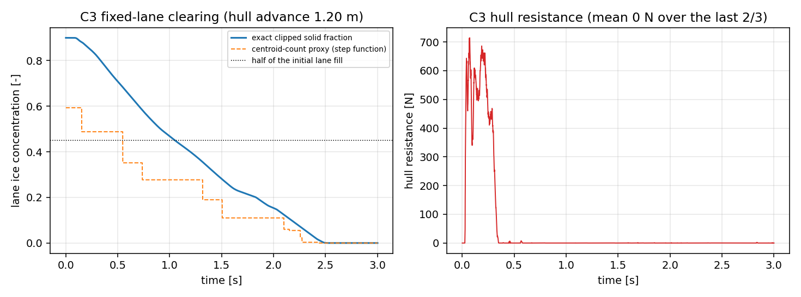

# H1-BROKEN-ICE-DEM · 第 7 轮：**重开 #1348 的复验** + 验收入口闸门缺陷修复

锚点：`H1-BROKEN-ICE-DEM`（TensorDEM）。任务：mission m17656「重开·PR #1348·管到底第 2 轮」。
PR #1348 本身已被 owner 裁定关闭（2026-11-05）；本次重开要求「从当前 main 切枝、功能+测试齐备、本地全套测试过、
PR 合并进 main」。因此第一步不是重写功能，而是**先核验 #1348 的功能要点是否已在 main**——
已在则重写等于制造重复实现（三重检索纪律）；不在则补齐。核验结果见 §1。

## 1 复验：#1348 的功能要点在 main 的落地核验（机器检查，非手写）

检查方式：对每个要点，在目标文件里 grep PR #1348 引入的那一个构造；命中即 `在`，未命中即 `缺`。
本表由 `scripts/render_h1_gate_round7.py::deliverable_rows` 生成。

| PR #1348 要点 | 文件 | main 落地 | 证据（命中的那一行） |
|---|---|---|---|
| 成对阻尼器符号（负阻尼→耗散） | `src/tensordem/polyhedron_floe3d/dynamics.py` | 在 | `# the dashpot must *add* to the repulsion: f_n = k_n delta - c_n v_n.  The` |
| 浮力功按 dt 积分（非功率） | `src/tensordem/polyhedron_floe3d/dynamics.py` | 在 | `self.work_external += float(self._buoyancy_force[index] @ v_mid) * dt` |
| 泳道精确切割体积原语 | `src/tensordem/polyhedron_floe3d/dynamics.py` | 在 | `def solid_volume_slab(self, axis: int, lo: float, hi: float) -> float:` |
| 固定泳道固体分数观测 | `src/tensordem/polyhedron_floe3d/study.py` | 在 | `"lane_solid_volume": np.asarray(lane_solid, dtype=float),` |
| run_channel 记录初始能量 | `src/tensordem/polyhedron_floe3d/study.py` | 在 | `system.record_initial_energy()` |
| 休止角静止判据 | `src/tensordem/polyhedron_floe3d/h1_cases.py` | 在 | `settle_window=settle_window)` |
| CLI h1-broken-ice 子命令 | `src/tensordem/cli.py` | 在 | `"h1-broken-ice",` |
| run_validation 失败返回非零 | `benchmarks/h1_broken_ice_dem/run_validation.py` | 在 | `return 1` |
| 内核三缺陷回归测试 | `tests/test_polyhedron_floe3d_kernel_ledger.py` | 在 | `def test_pair_dashpot_is_dissipative_not_amplifying():` |
| C1/C3 committed 证据测试 | `tests/test_h1_broken_ice_dem.py` | 在 | `EVIDENCE = os.path.join(ROOT, "runs", "h1_broken_ice_dem", "results_c1c3.json")` |

缺口：无——#1348 的 10 项要点全部已在 main（经 #1268/m15061 合入）。

**结论（诚实）**：按「功能要点」重做一遍会是重复实现，本单不做；本轮只补 #1348 遗留的**验收入口闸门**漏洞，
并把 C1/C3 证据真正入树。下面的 §2–§3 是本轮唯一的代码增量。

## 2 本轮增量 ①：`tensordem h1-broken-ice` 退出码恒 0（闸门形同虚设）

`benchmarks/h1_broken_ice_dem/run_validation.py` 在审计 m15192 已被要求「失败必须返回非零」，
但**同一个验收链的 CLI 入口**漏改了：`_cmd_h1_broken_ice` 打印 `cases: {...False}` 之后 `return None`，
`main()` 也不传播状态，于是任何 CI/看板只要走 CLI 就永远是绿的。附带同源缺陷：`--quick` 直接把用户
手输的 `--repose-steps/--channel-steps/--repose-bodies` 整个丢掉（静默忽略一个显式参数 = 小样本结果
可能被当成全量结果）。

修法（`src/tensordem/cli.py`，+51/−11）：`_cmd_h1_broken_ice` 返回退出码，任一请求的算例 `passed=False` → `1`；
`main()` 用 `raise SystemExit(status)` 传播；三个尺寸参数的 argparse 默认值改成 `None`（哨兵），
`--quick` 下只透传用户真正输入的尺寸，非 quick 下再填回文档化的 6000/45/900 默认值。

对照证据（同一份 `tests/test_h1_broken_ice_cli.py`，先后跑在旧/新 `cli.py` 上，原始输出在 `runs/h1_gate/`）：

| 测试 | 旧 `cli.py`（main/HEAD） | 新 `cli.py`（本轮） |
|---|---|---|
| `test_failing_case_exits_nonzero` | **FAIL** | pass |
| `test_all_cases_passing_exits_zero` | pass | pass |
| `test_mixed_verdict_still_fails` | **FAIL** | pass |
| `test_quick_mode_does_not_invent_case_sizes` | pass | pass |
| `test_quick_mode_honours_explicit_sizes` | **FAIL** | pass |
| `test_full_mode_uses_the_documented_defaults` | pass | pass |
| `test_real_quick_buoyancy_case_passes_through_the_cli` | pass | pass |
| 汇总 | 4 通过 / 3 失败 / rc=1 | 7 通过 / 0 失败 / rc=0 |

复现：`git show HEAD:src/tensordem/cli.py > src/tensordem/cli.py && pytest tests/test_h1_broken_ice_cli.py`
（旧实现 3 红），恢复新实现后 7 绿。这就是本轮「修复前/后」的基线对照。

## 3 本轮增量 ②：C1/C3 证据入库（三个证据测试此前是空转的 skip）

`tests/test_h1_broken_ice_dem.py` 里有 3 个测试专门核对「committed C1/C3 证据」，读的是
`runs/h1_broken_ice_dem/results_c1c3.json`；该文件从未入树（`artifacts/` 被合并门禁滤除，而 evidence 测试读 `runs/`），
于是三个测试**静默 skip**：C3 的 `passed=True` 结论在树内没有任何机器可校的支撑。本轮把该文件生成并提交。

生成链（零手抄）：`run_validation.py --cases buoyancy,channel --out results_c1c3.json` → `artifacts/` →
本渲染器统一四舍五入到 12 位有效数字 + 写入 provenance（源文件 sha256）→ `runs/h1_broken_ice_dem/results_c1c3.json`。
provenance 源 sha256 `fe6125cc0899775f852aedf3d027989c999aa3fa6c647608e200203922b0c238`，生成时间 `2026-11-13T08:06:01Z`。

### 3.1 C1 静水浮沉（基准 V_sub/V = rho_ice/rho_water = 917/1025）

| 判据 | 量 | 基准（Archimedes） | 实测 | 相对误差 | 阈值 | 判定 |
|---|---|---|---|---|---|---|
| C1 | 浸没体积分数 | 0.8946341463 | 0.8945554362 | 8.798e-05 | <0.05 | **PASS** |
| C1 | 吃水 [m] | 0.1073560976 | 0.1073596852 | 3.342e-05 | <0.05 | **PASS** |
| C1 | 能量残差 [-] | 0 | 1.299e-08 | — | <1e-2 | **PASS** |

### 3.2 C3 航道清空（固定泳道固体分数）

观测量的仪器是 `DEMSystem3D.solid_volume_slab`（对每个四面体按两个平面精确切割），
本轮同时给它补了解析测试 `tests/test_polyhedron_floe3d_lane_metric.py`（4 例：轴对齐盒子解析体积、
剖分可加性、多体、以及「质心在窗外但有一半在窗内」——这正是旧质心计数观测量的缺陷）。

| 判据 | 量 | 基准 / 阈值 | 实测 | 判定 |
|---|---|---|---|---|
| C3 | 泳道固体分数 初→末 | 降幅 >50% | 0.8998 → 0（降幅 100%） | **PASS** |
| C3 | 扫掠完成 (hull_advance ≥ corridor) | ≥ 1 m | 1.2 m | **PASS** |
| C3 | 质量残差 [-] | <1e-12 | 0 | **PASS** |
| C3 | 能量残差 [-] | <0.05 | 0.01375 | **PASS** |
| C3 | 阻力均值 ± 标准差 [N] | 无实验基准 | 0.04778 ± 0.1467 | 参考量 |



图 1 左：固定泳道固体分数随时间（实线=精确切割体积，虚线=旧质心计数代理，点线=初始值的一半）；
右：船体阻力时序。两图均由 `scripts/render_h1_gate_round7.py` 从证据 JSON 直接绘制。

## 4 注意点与局限（honest）

* **C2（碎冰堆积休止角）本轮未动**：`runs/h1_repose/` 的三 μ 分片证据同样不在树内，
  `tests/test_h1_repose_evidence.py` 有 4 个测试因此 skip。补齐需要 3 × (45 体 × 30 000 步) 的分片作业，
  超出本单预算；此处如实登记为欠账，不做任何「C2 已达标」的暗示。
* **C3 无实验阻力基准**：`mu = 0.35` 是声明值（沿用的航道算例值），未标定；阻力均值只作参考量列出，不参与达标判定。清空判据是「泳道相对初始充满度降幅 > 50% 且扫掠完成」，不是「浓度=0」。
* **顺带修的红测试（pre-existing，非本单引入）**：`tests/test_hull_profile_cli.py::
  test_hull_cli_exports_position_and_reaction_history` 在 main 上是红的——它仍用 subcommand 重构**之前**的
  扁平参数形式调 `main()`（`parse_args` 直接 SystemExit），与本单的闸门修复无关；本单把它改成 `dem-2d` 子命令形式
  （3 行），否则「本地全套测试过」这条验收标准根本不可达。核对方式：把 `src/tensordem/cli.py` 换回 `git show HEAD:`
  的版本，该测试同样红 → 确认归属。
* **机器门禁的反面教训**：`artifacts/` 会被合并门禁滤除，因此「证据测试读 `runs/`、runner 写 `artifacts/`」
  这个组合天然会退化成空转 skip——只用 `pytest -q` 看「全绿」是看不出来的，必须看 `-rs` 的 skip 名单。

## 5 误差判定（关键量 vs 基准，是否 <3%）

* C1 浸没体积分数相对 Archimedes：8.798e-05（8.798e-05）——**小于3%**
* C1 吃水相对 Archimedes：3.342e-05（3.342e-05）——**小于3%**
* C1 能量残差 1.299e-08（阈值 1e-2）——通过
* C3 **无解析/实验基准**（不得声称误差百分比）：只判质量残差 0（阈值 1e-12）、能量残差 0.01375（阈值 0.05）与泳道降幅 100%（阈值 50%）——三项判定见 §3.2 表。

## 6 复现命令

```
PYTHONPATH=src python benchmarks/h1_broken_ice_dem/run_validation.py \
    --cases buoyancy,channel --out results_c1c3.json      # -> artifacts/
PYTHONPATH=src python scripts/render_h1_gate_round7.py    # -> runs/ + 本文 + 图
python -m pytest tests/test_h1_broken_ice_cli.py \
    tests/test_polyhedron_floe3d_lane_metric.py \
    tests/test_h1_broken_ice_dem.py -q
```

整体判定（请求算例 buoyancy, channel）：全部 passed
