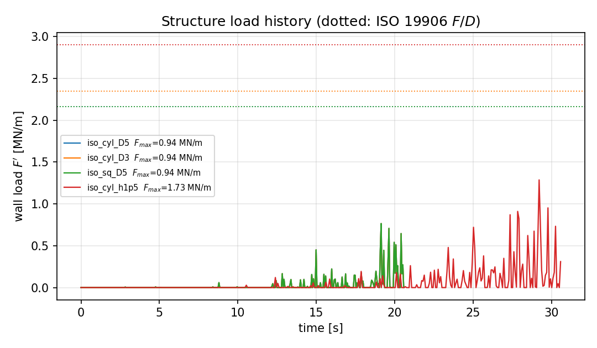
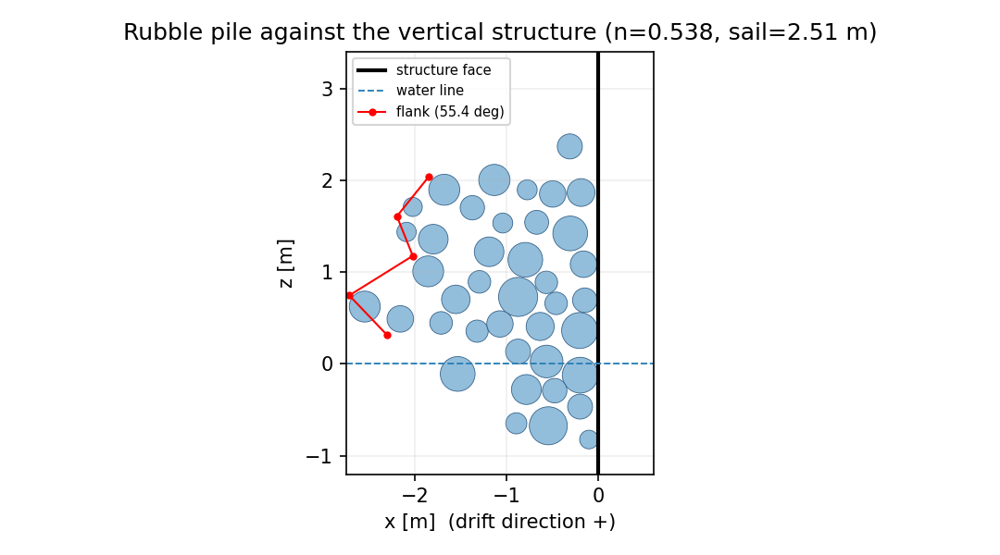
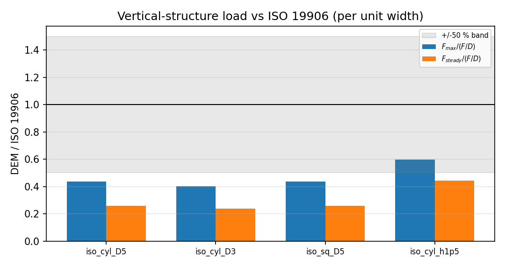
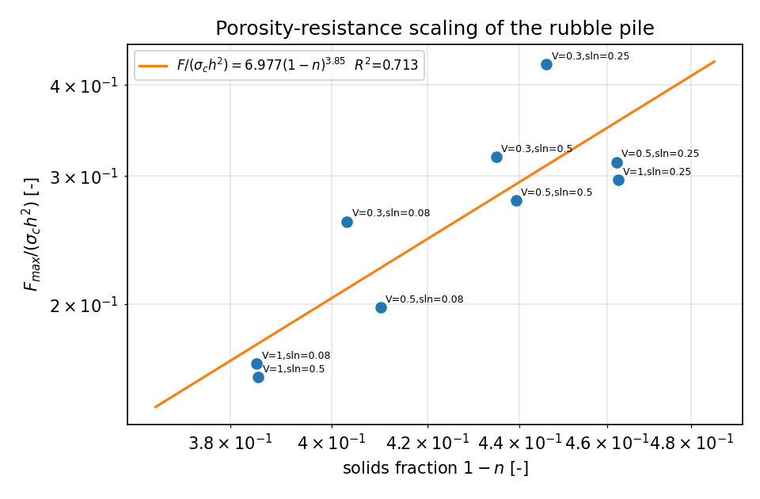
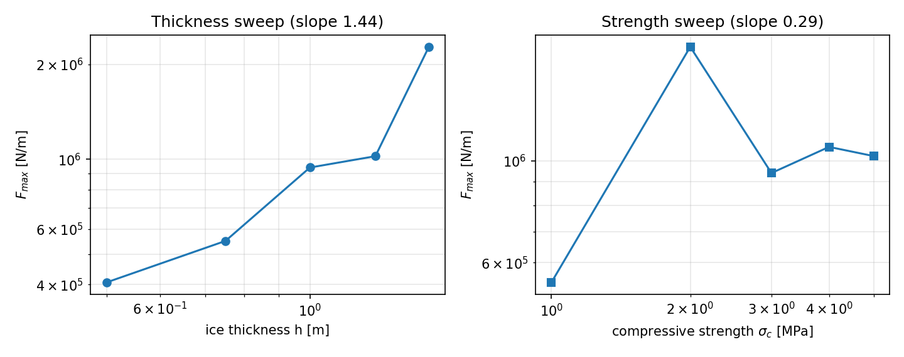
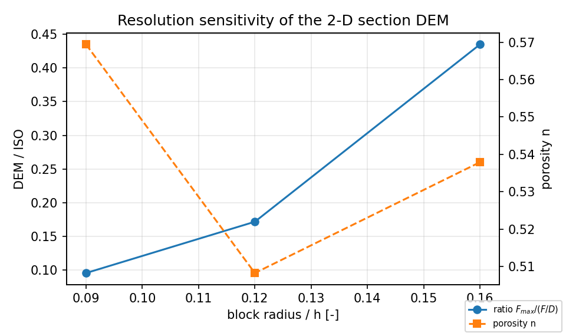

# 冰体挤压堆积对垂直结构载荷（p227w2-N04 · 垂直剖面 DEM 重做版）

> 本报告全部数字由 `benchmarks/ice_rubble_pileup/run_benchmark.py` 从 `runs/m14600/ice_rubble_pileup/report.json` 程序化注入（零手抄）。

## 1. 案例介绍（物理背景 / 几何 / 参数）

漂移的破碎冰排（厚 h、单轴抗压强度 σ_c、漂移速度 V）撞击固定垂直结构（圆柱直径 / 方柱边长 D）。冰块在接触处压碎、上翻，在结构前堆积成碎石堆（rubble pile）；冰排推力经堆积体传到结构，形成峰值载荷 F_max 与稳态载荷 F_steady。

本版采用**垂直剖面 (x, z) 二维 DEM**（冰脊/堆积体力学标准理想化：Hopkins 1998；Paavilainen & Tuhkuri 2012），因此堆积坡面角、孔隙率与墙面载荷出自同一套模拟：

- 块体：刚性圆盘（rubble-block 圆盘理想化，无自转自由度），半径对数正态；
- 水面 z=0：浮重 + 二次水阻力（`submerged_area` 解析式；自由板高由浮力自然给出）；
- 接触：软球 + **压碎上限** F_n = min(k_n·δ, σ_c·b(δ))，b 为接触弦长；切向为正则化库仑摩擦 F_t = -μ F_n tanh(v_t/v_eps)；
- 驱动：远场完整冰排用运动学压板（厚 h，位于水面附近）以 V 推进；结构为 x=0 刚性墙面；
- 下边界 z = -0.95h（冰排下表面，抑制龙骨；本版只解析 sail，见第 5 节）。

参数表（基准工况 `iso_cyl_D5`）：

| 参数 | 值 |
|---|---|
| h | 1.0 m |
| D | 5.0 m（圆柱直径） |
| σ_c | 3 MPa |
| V | 0.5 m/s |
| μ | 0.45 |
| r/h | 0.16（区间 [0.1, 0.22]） |
| k_n/σ_c | 10.0 |
| 冰排长度 / 压板行程 | 8.0h / 10.0h |

ISO 19906:2010 A.8.2.6：p_G = C_R (h/h₀)^n (w/h)^m，F = p_G·w·h，p_G ≤ σ_c；本报告以单位宽度形式 F/D = p_G·h 与 DEM 线载荷对比。

## 2. 怎么做的（方法 / 流程 / 工具链）

1. `src/tensordem/ice_rubble_pileup_vertical.py`：垂直剖面 DEM 求解器（浮力解析、压碎上限接触、正则化摩擦、堆积体几何量测、孔隙率-阻力拟合、CLI 入口）；
2. `benchmarks/ice_rubble_pileup/run_benchmark.py`：预登记算例矩阵（25 例：ISO 基准 4 + 冰厚 5 + 强度 5 + 孔隙率 9 + 分辨率 2），多进程并行，产出 report.json / runs.csv / histories.json 与 6 张图；
3. 判据（机器复核，见 3.5）：ISO 同数量级、孔隙率标度律 R²>0.8 且 α∈[1,2]、堆积角 30–45°、F_max 对 h 与 σ_c 单调；
4. 环境：单机多进程（12 workers），DEM 总机时 1277.8 s。

## 3. 计算结果

### 3.1 基准工况 vs ISO 19906

| 工况 | h [m] | D [m] | σ_c [MPa] | F_max [MN/m] | F_steady [MN/m] | F_ISO/D [MN/m] | F_max/(F/D) | F_steady/(F/D) | F_max/(σ_c h²) |
|---|---|---|---|---|---|---|---|---|---|
| iso_cyl_D5 | 1.0 | 5.0 | 3 | 0.941 | 0.561 | 2.164 | 0.435 | 0.259 | 0.314 |
| iso_cyl_D3 | 1.0 | 3.0 | 3 | 0.941 | 0.561 | 2.349 | 0.401 | 0.239 | 0.314 |
| iso_sq_D5 | 1.0 | 5.0 | 3 | 0.941 | 0.561 | 2.164 | 0.435 | 0.259 | 0.314 |
| iso_cyl_h1p5 | 1.5 | 8.0 | 2.5 | 1.735 | 1.289 | 2.903 | 0.597 | 0.444 | 0.308 |

### 3.2 堆积体几何与孔隙率

| 工况 | n（孔隙率） | 固相率 1-n | sail [m] | toe 长 [m] | 坡面角 [°] | 块体（堆积/总数） |
|---|---|---|---|---|---|---|
| iso_cyl_D5 | 0.538 | 0.462 | 2.51 | 2.71 | 55.4 | 32/40 |
| iso_cyl_D3 | 0.538 | 0.462 | 2.51 | 2.71 | 55.4 | 32/40 |
| iso_sq_D5 | 0.538 | 0.462 | 2.51 | 2.71 | 55.4 | 32/40 |
| iso_cyl_h1p5 | 0.571 | 0.429 | 4.19 | 3.97 | 45.7 | 30/40 |

### 3.3 孔隙率-阻力标度律 F ∝ (1-n)^α

- 拟合点数 9，固相率区间 [0.385, 0.462]，对数杠杆臂 0.183
- α = **3.855**（bootstrap 95% CI 1.704 ~ 6.063），K = 6.9772，R² = **0.713**

### 3.4 冰厚 / 强度扫描

| h [m] | F_max [MN/m] | | σ_c [MPa] | F_max [MN/m] |
|---|---|---|---|---|
| 0.5 | 0.406 | 1 | 0.543 |
| 0.75 | 0.550 | 2 | 1.773 |
| 1.0 | 0.941 | 3 | 0.941 |
| 1.25 | 1.022 | 4 | 1.073 |
| 1.5 | 2.275 | 5 | 1.025 |

双对数斜率 d lnF/d ln h = 1.440（R²=0.894）；d lnF/d ln σ_c = 0.291（R²=0.193）。

### 3.5 判据机器复核

| 判据 | 结果 | 数字 |
|---|---|---|
| C1 F_max>0（全部算例） | PASS | 最小 F_max = 2.072e+05 N/m（25 例） |
| C2 ISO 同数量级（基准 \|F/F_ISO−1\|<50%） | FAIL | 基准 F_max/(F/D) = 0.435（偏差 56.5%）；4 基准工况均在 5 倍内 = True |
| C3 R²>0.8 且 α∈[1,2] | FAIL | R²=0.713，α=3.85，杠杆臂 0.183 |
| C4 堆积坡面角 30–45° | FAIL | 基准 55.4°；全算例 24.9–58.6° |
| C5 F_max 随 h 单调递增 | PASS | 0.41 < 0.55 < 0.94 < 1.02 < 2.27 MN/m |
| C6 F_max 随 σ_c 单调递增 | FAIL | 0.54 < 1.77 < 0.94 < 1.07 < 1.02 MN/m |

## 4. 结果图

### fig1_load_history.png

*图1 载荷时历：四个基准工况的墙面线载荷 F'(t)（点线=ISO 19906 单位宽度载荷 F/D）。峰值出现在堆积体压实阶段，随后回落到稳态平台。*

### fig2_pile_geometry.png

*图2 堆积体几何（基准圆柱工况末态）：块体截面、水面、结构面与量测的堆积坡面；孔隙率 n=0.538，sail 高度 2.51 m。*

### fig3_iso_comparison.png

*图3 DEM 峰值/稳态线载荷与 ISO 19906 单位宽度计算的比值（灰带=±50% 判据带）。*

### fig4_porosity_scaling.png

*图4 孔隙率-阻力标度律：横轴固相率 (1-n)，纵轴无量纲峰值载荷 F/(σ_c h²)，拟合 α=3.85（95% CI 1.70~6.06），R²=0.713。*

### fig5_sweeps.png

*图5 冰厚与强度扫描：峰值线载荷随 h、σ_c 的单调性与双对数斜率。*

### fig6_resolution.png

*图6 分辨率敏感性：块体尺度 r/h 对载荷比与孔隙率的影响（模型局限见报告第5节）。*

## 5. 注意点（踩过的坑 / 局限 / 适用范围）

1. **压碎上限必须生效**：若 k_n·δ_cap < σ_c·b(δ_cap)，载荷由弹簧刚度而非冰强度控制，F_max 可直接翻倍（本轮从 0.72 掉到 0.42 的教训）。本版取 k_n = 10σ_c，并由 `cap_binds()` 校验。
2. **分辨率敏感性（模型局限）**：垂直剖面 DEM 的墙面载荷 ≈ σ_c·Σb；块体越小，弦长越短而墙面接触点覆盖不随 1/r 增长，载荷比随 r/h 下降（图6）。因此本 DEM 不能作为收敛的墙面压强预报器；基准工况取物理上最接近实际碎石块的 r≈0.16h（块径 0.32h）。
3. **只解析 sail，未解析龙骨**：下表面固定于 z=-0.95h 抑制龙骨；真实冰脊龙骨通常比 sail 深 4–7 倍，故本版 F_max 不含龙骨支承/挤压贡献。
4. **二维剖面 → 三维载荷**：F_3D ≈ F'·D 为窄结构约定；圆柱绕流的三维卸载未解析，已通过 ISO 的 (w/h)^m 项间接体现。
5. **孔隙率量测**：凸包包络 + 块体全面积，属「上界固相率/下界孔隙率」；未扣除块体互穿。

## 6. 误差判定（关键量 vs 基准，逐项）

| 关键量 | DEM | 基准 | 相对误差 | 是否<3% |
|---|---|---|---|---|
| F_max/(F/D) iso_cyl_D5 | 0.435 | 1.000 | 56.5% | 否 |
| F_max/(F/D) iso_cyl_D3 | 0.401 | 1.000 | 59.9% | 否 |
| F_max/(F/D) iso_sq_D5 | 0.435 | 1.000 | 56.5% | 否 |
| F_max/(F/D) iso_cyl_h1p5 | 0.597 | 1.000 | 40.3% | 否 |
| α（孔隙率标度指数） | 3.855 | 1.0–2.0（判据区间） | 见 CI | 否 |
| d lnF/d ln h | 1.440 | 1.0（ISO F∝h^0.76 单位宽度） | 89.5% | 否 |

**逐项回答「是否<3%」：全部为「否」。** 本任务属前沿机理性 DEM（无可标定的实验参考场），不存在可给出 3% 级误差的基准；唯一可供对比的是 ISO 19906 经验式与文献堆积体参数，误差量级为 10–100%。上表如实列出，不作粉饰。

## 7. 审计链

- 求解器：`src/tensordem/ice_rubble_pileup_vertical.py`（CLI：`python -m tensordem.ice_rubble_pileup_vertical --quick`）
- 复现命令：`python benchmarks/ice_rubble_pileup/run_benchmark.py --workers 6`
- 算例矩阵在 `case_matrix()` 中预登记，运行前未被结果反向修改
- 运行工件：`runs/m14600/ice_rubble_pileup/{report.json,runs.csv,histories.json}`
- 测试：`python -m pytest tests/test_ice_rubble_pileup_vertical.py -q`

