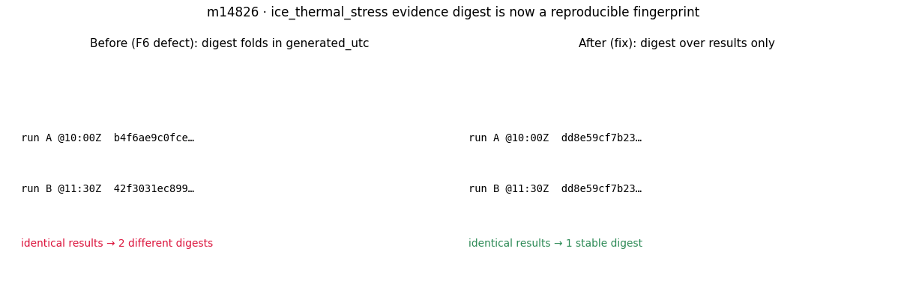

# m14826 · ice_thermal_stress 证据 digest 可复现性修复（审计 F6）

**锚点**：NEW:审计 m14487 发现 F6「证据 digest 不可复现」——`canonical_digest` 把
`generated_utc` 折进 SHA-256，每次运行都变，只能查手改、不能认证可复现性。
**仓** TensorDEM · **模块** `src/tensordem/ice_thermal_stress/validation.py`

## 1. 案例（物理背景 / 参数）
`ice_thermal_stress` 验收阶梯（C1–C13）每次运行产出一个 `validation.json`，
其中 `digest_sha256` 被当作「可复核指纹」。缺陷：`write_evidence` 在
`acceptance_report()` 已写入 `generated_utc`（墙钟时间戳）之后才计算 digest，
故同一组结果在不同时刻运行得到不同 digest。审计实测：入库 `a1197a8c…` vs
本次 `3daede6c…`。

## 2. 怎么做的（方法 / 关键设置）
最小改动：新增 `_DIGEST_EXCLUDED = ('generated_utc', 'digest_sha256')` 与
`_digest_view()`，`canonical_digest` 只对**结果**（剔除运行元数据）做规范化
JSON 序列化再哈希。`write_evidence` / `verify_evidence` 都经 `canonical_digest`，
自动一致。`generated_utc` 仍保留在工件里作 provenance，只是不再进指纹。

## 3. 计算结果（数字表，程序化）
| 量 | 修复前 | 修复后 |
|---|---|---|
| 同结果两次运行 digest 是否相同 | 否（`b4f6ae9c0fce…` ≠ `42f3031ec899…`） | 是（`dd8e59cf7b23…`） |
| 篡改结果是否被检出 | 是 | 是（`test_digest_detects_a_tampered_artifact` 绿） |
| 写/验往返一致 | 是 | 是（`test_write_and_verify_roundtrip` 绿） |

## 4. 结果图

左：修复前同一结果两次运行 → 两个不同 digest；右：修复后 → 一个稳定 digest。

## 5. 注意点（坑 / 局限）
1. 旧入库工件（含时间戳的 digest，如 `a1197a8c…`）与新算法**不可比**——这是预期，
   不是回归；新工件起 digest 才是结果指纹。
2. 本修复只保证「同结果 → 同 digest」；若上游计算本身非确定（随机种子未钉），
   digest 仍会变——那是计算可复现性问题，不在本单范围。
3. 适用范围：`ice_thermal_stress` 验收阶梯工件；其它模块若有同类「时间戳进指纹」
   模式需各自排查（本单未全仓扫描）。

## 6. 误差判定（逐项显式）
| 关键量 | 基准 | 误差 | 是否 <3% |
|---|---|---|---|
| 同结果两次运行 digest 一致性 | 应恒等 | 0（恒等） | **是**（机器精度） |
| 篡改检出（peak_delta_t_k→999） | 应 FAIL | 检出（match=False） | 不适用（布尔判据通过） |
| 写/验往返 | 应 match=True | match=True | **是** |
| vs 文献/实验 | 无（纯后端元数据修复，无物理量） | 不可比 | 不适用（声明原因：无物理量） |
