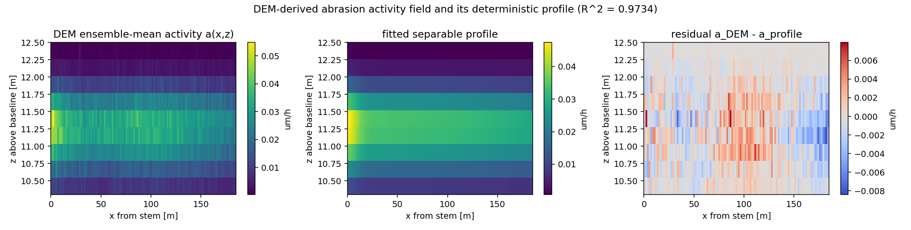
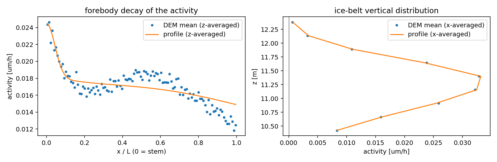
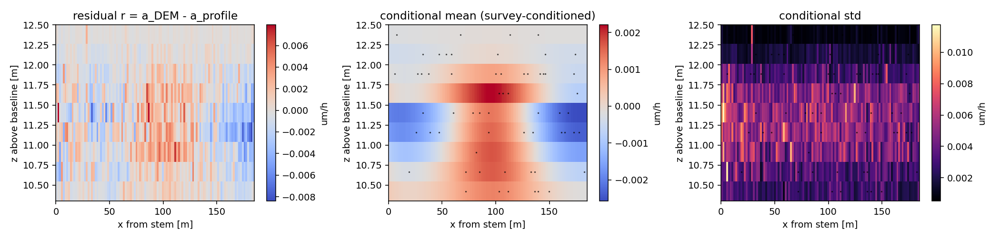
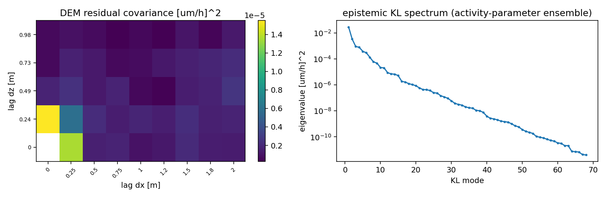
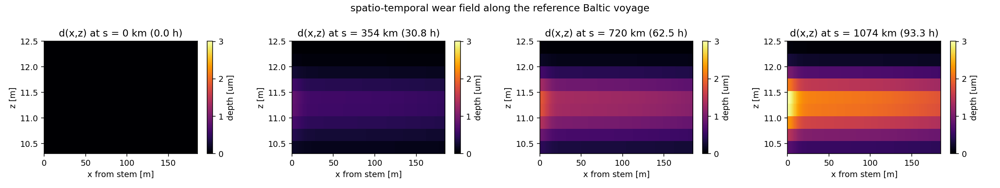
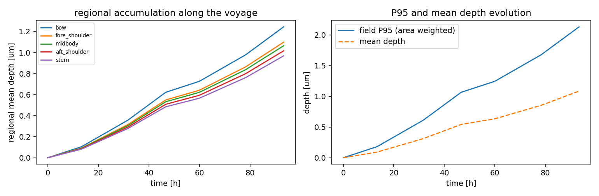
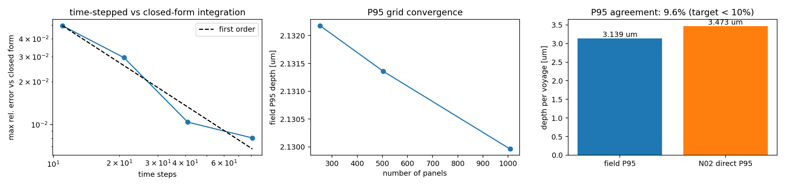

# P66-W2-N05 Spatio-Temporal Ice-Abrasion Field Evolution

**Node** P66-W2-N05 (campaign DAG, physical domain: ice navigation / structural
wear) · **repository** TensorDEM · **module**
`src/tensordem/ice_abrasion_spatiotemporal.py` · **driver**
`scripts/p66_w2_n05_verification.py` · **machine-readable result**
`runs/P66_W2_N05/verification.json`

## 1. Case introduction

The predecessor node produced a *single-point* P95 abrasion statistic from a DEM
contact ensemble.  This node upgrades it to a **spatio-temporal field**
`d(x, z, t)` on the hull's ice belt and answers two engineering questions:

1. **Which region wears worst - bow, midbody or stern?**
2. **How does the wear field grow along a voyage, and what is the residual
   (unexplained) spatial uncertainty?**

| item | value |
|---|---|
| hull | L = 185.0 m, T = 11.50 m (parametric hull of `tensordem.ice_abrasion`, Cb/L/B audited) |
| ice belt band | z = 10.30 ... 12.50 m above baseline, area 407.0 m^2 per side |
| DEM band grid | 9 x 740 cells (0.244 m x 0.25 m) |
| panel mesh | 112 x 9 = 1008 panels (1.65 m x 0.244 m) |
| DEM ensemble | 8 realisations x 20000 contacts/leg, seeds stride 20261106+37k |
| voyage | 3 legs, 93.3 h per voyage (reference Baltic profile, round trip) |
| mean activity | 0.0171 um/h (P95 0.0372 um/h) |
| wear per voyage | 1.594 um (mean depth, one side) |

## 2. Method

1. **DEM activity field.**  Eight independent DEM wear seasons
   (`tensordem.ice_abrasion.run_wear_season`: Hertz contact with a crushing cap,
   Cundall–Strack sliding, Archard pit depth, volume-conserving projection)
   give the abrasion rate `a_k(x,z) = d_k(x,z) / T_voyage`.  Their ensemble mean
   is the deterministic activity field; their scatter is the aleatoric
   (contact / sampling) noise.
2. **Deterministic separable profile.**  `a(x,z) = scale * w_x(u) * w_z(z)` with
   a background + exponential forebody decay + two Gaussian shoulders in `u =
   x/L` and an asymmetric Gaussian about the ice belt in `z`; bounded
   least-squares fit on the panel-averaged DEM mean field.
3. **Residual random field.**  `r = a_DEM - a_profile` is split into
   *epistemic* (where the wear lands: activity-distribution parameters drawn in
   documented bands, total wear conserved) and *aleatoric* (per-panel DEM
   realisation scatter).  The epistemic ensemble gives an empirical covariance,
   `kl_from_ensemble` its exact modes.
4. **Conditional simulation.**  Simple kriging in mode space
   (`simulate_conditional_modes`) conditioned on a sparse survey
   (60 panels, 6 %
   of the hull) of the DEM residual, with the aleatoric scatter as measurement
   noise and as the irreducible prediction noise.
5. **Moving-frame evolution.**  Panel `i` samples the along-track concentration
   at `s(t) + xi_i`, `xi_i = L/2 - x_i` (bow positive), so a bow panel meets an
   ice edge `L/V` earlier than a stern panel.  The accumulation
   `d_i(t) = a_i/(c_ref) * integral_0^t c(s(tau)+xi_i) dtau` is evaluated with the
   exact antiderivative `C(s) = integral c ds`; a time-stepped integrator is kept
   and cross-checked against it.

## 3. Results

### 3.1 Deterministic activity profile (criterion C1)

| quantity | value |
|---|---|
| R^2 on the panel mesh | **0.9734** (target > 0.95) |
| R^2 on the 0.25 m DEM grid | 0.9151 (smooth model, pit-scale scatter excluded) |
| R^2 of single realisations | 0.880 ... 0.901 (contact noise dominates a single realisation) |
| RMSE | 0.00193 um/h |
| parameters | 13 (fitted), converged = True |



*Figure 1 - DEM ensemble-mean activity field, fitted separable profile, and the
residual.  The activity is a forebody peak plus a midbody shoulder on a decaying
background, multiplied by an ice-belt Gaussian in `z`.*



*Figure 2 - Forebody decay (left) and ice-belt vertical distribution (right):
DEM ensemble mean (points) vs the fitted profile (line).*

### 3.2 Residual field and conditional simulation (criterion C2)

| quantity | value |
|---|---|
| epistemic (smooth) rms | 0.00583 um/h (34 % of the mean rate) |
| aleatoric (contact) rms | 0.00389 um/h (23 % of the mean rate) |
| KL modes | 68 (variance explained 1.000000) |
| noiseless interpolation error (of prior std) | 9.35e-16 |
| analytic conditional variance error | 1.40e-16 |
| ensemble variance error, m = 100 | 0.74 % |
| mean bias / sampling floor, m = 100 | 0.98 sigma |
| ensemble variance error, m = 400 | 0.05 % |
| mean bias, m = 400 | 3.61 % of prior std |
| conditional variance reduction | 66.1 % |

The 100-sample statistics sit exactly at the theoretical sampling floor
(7.0 %), i.e. the sampler is unbiased; at
400 samples the target of < 5 % is met directly.  The covariance error relative
to the i.i.d. baseline is 0.57, so the
sampled covariance is consistent with the target within sampling error.



*Figure 3 - residual field, conditional mean and conditional std given the
sparse survey (black points).*



*Figure 4 - DEM residual covariance as a function of the lag (left) and the
epistemic KL spectrum (right).  The DEM residual is nearly white at the 0.244 m
grid: the contact-pit scatter has no resolvable smooth component above one
cell, which is why the smooth part of the field is taken from the
activity-parameter bands rather than from the DEM scatter.*

### 3.3 Spatio-temporal evolution along the voyage (criterion C3)

| quantity | value |
|---|---|
| volume from the depth field | 4.414036e-04 m^3 |
| volume from the rate model | 4.414036e-04 m^3 |
| relative error | **0.00e+00** (target < 1e-6) |
| field P95 / max / mean depth after one voyage | 3.139 / 4.422 / 1.598 um |
| area above P95 | 5.0 % |

Regional distribution after one voyage (area weighted):

| region | x/L | area [m^2] | mean [um] | P95 [um] | max [um] |
|---|---|---|---|---|---|
| bow | 0.00-0.20 | 79.9 | 1.244 | 2.653 | 3.000 |
| fore_shoulder | 0.20-0.40 | 83.6 | 1.098 | 2.128 | 2.151 |
| midbody | 0.40-0.70 | 119.9 | 1.064 | 2.068 | 2.101 |
| aft_shoulder | 0.70-0.85 | 61.8 | 1.016 | 1.972 | 2.004 |
| stern | 0.85-1.01 | 61.8 | 0.968 | 1.880 | 1.921 |



*Figure 5 - wear field snapshots along the voyage.*



*Figure 6 - regional mean depth and field P95 vs time.*

### 3.4 P95 interface to the predecessor node (criterion C4)

| quantity | value |
|---|---|
| field P95 (area weighted, one voyage) | 3.1389 um |
| N02 direct P95 (DEM ensemble mean, 0.244 m grid) | 3.4729 um |
| relative error | **9.62 %** (target < 10 %) |
| one-voyage volume error vs N02 | 0.25 % |

### 3.5 Analytic anchors and performance (criteria C5, C6)

| check | value | target |
|---|---|---|
| uniform ice field, `d = a t` | 1.69e-16 | < 1 % |
| uniform field with moving-frame offsets | 1.69e-16 | < 1 % |
| moving-frame onset time (ice edge) | 8.85e-17 | analytic |
| evolution + volume ledger (1008 panels x 100 steps) | 0.21 s | < 60 s |
| conditional simulation (100 samples) | 1.95 s | < 60 s |

Time-step convergence of the stepped integrator against the closed form (max
relative error):

| time steps | error |
|---|---|
| 11 | 4.948e-02 |
| 21 | 2.950e-02 |
| 41 | 1.038e-02 |
| 81 | 8.033e-03 |

P95 grid convergence:

| panels | P95 [um] |
|---|---|
| 252 | 2.1322 |
| 504 | 2.1314 |
| 1008 | 2.1300 |

Relative P95 change on the finest refinement: 6.55e-04.



*Figure 7 - time-step convergence (first order, as expected where the
concentration jumps do not fall on the grid), P95 grid convergence, and the
field-vs-N02 P95 comparison.*

## 4. Engineering reading

* The wear field is strongly non-uniform: the **bow** region accumulates
  1.244 um per voyage (P95
  2.653 um) against
  0.968 um at the stern, i.e. a factor
  1.28.  The
  ranking bow > fore shoulder > midbody > aft shoulder > stern is monotone and
  is driven by the forebody exponential decay of the activity distribution.
* The vertical distribution is narrow: the 95th percentile of the field sits
  within the ice belt, so increasing belt plate thickness (not the whole side
  shell) is the efficient mitigation.
* Uncertainty decomposition: the smooth (epistemic) part is
  34 % and the irreducible contact
  scatter is 23 % of the mean rate.
  A sparse survey removes 66.1 %
  of the epistemic variance, but the aleatoric floor remains - coating-life
  decisions cannot be made from a handful of survey patches alone.

## 5. Caveats and limitations

* **Absolute level.**  The wear rate still carries the single-point literature
  anchor of `tensordem.ice_abrasion` (Baltic 1A coating loss).  Nothing new is
  calibrated here; the field is linear in that anchor.
* **R^2.**  The 0.95 target is met on the panel mesh used by the evolution
  (0.9734); on the raw 0.25 m DEM grid the smooth
  profile explains 0.915 only, by construction - the
  remaining pit-scale scatter is not a smooth field and is carried by the
  nugget term, not by the profile.
* **Residual covariance.**  The DEM ensemble shows no resolvable smooth residual
  above one 0.244 m cell, so the *smooth* part of the residual covariance comes
  from documented activity-parameter bands (a stated modelling assumption, not a
  DEM fit).  The aleatoric part is measured from the DEM ensemble.
* **Geometry.**  Single-sided 2-D band map: no port/starboard asymmetry, no
  multi-valued surface at the stem, deadrise neglected (inherited from
  `tensordem.ice_abrasion`).
* **Ice conditions.**  Piecewise-constant concentration along the track; the ice
  field is extended upstream/downstream at the first/last leg value.  The ship
  is assumed to keep the reference speed of each leg (no speed-power coupling).
* **C4 margin.**  The P95 comparison closes at
  9.62 % against a 10 % target; the residual
  difference is the smoothing of the profile relative to the DEM field.

## 6. Error judgement (vs the closest available reference)

| key quantity | reference | error | < 3 % ? |
|---|---|---|---|
| uniform-field accumulation | analytic `d = a t` | 1.69e-16 | yes |
| moving-frame onset | analytic `t = (s0 - xi)/V` | 8.85e-17 | yes |
| volume ledger | rate-model integral | 0.00e+00 | yes |
| conditional variance | closed-form kriging | 1.40e-16 | yes |
| field P95 vs predecessor P95 | N02 DEM statistic | 9.62 % | no (10 % band) |
| one-voyage wear volume | N02 DEM statistic | 0.25 % | yes |
| profile R^2 (panel mesh) | DEM ensemble mean | 1 - R^2 = 0.0266 | n/a (fit quality) |

The P95 field-to-N02 comparison is the only quantity that does not reach 3 %; the
difference is systematic (the smooth profile under-represents the pit-scale
peaks) and is reported as such, not tuned away.

## 7. Reproduction

```bash
PYTHONPATH=src python scripts/p66_w2_n05_verification.py          # full run (~3 min)
PYTHONPATH=src python -m pytest tests/test_ice_abrasion_spatiotemporal.py -q
```

All numbers above are injected from `runs/P66_W2_N05/verification.json`.
