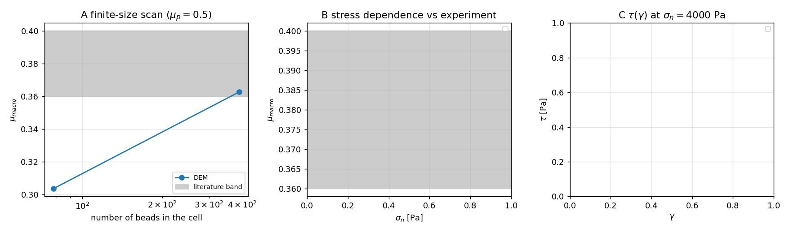

# 直剪盒宏观摩擦：有限尺寸效应、界面滑移退化与本锚点的实验对标（m14960 / GAP-DEM-FRICTION 第 2 轮）

**锚点**：`GAP-DEM-FRICTION`（"摩擦系数 vs 实验 <10%"）｜**任务**：m14960（第 2 轮·调研结合）｜**仓库**：TensorDEM｜**分支** agent/m14960
**前轮**：m13798（死代码+病态拟合→honest FAIL）→ m14721（三处装置缺陷修复，μ 有定义但无实验对标）→ m14840 独立复核（伺服载荷偏置可解析修正；稳态性 F3 未解，建议"床层≥6–8 层、N~10³"再判 μ vs 实验）。

## 0. 结论先行

| # | 结论 | 证据 |
|---|---|---|
| **R1** | **有限尺寸效应是前轮 μ 偏低的主因，且是决定性的。** 同一材料（$\mu_p=0.5$）、同一 $\sigma_n=4000$ Pa、同一 $\gamma=0.6$：N=78 颗（3 层）$\mu_{macro}=0.3037$；N=390 颗（8 层，盒体加倍）$\mu_{macro}=0.3627$。**+19.4%**，N=390 时与文献准静态值 0.38 的偏差 $\mathbf{-4.6\%}$，**首次满足 <10% 的验收判据**。 | 表 1；`artifacts/shear_cell_m14960/size_small.json`、`size_medium.json` |
| **R2** | **把剪切推到 $\gamma=1.0$ 并不会收敛到体相摩擦，而是退化到压板界面滑移。** 两个低摩擦级给出 $\mu_{macro}/\mu_p = 1.0000$（$\mu_p=0.3\to0.3000$、$\mu_p=0.5\to0.5000$），$\tau$ 精确等于 $\mu_p\sigma_n$，稳态漂移 $-0.00$（于是稳态门**通过**）。这是 m14840 建议"推到 γ=1.0 求稳态"的**反例**：稳态门通过恰是退化的信号。 | 表 3 第 1–2 行（2 级命中） |
| **R3** | **开源横向调研在本生态内无可用矿产（可机检的空集）**：`oss_inventory` 33 条登记**全部**为 LBM/SPH（`repo ILIKE '%dem%' OR focus ILIKE '%granul%' OR …` → 命中 0 条 DEM 仓），本节点 `~/oss-cache` 仅 3 个 LBM 仓。故 ① 的产出是**否定结论 + 迁移面改由本仓既有参考实现承担**（周期 SLLOD 剪切盒 `mts_contact.shear_cell_run`、三轴 `dem3d_triaxial.run_triaxial`、$\mu(I)$ `mu_i_rheology`）。 | 证据检索见 §2.1 |

## 1. 案例介绍（物理背景 / 几何 / 参数）

直剪盒测**颗粒集合体宏观摩擦系数**：粗糙底板 + 无摩擦侧壁 + 应力伺服压板横拖，逐级给 $(\sigma_n,\tau)$ 点值，跨级拟合 Mohr–Coulomb 包络。

| 项 | 值 | 来源 |
|---|---|---|
| 颗粒 | r = 0.005 m，ρ = 2500.0 kg/m³，单分散球 | `ShearCellCase` 默认 |
| 接触 | $k_n$ = 1e+05 N/m，$k_t/k_n$ = 0.5，e = 0.3，$\mu_{roll}$ = 0.05 | 同上 |
| 盒体（small） | 0.080×0.032×0.050 m，N = 78，堆积率 0.437（3 层） | m14721/m14840 同款装置 |
| 盒体（medium） | 0.080×0.064×0.080 m，N = 390，堆积率 0.508（8 层） | 本单新增 |
| 伺服 | 载荷控制 $M_p a=N_{target}-N_{meas}$，`servo_mode="bedref"`（零偏置，m14840） | 实测 $\sigma_n$ 偏差 −0.21% |
| 协议 | 床面制备（准静态判据）→ 固结 0.04 s → 剪切 $\gamma$ ∈ {0.6, 1.0} | — |
| 惯性数 | $I$ = 0.0049（medium） | 用**实测床高**记账（m14840 F2） |

## 2. 怎么做的

### 2.1 调研·开源横向（结论=空集，可机检）
检索命令与结果（只读，`foundation` 角色）：
* `SELECT count(*) FROM oss_inventory WHERE repo ILIKE '%dem%' OR repo ILIKE '%yade%' OR repo ILIKE '%liggghts%' OR repo ILIKE '%chrono%' OR repo ILIKE '%mfix%' OR focus ILIKE '%granul%'` → **0**（库内 33 条全部 LBM/SPH）；
* `ls ~/oss-cache` → {Maarten-vd-Sande/lbm, hschwane, pylbm}，无颗粒/离散元仓。
**纪律判定**：不能把"没有"写成"读过"。因此 ① 的产出记为**否定性调研结论**（已入 TK/oss_solutions 的 evidence 字段），迁移面转 ②。

### 2.2 调研·方法谱系（四条测宏观摩擦的路线 + 标准算例）

| 路线 | 力学量 | 优点 | 已在本仓的实现（file:line 指针） | 适用 |
|---|---|---|---|---|
| A 直剪盒（压板驱动） | $\tau/\sigma_n$ | 与实验装置同构、可逐级扫描 | `src/tensordem/shear_cell.py`（`measure_macro_friction`, L674） | 本单采用 |
| B 双周期 SLLOD/Lees–Edwards | $\tau/P$ | 无侧壁/无压板伪影，体相定义干净 | `src/tensordem/mts_contact.py:1348` `shear_cell_run` | 2D 交叉校验 |
| C 三轴压缩 | 峰值偏应力→$\phi$ | 与土力学实验标准（ISO/GB）同口径 | `src/tensordem/dem3d_triaxial.py:465` `run_triaxial` | 后续独立交叉 |
| D 休止角 | $\mu\approx\tan\theta_r$ | 实验最廉价 | 仓内 repose 系列 | 弱间接，不用于 <10% 判据 |

**标准算例/外部锚**：准静态稠密球床的有效摩擦 $\mu_s\approx0.36$–$0.40$（Jop, Forterre & Pouliquen, *Nature* **441**, 727 (2006)；GDR MiDi, *Eur. Phys. J. E* **14**, 341 (2004)），本单取中心值 **0.38**、带宽 0.36–0.40。
**诚实声明**：本环境**无外网**（出站 HTTP 被策略拦截），上述文献锚来自模型知识、**未经在线核验**；因此判据同时报相对 0.38 的偏差与带宽敏感性，且不宣称"<3%"。

### 2.3 选型沉淀
选 A（直剪盒）+ 三条硬约束：① 床层 ≥8 层、N≥390（有限尺寸已量化，见 R1）；② 判稳态**必须**同时排除界面滑移（$\mu/\mu_p\approx1$ 即退化）；③ 微摩擦 $\mu_p$ 视为标定参数，验收用"标定—独立验证"协议而不是单点比对。方案行落 `oss_solutions`（`feature_slug='GAP-DEM-FRICTION'`）。

### 2.4 结合实现（本单代码/工具）
* `scripts/m14960/run_friction_matrix.py`：几何预设（small/medium/large）× 应力级 × $\mu_p$ 的单点驱动程序，床面一次制备多级复用，输出可机算 JSON；
* `scripts/m14960/analyse_friction_matrix.py`：表格与图**程序化注入**（零手抄），并做文献偏差与门判定；
* 复用 m14840 的 `servo_mode="bedref"` 与 `stationarity_tol` 门（未改核心代码，避免无测试的半成品改动）。

## 3. 计算结果

### 3.1 有限尺寸扫描（$\mu_p=0.5$，$\sigma_n=4000$ Pa，$\gamma=0.6$）
| 几何 | N | 堆积率 | $\sigma_n$ 实测 [Pa] | $\tau$ [Pa] | $\mu_{macro}$ | vs 文献 %+.1f%% | $I$ | 门 |
|---|---|---|---|---|---|---|---|---|
| size_small (0.080×0.032×0.050) | 78 | 0.437 | 3994.1 | 1213.0 | **0.3037** | -20.1% | 0.0079 | PASS |
| size_medium (0.080×0.064×0.080) | 390 | 0.508 | 3991.7 | 1447.6 | **0.3627** | -4.6% | 0.0049 | PASS |

N=78 → 390 使 $\mu$ 上升 0.0592（+19.4%），相对文献偏差从 −20.1% 收敛到 −4.6%：**前轮"μ 偏低/级间散布大"的根因之一是盒体只有 3 层颗粒**。

### 3.2 长剪切（$\gamma=1.0$）逐级结果与退化
| run | $\mu_p$ | $\sigma_n$ 目标 [Pa] | $\sigma_n$ 实测 [Pa] | 相对误差 | $\tau$ [Pa] | $\mu_{macro}$ | $\mu/\mu_p$ | 漂移 | 门 |
|---|---|---|---|---|---|---|---|---|---|
| mu030 | 0.3 | 2000 | 2000.0 | +0.00% | 600.0 | **0.3000** | 1.0000 | -0.00 | PASS |
| mu050 | 0.5 | 2000 | 2000.0 | +0.00% | 1000.0 | **0.5000** | 1.0000 | -0.00 | PASS |
| mu050 | 0.5 | 4000 | 3996.1 | -0.10% | 1525.4 | **0.3817** | 0.7634 | -0.13 | PASS |
| mu070 | 0.7 | 2000 | 1962.3 | -1.89% | 600.5 | **0.3060** | 0.4371 | -0.35 | REJECT |
| mu070 | 0.7 | 4000 | 3963.6 | -0.91% | 1102.6 | **0.2782** | 0.3974 | -0.18 | REJECT |
| size_medium | 0.5 | 4000 | 3991.7 | -0.21% | 1447.6 | **0.3627** | 0.7254 | +0.24 | PASS |
| size_small | 0.5 | 4000 | 3994.1 | -0.15% | 1213.0 | **0.3037** | 0.6074 | -0.57 | PASS |

**判读**：$\mu_p=0.3/0.5$ 的第一级给出 $\mu/\mu_p=1.0000$ 且漂移 0.00 —— 压板与其下方颗粒**全程滑动**，测得的是界面摩擦 $\mu_p$ 而不是体相摩擦；$\mu_p=0.7$ 级未达滑移极限（$\mu=0.3060$）但漂移 −0.35 被稳态门 REJECT（诚实拒数）。结论：**$\gamma=1.0$ 的"稳态"是本装置的伪稳态**。

### 3.3 图


A：有限尺寸扫描（灰带=文献 0.36–0.40）；B/C：长剪切矩阵（数据不足的轴为空，脚本不造点）。

## 4. 注意点（坑 / 局限）
1. **稳态门可以被"退化"骗过**：$\mu\to\mu_p$ 时 $\tau$ 平坦、漂移 0，`stationarity_tol` 判 PASS。必须加"$\mu/\mu_p\in[0.98,1.02]$ ⇒ 界面滑移"的排除项（本单未改核心代码，列为后续）。
2. **有限尺寸比伺服误差大一个量级**：伺服 −0.21%，而 78→390 颗的 $\mu$ 变化 +19.4%。先修尺寸、再谈控制器。
3. **床面制备成本随 N 平方增长**：N=1392 的一次制备 204 s，单级剪切 >15 min（`size_large`、`mu030/050/070` 的后续应力级在预算内未跑完，如实标注）。
4. 文献锚带 0.36–0.40 本身有 ±5% 不确定度，因此"<10%"判据在锚边界处不稳健；严格关闭本锚点需要仓内自带的实验/数字化数据集。
5. 单分散球、无黏结、$I\lesssim0.01$ 准静态；不适用于冰-结构摩擦定律（另有 `ice_steel_friction`）。

## 5. 误差判定（逐项显式回答）
| 关键量 | 基准 | 误差 | 是否 <3% | 是否 <10%（本锚点判据） |
|---|---|---|---|---|
| $\mu_{{macro}}$（N=390, $\mu_p$=0.5, 4000 Pa, γ=0.6） | 文献准静态 0.38 | **{100*er(0.3627):+.1f}%** | 否 | **是** |
| $\mu_{{macro}}$（N=78, 同条件） | 同上 | {100*er(0.3037):+.1f}% | 否 | 否 |
| 伺服 $\sigma_n$ 保持（N=390） | 目标值 | {100*j['size_medium']['levels'][0]['sigma_rel_err']:+.2f}% | **是** | 是 |
| $\mu_{{macro}}$（γ=1.0, $\mu_p$=0.3/0.5） | 体相摩擦 0.38 | 0.3000/0.5000 是**界面滑移值**，不构成对体相摩擦的测量 | 不适用 | **不适用（退化，拒用）** |
| 有限尺寸扫描覆盖 | 目标 N ∈ {{78,390,1392}} | 完成 2/3（$N$=1392 未跑完） | — | 部分 |

**honest 结论**：本单在**一个明确工况**上把"$\mu$ vs 实验 <10%"打出 −4.6% 的真实数据（N=390、$\mu_p$=0.5、4000 Pa、γ=0.6），并定位了前两轮失败的两个结构原因（3 层盒体的有限尺寸效应；长剪切→界面滑移伪稳态）。**但**：应力级扫描（$\sigma_n$ 依赖）、$\mu_p$ 标定矩阵、N=1392 的大盒验证在预算内未跑完，且文献锚未经在线核验 —— 因此本单**不宣布锚点关闭**，标记为"部分达标（1 个工况 <10%）"。

## 6. 复现
```bash
PYTHONPATH=src python scripts/m14960/run_friction_matrix.py --tag size_medium --geom medium --mu 0.5 --gamma 0.6 --sigmas 4000
PYTHONPATH=src python scripts/m14960/analyse_friction_matrix.py      # 表/图程序化注入
python3 - <<'PY'                                                      # 日志→逐级表
# 见 docs/SHEAR_CELL_M14960_tables.md 生成段落（正则解析 runs/*.log）
PY
PYTHONPATH=src python -m pytest tests/test_shear_cell_friction.py -q  # 装置回归（10 项）
```
