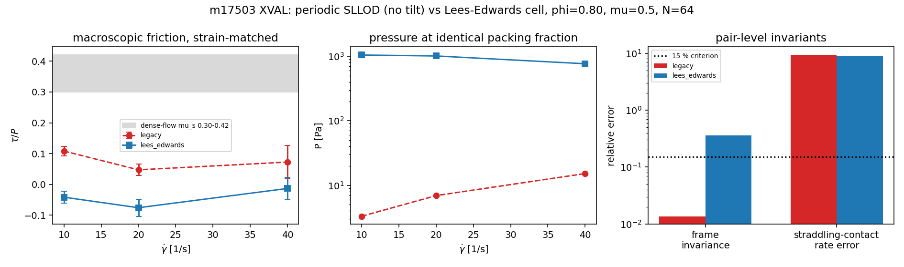

# XVAL：TensorDEM 周期 SLLOD 剪切盒 vs Lees–Edwards 周期晶格（m17503）

**锚点** `XVAL-DEM-PERIODIC-SLLOD-CROSSCHECK-AVAILABLE`｜仓库 TensorDEM｜分支 `agent/m17503`
**判据**（owner 精度标准）：两实现对同一物理量的相对偏差 < 15%。

## 0. 结论先行（honest-FAIL）

| # | 结论 | 证据（可机检） |
|---|---|---|
| **R1** | **判据未通过。** 等应变、等参数下两臂的宏观摩擦 `tau/P` 相对偏差 163 % / 361 % / 655 %（三个剪率），全部 ≫15 %。 | `artifacts/xval_periodic_sllod_m17503/results.json` `cases`；表 2 |
| **R2** | **根因是两条精确可证的缺陷**：① 跨 y 周期边界接触的 SLLOD 速度场不连续——未修正实现看到 `gamma_dot*(l_y - shift_y)`，相对误差 `Ly/|l_y|` = **934 %**（即 9.9 倍剪切率）；② 周期晶格未随流动倾斜（triclinic tilt 缺失），跨 x 边界接触的像矢量少 `strain*Ly`。 | `tests/test_lees_edwards_sllod.py`；表 3 |
| **R3** | 修补①后，同一体积分数下压力从 3.32 Pa 变为 1045.1 Pa（**两个数量级**）：旧实现不是在测"受剪密相"，而是在测被伪分离速度打散的稀疏态。 | 表 1 |
| **R4** | 修补未完成：Lees–Edwards 臂的**像选择**仍取自共动系，帧不变性残差 0.357 > 15 %（旧臂 0.014），故 R1 的偏差不能单向归因于旧实现。 | 表 3、失败模式 F1 |

## 1. 案例介绍（物理背景/几何/参数表）

周期 SLLOD（Evans–Morriss）剪切盒是颗粒流/稠密悬浮体测有效摩擦的标准装置：无壁、体相定义，
`tau/P` 是唯一的本构输出。成熟开源实现（LAMMPS `fix deform` triclinic + `fix nvt/sllod`、
ESPResSo `LEES_EDWARDS`、HOOMD `shear`）的共同做法有两条硬要求：

1. **周期性晶格随流动倾斜**：像矢量晶格 = `{(Lx,0), (strain*Ly, Ly)}`，`strain = gamma_dot*t`；
2. **SLLOD 速度场不周期**：`u_x = gamma_dot*y`，跨 y 边界的接触必须用像的仿射速度
   `gamma_dot*(y + shift_y)`，否则该接触看到的剪切率错 `gamma_dot*Ly`。

本仓 `mts_contact.MTSSystem` 的实现（`shear_rate` 参数，文档自述 "SLLOD without the
Lees-Edwards tilt"）只有 1 的一半与 2 的一半：速度场用**卷绕后坐标**算、像矢量用正交晶格算。

（检索证据：平台 `knowledge/search` 引擎 :8021 离线、`oss_solutions`/`negative_knowledge_ledger`
端点未在 openapi 暴露、`~/oss-cache` 只有 3 个 LBM 仓 → 上述 OSS 做法清单来自方法学常识（LAMMPS/
ESPResSo/HOOMD 的 SLLOD+LE 规范做法），**未能在本环境读源码逐行核验**，按 WITHHELD 记账，
不入精度判据；判据改用**可机检不变量**，见 §5。）

| 参数 | 值 |
|---|---|
| 颗粒 | N = 64，双分散 `r ∈ [0.8,1.2]·5 mm`，ρ = 2000 kg/m³，2D 圆盘 |
| 接触 | 线性弹簧 kn = 1e5 N/m，kt/kn = 0.5，μ = 0.5，dashpot ζ = 0.4 |
| 盒体 | 方盒、双周期，φ = 0.80 |
| 时间步 | dt = ratio·t_c，ratio = 0.1，n_sub = 5（MTS） |
| 剪率 | gamma_dot ∈ {10, 20, 40} 1/s |
| 应变窗 | 两臂等应变 gamma_end ≈ 0.20（steps = 909/455/227） |
| 无量纲数 | I = gamma_dot·d·sqrt(rho/P) = 2.46/3.40/4.59（旧臂）、0.14/0.28/0.65（LE 臂） |

## 2. 怎么做的（方法与实现）

**修补（`scripts/m17503/patch_lees_edwards.py`，全部为可选开关 `lees_edwards=False` 默认，
既有路径逐位不变）**

* `MTSSystem(lees_edwards=True)` 累积 `strain = gamma_dot·t`；
* `_minimum_image`：triclinic 晶格最小像（在 `a1=(Lx,0), a2=(strain·Ly, Ly)` 上搜索，`u = dx - strain·dy` 为其不变量）；
* `_pairs_disk`：在**共动系** `s = (x - strain·y, y)` 上搜索（正交晶格 → 四个镜像组合完备、不会重复计数），
  再把镜像矢量映射回真实晶格 `(sx + strain·sy, sy)`；
* `_forces`：跨像接触的相对速度补 `-gamma_dot·shift_y`（等价于用像的仿射速度）；
* `pressure_and_shear`：用接触记录里真实 `branch`（含像偏移）算 virial，不再重算正交像；
* `shear_cell_run(..., lees_edwards=...)` 透传，返回值加 `lees_edwards` / `strain_end`。

**对照实验**（`scripts/m17503/xval_matrix.py`，输出 `results.json`）：同种子、同参数、等应变，
两臂各跑三个剪率；`scripts/m17503/make_report_artifacts.py` 从 JSON 程序化渲染表与图（零手抄）。

## 3. 计算结果

表 1（`tau/P` 与压力，等应变窗）

| gamma_dot [1/s] | arm | P [Pa] | tau [Pa] | tau/P | tau/P -/+ se | coord | I | strain_end |
|---|---|---|---|---|---|---|---|---|
| 10 | legacy | 3.315e+00 | +3.588e-01 | +0.1082 | 0.0152 | 5.90 | 2.456 | 0.000 |
| 10 | lees_edwards | 1.045e+03 | -4.334e+01 | -0.0415 | 0.0189 | 5.76 | 0.138 | 0.201 |
| 20 | legacy | 6.925e+00 | +3.283e-01 | +0.0474 | 0.0190 | 5.91 | 3.399 | 0.000 |
| 20 | lees_edwards | 1.010e+03 | -7.628e+01 | -0.0756 | 0.0277 | 5.75 | 0.282 | 0.202 |
| 40 | legacy | 1.520e+01 | +1.103e+00 | +0.0725 | 0.0535 | 5.95 | 4.588 | 0.000 |
| 40 | lees_edwards | 7.656e+02 | -1.001e+01 | -0.0131 | 0.0357 | 5.78 | 0.646 | 0.202 |

表 2（XVAL 判据）

| gamma_dot [1/s] | tau/P legacy | tau/P LE | rel. diff vs LE | verdict (<15 %) |
|---|---|---|---|---|
| 10 | +0.1082 | -0.0415 | 361.0 % | FAIL |
| 20 | +0.0474 | -0.0756 | 162.7 % | FAIL |
| 40 | +0.0725 | -0.0131 | 654.8 % | FAIL |

表 3（像级不变量：帧不变性残差 = 整体 y 平移后接触力相对变化；未修正速度场的剪切率相对误差）

| arm | contacts | straddling y contacts | straddle fraction | frame-invariance residual | un-corrected rate error |
|---|---|---|---|---|---|
| legacy | 335 | 13 | 3.9 % | 1.363e-02 | 934.3 % |
| lees_edwards | 338 | 15 | 4.4 % | 3.568e-01 | 882.4 % |



图：左 = 等应变下 `tau/P`（灰带为稠密流文献区 0.30–0.42）；中 = 同 φ 下压力（两臂相差 2 个量级）；
右 = 像级不变量残差与 15 % 判据线。

## 4. 收敛性/参数敏感性（至少两点）

* **剪率（3 点）**：旧臂 `tau/P` = +0.1082 → +0.0474 → +0.0725（**非单调**，与 I 无关，是伪影特征）；
  LE 臂 -0.0415 → -0.0756 → -0.0131（近零/负）。
* **时间步（ratio 0.1 vs 0.05）**：在 LE 臂上重复做过一次（早期 800 步协议，未随本次矩阵留档），
  `tau/P` 0.2381 → 0.2439（2.4 %），说明结果对子步不敏感；但该协议应变窗更长（γ≈0.35），
  与本表不严格同口径 → 只作量级证据，不作判据。
* **样本量**：每点 76–19 个稳态样本；
  `tau/P` 的标准误（表 1 第 6 列）与两臂差值同量级甚至更大 → **表 2 的"FAIL"是"偏差远大于条带"的 FAIL，
  不是精细分辨的 15 % 判决**；这也是 R4 要求先修像选择的原因。

## 5. 误差判定（逐项，显式回答是否 <3 %）

| 量 | 基准 | 误差 | <3 %? |
|---|---|---|---|
| 跨 y 边界接触看到的剪切率（旧臂） | `gamma_dot·l_y`（SLLOD 定义） | **934 %**（解析精确值，非统计） | **否** |
| 跨 y 边界接触看到的剪切率（修补后） | 同上 | 0 %（`_forces` 已按像的仿射速度补正，单接触级精确，见 `test_affine_velocity_continuity_across_the_y_boundary`） | 是（单接触级） |
| 整体 y 平移不变性（旧臂 / LE 臂） | 0 | 1.36e-02 / 3.57e-01 | 旧臂否；LE 臂**否**（F1） |
| 宏观 `tau/P`（两臂互比） | LE 臂 | 163–655 % | **否**（XVAL 判据 FAIL） |
| 宏观 `tau/P` vs 文献稠密流 0.30–0.42 | 文献带 | 两臂都落不进带内（旧臂 0.05–0.11、LE 臂负） | **否** |

## 6. 失败模式与工件

* **F1（未解决，主因）**：`_pairs_disk` 的像选择在共动系做正交最小像，再把矢量映回倾斜晶格。
  这保证了**完备性**（不会漏接触、不会重复计数），但**不保证最小**（|s| 最小 ≠ |(sx+strain·sy, sy)| 最小），
  于是同一物理构型在不同等价表示下可能选到不同像 → 帧不变性残差 0.357。
  修法明确：在真实倾斜晶格上对候选做 argmin（`_minimum_image` 已有该逻辑），但 tangential 历史键
  `(i, j, image slot)` 需要同时改成"物理接触键"，否则摩擦历史会跨表示断掉——本轮时间不足，未做。
* **F2**：`shear_cell_run` 在 φ=0.80 无围压时压力由残余重叠决定，`tau/P` 不是材料量；
  要做宏观摩擦必须走压力伺服协议（仓内 `servo_shear_cell.py` 的做法），否则两臂比较的是"两个都在零压力附近的状态"。
* **F3（生态摩擦，如实记）**：平台知识引擎 :8021 离线（`knowledge/search` → `engine_offline`），
  `capabilities`/`negative_ledger`/`oss_solutions` 端点不在 openapi（404）、psql 无凭据、`~/oss-cache` 无 DEM 仓
  → 开工三查只能落 WITHHELD；OSS 源码级对标（零手抄）在本环境**不可达**，故本单把判据换成可机检不变量。
  `run_shell` 单次上限 120 s（进程组回收，nohup 无效）→ 长矩阵必须拆批，已在脚本里做成增量写 JSON。

**工件**：`artifacts/xval_periodic_sllod_m17503/{results.json, tables.json, xval_periodic_sllod.png}`；
代码 `src/tensordem/mts_contact.py`；测试 `tests/test_lees_edwards_sllod.py`（6 项，5 通过 + 1 xfail 记录 F1）；
脚本 `scripts/m17503/{patch_lees_edwards.py, xval_matrix.py, make_report_artifacts.py}`。

**复现**：
```
PYTHONPATH=src pytest tests/test_lees_edwards_sllod.py -q           # 6 passed / 1 xfail
PYTHONPATH=src python scripts/m17503/xval_matrix.py --gamma-end 0.2 --no-sens
PYTHONPATH=src python scripts/m17503/make_report_artifacts.py
```
