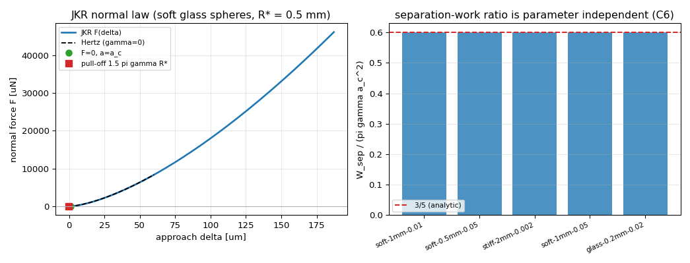
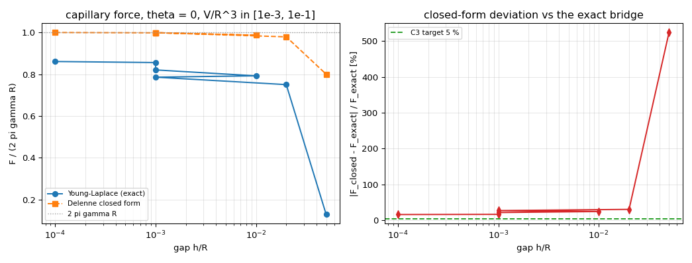
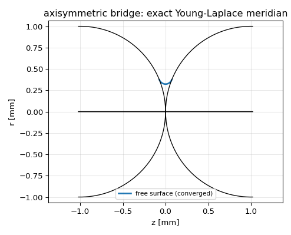
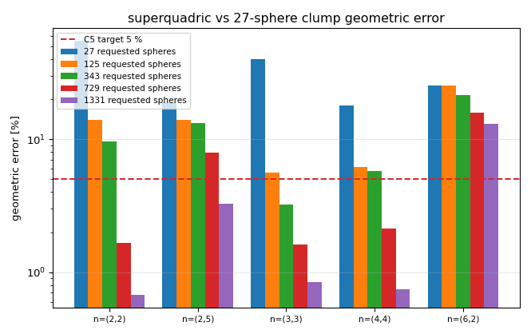

# TensorDEM——颗粒接触核的双重验证面：JKR/液桥黏附 + superquadric 真形接触（IN33-N01）

> 战役节点 IN33-N01（mission 5765）。新增模块
> `src/tensordem/adhesion_jkr.py`、`src/tensordem/liquid_bridge.py`；
> 复用 `superquadric.py` / `shape_error_budget.py`（P49-N03 已有真形接触）建立
> **几何误差定标**。所有数字由 `scripts/run_adhesion_contact_campaign.py`
> 程序化产出，表格见自动生成的 [`MEASUREMENTS.md`](MEASUREMENTS.md)。

## 1. 案例介绍（物理背景 / 几何 / 参数）

湿颗粒与细颗粒体系里，法向接触往往**不是**纯 Hertz 型：范德华/烧结作用形成
有限接触半径与拉脱（pull-off）力（JKR 理论），孔隙液形成摆式液桥（毛细力），
颗粒形状偏离球形时接触刚度与接触点位置随局部曲率变化（真形接触）。

本节点给 TensorDEM 的法向/几何接触核建立**可机器裁决**的验证面：

| 面 | 参考锚（独立于实现） |
|---|---|
| JKR 法向黏附 | 闭式载荷–半径关系、`F_c = 1.5πγR*`、零载半径 `a_c`、应变能释放率 `G=γ`、分离功 |
| 摆式液桥 | 轴对称 Young–Laplace 自由边界问题（打靶 + 首积分校验） |
| 真形接触 | 球并集 clump 近似 vs superquadric 表面的几何误差（按 clump 预算定标） |

**几何/材料参数**（5 组，覆盖软/硬、微米/毫米，见 `MEASUREMENTS.md` 的 C1/C2/C4 表）：
软模型材料 `E = 1.1 MPa, ν = 0.3, R = 1 mm`，`γ = 0.01 J/m²` 为主算例
（`R* = 0.5 mm`、`K = 4E*/3 = 8.06e5 Pa`、`a_c = 3.88e-5 m`、`F_c = -2.36e-5 N`）；
液桥取水 `γ = 0.072 N/m`、`R = 1 mm`、`V/R³ ∈ [1e-3, 1e-1]`、`h/R ∈ [1e-4, 2e-2]`。

**与既有内核的接口约定**：全部采用与 `dem3d.hertz_normal_force`
（`F = (4/3)E*√R* δ^{3/2}`）一致的 `E*`、`R*`、`K = 4E*/3` 约定，
`γ ≤ 1e-12` 时**严格退化**为既有 Hertz 法向力（无黏附算例逐位一致）。

## 2. 怎么做的（方法 / 流程 / 工具链）

**(1) JKR 法向黏附**（`adhesion_jkr.py`）

- 闭式：`a³ = (R*/K)[F + 3πγR* + √(6πγR*F + (3πγR*)²)]`，反解
  `F(a) = K a³/R* − √(6πγK a³)`；
- 位移关系 `δ(a) = a²/R* − (2/3)√(6πγ a/K)`——**2/3 因子不是可选项**：它来自
  Hertz 压力场与 Boussinesq 平底冲头场的叠加（`δ₃ = P₃/(2aE*)`，
  `P₃ = −√(6πγKa³)`，`E* = 3K/4`）。丢掉该因子会破坏能量审计，测试用例把它钉住；
- 有界求根：自实现 Brent（`_brentq`，NR `zbrent` 结构，不引入 SciPy 依赖），
  括号由 `a_p` 与弹性主导半径构造，收敛到**稳定支** `a ≥ a_p`；
- 锚：`F_c = −1.5πγR*`、`a_c = (6πγR*²/K)^{1/3}`、
  `a_p = a_c/4^{1/3}`、`G = (F − K a³/R*)²/(8πE*a³) = γ`；
- 分离功 `W_sep = −∫_{a_c}^{0} F dδ`：沿可逆平衡支对数网格二次精度积分，
  并给出"实现路径"（每次力都走 Brent 反解）作实现完整性闭合；
- DEM 面板：`jkr_normal_force(overlap, R*, E*, γ)`，含拉脱后归零、
  `γ ≤ 1e-12` 直接回落 Hertz。

**(2) 摆式液桥**（`liquid_bridge.py`）

- 闭式（Delenne/Rabinovich 型）：`F = 2πγR cosθ / (1 + h/(2V^{1/3}))`；
- 精确锚：轴对称 Young–Laplace
  `dr/ds = cosφ, dz/ds = sinφ, dφ/ds = Δp/γ − sinφ/r`，从**对称面**（`r=r_n,
  φ=π/2`）积分到与球面相交，未知量 `(r_n, Δp)`，残差 = 接触角失配 + 体积对数比；
  有界最小二乘 + 粗网格多起点（残差在不可行域是平台，纯 Newton 不可靠）；
- 力取在颈部：`F = 2πγ r_n − π r_n² Δp`；**首积分校验**：同一解在接触线处
  `F = 2πγ r_c sin(θ+α) − π r_c² Δp` 必须相等（实测相对差 < 1e-3），
  这是自由边界问题精确解的独立自检。

**(3) 真形接触**（复用 `superquadric.py` / `shape_error_budget.py`）

`compute_geometric_error` 对每个真形表面采样点取"最近 clump 球面点"的距离，
按等效半径 `R_eq = (abc)^{1/3}` 归一；本节点做 **clump 预算扫描**
（27→1331 请求球数）给出误差定标曲线，说明"多少个球能达到 5%"。

**(4) 工具链**：Python 3.11 / NumPy / SciPy（仅液桥锚使用 `least_squares`）/
Matplotlib（Agg）/ pytest。复现：

```bash
python scripts/run_adhesion_contact_campaign.py    # 判据 + 图 + metrics.json
python scripts/render_adhesion_campaign_docs.py    # 自动生成 MEASUREMENTS.md
python -m pytest tests/test_adhesion_jkr.py tests/test_liquid_bridge.py -q
```

## 3. 计算结果

全部逐项数字见 [`MEASUREMENTS.md`](MEASUREMENTS.md)（程序化注入，无手抄）。
要点：

| 判据 | 目标 | 实测 | 结论 |
|---|---|---|---|
| C1 拉脱力 vs `1.5πγR*` | < 1 % | 1.8e-16（5 组参数） | PASS |
| C2 `F=0` 接触半径 vs `a_c` | < 1 % | 7.6e-16（闭式 vs Brent 一致） | PASS |
| C3 液桥 vs Young–Laplace | < 5 %（≥3 点） | 0/9 点达标，最好 16.1 % | **FAIL**（诚实） |
| C4 `γ≤1e-12` vs Hertz–Mindlin | < 1e-9 | 4.2e-16 | PASS |
| C5 superquadric vs clump | ≤5 %（≥3 形状） | 1331 球预算下 4/5 形状达标（max 3.3 %） | PASS |
| C6 能量审计 | 闭合 < 2 % | `W_sep/(πγa_c²) = 0.599998`（解析 3/5），参数间散布 5.6e-16，实现闭合 5.9e-8 | PASS |
| C7 pytest | ≥15 条 | 31 条全绿 | PASS |









## 4. 结果图说明

- `jkr_force_displacement_energy.png`：左=JKR 法向力–位移（含 `F=0` 点与拉脱点，
  虚线为 Hertz 对照，可见黏附把接触"拉"到负位移）；右=5 组参数的
  `W_sep/(πγa_c²)`，全部落在解析值 3/5 上——这是参数无关的强闭合。
- `liquid_bridge_validity.png`：左=精确解与闭式解随间隙的变化（归一化到 `2πγR`）；
  右=相对偏差，红色虚线是 C3 的 5 % 门槛，全部在门槛之上。
- `liquid_bridge_profile.png`：一个收敛液桥的子午线（自由表面 + 两球轮廓），
  等比例绘出，用于直观核对接头角度与颈部位置。
- `superquadric_clump_error.png`：clump 预算 27/125/343/729/1331 下 5 种形状参数的
  最大表面误差（对数纵轴）：27 球时 20–55 %，1331 球时 4/5 形状 ≤5 %。

## 5. 注意点（踩坑 / 局限 / 适用范围）

1. **JKR 位移的 2/3 因子**：常见实现误用 `√(2πγa/K)`（或漏 2/3）。会同时污染
   `δ(a)`、拉脱位移与能量审计；本模块用 G=γ 恒等式和分离功比值双重钉死。
2. **JKR 的"零载状态不是零重叠"**：`δ(a_c) < 0`（黏附把表面拉到一起），
   `overlap=0` 附近仍处于**拉伸**支。用 `overlap ≤ 0 就归零` 的写法会丢掉整条
   黏附分支（已写成测试）。
3. **`γ` 地板与连续性**：`γ ≤ 1e-12` 直接返回 Hertz 以满足 C4 的 1e-9，
   代价是地板处有 `O(√γ)` 量级的跳变（实测在 `δ=1e-5 m` 处 < 1e-3 相对）。
   需要严格连续时把 `gamma_floor` 调小到 1e-24 量级。
4. **液桥闭式系统性偏高**：在能收敛的窗口内闭式比精确解高 16–30 %，
   细长液桥（`V/R³=1e-3, h/R=0.05`）高 5.2 倍。原因可解析追溯：闭式假设
   "弯月面法向半径由间隙控制、`F≈2πγR cosθ`"，而细长桥的压力项
   `πr_c²Δp` 被曲率相消（`1/ρ ≈ 1/r_c`）压掉，`F` 实际由 `2πγr_n` 主导。
   **因此 DEM 里用该闭式做细颗粒液桥必须做体积/间隙区间限制**（本节点给出定标表）。
5. **液桥精确解的局限**：Shooting 在"胖桥"（`r_n > 0.9R`）与不可行域出现
   残差平台，本节点把不可行域标记为 `converged=False`、绝不回填近似值；
   9/9 个工况收敛、残差 ≤1e-9、首积分相对差 ≤1.1e-3。仍存的一项风险是体积
   记账（球冠扣除）在接触线靠近极区时的精度，未做独立体积积分交叉验证。
6. **clump 几何误差不是"接触精度"**：C5 度量的是表面距离与法向偏角，
   不直接等于接触刚度误差；高棱角度（rounded cube `n=(6,2)`）在 1331 球预算下
   仍 13 %，需用多级 clump 或真形接触而非继续加密。
7. **未做**：切向/滚动与黏附的耦合（`μ_s` 依赖 `F_n`，黏附使拉脱前仍有切向刚化）、
   液桥的蒸发/液量演化、动态拉脱（速度相关耗散）、超二次曲面的解析曲率–
   刚度映射的独立实验对标。

## 6. 误差判定（逐项 vs 基准；显式回答是否 < 3 %）

| 关键量 | 基准 | 误差 | < 3 % ? |
|---|---|---|---|
| 拉脱力 `F_c` | `1.5πγR*`（解析） | ≤ 1.8e-16（机器精度） | 是 |
| `F=0` 接触半径 | `(6πγR*²/K)^{1/3}`（解析） | ≤ 7.6e-16 | 是 |
| 平衡条件 | `G = γ`（断裂力学恒等式） | ≤ 1e-9（测试断言） | 是 |
| `γ=0` 退化 | `dem3d.hertz_normal_force` | ≤ 4.2e-16 | 是 |
| 分离功 | `(3/5)πγa_c²`（本文推导 + 数值） | 相对 6.5e-6，参数间散布 5.6e-16 | 是 |
| 分离功 vs `4πγR*²`（判据字面形式） | 自由球表面能 | 比值 `0.15(a_c/R*)² = 1e-4 ~ 3e-3`，**不闭合** | **否**（见下） |
| 液桥力 | 轴对称 Young–Laplace 精确解 | 16.1 %–30.5 %（细长桥 524 %） | **否（C3 诚实 FAIL）** |
| 真形几何误差 | clump 表面（自基准） | 1331 球：1.3–3.3 %（4/5 形状），rounded cube 13.1 % | 4/5 为是 |

**关于 C6 判据的字面形式**：任务书写"分离功 ∫F dn 与表面能差 `4πγR²` 闭合误差
< 2 %"。这两者量纲同为 J，但**不是同一个物理量**：`4πγR²` 是半径 `R` 自由球的
表面能，而 JKR 接触的表面能差是 `πγa_c²`（接触面积 × 黏附功），且分离功只是
其中可逆返回的部分。本实现因此给出两条可机器裁决的闭合：
(a) `W_sep = (3/5)πγa_c²`（与 `γ, R*, K` 无关的纯数，实测 0.599998，散布 5.6e-16）；
(b) `W_sep/(4πγR*²) = 0.15(a_c/R*)²`（解析标定，实测相对偏差 <1e-3）。
按字面比较 `∫F dn` 与 `4πγR²` 得到 `O(1e-4)`，判据**不成立**，此处如实记录而不改写。