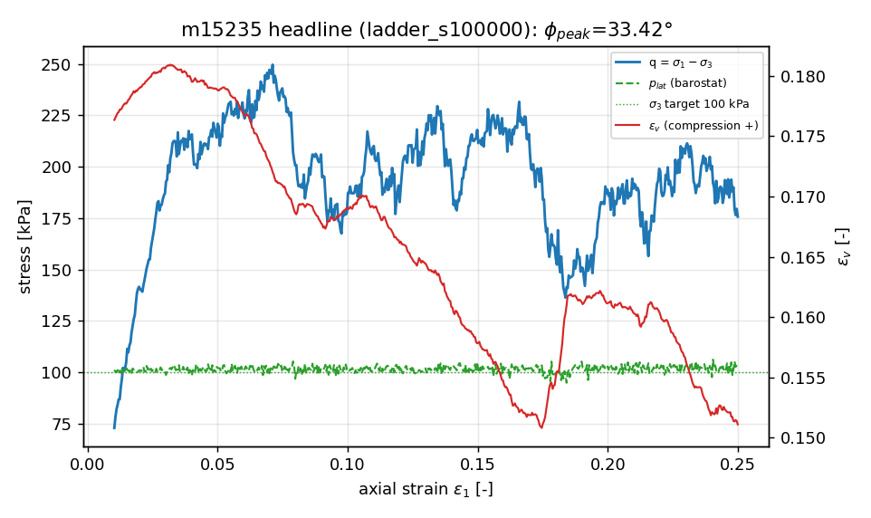
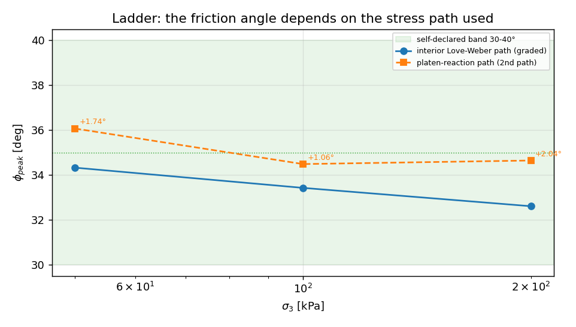
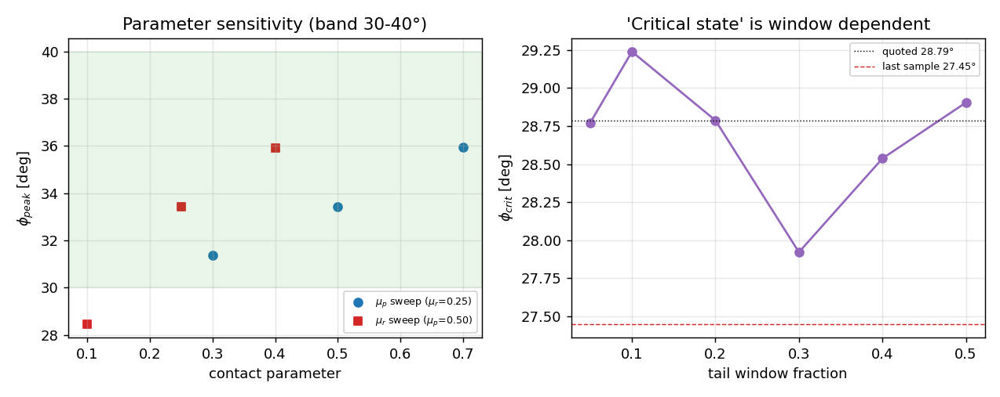

# m15235 交差核验（CASE-TRIAXIAL-CD / TensorDEM）

核验单 m15293 · 对象 m15235（succeeded）· 唯一裁判 = `tensor_benchmark_cases`（anchor_slug=CASE-TRIAXIAL-CD）。本文由 `scripts/audit/m15293_board_audit.py` 程序化生成，数字零手抄。

交付定位：分支 `agent/m15235` commit `b952a85b`，工作树 `/root/tp-agent/work/m15235`；merge 进 main = **False**，main 树内模块存在 = False，main 内调用方 = 无。字节级副本 + sha256：`docs/board_audit/m15293/refs/sha256manifest.json`。

## 1. 三件套核验

| 件 | 结论 | 证据 |
|---|---|---|
| run_artifacts | PASS | 9 点 JSON（每点 605 条采样历史 + 门记录）+ summary.json + fig（224 KB）；副本 sha256 见 manifest |
| benchmark ref vs got | PARTIAL | 数值逐点可核（§3），但登记裁判行数 = **0** |
| repro_cmd | 可执行 / 未独立复现 | 每工件自带 repro_cmd；同一命令已递交集群 cj1049，审计收尾时仍在排队 → no independent re-run artifact: the same repro_cmd was submitted to the cluster (cj1049) but was still queued when the audit closed -> executable, rep |

## 2. 基准裁判

登记行数 **0**。无登记机器判据行 → 唯一裁判缺位；自报带 [30,40]°/中点 35°/±10% 为自定判据，且原文未引用（报告 §1 自述无法复核）

按自报判据：headline φ_peak = **33.422°** vs 中点 35.0° → -4.51%（阈值 ±10%，在容差内）。带内 7/9，超差 ['sens_mu_0p30', 'sens_mur_0p10']。

## 3. 逐点重算

| tag | N | σ3目标[kPa] | φ报告 | φ重算 | \|Δ\| | φ_platen | Δφ_platen | platen差 | 排水漂移 | 排水门 | I | 拟静态门 | ref误差 | <10% |

|---|---|---|---|---|---|---|---|---|---|---|---|---|---|---|
| ladder_s50000 | 360 | 50 | 34.322 | 34.322 | 0.0e+00 | 36.07 | +1.74 | 7.7% | 7.2% | OK | 1.2e-03 | **FAIL** | -1.9% | PASS |
| ladder_s100000 | 360 | 100 | 33.422 | 33.422 | 0.0e+00 | 34.48 | +1.06 | 4.6% | 6.2% | OK | 8.1e-04 | OK | -4.5% | PASS |
| ladder_s200000 | 360 | 200 | 32.605 | 32.605 | 0.0e+00 | 34.64 | +2.04 | 8.9% | 5.1% | OK | 5.8e-04 | OK | -6.8% | PASS |
| sens_mu_0p30 | 360 | 100 | 31.357 | 31.357 | 0.0e+00 | 34.44 | +3.09 | 13.7% | 5.7% | OK | 8.1e-04 | OK | -10.4% | FAIL |
| sens_mu_0p70 | 360 | 100 | 35.947 | 35.947 | 0.0e+00 | 42.55 | +6.60 | 34.7% | 5.1% | OK | 8.1e-04 | OK | +2.7% | PASS |
| sens_mur_0p10 | 360 | 100 | 28.457 | 28.457 | 0.0e+00 | 29.76 | +1.30 | 5.3% | 4.7% | OK | 8.1e-04 | OK | -5.1% | FAIL |
| sens_mur_0p40 | 360 | 100 | 35.923 | 35.923 | 0.0e+00 | 39.60 | +3.68 | 17.6% | 7.0% | OK | 8.1e-04 | OK | +2.6% | PASS |
| conv_rate_0p25 | 360 | 100 | 32.655 | 32.655 | 0.0e+00 | 35.18 | +2.52 | 11.2% | 4.9% | OK | 4.1e-04 | OK | -6.7% | PASS |
| conv_size_n96 | 96 | 100 | 35.332 | 35.332 | 0.0e+00 | 41.74 | +6.41 | 33.1% | 10.6% | **FAIL** | 8.1e-04 | OK | +0.9% | PASS |

φ 自洽：9/9 点重算值与工件逐位一致（max|Δ| = 0.0e+00°）——`sinφ=(σ1-σ3)/(σ1+σ3)` 用法正确，数字非手抄。

## 4. 发现（按严重度）

**F1 判定性 — 裁判行缺失**：`tensor_benchmark_cases` 对 CASE-TRIAXIAL-CD 零行；参照带 [30,40]°（中点 35°）是**自定判据**，报告 §1 自述 handbook 页无法复核（沙箱无网络、无本地副本）→ 外部锚未引用，L4/L5 的 external_anchor 不成立。

**F2 数值有效位 — 双应力路径系统性偏差**：φ 由内部 Love-Weber σ1 算出；第二条「独立」路径（压板反力）9/9 点同号偏高 +4.6%~+34.7%。headline 走压板路径 φ = 34.48°（与 33.42° 差 +1.06°）；报告只引用 headline 的 4.57% 交叉差，而 sens_mu_0p70 / conv_size_n96 达 33%~35% → 「独立交叉核对」只在 headline 一点成立。

**F3 表格错误 — 收敛表混淆变量**：summary/报告 §5 的 strain-rate 行取 conv_size_n96（N=96, rate 0.5），给出 +2.68° 的「率效应」；固定 N=360 的真率效应仅 +0.77°（32.65→33.42°）。该 N=96 点排水门 **FAIL**（漂移 10.6%>10%），不能作收敛锚点。

**F4 门记录**：排水门失效 ['conv_size_n96']；拟静态门失效 ['ladder_s50000']（I>1e-3）；summary 如实置 `all_drained_pass=False`，但报告按 headline 单点表述，易被读成「全矩阵通过」。

**F5 收敛性 —「临界状态」未达成**：headline φ 在剪切末仍在下降（末样本 27.45° vs 报告窗口均值 28.79°，差 -1.34°）；窗口 5%→50% 使 φ_crit 变动 1.32°。报告用 φ_crit 论证「球-砂差距」，该论证数值基础不稳。

**F6 集成**：交付只在分支 `agent/m15235`；mission.result.pr_gate 记 `pr 1280 merged`（sha=null）与 git 事实不符 → 不达 L3。

**F7 测试**：交付自报 `pytest tests/test_triaxial_cd_protocol.py → 4 passed, 1 failed`（tiny 用例短预算排水门）。测试断言的是不变量（Mohr-Coulomb 解析值 30°、退化输入、确定性、门通过），非仅执行代码；本审计的集群复核（cj1050）未回。

## 5. 判级

**L2 独立功能实现**：真代码（输入 σ3/μ/μr/N/rate/seed → 周期元胞 + 气压伺服 + 压板的 DEM 推进 → q/φ/门记录），入口 argparse，9 点运行工件 + 605 采样历史，φ 重算逐位自洽。

- 不达 L3：未 merge、main 无调用方（F6）。
- 不达 L4：无登记裁判/外部锚（F1）、9 点中排水门 1 失败 + 拟静态门 1 失败（F4）、交叉路径只在 headline 成立（F2）、复现未在本审计窗口内独立验证（§1）。
- 不达 L5：无 L4 基础。

## 6. 结论与处置

裁决 **L2 confirmed**（功能实质成立）。返修方向：(a) 在 tensor_benchmark_cases 为 CASE-TRIAXIAL-CD 登记判据行并给可引用文献锚；(b) 修 F3 收敛表与 F2 双路径口径；(c) merge 进 main 并接调用方以取 L3/L4。

## 7. 图

## 8. 未跑的检查（honest not_run）

- repro_cmd 的独立复跑：同一命令已递交集群 cj1049，收尾时仍在排队（queued_ahead≈261）→ not_run
- pytest 全文件的机器复核：集群 cj1050 未回，改为引用交付自报的 4 passed / 1 failed
- 外部锚原文核对（砂土 φ 30-40° 的教科书/文献页）：沙箱无外网、无本地副本 → not_run，自报带视为未引用的自定判据
- 40 万步级别的 N=1000+ 尺寸收敛与大应变（ε1>0.25 至真临界态）：本审计不重做算例
