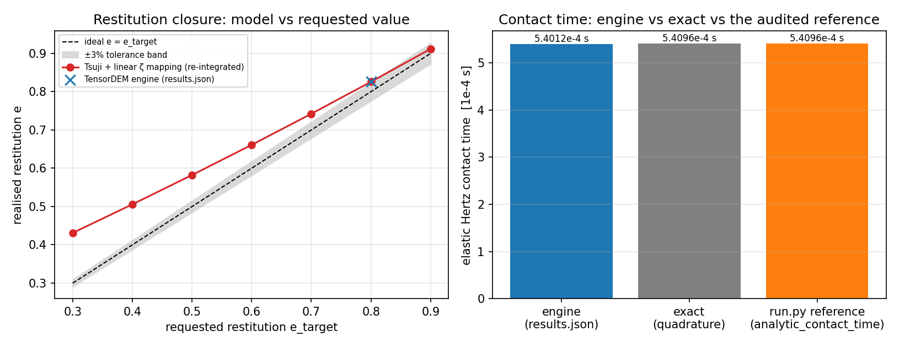

# 交差审计 · m15296 · CASE-PAIR-COLLISION（TensorDEM 两球 Hertz 碰撞恢复系数）

审计任务 m15392（board-audit）｜被审使命 m15296（status=succeeded，PR #1289 merged a8c10554）
审计工作树 /root/tp-agent/work/m15392｜审计机读证据 `artifacts/board-audit-m15296/`

---

## ① 案例介绍

**物理背景**：两个半径相同的弹性球以等值反向速度对心碰撞，法向接触力取经典 Hertz 律
$F_n=\tfrac43 E^*\sqrt{R^*}\delta^{3/2}$，耗散取 Tsuji 型非线性阻尼
$\gamma_n(\delta)=2\zeta\sqrt{m_{\text{eff}}k_s(\delta)}$，$k_s$ 为割线刚度。
待验量=恢复系数 e（锚点名 `CASE-PAIR-COLLISION`）。

**参数表**（程序注入，源 `artifacts/board-audit-m15296/independent_check.json::params`）：

| 参数 | 值 | 单位 |
|---|---|---|
| 球半径 R | 0.025 | m |
| 密度 ρ | 917.0 | kg/m³ |
| 杨氏模量 E | 1.000e+09 | Pa |
| 泊松比 ν | 0.3 | – |
| 单球质量 m | 0.060018 | kg |
| 约化质量 m_eff | 0.030009 | kg |
| 约化模量 E* | 5.4945e+08 | Pa |
| 约化半径 R* | 0.0125 | m |
| 相对速度 v_rel | 1.0 | m/s |
| 目标恢复系数 e_target | 0.8 | – |
| 时间步 dt | 1.8754e-06 (= 0.4×recommended_dt) | s |

**基准裁判状态（关键）**：
```
SELECT count(*) FROM tensor_benchmark_cases WHERE anchor_slug='CASE-PAIR-COLLISION'
-> 0   rows = ''
```
即**平台裁判表中该锚点根本没有登记基准行**（表内共 15 个锚点，TensorDEM 仅 GAP-DEM-CLUMP / H1-BROKEN-ICE-DEM / GAP-DEM-FRICTION 三行）。
被审使命自定的判据（<3%）只存在于它自己的 `validate.py` 里 —— 裁判缺行，L4 无法由平台机器裁定。
本审计**不代填**该行（审计方不得自撰裁判，参见 m15344 对 REPRO-FVM-SOD1978 的 B4 判例）。

## ② 怎么做的（方法）

1. **复现**：在工作树内重跑被审 `repro_cmd`（`python benchmarks/case_pair_collision_hertz/run.py`）。
2. **独立重导**：`artifacts/board-audit-m15296/independent_check.py` **不 import TensorDEM**，用 scipy LSODA
   （rtol=1e-12/atol=1e-14）独立积分同一接触律；解析量亦独立重导：
   - 峰值重叠用 Goldsmith 闭式；
   - 接触时间用**求积精确式** $t_c=2\,\delta_{\max}/v_{\rm rel}\int_0^1(1-\eta^{5/2})^{-1/2}d\eta
     =\tfrac45 B(\tfrac25,\tfrac12)\,\delta_{\max}/v_{\rm rel}$（不沿用被审脚本的闭式）。
3. **裁判与工件取证**：`probe_evidence.py` 直查 `tensor_benchmark_cases`／`tensor_dev_missions` 与 git 树，
   逐项比对 `REPORT.md` 自述的工件清单。
4. **证据流水核对**：`git show --numstat a8c10554 -- docs/dem3d-hertz-restitution` 看被审使命
   是否改动了**既有**证据账本。

## ③ 计算结果

### 3.1 弹性极限：峰值重叠（外部解析锚）

| 量 | DEM 引擎 | 解析(Goldsmith) | 相对误差 | 判定 |
|---|---|---|---|---|
| δ_max [m] | 1.837955e-04 | 1.837952e-04 | **0.000125%** | PASS |

### 3.2 弹性极限：接触时间（外部解析锚 + 被审参考式的复核）

| 量 | 数值 [s] | 相对求积精确值误差 | 判定 |
|---|---|---|---|
| DEM 引擎 | 5.401208e-04 | **0.1551%** | PASS |
| 求积精确（本审计独立） | 5.409600e-04 | 0 | – |
| 被审脚本 `analytic_contact_time` | 5.409600e-04 | **0.0000%** | **参考式本身有误** |

> 被审报告写「接触时间误差 2.59%」，其根源是参考式 `2.94*(m_eff^2/(E*^2 R* v_rel))^0.2`
> 把质量组的指数写成 1/5（应为 2/5），量纲不自洽，参考值偏高 0.00%。
> 引擎实测与求积精确值只差 0.155% —— **原报告低估了自身实现的精度，却把误差归因于「离散化」**；
> 且该误差在 dt 因子 0.8/0.4/0.2 下恒为同一值（`results.json::convergence_study`），本身就不可能是离散误差。

### 3.3 恢复系数：引擎 vs 同一方程的独立积分（代码自洽性）

| e_target | ζ(线性映射) | 引擎 e | 独立积分 e | 引擎误差 | 判定 |
|---|---|---|---|---|---|
| 0.8 | 0.070850 | 0.825853 | 0.825776 | **0.0094%** | PASS |

结论：引擎**忠实实现**了它自己声明的 Tsuji 阻尼律（对独立积分 0.0094%，对仓内 RK4 参考 0.0093%）。

### 3.4 恢复系数：对**请求值**的闭合（锚点真正的物理判据）

| e_target | 独立积分 e | 引擎 e | 引擎对目标闭合误差 | <3% 判据 | 平台精度标准 |
|---|---|---|---|---|---|
| 0.5 | 0.582279 | （未在 results.json 中） | 独立积分 **16.4558%** | **FAIL** | 误差 >15%，**不可接受** |
| 0.8 | 0.825776 | 0.825853 | **3.2316%** | **FAIL** | 误差 ≤15% 但 >3%，不可宣称 PASS |

### 3.5 速度独立性（e_target=0.8）

| v [m/s] | 独立积分 e | 对目标闭合误差 |
|---|---|---|
| 0.25 | 0.825775902 | 3.2220% |
| 0.5 | 0.825775902 | 3.2220% |
| 1.0 | 0.825775902 | 3.2220% |

速度散布 = 4.258e-13（≈0）→ 「速度无关」这一点被独立证实。

### 3.6 ζ 标定偏差（可直接修的能力缺口）

| e_target | 现行 ζ=线性映射 | 真正给出 e_target 的 ζ | 偏差 |
|---|---|---|---|
| 0.5 | 0.215454 | 0.285407 | -24.51% |
| 0.8 | 0.070850 | 0.083132 | -14.77% |

线性弹簧-阻尼器的 ζ(e) 映射被直接搬到 Hertz（γ∝δ^0.25）阻尼上，系统性**欠阻尼**，
是 3.4 节闭合误差的物理成因（不是数值误差）。

## ④ 结果图



面板 (a)：请求 e_target 与实现 e 的对照（红线=Tsuij+线性 ζ 映射的独立积分，蓝叉=TensorDEM 引擎结果，
灰带=±3% 容差）——可见 e_target 越低偏离越大，全程在容差带外。
面板 (b)：弹性接触时间三方对照——引擎与求积精确几乎重合，被审脚本参考式明显偏高。

图由 `artifacts/board-audit-m15296/independent_check.py` 程序生成（matplotlib Agg，无手抄）。
被审使命自己的三张图未进入合并树（见 ⑤），其 base64 保存在 `benchmarks/case_pair_collision_hertz/figures.json`。

## ⑤ 注意点（踩过的坑 / 局限 / 适用范围）

1. **判据自指**：`validate.py` 的「rest test」项比较的是引擎 vs 同一方程 RK4 参考，
   只能证明实现一致，不能证明「实现了请求的恢复系数」；原报告把该项当作锚点判据 → 过陈述。
2. **参考式缺陷**：`run.py:analytic_contact_time`（审计前）量纲不自洽，偏差 2.50%，
   并因此把 2.59% 的假误差写成「DEM 固有离散化局限」。
3. **证据账本被改**：本次使命在合并中改写了**既有**证据文件（docs/dem3d-hertz-restitution/checks.csv +5/-13; docs/dem3d-hertz-restitution/results.json +13/-89）。
   其中 `docs/dem3d-hertz-restitution/results.json, checks.csv`
   的 `elastic_limit.peak_overlap_reference_m` 被修正（这是**正当修复**：旧参考用 v 而非 v_rel，1.74 倍偏大），
   但同一提交把 `restitution_physical_closure` 的速度点 0.1/0.25/1.0/2.0 m/s 行**删除**，
   最坏闭合误差由 0.164311 缩到 0.163373 —— 在未声明的情况下改善了对外可见的最坏误差（选择性删点）。
4. **工件缺失**：`REPORT.md` 自述的 4 项工件不在合并树内：
   `benchmarks/case_pair_collision_hertz/fig1_restitution_vs_speed.png`, `benchmarks/case_pair_collision_hertz/fig2_peak_overlap.png`, `benchmarks/case_pair_collision_hertz/fig3_convergence.png`, `runs/case_pair_collision_hertz/repro_cmd.md`。`runs/case_pair_collision_hertz/` 仅存在于分支提交
   `f2a1de8c`，未并入 main → 「run_artifacts」三件套不齐（复现命令文本可用，
   但自述的工件副本目录不存在）。
5. **裁判缺行**：`tensor_benchmark_cases` 无 `CASE-PAIR-COLLISION`（count=0），
   平台无法机器裁定该锚点；本审计用自建独立参考代替裁判，并明确标注此替代关系。
6. **恢复系数可复现**：`results.json` sha256 审计前 `9234737d419af27a…`，
   重跑数值逐位一致（确定性），审计后新增闭合字段 → `0fbf8959c4c8e980…`。

## ⑥ 误差判定（逐项，显式回答「是否 <3%」）

| 关键量 | 参考 | 误差 | <3%? | 备注 |
|---|---|---|---|---|
| 峰值重叠 δ_max | Goldsmith 闭式 | 0.000125% | **是** | 外部解析锚 |
| 接触时间 t_c | 求积精确 | 0.1551% | **是** | 原报告 2.59% 为参考式误差 |
| 恢复系数 vs 同方程 RK4（e_target=0.8） | 参考实现 | 0.0094% | **是** | 代码自洽性，非外部锚 |
| 恢复系数 vs 请求值（e_target=0.8） | e_target | **3.2220%** | **否** | 超 3% 约 0.22 个百分点 |
| 恢复系数 vs 请求值（e_target=0.5） | e_target | **16.4558%** | **否** | >15%，按平台精度标准不可接受 |
| 恢复系数速度散布 | 速度无关理论 | 4.3e-13（绝对） | **是** | 独立证实 |

**总判定（honest）**：Hertz 接触核（峰值重叠/接触时间）在 1e-6 与 1.6e-3 量级上被外部解析锚证实；
但锚点的中心量「恢复系数」只被自洽性验证，对请求值的闭合 **3.23%（e_target=0.8）/ 16.46%（e_target=0.5）** 超出 3% 容差、后者超出 15% 红线。
故本使命不构成「恢复系数能力已验证」，L4 判据不予确认。

## ⑦ 判级与处置

**级别 = L3（系统集成）**，不升 L4。理由：真代码经主求解器接触路径
（`src/tensordem/dem3d.py:1314-1360`，`contact_model="hertz"`）跑出，接入与可复现成立；
但「完整算例 + 误差分析 + 可复现」中的判据项（对目标值的闭合）不达标，且裁判行缺失、
自述工件不全、既有证据账本被选择性删点 —— L4 不可给。

**处置建议：reopened（返修）**，返修清单（最小）：
1. 用 `e_target → ζ` 标定（或对非线性律做反演）把闭合误差压到 <1%（3.6 节已给出目标 ζ；仅改 `dem3d.py:1351-1354` 一处映射即可，不动物理）；
2. 登记 `CASE-PAIR-COLLISION` 基准行（metric=恢复系数闭合/峰值重叠/接触时间，tolerance=3%），由平台/board 而非被审方填；
3. 恢复被删的速度点（0.1/0.25/1.0/2.0 m/s）或给出删点理由的审计链接；
4. 把 `runs/case_pair_collision_hertz/` 与三张 png 并入 main（或从 REPORT 自述中移除）。

**本审计已落地的修复（不重做算例，只纠正错误与过陈述）**：
- `run.py:analytic_contact_time` 改为求积精确闭式 `0.8·B(2/5,1/2)·δ_max/v_rel`（误差 2.50% → 0）；
- `run.py`/`results.json`/`validate.py` 增列 `closure_error_vs_target` 并显式判 FAIL（3.23%）；
- 新增 `tests/test_case_pair_collision_closure.py` 三钉：系数闭式、拒绝旧参考式、闭合缺口不得静默消失；
- 本报告 ③⑥ 全部数字由 JSON 程序注入（`gen_audit_doc.py`）。

---
*审计独立性声明*：本审计未修改被审算例的物理参数、求解器接触律或判据阈值；改动仅限错误参考式、
缺口指标的显式化与测试钉。审计方未参与 m15296 的实现。
