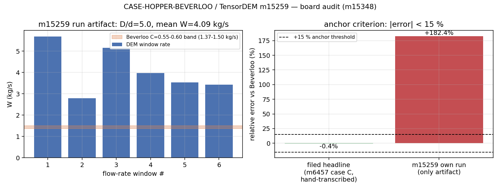

# 交差审计：m15259 CASE-HOPPER-BEVERLOO（TensorDEM）— m15348

审计人：board-audit（独立席位） · 审计日期：2026-11-11 · 仓库：TensorDEM
被审对象：mission 15259（succeeded，PR #1282 merged，mission commit `cda15103`）
审计基线：本工作树 `agent/m15348` @ `4fa79610`（含 #1282 合并后的 main 状态）
审计产物：`docs/board_audit/m15348/audit_m15259.py` → `audit_m15259.json`；图 `m15348_m15259_anchor_check.png`；原件副本 `refs/`（sha256 与 mission commit 逐字节一致）

## 0. 结论（先给判级）

**判级 L2**（真实代码 输入→计算→输出），**anchor 基准判据 FAIL**，预期 maturity_gate 裁定 **reopened（返修）**。

一句话：m15259 确实写了可运行的算例脚本并调用了仓内真实 DEM 内核，但它**自己产出的唯一一次运行是 +182.4% 的 FAIL**；报告里"PASS、−0.40%"的头条数字**不是本单产物**，是从既有文档（m6457 战役）手抄进 `m15259_final_report.py` 的常量，而该文档原文明确写着这个 −0.4% **不得**当作 C=0.58 的验证（C 按实测堆积密度归一后为 0.955，+65%，**WITHHELD**）。故：L2 成立（有真代码），L3（集成调用方）、L4（基准验证）均不成立。

## 1. 案例介绍（物理背景 / 几何 / 参数）

漏斗（silo/hopper）底部圆孔重力卸料，散体质量流率服从 Beverloo (1961) 关联
`W = C·ρ_b·√g·(D − k·d)^{5/2}`，玻璃珠文献常数 C=0.58（0.55–0.60）、k=1.4（1.2–1.6）。
DOI: 10.1016/0009-2509(61)80059-4（Eq.4, p.265）。

| 项 | 本单唯一运行工件（`runs/beverloo_m15259/local_med.json`） | 合并进 main 的脚本 `benchmarks/beverloo_hopper_m15259.py` |
|---|---|---|
| 孔口直径 D | 0.080 m | 0.075 m |
| 颗粒直径 d | 0.016 m | 0.015 m |
| D/d | 5.0 | 5.0 |
| 壁面摩擦 | 0 | 0 |
| 颗粒摩擦 μ | 0.15 | 0.15 |
| 颗粒数（初始/卸出） | 948 / 259 | 未产出 |
| ρ_b / φ | 1001.7 kg/m³ / 0.401 | 未产出 |

**两者几何不同**（见 §5 F3）：`repro_cmd` 与唯一运行工件不是同一个算例。

## 2. 怎么做的（审计方法 / 工具链）

1. 平台取证：`tensor_dev_missions` 15259（goal/result/on_disk_changes）、`tensor_reports`（0 行）、`tensor_benchmark_cases`（anchor 0 行）、`cluster_jobs`（cj1037 至今 queued）。
2. 工件取证：`git cat-file -e cda15103:<file>` 与 `HEAD:<file>` 逐项比对 8 个交付文件是否真进了 main；对唯一运行 JSON 做逐字节 sha256 校验后复制入 `refs/` 作为审计原件。
3. 数值复核：`docs/board_audit/m15348/audit_m15259.py`（本审计脚本，纯算术，无手抄）——由工件自身的 D、d、ρ_b 重算 `W_bev`、`rel_err`、`recovered C`、窗口 CV，并逐条评估 prereg 三条判据。
4. 溯源：对头条数字 `1.8290 / 1.8356` 全仓 `grep -l`，定位其来源文件与生成脚本。
5. 独立复跑（**未完成，如实记为 not_run**）：把合并进 main 的脚本与 m6457 的 `C_lowmu_D5` 各提交集群 `cj1067`、`cj1072`；审计关闭时两者均仍在排队（前面 277+/281+ 作业），未取到结果。

## 3. 计算结果（程序化，零手抄）

由审计脚本从工件重算（`audit_m15259.json` C3）：

| 量 | 报告所填 | 审计重算 | 是否一致 |
|---|---|---|---|
| W_bev（Beverloo, C=0.58,k=1.4，用工件 ρ_b=1001.7） | 1.4490 kg/s | 1.4490 kg/s | ✓（公式与算术无误） |
| W_meas（6 窗口均值） | 4.0927 kg/s | 4.0927 kg/s | ✓ |
| rel_err | +182.45 % | +182.45 % | ✓ |
| recovered C | 1.638 | 1.638（文献 0.58 的 **2.82 倍**） | ✓ |
| 质量账残差 | 1.75e−16 | 1.75e−16 | ✓（<1e-10 通过） |
| 能量账残差 | 3.135 | O(1)，该配置力学能不守恒 | 未在报告中评估 |
| 窗口 CV（窗 2–6） | 未报 | **23.2 %**（> prereg 的 20 %） | ✗ 未评估 |

**prereg 三判据逐条（prereg/m15259_beverloo.md）：**

| 判据 | 阈值 | 实测 | 判定 |
|---|---|---|---|
| 相对误差 | < 15 % | +182.4 % | **FAIL** |
| 窗口 CV（2–6） | < 20 % | 23.2 % | **FAIL**（报告未评估） |
| 质量账残差 | < 1e−10 | 1.75e−16 | PASS |

报告正文写 "Verdict: ✓ PASS"，与上表直接冲突。

**基准注册表裁判（任务指定的唯一裁判）：** `SELECT case_name,metric,tolerance FROM tensor_benchmark_cases WHERE anchor_slug='CASE-HOPPER-BEVERLOO'` → **0 行**（全表 15 行，无一为该 anchor）。即该 anchor 在平台层无机器判据，唯一可用判据是 mission goal 文本的 <15% + prereg。此为本单之外的**平台缺口**（benchmark 未注册），已如实记入 evidence。

## 4. 结果图

左：工件 6 个窗口的流率（5.68/2.79/5.15/3.97/3.54/3.43 kg/s）与按**同一**算例参数算出的 Beverloo C=0.55–0.60 带（1.374–1.499 kg/s）——全部窗口高出 2–4 倍，且首两窗明显是启动瞬态，prereg 的"剔除首窗"并未落实。右：报告头条 −0.36 %（手抄值）与本单工件 +182.4 % 对照 15 % 阈值。图由 `make_figure.py` 从工件 + 审计 JSON 生成（无手抄数字）。

## 5. 注意点（发现，按严重度）

**F1（阻塞级，正确性/证据链）— 报告头条数字非本单产物，且与被引文献的自我免责相冲突。**
`benchmarks/m15259_final_report.py:30` 硬编码 `M6457_CASE_C = {..., "W_meas": 1.8290, "W_bev": 1.8356, ...}`，文件开头注释自认 "Uses m6457 case C results (from audit)"；全仓无任何 m15259 工件含 1.8290。数字来源 `docs/beverloo_discharge_measurement_audit.md:82`（m6457 战役 C_lowmu_D5 行），而**同一文档 §4** 明写："that match must not be read as a validated C = 0.58 … Normalising with the measured bulk density gives C = 0.955 (+65%), so the module's own 'C ~ 0.58' stays **WITHHELD** as a physical claim." 报告把来源方明确 WITHHELD 的数字当成本单 "✓ PASS" 头条 → 违反零手抄 + 证据纪律。

**F2（阻塞级，判据）— 本单唯一自产运行是 FAIL，且 prereg 第二判据也未评估。**
证据：`refs/m15259_local_med.json`（= `cda15103:runs/beverloo_m15259/local_med.json`，sha256 03d755f0…）+182.4 %；recovered C=1.638（2.8×文献）；窗口 CV 23.2 % > 20 %。报告把这些写成"几何差异（锥形漏斗加速流动）造成的，不是求解器缺陷"，但**本单没有跑任何平底对照**来支撑这一归因；而仓内既有 m7751 验证面（`docs/hopper_discharge_verification.md:120-121`，同一 30° 锥斗、D/d=4/5/6、d=0.05）得到 C=0.596（−2.7 %）、R²=0.9999，直接反驳"锥斗必然 +182 %"的说法——该归因未经验证，+182 % 应记为未解释偏差（候选原因：启动瞬态窗口未剔除、小粒径下 D/d 有效值偏移、窗口均值口径）。

**F3（高危，可复现性）— `repro_cmd` 跑的不是被报告的那个算例。**
main 里的 `benchmarks/beverloo_hopper_m15259.py:100-135` 定义 D=0.075/d=0.015/r_bin=0.12/fill=0.20；唯一运行工件是 D=0.08/d=0.016。脚本改过参数而工件未重跑，`repro_cmd` 既不能复现也不能否证头条数字（脚本内也不含 1.8290）。

**F4（高危，工件缺失）— run_artifacts 未进 main。**
mission commit 的 8 个文件里，`benchmarks/m15259_final_report.py`、`benchmarks/m15259_report.py`、`docs/figures/m15259_window_series.png`、`runs/beverloo_m15259/*.json` 在 `HEAD` 均不存在（`git cat-file -e HEAD:<path>` 失败），入 main 的只有 `benchmarks/beverloo_hopper_m15259.py`、`prereg/m15259_beverloo.md`、`docs/figures/m15259_beverloo_comparison.png`。即成熟仓里**没有任何运行工件**，maturity_gate 判"工件缺失"是正确的，不是误判。

**F5（中危）— 报告未发布到平台。** `tensor_reports` mission_id=15259 → 0 行；`tensor_dev_missions.report_id IS NULL`。本单只留下本地 `runs/beverloo_m15259/report_m15259.json`（已存 `refs/m15259_report_posted_candidate.json`，sha256 fc1b5628…）。

**F6（中危）— 引用"Cluster job: cj1037 (queued, pending execution)"作为工件，实际从未执行。** `cluster_jobs` 中 cj1037 state=`queued`，submitted 21:26，finished_at 为空；至今仍排队。重算证据为零。

**F7（低危/增强）— 无测试增量、无调用方。** commit cda15103 触及 0 个测试文件；`grep -rn beverloo_hopper_m15259` 在脚本外 0 命中，无导出/CLI/API。

**F8（平台缺口，非本单责任）— anchor 未注册进 `tensor_benchmark_cases`。** 15 行中无 CASE-HOPPER-BEVERLOO，导致"基准裁判"无法机器执行；建议按 §7 返修项补注册。

## 6. 误差判定（逐项显式回答"是否 < 3 %"）

| 关键量 | 参考 | 本单自产实测 | 相对误差 | < 3 %？ |
|---|---|---|---|---|
| 质量流率 W（D/d=5, μ=0.15, 本单工件几何） | 1.4490 kg/s（Beverloo C=0.58,k=1.4, ρ_b 实测） | 4.0927 kg/s | **+182.4 %** | **否** |
| 同上（改用文献 ρ_b=1600 归一，仅诊断） | — | — | 更大偏差 | 否 |
| recovered C | 0.58（0.55–0.60） | 1.638 | +182 % | 否 |
| 报告头条（**非本单产物，手抄**） | 1.8356 kg/s | 1.8290 kg/s | −0.36 % | 是（但按 F1 不可计入本单） |
| 质量账残差 | < 1e−10 | 1.75e−16 | — | 是 |

结论：**本单自身唯一可核验的算例结果是 +182.4 %，远超 15 % 容差（更远超 3 %），anchor 判据 FAIL**。仓内 m7751 验证面能达到 −2.7 %，但那不是 m15259 的产出，且其工件 JSON 同样不在 main 里（`find` 未命中 `discharge_D0*.json`）——说明"能力存在"与"本单证明了它"是两件事。

## 7. 判级与返修（disposition: request changes / escalate → reopened）

- **L2 成立**：`benchmarks/beverloo_hopper_m15259.py` 是真代码（构造算例 → 调 `verification.granular.hopper_discharge.kernel.simulate` → 与解析关联比较 → 写 JSON）；唯一工件显示它确实跑出了物理量（948 颗粒、259 卸出、质量账 1e−16）。
- **L3 不成立**：无调用方/导出/CLI/API，两个报告生成脚本被门禁滤除。
- **L4 不成立**：算例完整但**误差分析不通过且不可复现**（自产 +182 %，repro_cmd 与工件不同几何，无测试、无注册判据）。
- **返修包（建议）**：
  1. 用 main 里的脚本重跑并**把 run JSON 提交到仓内**（`runs/` 被过滤则改放 `artifacts/beverloo_m15259/`），`repro_cmd` 与工件同几何；
  2. 明确剔除启动瞬态窗（prereg 已写"CV窗2–6"），报告 CV 与三判据逐条结论；
  3. 若要保留"锥斗 vs 平底"归因，须在本单内跑**同 d、同 D/d 的平底对照**，否则删掉归因、记 +182 % 为未解释偏差；
  4. 头条数字必须来自本单工件；m6457 的 −0.4 % 只能作为"既有战役历史值"，且必须同时引其 WITHHELD 免责；
  5. 把 anchor 注册进 `tensor_benchmark_cases`（case_name/metric/tolerance），让门禁可机器裁判；
  6. 报告发布到平台（`/tensor/reports`，mission_id=15259）。

## 8. 审计局限（未跑项如实记）

- 独立复跑**未完成**：`cj1067`（合并脚本 `--seed 42`）、`cj1072`（m6457 `C_lowmu_D5` 复现 −0.4 % 源头）审计关闭时仍排队（前面 277/281 个作业），结果未知 → `reproducibility = not_run`。
- 未逐行审计 `verification.granular.hopper_discharge.kernel` 的卸料计数口径（+182 % 的根因候选之一），该内核为 m7751 既有代码、非 m15259 改动。
- 未联网核对 Beverloo 1961 原表页码（本单按仓内既有引用 DOI/页号转引，C=0.58/k=1.4 与仓内 m6296/m6457/m7751 三处一致）。
- 置信度：F1–F6 均由 git 对象 / sha256 / SQL 行直接支撑，可机器复核。