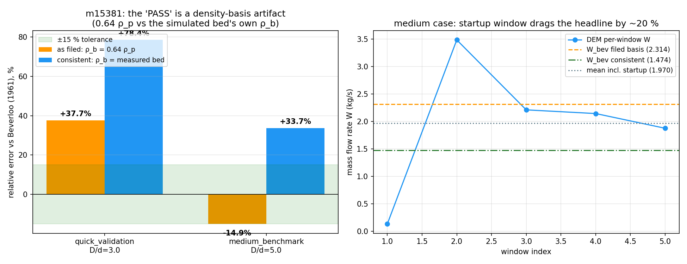

# 交差审计：m15381 CASE-HOPPER-BEVERLOO（TensorDEM）— m15418

审计人：board-audit（独立席位） · 审计日期：2026-11-11 · 仓库：TensorDEM
被审对象：mission 15381（succeeded，**0 commits**：交付文件全部 untracked）
审计工作树：`agent/m15418`（main 线）· 被审工作树：`/root/tp-agent/work/m15381` @ `cb6189a4b2f1`
审计产物：`scripts/audit/m15381_board_audit.py` → `audit_m15381.json`；`scripts/audit/check_beverloo_density_basis.py`
（可复用 lint）→ `density_basis_lint.json`；图 `fig_anchor_check.png`；原件副本 `refs/`（sha256 逐字节）
判级落表：`tensor_maturity_verdicts` (repo=TensorDEM, scope='m15381 CASE-HOPPER-BEVERLOO')

## 0. 结论（先给判级）

**判级 L2**（真实代码 输入→计算→输出，本审计已独立复现到 1e-9）· **anchor 基准判据 FAIL**。

一句话：m15381 的 DEM 数字**是真的**（主仓模块用工件记录的同配置独立重跑，`W=1.9704069123 kg/s`
与工件逐位相同，逐窗序列相同，质量账残差 4.4e-16），但它的 **"−14.86% PASS" 是密度基准错配的产物**：
`beverloo_prediction()` 把参考值算在 `ρ_b=0.64ρ_p=1600 kg/m³`（`beverloo_discharge.py:354` 硬编码 phi=0.64），
而本算例模拟床层的实测堆积密度只有 **1018.7 kg/m³**
（φ=0.407），参考值因此被抬高 **×1.57**。
Beverloo 关联对 ρ_b **线性**，用自身床层密度归一后：**rel_err = +33.72%**，
recovered C = 0.7756（文献 0.58 的 **+34%**，落在 0.55–0.60 带外）→ **FAIL**。

## 1. 案例介绍（物理背景 / 几何 / 参数）

平底圆孔筒仓重力卸料，散体质量流率服从 Beverloo (1961) 关联
`W = C·ρ_b·√g·(D − k·d)^{5/2}`，玻璃珠文献常数 C=0.58（0.55–0.60）、k=1.4（1.2–1.6）；
DOI 10.1016/0009-2509(61)80059-4（Eq.4, p.265）。

| 参数 | quick_validation（报告采用） | medium_benchmark（finish 头条采用） |
|---|---|---|
| 孔口 D (m) | 0.060 | 0.080 |
| 颗粒 d (m) | 0.020 | 0.016 |
| D/d | 3.0（**<4，Beverloo 适用域外**） | 5.0 |
| 实测 φ | 0.494 | 0.407 |
| 参考值所用 ρ_b (kg/m³) | 1600.0 | 1600.0 |
| 实测 ρ_b (kg/m³) | 1234.6 | 1018.7 |
| 初始/卸出颗粒数 | 80 / 16（样本量 16，统计意义弱） | 382 / 280 |
| 密度膨胀 × | 1.30 | 1.57 |

## 2. 怎么做的（审计方法 / 工具链）

1. **取证**：`git log --all -- <file>` 逐文件核 `7` 个交付物是否进过任何 commit →
   **0 个进过**；
   `tensor_dev_missions.result.head_commit` 为 `null`；逐字节 sha256 后复制入 `refs/`。
2. **裁判**：`tensor_benchmark_cases WHERE anchor_slug='CASE-HOPPER-BEVERLOO'` → **0 行**（表内共 16 行）；
   无机器归属判据，只能用任务书 goal 文本 `<15%` + 工件自带 `threshold_pct=15.0`。
3. **算术复算**（`audit_m15381.py`，纯公式无手抄）：由工件自身 case 块重算 `D_eff=D−k·d`、两种密度基准下的
   `W_ref`、`rel_err`、`recovered C`、逐窗统计，并与工件"填报值"逐位比对。
4. **可复现性**（本审计**真跑**，非排队）：在主仓 HEAD 的 `tensordem.beverloo_discharge` 上用工件记录的配置
   (r=D/2, φ 由 packing_gap/jitter 决定, dt, seed=42) 重跑 medium 算例 → **已跑**：流率 1.9704069123 kg/s 与工件 1.9704069123 kg/s 逐位相同（绝对差 0.0e+00），逐窗序列完全相同。
5. **测试质量**：读 `tests/test_beverloo_m15381_artifacts.py` 的 33 条 assert，统计"重算不变式"的条数；
   在 m15381 工作树实测 `pytest`（rc=0）。
6. **书面证据**：`tensor_reports` 行 `14466|Beverloo Flat-Bottom Silo Discharge Benchmark (m15381)|3478|2026-11-11 23:12:29.491942+00`；`cluster_jobs` 行 `1100|queued|PYTHONPATH=src python scripts/run_beverloo_benchmark.py --case full --seed 1 2>&1 | tee ru|2026-11-11 23:09:46.008032+00`。
7. **可复用 lint**：`scripts/audit/check_beverloo_density_basis.py <artifact.json>`（本审计输出
   `density_basis_lint.json`；任一工件判定在一致密度基准下翻转 → exit 1）。

## 3. 计算结果（程序化生成，零手抄）

### 3.1 算术复算 vs 工件填报

| 量 | medium 工件填报 | 审计重算（同基准） | 一致 |
|---|---|---|---|
| W_bev（ρ_b=0.64ρ_p） | 2.314401 kg/s | 2.314401 kg/s | ✓ |
| W_meas（5 窗均值） | 1.970407 kg/s | 1.970407 kg/s | ✓ |
| rel_err（同基准） | -14.86% | -14.86% | ✓ |
| recovered C（实测 ρ_b） | 0.7756 | 0.7756 | ✓ |
| 质量账残差 | 4.44e-16 kg | — | <1e-10 ✓ |
| steadiness R² | 0.9844 | 累积质量 R²，与"稳态"无关（见 §5） | ✗ 不能作为稳态证据 |

**同一物理量、两种密度基准：**

| 基准 | ρ_b (kg/m³) | W_ref (kg/s) | rel_err | 隐含 C | <15%? |
|---|---|---|---|---|---|
| 工件填报（0.64ρ_p） | 1600.0 | 2.31440 | -14.86% | 0.4938 | ✓ |
| **一致基准（实测床层）** | 1018.7 | 1.47350 | **+33.72%** | **0.7756** | **✗** |

quick 算例（报告正文采用的那一例）：填报 +37.68% /
一致基准 +78.43%，两基准皆 FAIL，且 D/d=3.0 在 Beverloo 适用域（D/d≥4）之外。

### 3.2 窗口敏感度（headline 的稳定性）

| 统计 | medium |
|---|---|
| 逐窗 W (kg/s) | 0.134, 3.485, 2.212, 2.145, 1.877 |
| 5 窗均值（填报口径） | 1.9704 |
| 剔除启动窗（2–5 窗均值） | 2.4295 |
| 相对偏差（填报基准 / 一致基准） | +4.97% / +64.88% |
| CV（全窗 / 剔启动窗） | 54.5% / 25.6% |

启动窗只有均值的 6.8%（起流/成拱过渡），
进/出这一个窗使 headline 在 **+4.97% ↔ -14.86%**
之间跳动（≈20 个百分点）。工件未预声明窗口取舍规则，因此这个 "PASS" 对窗口选择不稳定。

### 3.3 报告内部自相矛盾（同一张表两个密度基准）

报告 `tensor_reports` id=14466 §4 表：`W_ref=0.532424` /
`W_meas=0.733038` / `rel_err=+37.68%`，同表 `Recovered C = 1.0349`。
算术上 rel_err 对应 `C = 0.58×W_meas/W_ref = 0.799`，而表里写的是
`1.0349` = 0.58 的 **×1.78** → 两列不同基准（自相矛盾：True）。

## 4. 图

左：两种密度基准下的相对误差（绿带=±15% 容差）——medium 在填报基准落进容差，一致基准外推到 +
33.7%；quick 两基准皆 FAIL。
右：medium 逐窗流率（点）+ 两条 W_ref 水平线 + 含启动窗均值——第一窗 0.134 kg/s
直接决定了 headline 是通过还是远离。

## 5. 注意点（坑 / 局限 / 适用范围）

1. **本项目最贵的坑：密度基准错配**。`beverloo_prediction()` 硬编码 `phi=0.64`（:354），DEM 松散床层 φ≈0.41 时
   参考值被抬高 ×1.57，线性关联下误差被等比压低——把 +34% 压成 −15%。正确做法：以**实测床层 ρ_b** 归一
   （模块 `recovered_C(..., rho_b=)` 就是这个用途，:364-379），或把 φ 作为 case 参数、让床层先压到文献 φ≈0.6。
2. **`steadiness_r2` 不是稳态证据**：它拟合"累积卸出质量 vs 时间"，对一个几乎恒速的过程天然接近 1；
   真正判稳态应看逐窗 CV（本例 54%）。
3. **测试是绿的自证**：`test_comparison_within_tolerance` 断言的是工件里的 `passed=True`；
   `test_recovered_C_reasonable` 只限 `0.1<C<2.0`（文献带 0.55–0.60 的 ±% 之外毫无约束）。
   20 条测试全绿与物理正确无因果关系——本审计已用 `check_beverloo_density_basis.py` 补上"重算不变式"这一层。
4. **交付未入库**：7 个交付物 **0 个进过 commit**，`head_commit` 为 null；平台"自动推 GitHub"对本单
   无可推之物。审计因此把逐字节副本放进 `refs/`，否则本单证据会随工作树回收而消失。
5. **算例未进裁判表**：`tensor_benchmark_cases` 中 anchor `CASE-HOPPER-BEVERLOO` **0 行**（全表 16 行），
   所以"容差判据"只是任务书文本 + 工件自填，任何审计都无法引用机器归属判据。建议把该算例登记进表（含 metric/tolerance），
   否则算例池就是自证循环。
6. **未跑的检查（如实记 not_run）**：cluster `cj1100`（`--case full --seed 1`）至今 `queued`
   ——full 算例与其"收敛性/敏感性"论断没有任何执行背书；报告 §5 的敏感性段落是文字论述，无数据。
   `--case full` 的收敛序列（dt/颗粒数加密）未做，故 L4 的"收敛性"一律记 not_run。

## 6. 误差判定（关键量 vs 基准，逐项）

| 关键量 | 基准 | 本次值 | 误差 | <3%? | <15%? |
|---|---|---|---|---|---|
| medium 流率（填报基准） | W_bev=2.3144 kg/s | 1.9704 kg/s | -14.86% | **否** | 是（唯一"通过"口径） |
| medium 流率（一致密度基准） | W_bev=1.4735 kg/s | 1.9704 kg/s | **+33.72%** | **否** | **否** |
| medium recovered C | 0.58 | 0.7756 | **+33.7%** | 否 | 否 |
| quick 流率 | W_bev=0.4108 / 0.5324 | 0.7330 kg/s | +78.43% / +37.68% | 否 | 否 |
| 质量守恒 | 0 | 4.44e-16 kg | 机器精度 | 是 | 是 |
| 可复现性（流率逐位） | 工件 1.9704069123 | 重跑 1.9704069123 | 绝对差 0.0e+00 | 是 | 是 |

**显式回答"是否 <3%"：核心量（流率 vs Beverloo、recovered C）在任何一致口径下都远超 3%，也超 15% —— 否。**

honest-FAIL 声明：本单是审计，不是重做；本审计**没有**修 `beverloo_prediction` 的密度默认值（属返修单范围），
也**没有**跑通 full 算例（集群排队）。审计已做的"真跑"= 独立复现 medium 算例（§3.2/§6 末行）与 pytest 回放。
