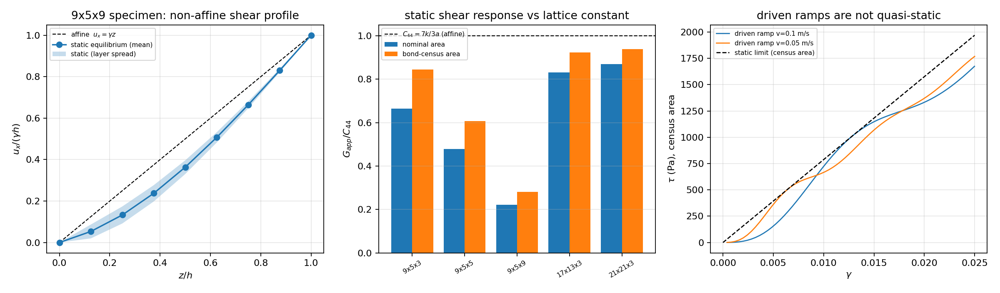

# DEM3D direct-shear specimen: static reference and rate audit

## 1. Cross-section definition bias (affine, exact)

| specimen | bonds on fixed layer | $A_{eff}/A_{nom}$ |
| --- | ---: | ---: |
| 9x5x3 | 325 | 0.7873 |
| 9x5x5 | 325 | 0.7873 |
| 9x5x9 | 325 | 0.7873 |
| 17x13x3 | 1813 | 0.8998 |
| 21x21x3 | 3721 | 0.9265 |

## 2. Static equilibrium (rate-free limit, sparse solve)

| specimen | $h/a$ | $G_{nom}/C_{44}$ | $G_{eff}/C_{44}$ | reaction check | free residual |
| --- | ---: | ---: | ---: | ---: | ---: |
| 9x5x3 | 2 | 0.6646 | 0.8442 | 2.3e-07 | 6.5e-03 |
| 9x5x5 | 4 | 0.4778 | 0.6068 | 2.5e-07 | 1.9e-02 |
| 9x5x9 | 8 | 0.2206 | 0.2802 | 2.2e-07 | 4.0e-02 |
| 17x13x3 | 2 | 0.8307 | 0.9232 | 1.8e-07 | 1.1e-02 |
| 21x21x3 | 2 | 0.8697 | 0.9388 | 1.8e-07 | 1.3e-02 |

Default 9x5x3 specimen: $G_{eff}/C_{44} = 0.8442$,
$G_{nom}/C_{44} = 0.6646$.

## 3. Linearity in $\gamma$

| $\gamma$ | $G_{eff}/C_{44}$ |
| --- | ---: |
| 1e-05 | 0.8442 |
| 1e-04 | 0.8442 |
| 1e-03 | 0.8442 |
| 5e-03 | 0.8442 |

## 4. Legacy driven ramp (window $0.008 \le \gamma \le 0.022$)

| $v$ (m/s) | steps | $G_{nom}/C_{44}$ | fit residual |
| --- | ---: | ---: | ---: |
| 0.1 | 741 | 0.6691 | 1.1e-01 |
| 0.05 | 1483 | 0.7500 | 2.9e-02 |

## 5. Relaxation verification against the static solution

| drag (N s/m) | $G_{eff}/C_{44}$ | static | deviation | trace drift | broken bonds |
| --- | ---: | ---: | ---: | ---: | ---: |
| 50.0 | 0.8221 | 0.8442 | -2.61 % | 1.9e-02 | 0 |
| 300.0 | 0.7305 | 0.8442 | -13.47 % | 2.0e-01 | 0 |

