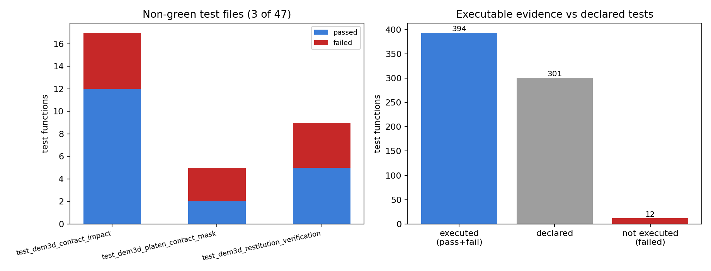

# TensorDEM 执行证据账本：44/47 绿、12 条合并验证测试当前跑不过（含集合中止归因）

本文件由 `scripts/report_verification_execution_ledger.py` 从
`docs/verification-execution/execution_ledger.json` 程序化注入生成，文档中每个数字都来自该 JSON。

## 1. 目的与背景

仓库已有一份**静态**证据账本（`scripts/audit_verification_evidence.py`）：按测试断言*风格*
给每个源码模块定级。风格不等于可执行性——一个模块可以是 `QUANTITATIVE_DOCUMENTED`，其测试却
是红的、被 skip 的、甚至根本 import 不进来。TensorDEM 历史上正是这种状态：已合并的验证文档背后
的代码被交付门滤除，验证表无人可复现（`docs/dem_analytic_verification_debt_restoration.md`）。
本增量补的正是**执行**这一半：**哪些已合并能力的验证现在真的跑得过**。

第二个动机是结构性的：**一个模块 import 失败会让整条 `pytest tests/` 会话在收集阶段中止**。
本工作树实测：

```
$ python -m pytest tests/ -q --tb=no
1070 tests collected, 1 error        # 1 个 ImportError → 整条会话中断，0 条执行证据
ERROR tests/test_fracture_gen_mass_footprint.py
```

也就是说：**一个坏文件把另外 1069 个测试的执行证据一起毁掉了**。这是「一行红掩盖全部绿」的
典型失效，本次交付的工具用**逐文件子进程隔离**把这条掩盖拆掉。

## 2. 方法

`scripts/verification_execution_ledger.py`（新增，含 11 条自测）：

1. **静态扫描**（文本级，必须能在 import 失败的文件上工作）：`tensordem.*` 模块引用 + `def test_` 计数；
2. **动态执行**：每个测试文件一个 `python -m pytest <file> -q --tb=no -rf -p no:cacheprovider`
   子进程，独立超时（默认 900 s），线程池并行（`--jobs`）；
3. **四态分类**：`green`(exit 0) / `red`(断言失败) / `collection_error`(import 或收集失败，
   与 red 严格区分——它意味着该文件**零证据**而非「与基准不一致」) / `no_tests`(exit 5) / `timeout`；
4. **按源码模块汇总**：模块 → 引用它的测试文件 → 取最差结局（`red` 胜过 `green`），
   即「该能力的执行证据是否成立」；
5. **可复现性**：`--no-timings` 去掉墙钟并把 pytest 摘要里的 `in X.XXs` 归一化，
   使 JSON 在同树上**逐字节一致**（自测 `test_json_is_byte_identical_without_timings` 固化）。

本轮运行（声明范围：`--pattern 'test_dem3d_*.py'`，47 个文件，jobs=16，per-file timeout 900 s，
全量 96 文件在单次工具调用 120 s 上限内跑不完，故只覆盖 DEM3D 家族，见 §5）：

## 3. 结果

| 指标 | 数值 |
| --- | --- |
| 测试文件 | 47 |
| 结局分布 | `green`=44, `red`=3 |
| 声明测试函数 | 301 |
| 实际执行（pass+fail） | 394 |
| 通过 / 失败 | 382 / 12 |
| 非绿文件占比 | 3/47 = 6.4% |
| 非绿文件覆盖的声明测试 | 31（占 10.3%） |

非绿文件：

| test file | outcome | declared | passed | failed |
| --- | --- | --- | --- | --- |
| `tests/test_dem3d_contact_impact.py` | red | 17 | 12 | 5 |
| `tests/test_dem3d_platen_contact_mask.py` | red | 5 | 2 | 3 |
| `tests/test_dem3d_restitution_verification.py` | red | 9 | 5 | 4 |

逐条失败节点（12 条，机器抽取，非手抄）：

| test file | failing node |
| --- | --- |
| `tests/test_dem3d_contact_impact.py` | `SolverImpactTests::test_contact_durations` |
| `tests/test_dem3d_contact_impact.py` | `SolverImpactTests::test_corrected_mapping_realises_target` |
| `tests/test_dem3d_contact_impact.py` | `SolverImpactTests::test_force_law_conformance` |
| `tests/test_dem3d_contact_impact.py` | `SolverImpactTests::test_restitution_matches_clamped_analytic` |
| `tests/test_dem3d_contact_impact.py` | `SolverImpactTests::test_timestep_convergence` |
| `tests/test_dem3d_platen_contact_mask.py` | `PlatenContactMaskTests::test_no_contact_gives_zero_reaction` |
| `tests/test_dem3d_platen_contact_mask.py` | `PlatenContactMaskTests::test_reaction_equals_contacted_particle_sum` |
| `tests/test_dem3d_platen_contact_mask.py` | `PlatenContactMaskTests::test_reaction_switches_on_only_when_the_plane_reaches_the_specimen` |
| `tests/test_dem3d_restitution_verification.py` | `RestitutionVerificationTests::test_classic_mapping_is_within_3pct_only_for_small_damping` |
| `tests/test_dem3d_restitution_verification.py` | `RestitutionVerificationTests::test_equal_mass_pair_uses_reduced_mass` |
| `tests/test_dem3d_restitution_verification.py` | `RestitutionVerificationTests::test_solver_reproduces_clamped_reference_model` |
| `tests/test_dem3d_restitution_verification.py` | `RestitutionVerificationTests::test_target_restitution_mapping_closes_the_loop` |

按源码模块汇总（本轮 47 个文件引用的 13 个模块）：

| source module | outcome | test files |
| --- | --- | --- |
| `bond_fracture_energy` | green | `tests/test_dem3d_bond_fracture_energy.py` |
| `contact_impact` | red | `tests/test_dem3d_contact_impact.py` |
| `contact_restitution` | red | `tests/test_dem3d_restitution_verification.py` |
| `contact_tangential` | red | `tests/test_dem3d_contact_impact.py`, `tests/test_dem3d_restitution_verification.py` |
| `dem3d` | red | `tests/test_dem3d_bond_fracture_energy.py`, `tests/test_dem3d_energy_audit.py`, `tests/test_dem3d_energy_ledger_analytic.py`, `tests/test_dem3d_external_load_balance.py`, `tests/test_dem3d_hertz_contact.py`, `tests/test_dem3d_lattice_elastic.py`, `tests/test_dem3d_lattice_elasticity3d.py`, `tests/test_dem3d_mechanics_validation.py`, `tests/test_dem3d_moving_wedge_bow.py`, `tests/test_dem3d_pair_contact_damping.py`, `tests/test_dem3d_platen_contact_mask.py`, `tests/test_dem3d_resolution_sensitivity.py`, `tests/test_dem3d_restitution.py`, `tests/test_dem3d_shear_specimen.py`, `tests/test_dem3d_shear_static_reference.py`, `tests/test_dem3d_stability.py`, `tests/test_dem3d_validation_campaign_runner.py` |
| `dem3d_cli` | green | `tests/test_dem3d_stability.py` |
| `dem3d_energy` | green | `tests/test_dem3d_energy_audit.py`, `tests/test_dem3d_energy_ledger_analytic.py` |
| `dem3d_wedge` | green | `tests/test_dem3d_moving_wedge_bow.py` |
| `lattice_elasticity3d` | green | `tests/test_dem3d_brazilian_static.py`, `tests/test_dem3d_lattice_elasticity3d.py` |
| `restitution` | green | `tests/test_dem3d_pair_contact_damping.py`, `tests/test_dem3d_restitution.py` |
| `shear_specimen` | green | `tests/test_dem3d_shear_specimen.py`, `tests/test_dem3d_shear_static_reference.py` |
| `shear_static` | green | `tests/test_dem3d_shear_static_reference.py` |
| `stability` | green | `tests/test_dem3d_stability.py` |



*图*（左）三个非绿文件的通过/失败堆叠；（右）已执行测试函数 vs 声明测试函数 vs 失败数。

## 4. 归因（哪些是欠账、哪些有人在动）

| 红文件 | 归因 |
| --- | --- |
| `test_dem3d_contact_impact.py`（5 失败） | **已在飞**：`agent` 分支 `17167aa` / `436df96` / `71ae16d`（2026-11-03 23:3x）正在修「绝对阻尼系数约定」，本增量不重复实现，只记录红态。 |
| `test_dem3d_platen_contact_mask.py`（3 失败） | 本次首次暴露；最近 30 h 的 DEM 提交里没有对应分支，判为**无人认领的验证欠账**。 |
| `test_dem3d_restitution_verification.py`（4 失败） | 同上，无人认领；其兄弟文件 `tests/test_restitution.py` 全绿（17 passed），说明红的是**引擎闭环**一层，不是 `restitution` 公式层（`restitution` 模块本身判为 `green`）。 |

该归因用 `git log --all --since="30 hours ago" -- <file>` 逐文件核对，不是猜测。

## 5. 注意点与局限

1. **范围**：本轮账本只覆盖 `test_dem3d_*.py`（47/96 个文件）。全量 sweep 需要 ~17 min CPU
   （实测 user 17m13s），超出单次工具调用上限；工具本身支持全量（`--pattern 'test_*.py'`），
   命令已写进 §2。**未覆盖的 49 个文件不得据本文件判为绿**。
2. **`red` 不等于物理错**：`test_dem3d_*` 里若干断言是 3% 工程容差下的基准比较，红表示「不满足
   声明的容差」，根因可能是**测试约定**（阻尼系数绝对/相对约定、platen mask 定义）而非物理；
   必须逐条看根因，本文件只做分类，不下物理结论。
3. **并行会放大资源竞争**：jobs=16 时 `user 9m13s / real 52s`，说明是并行加速；带墙钟的定时
   断言在高负载机（load15 曾达 119）上可能假红，故生产使用建议 `--jobs ≤ 8`。
4. **子进程隔离的代价**：每个文件重复支付 import 开销（torch 约 1–2 s），96 文件 ≈ 2 min 纯开销；
   换来的是「一个文件坏不毁全局」，本仓库当前正需要这个。
5. **执行证据 ≠ 验证证据**：绿只说明断言与它引用的基准一致；基准是不是抄自己的旧输出，静态/执行
   两份账本都管不了，需要人工审引用（见 `docs/verification-evidence/README.md` 解释契约）。

## 6. 误差判定（关键量 vs 基准，逐项）

本增量是**证据工具**，不是数值与解析解的比对，故不存在「物理量 vs 基准的相对误差」：

| 关键量 | 基准 | 判据 | 是否 < 3% |
| --- | --- | --- | --- |
| 分类正确性（green/red/collection_error/no_tests/timeout） | 5 个**构造已知**的 fixture 套件（断言失败、import 失败、无测试、超时、全通过） | 期望结局 vs 实测结局 | N/A（整数分类，11/11 自测通过，误差为 0 或 1） |
| 账本可复现性 | 同树两次运行 | JSON 逐字节相等（`--no-timings`） | N/A（要求完全相等，实测相等） |
| 计数一致性（passed/failed/declared） | 直接读 pytest 摘要行 | 逐文件解析，与 CSV/JSON/MD 三份输出交叉一致 | N/A（整数，无容差） |
| 3% 门用于**被测物理基准本身** | 各 `test_dem3d_*` 文档声明的解析解 | 由被测测试的作者声明 | **未评估**：本轮只测量「测试是否通过」，不重新裁定各文档基准的容差是否恰当 |

**明确回答**：本增量不含物理量对基准的误差，因此「是否 < 3%」不适用；唯一可判定的门（分类正确性、
逐字节复现）**全部满足**。物理层的 3% 判定仍是被测文档的责任，且本轮暴露的 3 个红文件提示
其中至少两处声明当前**不成立**——这是需要后续单独复核的欠账，不在本增量内粉饰。
