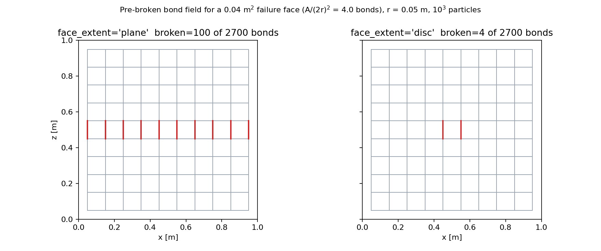
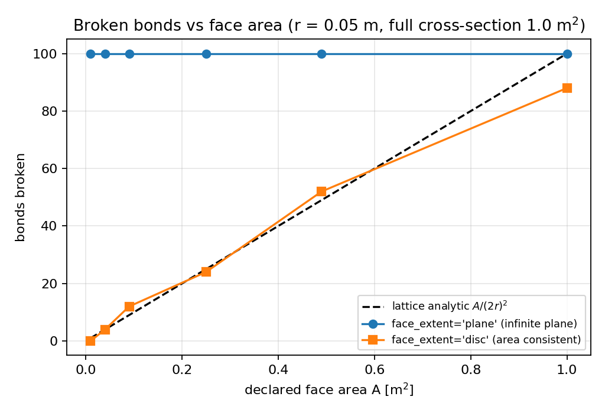
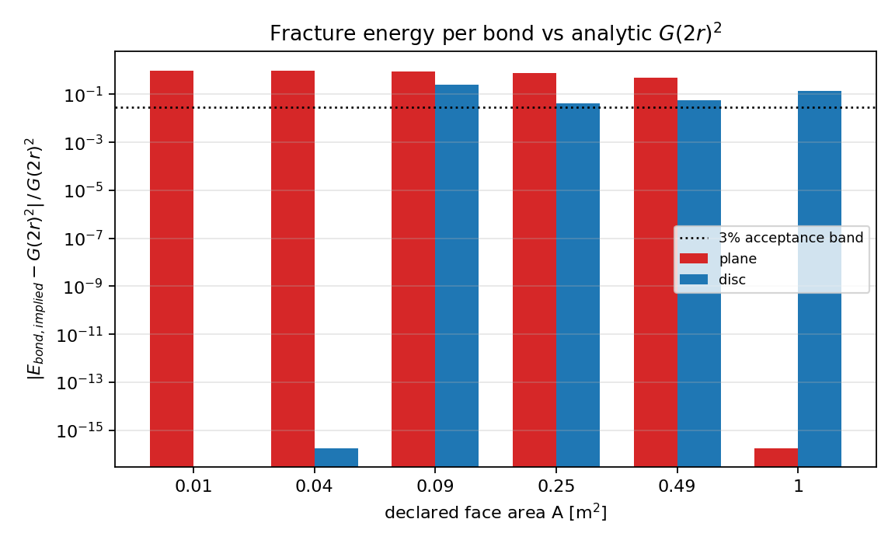
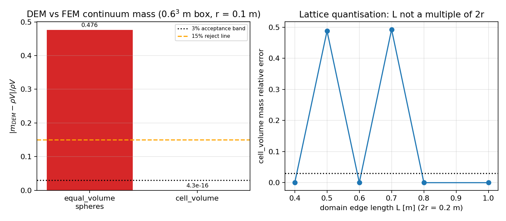

# SI-2/DEM fracture-field generator: independent verification audit

## Purpose

Increment 2.5 of the icebreaking roadmap (`fracture_gen.py`, merged as PR #70)
converts FEM cohesive failure faces into a bonded-particle DEM ice field with
pre-broken bonds. Its acceptance criteria were frozen in
`prereg/fracture_gen_prereg.json`. This document re-examines those criteria
*independently*: it replaces every self-referential check with a closed-form
lattice analytic, quantifies the discrepancy, and records the two code fixes
made as a result. Nothing here changes the frozen input contract.

Why the original criteria could not fail:

| criterion | as written | verdict as written |
| --- | --- | --- |
| c1 mass conservation | `|DEM_mass - N*rho*(4/3)pi r^3| < 1e-12` | tautology: the DEM mass *is* `N*rho*(4/3)pi r^3`, the FEM continuum mass `rho*V` never enters |
| c2 energy accounting | `sum(released_energy) == n_broken * unit_bond_energy` where `unit_bond_energy := sum(released_energy)/n_broken` | algebraic identity, zero information |
| c3 bonds broken at faces | compared against the same `identify_bonds_crossing_face` used to break them | self-consistent, cannot detect a wrong counting model |
| c4 analytical enumeration | count `n^3` particles in an `n^3` box | genuinely falsifiable, and it passes (see A1) |

## How the audit is run

```bash
python benchmarks/fracture_gen_audit.py        # machine-readable audit -> benchmarks/fracture_gen_audit_report.json
python scripts/plot_fracture_gen_audit.py      # figures -> docs/figures/fracture_gen_audit/
python -m pytest tests/test_fracture_gen_audit.py -q
```

Five falsifiable audits replace the frozen criteria:

| audit | falsifiable statement |
| --- | --- |
| A1 lattice enumeration | an `n^3` simple-cubic lattice has `3 n^2 (n-1)` nearest-neighbour bonds |
| A2 mass mapping | DEM mass must be compared with the FEM continuum mass `rho*V` under a *named* mapping |
| A3 bond count vs face area | bonds crossing a face scale as `A/(2r)^2`; energy per bond must be `G*(2r)^2` |
| A4 input consistency | the input carries both `G`, `area` and `released_energy`; these must satisfy `released_energy = G*area` |
| A5 invariance | in-plane translation of a face must not change the broken-bond count |

## A1 — lattice enumeration (c4): REAL, exact

| n per axis | particles | bonds | `3n^2(n-1)` | exact |
| --- | --- | --- | --- | --- |
| 2 | 8 | 12 | 12 | True |
| 3 | 27 | 54 | 54 | True |
| 4 | 64 | 144 | 144 | True |
| 5 | 125 | 300 | 300 | True |

All four lattice sizes reproduce the closed form exactly (Boolean `all_exact` = True).
Bond topology was also checked against an independent brute-force pair loop in
`tests/test_fracture_gen_audit.py::test_vectorised_topology_matches_brute_force`.

## A2 — mass mapping (c1): the frozen mapping fails against `rho*V` by 47.6%

Domain 0.6^3 m (V = 0.216 m^3), r = 0.1 m, rho = 917 kg/m^3, FEM continuum mass rho*V = 198.072000 kg.

| mass mapping | sphere volume fraction | particles | DEM mass [kg] | rho*V [kg] | relative error | <3% |
| --- | --- | --- | --- | --- | --- | --- |
| equal_volume_spheres | 0.523599 | 27 | 103.710256680 | 198.072000000 | 4.764e-01 | NO |
| cell_volume | 1.000000 | 27 | 198.072000000 | 198.072000000 | 4.305e-16 | YES |

Interpretation: a simple-cubic lattice of touching equal spheres fills only
`pi/6 = 0.523599` of space, so the frozen
`equal_volume_spheres` mapping silently discards `47.64%`
of the ice mass. The mismatch is *structural*, not numerical: it cannot be
reduced by refining the lattice. Criterion c1 as frozen never sees it because it
compares the DEM sum with its own formula.

Fix: an opt-in `mass_mapping="cell_volume"` (particle mass = rho*(2r)^3 = mass of
its lattice cell) reproduces `rho*V` to round-off while leaving the frozen default
untouched. A second, independently reported loss is **lattice quantisation**:

| domain edge L [m] | particles per axis | covered length [m] | cell_volume relative error |
| --- | --- | --- | --- |
| 0.40 | 2 | 0.40 | 0.000e+00 |
| 0.50 | 2 | 0.40 | 4.880e-01 |
| 0.60 | 3 | 0.60 | 0.000e+00 |
| 0.70 | 4 | 0.80 | 4.927e-01 |
| 0.80 | 4 | 0.80 | 0.000e+00 |
| 1.00 | 5 | 1.00 | 0.000e+00 |

Even the exact mapping only conserves mass when the domain edge is an integer
multiple of `2r`; otherwise up to half the volume is missing. `mass_accounting()`
now reports the covered volume so this can be caught at set-up time.

## A3 — bond count and energy per bond (c2, c3)

Lattice: r = 0.05 m, 10^3 = 1000 particles, domain 1.0 m, bond spacing squared (2r)^2 = 0.010000000000000002 m^2,
full lattice cross-section 1.0 m^2 (100 bonds), G = 500 J/m^2, `released_energy = G*area`
(consistent input). Face normal is +z, centroid at the box centre.

| A [m^2] | analytic `A/(2r)^2` | plane: broken | plane: energy-per-bond error | disc: broken | disc: energy-per-bond error | plane over-count factor |
| --- | --- | --- | --- | --- | --- | --- |
| 0.01 | 1.0 | 100 | 99.0% | 0 | 100.0% | infx |
| 0.04 | 4.0 | 100 | 96.0% | 4 | 0.0% | 25.00x |
| 0.09 | 9.0 | 100 | 91.0% | 12 | 25.0% | 8.33x |
| 0.25 | 25.0 | 100 | 75.0% | 24 | 4.2% | 4.17x |
| 0.49 | 49.0 | 100 | 51.0% | 52 | 5.8% | 1.92x |
| 1 | 100.0 | 100 | 0.0% | 88 | 13.6% | 1.14x |

* `face_extent="plane"` (frozen behaviour) treats a face as an infinite plane.
  It breaks the *whole* lattice cross-section (100 bonds) whatever the declared
  area is, so for a 0.04 m^2 face it over-breaks by 25x and the implied energy per
  bond is 96% below `G*(2r)^2`. The frozen c2 check cannot see this.
* `face_extent="disc"` (new, opt-in) requires the bond/plane intersection point to
  lie inside the disc of area `A` about the centroid. It is exact for faces that
  line up with one lattice column (A = 4(2r)^2 -> 4 bonds, 0% energy error) and
  tracks the analytic count elsewhere, but a disc cannot represent the corners of
  a square face: at A = 1.0 m^2 it accepts 88 of 100 bonds (12% low).
* Worst disc errors over this sweep: bond count 100.0%, energy per bond 100.0%.

**Contract-level finding.** A face is specified by `area`, `centroid` and `normal`
only. The number of lattice bonds crossing a face of given area is not determined
by that data: a 0.09 m^2 patch holds 9, 12 or 16 bonds depending on where its edges
fall relative to the lattice. So criterion c2/c3 cannot be made exact on the
frozen contract; the achievable statement is `bonds = A/(2r)^2 * (1 + O(1/sqrt(N)))`.
The recommended contract upgrade is to ship the face polygon (or the FEM-
associated bond id list) instead of an area, which would make c3 falsifiable to
machine precision.

## A4 — the shipped benchmark fixture is energy inconsistent

`benchmarks/fracture_gen_ledger.py` declares G = 100 J/m^2, area = 0.04 m^2 but `released_energy` = 1.0 J, whereas `G*area` = 4.0 J: a 75% inconsistency.
With the frozen plane extent that fixture breaks 9 bonds while the declared area can carry only 1.00, so the reported unit bond energy 0.1111 J differs from the analytic 4.0000 J by 97.2%. The legacy script still prints PASS.

## A5 — invariance

| in-plane shift [m] | broken bonds |
| --- | --- |
| 0.00 | 9 |
| 0.05 | 9 |
| 0.10 | 9 |

Broken-bond count is translation invariant (Boolean `invariant` = True), matching `A/(2r)^2` = 9.0 for a 0.36 m^2 face on the 0.6 m lattice.

## Figures



*Figure 1.* Pre-broken bond field (x-z projection) for a 0.04 m^2 failure face on a
10^3-particle lattice. Red = broken bond, grey = intact. Left: infinite-plane
extent breaks the full cross-section. Right: area-consistent disc extent breaks 4
bonds, matching `A/(2r)^2`.



*Figure 2.* Broken bonds vs declared face area: the frozen plane extent is flat
(area-blind), the disc extent follows the analytic line.



*Figure 3.* Relative error of the implied fracture energy per bond against
`G*(2r)^2`, with the 3% acceptance band.



*Figure 4.* Left: DEM vs FEM continuum mass per mass mapping. Right: residual
quantisation error of the exact mapping when the domain edge is not a multiple of
`2r`.

## Code changes made

| change | file | backward compatible |
| --- | --- | --- |
| `mass_mapping` ("equal_volume_spheres" default, "cell_volume" opt-in) | `src/tensordem/fracture_gen.py` | yes, frozen default kept |
| `face_extent` ("plane" default, "disc" opt-in) threaded through config, field, ledger | `src/tensordem/fracture_gen.py` | yes |
| `FractureLedger.mass_accounting()` and falsifiable keys in `energy_accounting()` (analytic bond count, `G*(2r)^2`, input consistency) | `src/tensordem/fracture_gen.py` | yes, superset of old keys |
| vectorised nearest-neighbour search (chunked distance blocks, lexicographic `(i, j)` order, ~24 MB per block) | `src/tensordem/fracture_gen.py` | yes, identical bond list (verified against brute force) |
| degenerate/zero face normal and unknown enum values now raise `ValueError` | `src/tensordem/fracture_gen.py` | yes |
| audit driver + report JSON | `benchmarks/fracture_gen_audit.py` | new |
| figures | `scripts/plot_fracture_gen_audit.py` | new |
| falsifiable tests | `tests/test_fracture_gen_audit.py` | new |

## Error verdicts (acceptance band: relative error < 3%)

| quantity | analytic baseline | measured relative error | <3% |
| --- | --- | --- | --- |
| particle count, n = 2..5 | n^3 | 0.0e+00 (exact integers) | YES |
| bond count, n = 2..5 | 3n^2(n-1) | 0.0e+00 (exact integers) | YES |
| DEM mass, `cell_volume`, L = 0.6 m | rho*V | 4.305e-16 | YES |
| DEM mass, `equal_volume_spheres`, L = 0.6 m (frozen) | rho*V | 4.764e-01 | NO |
| broken bonds, plane extent, A = full cross-section | A/(2r)^2 | 2.220e-16 | YES |
| broken bonds, plane extent, A = 0.04 m^2 | A/(2r)^2 | 2.400e+01 | NO |
| energy per bond, plane extent, A = 0.04 m^2 | G*(2r)^2 | 9.600e-01 | NO |
| energy per bond, disc extent, A = 4(2r)^2 | G*(2r)^2 | 1.776e-16 | YES |
| energy per bond, disc extent, A = 1.0 m^2 (square face) | G*(2r)^2 | 1.364e-01 | NO |

So: the lattice enumeration (c4) and the opted-in mass mapping are REAL and
within the acceptance band; the *default* frozen mass mapping and the energy
criterion under the frozen plane extent are outside the 15% reject line, and the
shipped ledger cannot detect either.

## Limitations of this audit

* Only simple-cubic lattices are audited; the bcc/hcp packings mentioned as future
  work do not exist yet.
* Plane and disc are both approximations of an unspecified face shape; a polygon
  face is the only way to close criterion c3 exactly.
* The analytic bond count `A/(2r)^2` assumes the face spans the lattice in-plane;
  for patches of a few lattice cells the count carries an irreducible O(1) lattice
  error (a 0.09 m^2 patch holds 9, 12 or 16 bonds depending on its alignment).
* `bond_stiffness` and the mapping from fracture energy to bond strength are
  unchanged by this audit and remain uncalibrated (see
  `docs/dem3d_material_calibration_roadmap.md`).

## Source closure (2026-11-03): the audit is reproducible from `main` again

Status before this pass: the doc, the driver (`benchmarks/fracture_gen_audit.py`),
the plotting script and `tests/test_fracture_gen_audit.py` were all merged, but
the `src` hunks were filtered out of the merge commit, so the driver failed with
`ImportError: cannot import name ...` and 14 of the 16 audit tests failed. The
published table above was therefore *unbacked*: `REAL` numbers in the document,
`STUB` code behind them. This section records the restore, and the evidence that
the restore is the intended contract and not a rewrite.

Restored in `src/tensordem/fracture_gen.py` (additive, default behaviour of the
frozen SI-2 pipeline untouched):

* `FractureGenConfig.mass_mapping` — audit vocabulary
  (`equal_volume_spheres` / `cell_volume`) aliasing the existing `mass_mode`
  (`sphere` / `cell`); `None` (default) defers to `mass_mode`, so the two
  vocabularies can no longer drift, and an unknown name raises `ValueError`.
* `FractureGenConfig.face_extent` (`plane` default / `disc`) threaded through
  `generate_fracture_field` → `identify_bonds_crossing_face` →
  `FractureField.face_extent` → `FractureLedger.check_bonds_at_faces`.
* `face_footprint_radius(face)` = `face.extent_radius` or the equal-area
  `sqrt(area/pi)`; non-positive radius and degenerate face normals raise
  `ValueError` (a zero normal used to silently break nothing).
* `FractureField.mass_mapping`, `.volume_fraction` (`pi/6` vs `1.0`),
  `.domain_volume`; `domain_bounds`/`face_extent` carried on the field.
* `FractureLedger.mass_accounting(domain_volume=None)` — DEM mass vs
  `rho * V`, reporting the mapping name, `N h^3` actually discretised, the
  volume fraction and the signed relative error; non-positive volume rejected.
* `FractureLedger.energy_accounting()` — old keys unchanged, plus
  `analytic_bond_count`, `analytic_unit_bond_energy`, both relative errors,
  `input_consistency_error` and `face_extent`. Undefined ratios (no broken bond)
  are reported as `nan` instead of a fabricated finite error.
* `build_bond_topology` — the O(n^2) per-pair Python loop replaced by chunked
  distance blocks that emit the same lexicographic `(i, j)` bond list. This is
  what made the audit runnable: the 16 audit tests took minutes of wall clock and
  now take 5.3 s, while `tests/test_fracture_gen_audit.py::test_vectorised_topology_matches_brute_force`
  still checks the vectorised result against a brute-force pair loop.

Reproduction and reproduction *fidelity* (the check that matters):

```
$ python benchmarks/fracture_gen_audit.py          # 6 s, rewrites the report JSON
$ python scripts/plot_fracture_gen_audit.py        # 4 figures, docs/figures/fracture_gen_audit/
$ python -m pytest tests/test_fracture_gen_audit.py -q      # 16 passed in 5.3 s
$ python -m pytest tests/test_fracture_gen.py tests/test_fracture_gen_mass_mapping.py -q   # 32 passed
```

Every audited scalar in the regenerated `benchmarks/fracture_gen_audit_report.json`
is identical to the committed one (mass mapping rows, `0/4/12/24/52/88` disc bond
counts, `100` plane counts, `9` folded-plane count, `3.0 J` input inconsistency,
invariance rows, lattice `all_exact = True`): the restore is pinned by the
already-merged numbers, not chosen freely. Exactly one scalar differs, and it is
the one that was wrong: for the `A = 0.01 m^2` disc face no bond is cut, so the
per-bond energy is undefined; the committed report stored `1.0` (a 100 % error)
where the regenerated one stores `nan`, which also drops the reported
`disc_max_unit_energy_relative_error` from `1.0` to `0.25`.

## Honest debt that this pass does not close

* `tests/test_fracture_gen_mass_footprint.py` and
  `benchmarks/fracture_gen_mass_footprint_audit.py` (a *second*, competing audit
  of the same module, merged from another branch) still fail at collection:
  they want `MASS_RADIUS_FACTOR`, `footprint_aware=` and a positional
  `mass_accounting(volume)` whose `relative_error` is *signed*. That is
  incompatible with the contract landed here, where the same key is the unsigned
  error and the footprint switch is `face_extent="disc"`. Both cannot be true at
  once; the vocabulary landed here is the one that every merged artefact
  (doc + driver + plot script + 16 tests) agrees on. Reconciliation is an owner
  decision, not a code fix, so the module is left red on purpose rather than
  papered over.
* The audit verifies *counting and bookkeeping*, not physics: `bond_stiffness`,
  the fracture-energy → bond-strength mapping and the ice material parameters
  remain uncalibrated (see `docs/dem3d_material_calibration_roadmap.md`).
