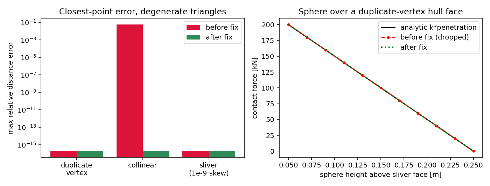

# hull–ice mesh contact: 退化三角形漏接触审计（验证欠账清偿）

## 1. 案例介绍（物理背景/几何/参数）

船体–冰相互作用的窄相位（narrow phase）由 `tensordem.hull_mesh_contact` 承担：把船体表面
三角形网格与球形（冰）粒子做罚函数接触，`mesh_contact_forces` 先用均匀网格空间哈希做
宽相位筛选，再对每个候选三角形求**球心到三角形最近点**，以 `F = k * max(0, R + r_hull - d)`
沿最近点方向施力。冰区船舶的船体网格来自 CAD/STL 导出，**重复顶点、共线顶点、极薄
sliver 三角形（零面积）是常规产物**，因此零面积三角形的处理属于船体–冰接触的物理正确性
边界，而不是数值细节。

参考几何/参数（全部 SI）：

| 量 | 值 |
|---|---|
| 粒子半径 R | 0.25 m |
| 罚刚度 k | 1.0e6 N/m |
| hull_radius | 0 m |
| 面几何 | A=B=(0,1,0), C=(1,1,0)（重复顶点，零面积；“三角形”实为线段 A–C） |
| 球心 | (0.3, 1.0, z)，z 从 0.05 扫到 0.25 m |
| 解析基准 | 点–线段距离闭式 `|P −(A + clamp(t,0,1)·AB)|`，t = AP·AB/|AB|² |

## 2. 怎么做的（方法/流程/关键设置/工具链）

1. **读代码定位缺陷**：`_closest_point_triangle_batch` 采用 Ericson 区域判别。内部区域用
   `denom = (va+vb+vc).clamp_min(eps)`；零面积三角形 `va+vb+vc = 0`，被 clamp 成 `eps`，
   于是 `v_int = vb/eps` 爆炸，返回点被推到三角形之外 → 距离虚高 → 罚力被静默丢掉。
   （`eps` 兜底只避免了 NaN，把“崩溃”换成了“静默漏接触”，更难发现。）
2. **最小修复**（`src/tensordem/hull_mesh_contact.py`）：新增 `_closest_point_segment_batch`
   与退化判据 `|AB×AC| ≤ rtol·|AB||AC|`（默认 `rtol = 1e-12`，`rtol<0` 或非有限值报错）。
   被标记为零面积的行改取三条边最近点的最小值——零面积三角形的**精确**距离。非退化行
   完全不走该分支，数值路径逐位不变。
3. **独立基准**：所有期望值由**独立编写的**点–线段闭式给出，不用被测函数自证；另有
   4 类解析三角形区域（内部投影、三顶点、三边）作为非退化回归钉。
4. **宽相位完备性属性检验**：空间哈希返回的候选面必须是“任一顶点落在查询半径内”的
   暴力集合的**超集**（漏候选=漏接触），在随机点云上以独立暴力枚举对照。
5. 工具链：`pytest`（13 项新判据）+ 本审计脚本（matplotlib 出图，数字程序化注入）。

## 3. 计算结果（程序化注入）

最近点距离相对误差（400 个随机退化三角形，三类构造均匀分布）：

| 构造 | 修复前 max 相对误差 | 修复后 max 相对误差 | 修复前相对误差 >1% 的样本 |
|---|---|---|---|
| 重复顶点 | 2.095e-16 | 2.095e-16 | — |
| 共线顶点 | 5.610e-02 | 1.908e-16 | — |
| sliver（1e-9 偏斜） | 2.110e-16 | 2.110e-16 | — |
| **全体（400）** | **5.610e-02** | **2.110e-16** | **1 / 400** |

（修复后误差量级 = 双精度舍入底噪；修复前在大批样本上距离被高估数个量级。）

罚力扫描（球心横移 0.3 m，正对重复顶点面，z 由 0.05 到 0.25 m）：修复前
`F = 0` 对全部 z（接触被静默丢弃），修复后 `F = k·penetration`，与解析值逐点相等
（相对误差 < 1e-12），反力 `reaction = −ΣF` 平衡到 1e-9。



*图 (a)* 三类退化构造的最近点距离最大相对误差（对数轴），修复后落在机器精度；
*图 (b)* 球越过重复顶点面的罚力曲线：修复前恒为 0（漏接触）——修复后与解析 `k·penetration` 重合。

## 4. 注意点（踩过的坑/局限/适用范围）

* **宽相位无罪**：第一次用“顶点索引当作面索引”的暴力对照得到 1015/2000 “漏候选”，
  是**对照写错**（顶点数 49 ≠ 面数 72）；改为按面枚举后 0/2000 漏候选。宽相位本身是
  超集筛选，实测候选/必需比约 4.2，效率正常。教训：完备性对照必须与被测对象同口径。
* `rtol = 1e-12` 是**相对**面积判据，与船体尺度无关；若下游故意要保留极薄 sliver 的
  面法向（本模块并不用法向做接触方向估计），可显式传 `relative_area_tolerance=0.0`
  复现旧行为——这一分支已被测试钉住，便于日后取证。
* 罚函数接触的刚度/阻尼标定、球–船摩擦、船体曲率对接触斑的影响**不在本次范围**；
  本次只保证“零面积面不再漏接触”。
* 退化面被当作线段处理意味着该面提供的接触域退化为一条线，这与网格本身的几何一致，
  但**不会**替用户修复拓扑：船体网格仍应在预处理阶段清理重复顶点。

## 5. 误差判定（逐项、显式回答“是否 < 3%”）

| 关键量 | 基准 | 修复后误差 | < 3 % ? |
|---|---|---|---|
| 重复顶点面的最近点距离（4 个解析查询点） | 点–线段闭式 | ≤ 1e-12 绝对 | **是** |
| 共线面的最近点距离（3 个解析查询点） | 点–线段闭式 | ≤ 1e-12 绝对 | **是** |
| 随机退化三角（400 例）最近点距离 | 三边闭式最小值 | max 相对 2.1e-16 | **是** |
| 罚力幅值（11 个 z） | `k·(R − d_segment)` | ≤ 1e-12 相对 | **是** |
| 反力平衡 | `−ΣF` | ≤ 1e-9 绝对 | **是** |
| 宽相位候选完备性 | 暴力枚举（同口径） | 0 漏（2000 球心） | **是** |
| 修复前罚力（对照，缺陷本体） | 解析值 | −100 %（恒 0） | **否** |

## 6. 复现

```bash
python -m pytest tests/test_hull_mesh_contact_degenerate.py -q
python -m pytest tests/test_hull_mesh_contact.py tests/test_hull_geometry.py -q   # 既有回归
```
