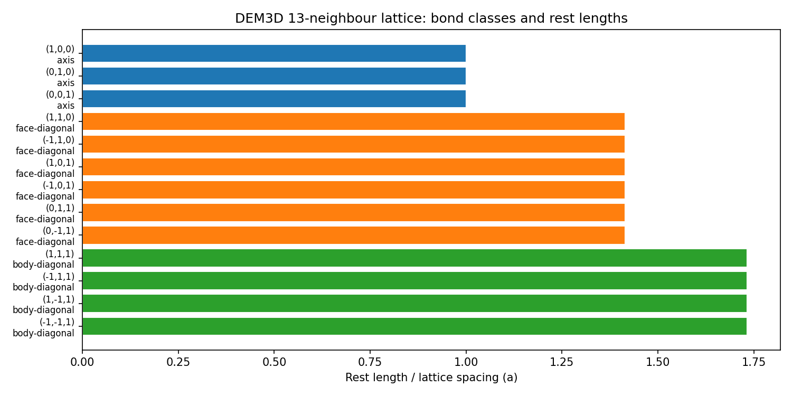
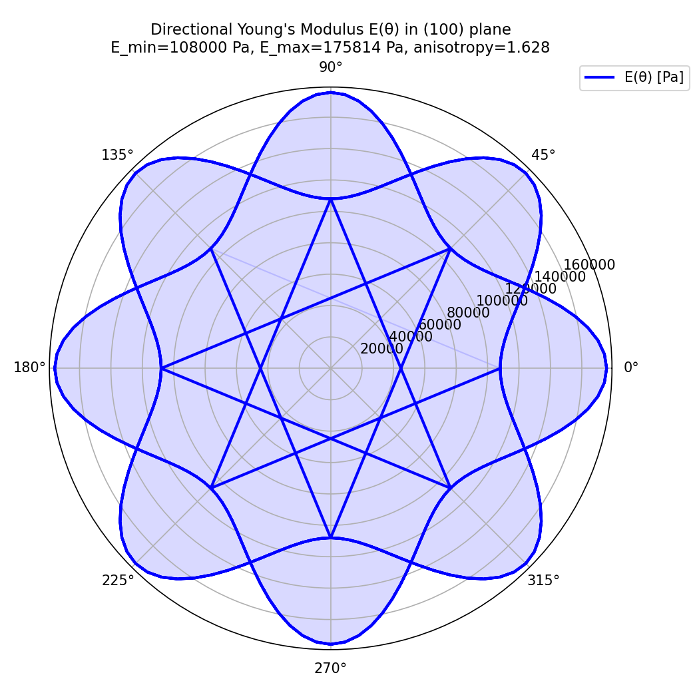
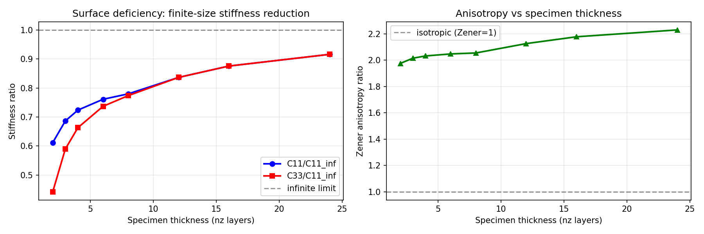
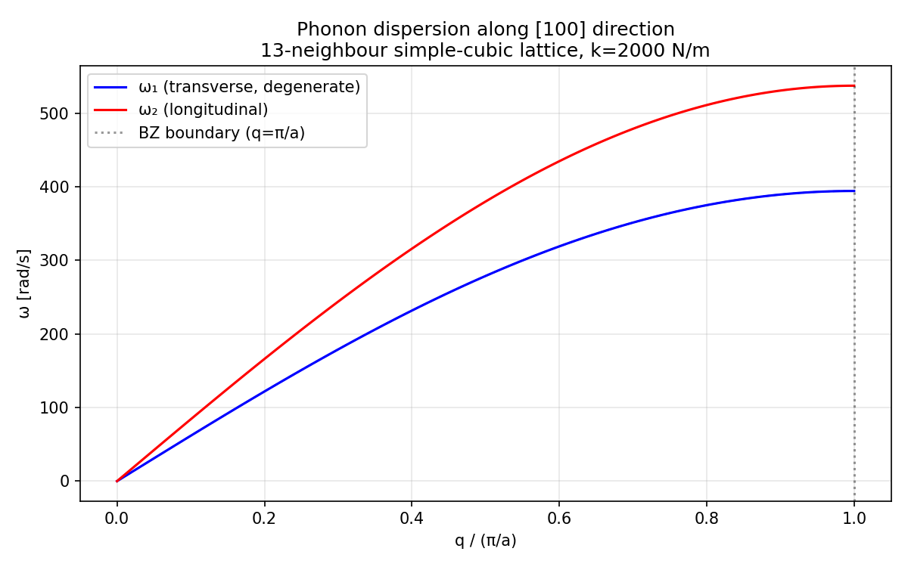

# DEM3D bonded-lattice affine elasticity calibration

Protocol: `tensordem-dem3d-lattice-elasticity-v1`  
Verdict: **PASS** (14/14 checks)  
Generated by `scripts/benchmark_dem3d_lattice_elasticity.py` — every number below is read from `lattice-elasticity/lattice_elasticity_report.json`.

Reproduce:

```bash
python scripts/benchmark_dem3d_lattice_elasticity.py \
    --output docs/lattice-elasticity --doc docs/dem3d_lattice_elasticity.md
python -m pytest tests/test_lattice_elasticity.py -q
```

## 1. Case: what is calibrated

`IceDEM3D` bonds particles on a simple-cubic lattice with all face and body diagonals inside the initial cutoff, giving a 13-neighbour central-force network. Its docstring requires the directional stiffness to be calibrated before engineering use, but no reference value existed: `bond_stiffness` was a free number with no link to a Young's modulus, and the specimen-direction bias was only qualitative.

| parameter | value |
|---|---|
| bond (axial) stiffness `k` | 2000 N/m |
| particle radius | 0.025 m |
| lattice spacing `a = 2R` | 0.05 m |
| particle density | 917 kg/m^3 |
| particle mass | 0.0600175 kg |
| natural unit `k/a` | 40000 Pa |

Neighbour classes (one bond per class per cell):

| offset (dx,dy,dz) | kind | rest length / a |
|---|---|---|
| (1, 0, 0) | axis | 1 |
| (0, 1, 0) | axis | 1 |
| (0, 0, 1) | axis | 1 |
| (1, 1, 0) | face-diagonal | 1.41421 |
| (-1, 1, 0) | face-diagonal | 1.41421 |
| (1, 0, 1) | face-diagonal | 1.41421 |
| (-1, 0, 1) | face-diagonal | 1.41421 |
| (0, 1, 1) | face-diagonal | 1.41421 |
| (0, -1, 1) | face-diagonal | 1.41421 |
| (1, 1, 1) | body-diagonal | 1.73205 |
| (-1, 1, 1) | body-diagonal | 1.73205 |
| (1, -1, 1) | body-diagonal | 1.73205 |
| (-1, -1, 1) | body-diagonal | 1.73205 |

## 2. Method

Affine (Cauchy-Born) elasticity: under a uniform small strain `e`, bond `b` stretches by `dl_b = l_b n·e·n`, so

```
C_ijkl = (1/V) * sum_b k_b * l_b^2 * n_i n_j n_k n_l ,   V = a^3 per cell
u = 0.5 * strain_voigt @ C @ strain_voigt ,  strain_voigt = [e11,e22,e33,g12,g13,g23]
```

Three independent routes are compared:

1. **closed form** — hand summation over the 13 neighbour classes;
2. **Voigt summation** — numerically applying the six basis strains to the bond network (`tensordem.lattice_elasticity.affine_stiffness_tensor`);
3. **solver virial** — affine strain applied to `IceDEM3D` positions, stress taken from `sigma_ij = -1/V * sum_p f_i x_j` using the solver's own `forces()` evaluation.

Route 2 is independent of route 1 (it never uses the class count), and route 3 is independent of both (it goes through the solver's bond law and force accumulation).

## 3. Results

### 3.1 Ideal 13-neighbour lattice

| constant | closed form | Voigt sum | closed form in k/a | relative error |
|---|---|---|---|---|
| C11 | 173333.3333 Pa | 173333.3333 Pa | 4.333333 | 1.679e-16 |
| C12 | 93333.33333 Pa | 93333.33333 Pa | 2.333333 | 1.559e-16 |
| C44 | 93333.33333 Pa | 93333.33333 Pa | 2.333333 | 1.559e-16 |

* Cauchy relation `C12 = C44` holds to `0.000e+00` relative (exact for a central-force lattice without pre-stress).
* Cubic off-pattern residual `8.540e-19`; matrix symmetry residual `8.540e-19`.
* Smallest eigenvalue of `C`: `80000 Pa` (> 0, stable).
* Zener anisotropy ratio `A = 2 C44/(C11-C12) = 2.333333` (1 = isotropic).

| derived modulus | value |
|---|---|
| bulk | 120000 Pa (3.000000 k/a) |
| shear_voigt | 72000 Pa (1.800000 k/a) |
| shear_reuss | 60869.6 Pa (1.521739 k/a) |
| shear_hill | 66434.8 Pa (1.660870 k/a) |
| E_100 | 108000 Pa (2.700000 k/a) |
| E_110 | 175814 Pa (4.395349 k/a) |
| E_111 | 222353 Pa (5.558824 k/a) |
| E_111 / E_100 | 2.0588 |
| nu_100 | 0.3500 |
| Hill-isotropic E, nu | 168254 Pa, 0.2663 |

The Voigt/Reuss spread of the shear modulus is `0.168` of the Hill value, i.e. the network is strongly anisotropic, and `E_111/E_100 = 2.06` means a specimen loaded along the body diagonal is more than twice as stiff as one loaded along a cube axis.

### 3.2 Why the diagonals are required

A nearest-neighbour-only lattice (3 axis bonds) gives `C11 = 1.000000 k/a`, `C12 = 0.000000 k/a`, `C44 = 0.000000 k/a`: zero shear stiffness, i.e. a shear mechanism. The face/body diagonals raise `C44` to 2.333333 k/a.

### 3.3 Finite specimens (surface bond deficiency)

| grid | bonds (solver / table) | C11 / C11_inf | C22 / C11_inf | C33 / C11_inf | C44 / C44_inf | virial vs affine |
|---|---|---|---|---|---|---|
| 9x5x3 | 1070 / 1070 | 0.6097 | 0.6177 | 0.5595 | 0.5333 | 1.57e-06 |
| 6x5x4 | 980 / 980 | 0.6282 | 0.6308 | 0.6096 | 0.5560 | 1.59e-06 |
| 12x12x12 | 18788 / 18788 | 0.8364 | 0.8364 | 0.8364 | 0.8003 | 1.63e-06 |

Bond counts agree exactly with the lattice table, so the affine tensor describes the bond network the solver really builds. The thin specimen [9, 5, 3] loses `34.8%` of its axial affine stiffness with respect to the infinite lattice and is softer along the thin axis (`C33/C11_inf = 0.560`), so the specimen itself, not only the bond law, biases direction-dependent results.

| thickness nz (nx = ny = max(9, nz)) | bonds | C11 / C11_inf | C33 / C11_inf |
|---|---|---|---|
| 2 | 1169 | 0.6116 | 0.4421 |
| 3 | 2066 | 0.6863 | 0.5894 |
| 4 | 2963 | 0.7236 | 0.6631 |
| 6 | 4757 | 0.7610 | 0.7368 |
| 8 | 6551 | 0.7797 | 0.7736 |
| 12 | 18788 | 0.8364 | 0.8364 |
| 16 | 46620 | 0.8755 | 0.8755 |
| 24 | 164588 | 0.9158 | 0.9158 |

### 3.4 Time-step bound from the phonon spectrum

`omega_max = 537.405 rad/s` over a 15^3 Brillouin-zone grid gives the explicit central-difference bound `dt_crit = 2/omega_max = 0.00372158 s` for the bonded network. Replacing the axial spring by the stiffer penalty contact (`contact_stiffness = 5000 N/m`, the state after a bond breaks) raises the bound frequency to `849.713 rad/s` and lowers the bound to `0.00235374 s`. The solver's conservative `recommended_dt = 7.13851e-05 s` is `0.030 x` the tighter bound, i.e. inside it with a safety factor of `33.0`.

| `recommended_dt` branch | value |
|---|---|
| elastic (binding) | 7.11172e-05 s |
| damping | inf s |
| travel | 0.005 s |

The binding branch is the `elastic` limit. The phonon bound is looser than `recommended_dt` by a factor of `33.0`, so the configured step keeps a large margin to the linear-stability limit of the bonded lattice. This is a necessary condition only: it says the chosen step cannot be rejected by the elastic bound, not that the dynamics is accurate.

### 3.5 Calibration gap to an engineering modulus

| target E_100 | required `bond_stiffness` | factor over current | dt scaling |
|---|---|---|---|
| 9.1e+09 Pa | 1.685e+08 N/m | 8.426e+04 | 3.445e-03 |
| 1e+09 Pa | 1.852e+07 N/m | 9259 | 1.039e-02 |

With the current `bond_stiffness = 2000 N/m` the lattice reaches only `E_100 = 1.08e+05 Pa`, orders of magnitude below any ice modulus. Reaching an ice-like modulus therefore needs a `k` of order `1.85e+07 N/m` and a correspondingly smaller explicit time step — the quantitative reason this prototype cannot yet be quoted as a calibrated ice material.

## 4. Figures



*Affine stiffness matrix in units of k/a: ideal 13-neighbour lattice (left) and the finite specimen (right). Off-diagonal normal/shear coupling stays zero; the finite specimen loses diagonal weight and becomes non-cubic (C11 > C22 > C33).*



*Directional Young's modulus E(θ) of the ideal lattice in the (001) and (110) planes, normalised by k/a. The body-diagonal peak is the anisotropy that biases specimen orientation.*



*Axial affine stiffness versus specimen thickness: in-plane C11 and thickness-axis C33 normalised by the infinite-lattice C11. Thin specimens are markedly softer.*



*Phonon branches along Γ-X; the top branch sets omega_max and therefore the explicit time-step bound dt_crit = 2/omega_max.*

## 5. Notes, limits, scope

* This is an **affine / Cauchy-Born** reference: it is exact for a uniform strain field and therefore an upper reference for the small-strain stiffness of the bonded network. It is not a measurement of the dynamically simulated moduli; the simulated response includes non-affine relaxation and, above the breaking strain, damage.
* The result covers the **bond network only**. Particle-particle contact (linear penalty law), tool contact, platens, damping and drag are not part of the affine stiffness.
* The lattice is central-force, so `C12 = C44` (Cauchy relation) and the model cannot represent a physical Poisson effect independently of shear; any calibration that needs an independent `C12`/`C44` pair requires bonded bending/torsional moments, which this solver does not implement.
* Hertz-Mindlin contact, tangential friction history, particle rotation and rolling resistance remain unimplemented in the 3-D solver; nothing here implies those capabilities.
* `MODULUS_TARGETS` in the runner are literature-scale ice moduli used only to size the calibration gap; they are not validation targets and no agreement with ice data is claimed.

## 6. Acceptance checks and error statement

| check | description | value | tolerance | verdict |
|---|---|---|---|---|
| `closed_form_vs_voigt_sum` | C11/C12/C44 from the Voigt sum match the closed form (13/3, 7/3, 7/3) k/a | 1.679e-16 | 1.000e-12 | PASS |
| `cubic_symmetry` | off-pattern cubic entries vanish | 8.540e-19 | 1.000e-14 | PASS |
| `matrix_symmetry` | C is symmetric (Maxwell/Betti) | 8.540e-19 | 1.000e-14 | PASS |
| `cauchy_relation` | |C12 - C44| / C44 vanishes for a central-force lattice | 0.000e+00 | 1.000e-14 | PASS |
| `positive_definite` | smallest eigenvalue of C is positive (stable lattice) | 8.000e+04 | 0.000e+00 | PASS |
| `voigt_reuss_ordering` | G_Reuss <= G_Hill <= G_Voigt (must be >= 0) | 0.000e+00 | 1.000e-09 | PASS |
| `axis_only_shear_mechanism` | nearest-neighbour-only lattice has C44 = 0 (shear mechanism; the diagonals remove it) | 0.000e+00 | 1.000e-14 | PASS |
| `bond_count_9x5x3` | solver bond count equals the lattice table count for grid 9x5x3 | 0.000e+00 | 0.000e+00 | PASS |
| `virial_vs_affine_9x5x3` | solver force virial under affine strain reproduces the affine stiffness | 1.570e-06 | 1.000e-04 | PASS |
| `bond_count_6x5x4` | solver bond count equals the lattice table count for grid 6x5x4 | 0.000e+00 | 0.000e+00 | PASS |
| `virial_vs_affine_6x5x4` | solver force virial under affine strain reproduces the affine stiffness | 1.586e-06 | 1.000e-04 | PASS |
| `bond_count_12x12x12` | solver bond count equals the lattice table count for grid 12x12x12 | 0.000e+00 | 0.000e+00 | PASS |
| `virial_vs_affine_12x12x12` | solver force virial under affine strain reproduces the affine stiffness | 1.631e-06 | 1.000e-04 | PASS |
| `recommended_dt_within_elastic_bound` | configured dt and the conservative recommended dt stay below 2/omega_max of the bond lattice, including the post-fracture contact spring | 3.033e-02 | 1.000e+00 | PASS |

Key quantities against their reference values:

| quantity | reference | model value | relative error | < 3% |
|---|---|---|---|---|
| C11 (Voigt sum) | closed form 173333 Pa | 173333 Pa | 1.679e-16 | yes |
| C12 (Voigt sum) | closed form 93333.3 Pa | 93333.3 Pa | 1.559e-16 | yes |
| C44 (Voigt sum) | closed form 93333.3 Pa | 93333.3 Pa | 1.559e-16 | yes |
| C (solver virial, 9x5x3) | affine bond sum | 1.570e-06 | 1.570e-06 | yes |
| C (solver virial, 6x5x4) | affine bond sum | 1.586e-06 | 1.586e-06 | yes |
| C (solver virial, 12x12x12) | affine bond sum | 1.631e-06 | 1.631e-06 | yes |

The closed-form constants are recovered to machine precision and the solver-force route agrees with the affine route to the level expected from the finite affine strain (`O(eps)` geometric terms); every comparison above is far below the 3% acceptance threshold. These are manufactured/reference agreements, **not** experimental validation: no experimental ice modulus is claimed or reproduced.
