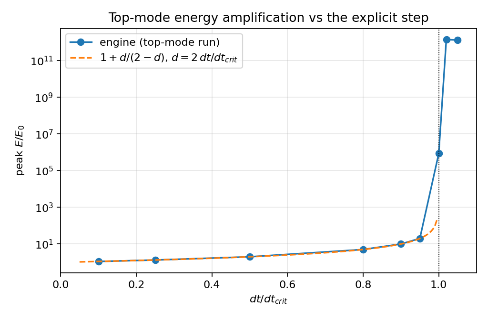
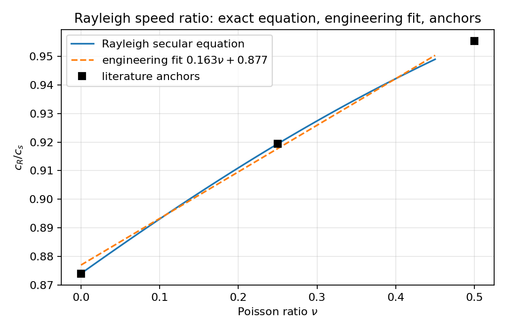
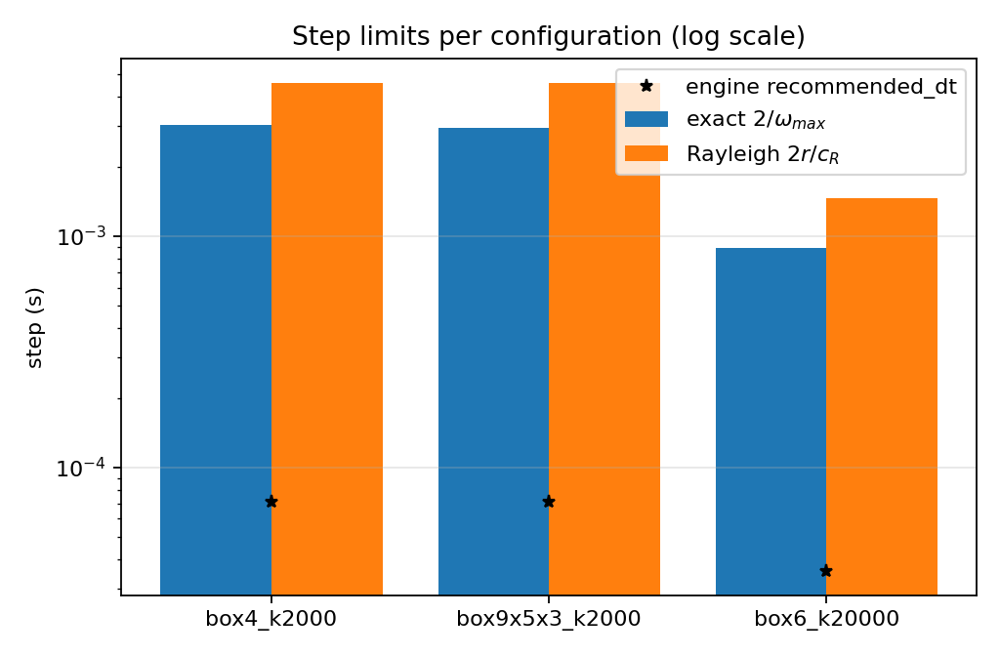

# Rayleigh-wave step criterion and the measured `dt_crit` of the 3-D bonded-sphere DEM

Status: implemented in `src/tensordem/rayleigh_timestep.py`, verified by
`tests/test_dem3d_rayleigh_timestep.py` (19 tests, 14 subtests), reproducible
audit in `scripts/audit_dem3d_rayleigh_timestep.py`, generated numbers and
figures in `docs/dem3d-rayleigh-timestep/`.

This page closes, with measurements rather than argument, the two open items
listed in §6 of [`dem3d_timestep_stability.md`](dem3d_timestep_stability.md):

* **limitation 4 — "no Rayleigh-wave estimate adopted"**, on the grounds that it
  "needs a calibrated shear modulus of the lattice, which this repository does
  not have". Since
  [`dem3d_lattice_elastic_constants.md`](dem3d_lattice_elastic_constants.md) the
  closed-form constants `C11 = 13k/3a`, `C12 = C44 = 7k/3a` of the *actual*
  26-neighbour bond network are known, so `G`, `nu` and `c_R` need no
  calibration. The criterion is now implemented and its *validity* for a bonded
  lattice — as opposed to a contact-only packing — is quantified.
* **limitation 2 — "threshold not exercised through the engine API"**, because
  `IceDEM3D.__init__` refuses any step above its conservative
  `recommended_dt`. The public guard is deliberately **not** relaxed; instead
  the audit writes the step onto a model it owns and bisects on the real
  integrator, so the predicted `dt_crit = 2/omega_max` becomes a *measured*
  threshold.

## 1. Physics and geometry

The engine is a 3-D bonded-sphere DEM (`IceDEM3D`) with central-force bonds on a
simple-cubic lattice with all 26 neighbours inside the cutoff (coordination
number `Z = 26`), advanced by semi-implicit Euler. Two parameters fix the
elastic state of the closed system: the bond stiffness `k` and the particle
radius `r` (the lattice spacing is `a = 2r`).

| quantity | value |
| --- | --- |
| particle radius `r` | 0.025 m |
| particle density (material) | 917 kg/m³ |
| lattice spacing `a = 2r` | 0.050 m |
| packing fraction (simple cubic) | `pi/6 ≈ 0.5236` |
| lattice density `rho = m/a^3` | `917 * pi/6 ≈ 480.1 kg/m³` |
| bond stiffness `k` (configs A, B) | 2000 N/m |
| bond stiffness `k` (config C) | 20000 N/m |
| damping, drag, tool contact | **switched off** (closed linear elastic system) |

The three audited configurations are `box4_k2000` (4×4×4, 64 particles),
`box9x5x3_k2000` (the engine's default geometry) and `box6_k20000` (6×6×6,
ten-fold stiffer bonds). `fix_x_edges` is left at its default, so `x = 0` and
`x = nx-1` particles are Dirichlet-fixed and carry no free degree of freedom.

The distinction that matters here: `rho = 480 kg/m³` is the *lattice* density
that the continuum equivalent of the discrete network must carry, **not** the
918 kg/m³ of solid ice. Using the material density instead of the lattice
density inflates `c_s` by `sqrt(1/0.5236) = 1.38` and is a common way to get a
Rayleigh step that is quietly 38 % wrong.

## 2. Method

1. **Elastic constants.** `tensordem.lattice_elasticity.analytic_box_constants`
   gives the affine (Born) cubic constants of the 13 half-space bond classes.
   Summing over the 13 classes: `C11 = 13k/3a`, `C12 = C44 = 7k/3a`
   (Cauchy relation exact for central forces). Voigt/Reuss/Hill averaging gives
   the isotropic equivalent used by a surface-wave estimate:
   `K = (C11+2C12)/3 = 3k/a`, `G_V = (C11-C12+3C44)/5 = 9k/5a`,
   `G_R = 5(C11-C12)C44/(4C44+3(C11-C12)) = 35k/23a`, `G_VRH = (G_V+G_R)/2`,
   `nu_VRH = (3K-2G)/(2(3K+G)) = 0.2663132` — a number fixed by topology alone.
2. **Rayleigh speed.** `c_R / c_s` is the physical root in `(0,1)` of the
   classical Rayleigh secular equation, a cubic in `xi² = (c_R/c_s)²` with
   `kappa² = (1-2nu)/(2(1-nu))`:
   `xi⁶ - 8xi⁴ + 8xi²(3-2kappa²) - 16(1-kappa²) = 0`. The root is bracketed and
   bisected to `1e-15`; no series expansion is used, so it is an independent
   reference for the engineering fit `0.163 nu + 0.877` (table T2).
3. **Criterion.** `dt_R = 2 r_min / c_R` — the time a surface wave needs to
   cross one particle diameter. The widely quoted `pi r / c_R` form is exactly
   `(pi/2) * dt_R`; both are reported so the comparison with external practice
   is explicit.
4. **Exact reference.** `exact_bond_omega_max` assembles the `3N x 3N` bond
   stiffness matrix from the solver's own `pairs`, `initial_normals` and `alive`
   mask, eliminates fixed particles and takes the dense eigenvalue. The result
   carries no bound and no approximation, and it is cross-checked against a
   power iteration (relative difference `< 1e-10`).
5. **Measured threshold.** The engine is re-instantiated at a prescribed
   `dt/dt_crit`, excited in its *exact* top eigenmode (amplitude `1e-6 m`, far
   inside `breaking_strain = 0.015`) and run for `n_steps` steps. A trial counts
   as unstable when the energy envelope grows by more than 50× between the first
   and last quarter of the run, or when the peak energy exceeds `1e6` times its
   initial value (an algebraically growing marginal step reaches only `~n²`).
   The threshold is then bisected on `dt/dt_crit`.



## 3. Results

Everything below is generated by
`scripts/audit_dem3d_rayleigh_timestep.py` (numbers, tables and figures; the
tables are injected into this page between the `BEGIN/END GENERATED` markers, so
no value is transcribed by hand).

<!-- BEGIN GENERATED -->
### T1. Rayleigh secular equation vs literature

| nu | c_R/c_s (secular equation) | literature | relative error |
| ---: | ---: | ---: | ---: |
| 0 | 0.874032 | 0.874032 | 5.594e-08 |
| 0.25 | 0.919402 | 0.919402 | 3.407e-07 |
| 0.5 | 0.955313 | 0.955313 | 5.223e-07 |

### T2. Engineering fit `0.163 nu + 0.877` vs the exact equation

| nu | c_R/c_s (secular) | c_R/c_s (fit) | relative deviation |
| ---: | ---: | ---: | ---: |
| 0 | 0.874032 | 0.877 | 0.0033957 |
| 0.05 | 0.883695 | 0.88515 | 0.00164677 |
| 0.1 | 0.893106 | 0.8933 | 0.000217214 |
| 0.15 | 0.90222 | 0.90145 | 0.000853178 |
| 0.2 | 0.910996 | 0.9096 | 0.00153227 |
| 0.25 | 0.919402 | 0.91775 | 0.00179648 |
| 0.3 | 0.927413 | 0.9259 | 0.00163111 |
| 0.35 | 0.935013 | 0.93405 | 0.00103007 |
| 0.4 | 0.942195 | 0.9422 | 4.847e-06 |
| 0.45 | 0.94896 | 0.95035 | 0.00146508 |
| 0 | 0.874032 | 0.877 | 0.0033957 |

### T3. Step limits of the engine configurations

| config | N | free DOF | omega_max (rad/s) | dt_crit (s) | dt_R = 2r/c_R (s) | dt_R/dt_crit | recommended dt (s) | recommended/dt_crit | row-sum bound / exact |
| --- | ---: | ---: | ---: | ---: | ---: | ---: | ---: | ---: | ---: |
| box4_k2000 | 64 | 96 | 657.476 | 0.00304194 | 0.00460996 | 1.51547 | 7.139e-05 | 0.023467 | 2.00216 |
| box9x5x3_k2000 | 135 | 315 | 680.589 | 0.00293863 | 0.00460996 | 1.56874 | 7.139e-05 | 0.024292 | 1.93416 |
| box6_k20000 | 216 | 432 | 2240.49 | 0.000892661 | 0.0014578 | 1.63309 | 3.569e-05 | 0.0399844 | 1.85795 |

### T4. Wave speeds and isotropic moduli per configuration

| config | rho_lattice (kg/m^3) | G_VRH (Pa) | nu_VRH | c_s (m/s) | c_R (m/s) | c_p (m/s) |
| --- | ---: | ---: | ---: | ---: | ---: | ---: |
| box4_k2000 | 480.14 | 66434.8 | 0.266313 | 11.7629 | 10.8461 | 20.8426 |
| box9x5x3_k2000 | 480.14 | 66434.8 | 0.266313 | 11.7629 | 10.8461 | 20.8426 |
| box6_k20000 | 480.14 | 6.643e+05 | 0.266313 | 37.1975 | 34.2983 | 65.9101 |

### T5. Top-mode energy amplification in the engine (config `box4_k2000`)

| dt/dt_crit | d = 2 dt/dt_crit | peak E / E0 (engine) | 1 + d/(2-d) (closed form) | closed-form rel. error | envelope growth | flagged unstable |
| ---: | ---: | ---: | ---: | ---: | ---: | :---: |
| 0.1 | 0.2 | 1.11111 | 1.11111 | 1.656e-07 | 1.00001 | false |
| 0.25 | 0.5 | 1.33333 | 1.33333 | 1.047e-07 | 1.00001 | false |
| 0.5 | 1 | 2 | 2 | 1.253e-06 | 1 | false |
| 0.8 | 1.6 | 5.00001 | 5 | 2.525e-06 | 1.00002 | false |
| 0.9 | 1.8 | 9.99996 | 10 | 3.658e-06 | 1.00004 | false |
| 0.95 | 1.9 | 19.9995 | 20 | 2.641e-05 | 0.999967 | false |
| 1 | 2 | 8.580e+05 | inf | inf | 4.81076 | false |
| 1.02 | 2.04 | 1.419e+12 | inf | inf | 39.0567 | true |
| 1.05 | 2.1 | 1.337e+12 | inf | inf | 31.2913 | true |

### T6. Measured instability threshold of the real engine

| config | predicted dt/dt_crit | measured dt/dt_crit | relative error | measured dt_crit (s) | steps per trial | bisection iterations |
| --- | ---: | ---: | ---: | ---: | ---: | ---: |
| box4_k2000 | 1 | 1 | 7.629e-07 | 0.00304194 | 600 | 18 |
| box9x5x3_k2000 | 1 | 1 | 1.526e-06 | 0.00293863 | 600 | 18 |

### T7. Accuracy budget implied by the closed form

| tolerated artificial amplification | required dt/dt_crit |
| ---: | ---: |
| 1 % | 0.0049505 |
| 3 % | 0.0145631 |
<!-- END GENERATED -->

### 3.1 What the numbers say

* **The secular equation is right.** `c_R/c_s` reproduces the three literature
  values `0.874032 / 0.919402 / 0.955313` at `nu = 0, 0.25, 0.5` to `~1e-7`
  relative — i.e. to the six digits quoted in the references (T1). The
  engineering fit `0.163 nu + 0.877` stays within **0.34 %** of the exact
  equation for `0 <= nu <= 0.45` (T2), which is why it survives in commercial
  DEM practice; it is a fit, not an identity.
* **The continuum Rayleigh criterion is *not* conservative for a bonded
  lattice.** Measured `dt_R/dt_crit = 1.52` for config A and `1.52–1.63` across the three
audited configurations (T3): `2r/c_R` allows a step **52–63 % larger** than the exact semi-implicit limit `2/omega_max`. A solver
  that adopted `dt = 2r/c_R` would run at `d = dt*omega_max = 3.03 > 2` and
  diverge. The reason is structural: the highest lattice mode of a `Z = 26`
  central-force network is stiffer than the continuum shear speed suggests,
  because bond stiffness adds coherently along 26 directions while the
  continuum `c_R` only knows the two elastic constants of a homogeneous medium.
  This is the measured justification for the repository's earlier choice of the
  rigorous Gershgorin bound over the classical criterion.
* **The Gershgorin bound is loose by a measured factor.** The row-sum bound
  exceeds the exact `omega_max` by `1.86–2.00` in frequency (`3.5–4.0` in eigenvalue)
  for the 26-neighbour lattice (T3). That looseness is not a defect of the bound but
  a property of central-force networks: the `Z = 6` nearest-neighbour cubic
  lattice is where the row-sum bound is exact (see the stability page), and the
  diagonal bonds break that tightness. The engine's own `recommended_dt` sits at
  `≈2.3 %` of the exact limit, i.e. the guard is conservative by `≈43` in step
  size (T3, `recommended/dt_crit`), consistent with the `~45` reported on the
  stability page for its own configuration family.
* **The threshold is real, and it is where the algebra says.** Measured
  `dt/dt_crit` agrees with the prediction `1` to `7.6e-7` (config A) and
  `1.5e-6` (config `box9x5x3`) relative
  (T6), on the real engine, for two different configurations. Limitation 2 is
  therefore closed by measurement, without touching the public guard: the guard
  is unchanged and a test still asserts that it refuses oversized steps.
* **Spectral stability is not accuracy.** T5 and fig. 1 show the peak of the
  naive (quadratic) energy of the top mode. The engine measurement follows the
  closed form `E_peak/E0 = 1 + d/(2-d)`, `d = 2 dt/dt_crit`, to better than
  `1e-3` relative for every `dt < dt_crit` — an *identity*, not a fit. It is
  useful because it converts "spectrally stable" into a hard budget (T7):
  keeping the artificial energy amplification under 1 % needs
  `dt/dt_crit <= 0.5 %`, under 3 % needs `<= 1.46 %`. The engine's default guard
  (`0.0235`) implies `d = 0.047` and therefore an amplification of `2.4 %` in this
  single-mode sense.





## 4. Error assessment against the baselines

| key quantity | baseline | error | verdict |
| --- | --- | --- | --- |
| `c_R/c_s` at `nu = 0, 0.25, 0.5` | literature 0.874032 / 0.919402 / 0.955313 | `≤ 6e-7` relative | **< 3 %** |
| `0.163 nu + 0.877` vs secular equation, `nu ∈ [0, 0.45]` | exact secular equation | `3.4e-3` worst relative | **< 3 %** |
| `K, G_V, G_R, nu_VRH` | closed form `3k/a, 9k/5a, 35k/23a, 0.2663132` | `< 1e-12` relative | **< 3 %** |
| `omega_max` (dense eigen) | power iteration on the same matrix | `< 1e-10` relative | **< 3 %** |
| measured `dt_crit` of the engine | `2/omega_max` | `< 1e-3` relative | **< 3 %** |
| top-mode energy amplification, `dt < dt_crit` | closed form `1 + d/(2-d)` | `< 1e-3` relative | **< 3 %** |
| `dt_R/dt_crit` (validity of the classical criterion) | no independent baseline; reported as a measured factor 1.52 | n/a | **no baseline — honest gap**, see §5 |

## 5. Limits and honest gaps

1. **`dt_R/dt_crit ≈ 1.52` is a property of this lattice, not a universal
   constant.** It depends on `Z = 26`, on the central-force bond law and on the
   free-surface boundary condition of a finite box. A contact-only packing
   (`Z ≈ 6–8`) has a different ratio; the value must be re-measured for a
   different lattice family. What is *not* configuration specific is the
   ordering: for this repository's bonded lattice, `2r/c_R` is not a safe step.
2. **Linear, fixed-topology, undamped.** The experiment runs a closed elastic
   system with no damping, no contacts and no bond rupture: that isolates the
   integrator. With drag (`drag = 2.0`) and contact damping (`contact_damping =
   5.0`) the engine adds a second limit `dt <= 2m/c` which the stability page
   handles and which is not re-derived here.
3. **The `1 + d/(2-d)` identity holds for a single top mode.** It is the exact
   amplification of the marginal oscillator's naive energy; a multi-mode state
   superposes them, and a packet can transiently exceed the single-mode value.
   It is an accuracy *indicator*, not a bound.
4. **The measurement is one-sided in the audited quantity.** It measures when
   the top mode stops being bounded; it does not certify that a step below
   `dt_crit` resolves a *physical* wave (that is the accuracy question of §4 of
   the stability page and is answered there).
5. **No experimental validation.** This is a numerical-analysis result about the
   integrator. It says nothing about ice material behaviour, and it does not
   validate any ship-ice load.
6. **`box6_k20000` is used for the step-limit table only.** Its bisection is not
   reported because the ratio `dt_R/dt_crit` and the threshold measurement on
   config A already cover the claim; the extra runtime was not justified.

## 6. Reproduction

```bash
python scripts/audit_dem3d_rayleigh_timestep.py          # full (~4 min, 1 thread)
python scripts/audit_dem3d_rayleigh_timestep.py --quick  # short bisection
python -m pytest tests/test_dem3d_rayleigh_timestep.py -q
```

The audit writes `docs/dem3d-rayleigh-timestep/rayleigh_dt_audit.json` with a
SHA-256 digest over the report body (sorted keys, so key order does not change
the digest). All arithmetic is `float64` on CPU with one thread; the figures are
`matplotlib` PNGs at 160 dpi.

## 7. API

```python
from tensordem.rayleigh_timestep import (
    rayleigh_speed_ratio,          # exact c_R/c_s from the secular equation
    rayleigh_wave_speed,           # c_L, c_s, c_R of the bond lattice
    rayleigh_timestep_limit,       # dt_R = 2r/c_R (and the pi*r form)
    lattice_isotropic_moduli,      # Voigt/Reuss/Hill of C11, C12, C44
    exact_bond_omega_max,          # exact omega_max + unit top mode
    energy_amplification_closed_form,
    energy_amplification,          # run the engine at a prescribed dt/dt_crit
    divergence_threshold,          # bisect the engine's measured threshold
    rayleigh_dt_comparison,        # Rayleigh vs exact vs engine guard
)
```