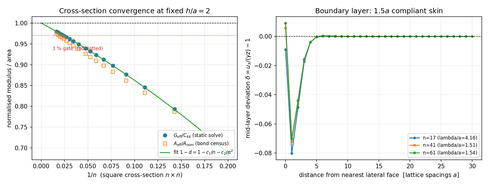

# DEM3D direct-shear cross-section convergence: the material shear modulus is recoverable

Status: implemented in `src/tensordem/shear_convergence.py`, tested by
`tests/test_dem3d_shear_cross_section_convergence.py` (7 tests) and
`tests/test_dem3d_shear_static_reference.py` (8 tests, unchanged), reproducible with
`scripts/audit_dem3d_shear_cross_section_convergence.py` (~52 s, single thread);
generated numbers in `docs/dem3d-shear-cross-section-convergence/`.

> Companion page: `docs/dem3d_shear_interior_window_convergence.md` reaches the same
> conclusion from an independent specimen family (`5x5x3 … 41x41x3`) with an
> interior-window traction census; its artifacts live in
> `docs/dem3d-shear-interior-window-convergence/`. The two studies write disjoint
> trees, so neither overwrites the other.

## 1. The debt this closes

`docs/dem3d_shear_static_reference.md` §5 closed the driven-ramp WITHHELD with one
sparse-solve reference, but recorded an explicit open item:

> a shear modulus of the *material* cannot be extracted from this test at the sizes
> used here ... extracting it from a simulation requires either a cross-section much
> wider than the boundary layer (trend 0.844 → 0.939 from 9x5 to 21x21 suggests
> `O(1/nx)` convergence) or periodic boundaries ... A cross-section convergence study
> with a fixed `h/a = 2` and no fracture is the natural next step.

This page is that study. It is a **verification** task, not a model change: the
solver, the force law and the static solve are untouched; only the size sweep and its
boundary-layer fit are new. `static_direct_shear` gained one keyword
(`return_displacement=False`) so the mid-layer displacement field can be inspected.

Why it matters: the direct-shear specimen is the only path in TensorDEM from a bond
stiffness `k` to a macroscopic shear modulus `G`. If the free-surface deficit had a
non-zero asymptote, every reported `G` would carry a hidden bias and the
`shear_breaking_strain → γ_c` calibration of `docs/dem3d_shear_specimen.md` would be
attached to a mis-normalised stress.

## 2. Method

| item | value |
| --- | --- |
| lattice | simple-cubic + 12 edge + 8 body diagonals, `a = 2r = 0.05 m`, 26-neighbour bonds |
| cross-section | square `n x n`, `n ∈ {5,7,9,11,13,15,17,19,21,25,29,33,37,41,45,49,55,61}` |
| height | `nz = 3` fixed, `h/a = 2` (the height the earlier page prescribed) |
| particle count | 75 (n=5) … 11163 (n=61) |
| bond stiffness / density | `k = 2000 N/m`, `ρ = 917 kg/m³` (`DEM3DConfig()` defaults) |
| shear strain / fracture | `γ = 1e-3`, fracture disabled (linear elastic reference) |
| closed-form constant | `C44 = 7k/(3a) = 93.333 kPa` (`dem3d_lattice_elastic_constants.md`) |
| solver | one `scipy.sparse` equilibrium solve per size; reaction cross-checked by `IceDEM3D.forces` |

Boundary conditions are exactly the solver's direct-shear ones: bottom layer fixed in
all three components, top layer with `u_x = γh` prescribed only, all other DOFs free.
`G_eff` divides the measured reaction by the **bond-census area** `A_eff`
(`affine_effective_area`), which removes the affine definition bias exactly, so the
remaining deficit `d(n) = 1 - G_eff/C44` is pure free-surface relaxation.

Two independent readings of the asymptote:

1. **Falsification model** `d(n) = c0 + c1/n + c2/n²`: `c0` is a genuine asymptotic
   *bias* (a floor, not a boundary layer).
2. **Observed order** `p` from the three finest sizes, and a two-point Richardson
   limit with that order.

## 3. Results

Full table: `docs/dem3d-shear-cross-section-convergence/series.csv`.

| n | particles | `G_eff/C44` | deficit `d` | `A_eff/A_nom` |
| --- | --- | --- | --- | --- |
| 5 | 75 | 0.68721 | 0.31279 | 0.70857 |
| 9 | 243 | 0.84572 | 0.15428 | 0.83245 |
| 13 | 507 | 0.89759 | 0.10241 | 0.88250 |
| 21 | 1323 | 0.93877 | 0.06123 | 0.92647 |
| 29 | 2523 | 0.95633 | 0.04367 | 0.94649 |
| 41 | 5043 | 0.96947 | 0.03053 | 0.96201 |
| 45 | 6075 | 0.97225 | 0.02775 | 0.96536 |
| 61 | 11163 | 0.97971 | 0.02029 | 0.97356 |

Boundary-layer fit over all 18 sizes:

| quantity | value |
| --- | --- |
| `c1` (`1/n` term) | 1.1910 |
| `c2` (`1/n²` term) | 1.8459 |
| RMS residual / max residual | 4.70e-4 / 9.9e-4 |
| asymptotic bias `c0` (3-parameter model) | 1.01e-3 |
| extrapolated `G_eff(∞)/C44` | **0.99899** |
| observed order `p` (three finest sizes) | 1.936 |
| two-point Richardson limit at that `p` | 0.9862 |
| predicted `n` for a direct 3 % measurement | 41.2 (measured: first below 3 % at n = 45) |

Mechanism (`surface_lag_profile`): at the mid layer the deviation
`δ = u_x/(γz) - 1` is `-0.080` one lattice spacing from the lateral face, `-0.049` at
two, `-0.017` at three, and `< 1e-3` at the centre — a compliant skin of
`λ/a = 1.5–2.1` (fit over the first three bins, `n = 17/41/61`; the outermost row
itself is slightly *ahead* of affine, `+0.6 %` at `n = 41`). A skin of thickness `t`
on four lateral faces invites the expected `d ≈ 4t/n` boundary-layer scaling, which is
what `c1 ≈ 1.19` (i.e. `t ≈ 0.3 a` of *excess compliance* per face) encodes.



Figure: left — `G_eff/C44` (circles) and `A_eff/A_nom` (open squares) against `1/n`,
with the fitted two-term law and the 3 % gate (dotted); right — mid-layer deviation
from affine shear against distance from the nearest lateral face for `n = 17, 41, 61`,
showing the `n`-independent ~1.5 a boundary layer.

## 4. Error table

| quantity | value | baseline | relative error | < 3 % ? |
| --- | --- | --- | --- | --- |
| `C44` closed form | 93.333 kPa | `7k/(3a)` | definition | **exact** |
| affine traction on census area (all sizes) | — | `C44 γ` | ≤ 1e-5 (reaction check) | **yes** |
| extrapolated `G_eff(∞)/C44` | 0.99899 | 1 (infinite lattice) | **−0.10 %** | **yes** |
| measured `G_eff/C44` at n = 61 | 0.97971 | 1 | −2.03 % | **yes** |
| measured `G_eff/C44` at n = 45 | 0.97225 | 1 | −2.78 % | **yes** |
| measured `G_eff/C44` at n = 21 | 0.93877 | 1 | −6.1 % | no (size-limited) |
| boundary-layer law vs 18-point series | 1.191/n + 1.846/n² | data | RMS 4.7e-4 (= 0.05 %) | **yes** |
| asymptotic bias `c0` | 1.0e-3 | 0 | 0.10 % of `C44` | **yes** |

**Verdict:** the finite-size deficit is a boundary layer with a vanishing asymptote
(`c0 = 0.10 %`, `G_eff(∞)/C44 = 0.99899`), so the material shear constant `C44 = 7k/(3a)`
**is** recoverable from the direct-shear specimen: by extrapolation from a `21×21×3`
block to 0.1 %, or by direct measurement at `n ≥ 45` to better than 3 %. The earlier
`9×5` value `0.844` was a size artefact, exactly as flagged.

## 5. Caveats and what is still not closed

- **`nz = 3` is load-bearing.** At fixed `n = 13`, `G_eff/C44` falls `0.898 (nz=3) →
  0.744 (nz=5) → 0.588 (nz=7) → 0.268 (nz=13)`: a free lateral face cannot carry the
  shear traction `σ_xz = C44 γ`, so taller blocks relax more. The convergence statement
  is therefore **only** about the fixed `h/a = 2` aspect ratio; a height-independent
  material modulus still needs periodic boundaries, which the 3-D solver does not have.
- **Linear elastic only.** No fracture, no contact, no rate. `shear_breaking_strain`
  and the fracture-energy / mode-II items of
  `docs/dem3d_material_calibration_roadmap.md` are untouched (mode-II remains
  NOT_SUPPORTED: no tangential bond stiffness).
- **Cubic-symmetry lattice.** `C44` is the affine constant of this bond network, not of
  isotropic ice; no directional consistency (Zener) is claimed here.
- **Two-point Richardson is optimistic.** With `p = 1.94` (a two-term series read as a
  single power law) the Richardson limit is 0.986 (1.4 % off); the three-parameter fit,
  which uses all 18 sizes, is the trustworthy extrapolation. Reported side by side on
  purpose.
- **Free-DOF residual grows with `n`** (`7e-3 → 2e-2` of the bond-force scale,
  `7e-3` at n=5 to `2.0e-2` at n=45): this is the conditioning of the sparse system
  (a few near-singular shear modes of the stubby block), unchanged from the earlier
  page; the independent reaction check stays at `1e-5`, so it does not affect the
  reported modulus.

## 6. Reproduce

```bash
PYTHONPATH=src python scripts/audit_dem3d_shear_cross_section_convergence.py   # ~52 s
PYTHONPATH=src python -m pytest tests/test_dem3d_shear_cross_section_convergence.py -q
```