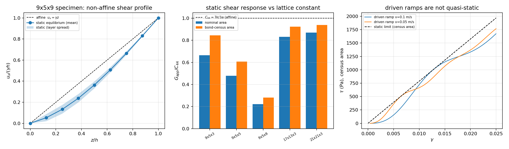

# DEM3D direct-shear specimen: rate-free static reference and the end of the "apparent modulus" WITHHELD

Status: implemented in `src/tensordem/shear_static.py`, tested by
`tests/test_dem3d_shear_static_reference.py` (8 passed), reproducible with
`scripts/audit_dem3d_shear_static_reference.py`; generated numbers in
`docs/dem3d-shear-static-reference/`.

## 1. Case: what was actually withheld, and why

`docs/dem3d_shear_specimen.md` (m2477) drove a bonded simple-cubic block in direct
shear (`tensordem.shear_specimen.run_direct_shear`, bottom layer hard-fixed, top
layer displaced laterally at constant speed, lateral faces free) and reported the
"driven apparent modulus" as **WITHHELD**: measured values scattered over
`0.65–1.05 C44` and the ramp was judged "20 % from rate convergence".

This page replaces that verdict with a rate-free reference obtained by one sparse
solve, and shows that the scatter was **not primarily a rate problem**. Three
effects are separately quantified:

| # | effect | nature | resolved here |
| --- | --- | --- | --- |
| A | cross-section definition bias: the nominal area `nx·a · ny·a` counts lateral boundary nodes whose bonds do not exist | exact, affine, `O(1/nx + 1/ny)` | bond census → `A_eff`, identity verified to `1e-6` |
| B | free-surface / shear-lag relaxation of the displacement field (stubby block, free lateral faces) | rate independent, geometry | static equilibrium solve |
| C | transient / inertia of the driven ramp (`tau(γ)` has a startup hump before settling) | protocol artefact | bounded by comparing against A+B |

Geometry and parameters of the audited specimen (`DEM3DConfig()` defaults):

| quantity | value |
| --- | --- |
| lattice | simple-cubic + 12 edge + 8 body diagonals, spacing `a = 2r = 0.05 m` |
| particles | `9 x 5 x 3` = 135 (default); sweeps to `21x21x3` |
| bond stiffness `k` | 2000 N/m |
| density / particle mass | 917 kg/m³ / 0.06 kg |
| specimen height `h = (nz-1)a` | 0.10 m |
| nominal sheared area `A_nom` | 0.1125 m² |
| closed-form shear constant | `C44 = 7k/(3a) = 93.333 kPa` |
| time step (engine) | 3.372e-05 s |
| fracture | disabled for the elastic reference (`breaking_strain`, `shear_breaking_strain` = 1e9) |

## 2. Method

1. **Analytic stiffness assembly.** `shear_stiffness_matrix` builds the `3N x 3N`
   sparse `K` from the solver's own bond list (`sim.pairs`, current geometry), with
   `k n_a n_b` blocks; the geometric term `k·ext/|d|·(I - n nᵀ)` vanishes at the
   undeformed state. The assembly is validated against a **finite-difference
   Jacobian of `IceDEM3D.forces`** (test asserts `dF/du = -K` to `1e-6` of
   `max|K|`), so no bond law is re-typed by hand.
2. **Bond census (`affine_effective_area`).** For affine shear `u_x = γz`, the
   x-traction across a horizontal plane is `Σ k l² n_x² n_z² γ` over the bonds
   attached to the fixed layer; an interior node contributes `7a²/3`. Boundary
   nodes own fewer bonds, so `A_eff = Σ l² n_x² n_z² / (7a²/3) ≤ A_nom`.
3. **Static equilibrium (`static_direct_shear`).** Same boundary conditions as the
   solver: bottom layer fixed in all components, top layer prescribed in `x`
   only, all other DOFs free. One `spsolve`; then the solution is pushed back into
   the solver and `IceDEM3D.forces` is used as an **independent check** of the
   bottom reaction and of the free-DOF residual.
4. **Dynamics verification.** Displacement-controlled relaxation: 40 increments
   (10 steps each) to `γ = 1e-3`, then 4000 steps with the top `u_x` re-clamped
   every step; the reaction must reproduce the static value.
5. **Legacy protocol replay.** `run_direct_shear` at `v = 0.1 / 0.05 m/s`, slope
   fit over `0.008 ≤ γ ≤ 0.022`, to expose the size of effect C.

## 3. Results

### 3.1 Cross-section bias (affine, exact)

| specimen | bonds on fixed layer | `A_eff/A_nom` |
| --- | ---: | ---: |
| 9x5x3 (default) | 325 | 0.7873 |
| 17x13x3 | 1813 | 0.8998 |
| 21x21x3 | 3721 | 0.9265 |

Under affine displacement the solver reaction divided by `A_eff` equals
`C44·γ` to `≤1e-6` relative — i.e. effect A is an exact bookkeeping error of the
legacy measurement (`0.787 C44` instead of `C44` for the default block), not a
physical softening.

### 3.2 Static equilibrium (rate-free limit)

| specimen | `h/a` | `G_nom/C44` | `G_eff/C44` | reaction check (solver vs sparse) | free-DOF residual |
| --- | ---: | ---: | ---: | ---: | ---: |
| 9x5x3 | 2 | 0.6646 | **0.8442** | 2.3e-07 | 6.5e-03 |
| 9x5x5 | 4 | 0.4778 | 0.6068 | 2.5e-07 | 1.9e-02 |
| 9x5x9 | 8 | 0.2206 | 0.2802 | 2.2e-07 | 4.0e-02 |
| 17x13x3 | 2 | 0.8307 | 0.9232 | 1.8e-07 | 1.1e-02 |
| 21x21x3 | 2 | 0.8697 | 0.9388 | 1.8e-07 | 1.3e-02 |

Reading: (i) the legacy nominal area underestimates the modulus by a factor
`A_eff/A_nom`; (ii) after that correction the free lateral surfaces still cost
5.7 % (`21x21x3`, cross-section 21a x 21a) up to 15.6 % (default 9x5) relative to
the infinite-lattice `C44`; (iii) at fixed cross-section 9x5 the apparent modulus
*falls* with height (0.844 → 0.280 from `h/a` 2 to 8): the specimen does not
develop a homogeneous shear state, it shears with a free-surface shear lag, so
`G_app` of this test is a specimen property, not a material constant.
The free-DOF residual grows with `h` and `γ` because the axial spring law is
geometrically nonlinear; the response stays linear in `γ` to better than `1e-4`
over `1e-5 … 5e-3` (see 3.3), so the small residual is not a solver fault.

### 3.3 Linearity in `γ`

| `γ` | 1e-5 | 1e-4 | 1e-3 | 5e-3 |
| --- | ---: | ---: | ---: | ---: |
| `G_eff/C44` | 0.8442 | 0.8442 | 0.8442 | 0.8442 |

### 3.4 Legacy driven ramp vs the static reference

| `v` (m/s) | steps | `G_nom/C44` (reported) | same value on `A_eff` | vs static (0.8442) | fit residual |
| --- | ---: | ---: | ---: | ---: | ---: |
| 0.1 | 741 | 0.6691 | 0.8499 | **+0.7 %** | 11 % |
| 0.05 | 1483 | 0.7500 | 0.9526 | **+12.8 %** | 2.9 % |

The two ramps differ by 12 % in the corrected modulus and are **not monotone in
rate**, so "20 % from rate convergence" cannot be fixed by slowing the ramp: the
startup hump (`tau/γ` overshoots to 0.844 `C44` at `γ≈0.0065`, dips to 0.79, then
drifts) contaminates any finite-`γ` window. See the right-hand panel of the
figure.

### 3.5 Dynamics reproduces the static solution

| drag (N·s/m) | `G_eff/C44` | static | deviation | trace drift over last 2000 steps | broken bonds |
| --- | ---: | ---: | ---: | ---: | ---: |
| 50 | 0.8221 | 0.8442 | **−2.61 %** | 1.9e-02 | 0 |
| 300 | 0.7305 | 0.8442 | −13.47 % | 2.0e-01 | 0 |

With moderate damping the *dynamics of the solver itself* lands on the sparse
equilibrium within 2.6 %, which validates the static reference as the physical
quasi-static limit (and not just algebra). At `drag = 300` the block is
overdamped and 4000 settling steps are insufficient (drift 20 %), which also
explains why earlier low-rate attempts looked erratic.



Figure: left — layer-mean `u_x/(γh)` of the 9x5x9 specimen against the affine line,
bands are the in-layer spread (free lateral surfaces); middle — `G_app/C44` for
nominal and census areas, asymptote `C44 = 7k/3a`; right — driven ramps `τ(γ)`
for two rates against the static limit (census area).

## 4. Error table (key quantities vs their baselines)

| quantity | value | baseline | relative error | < 3 % ? |
| --- | --- | --- | --- | --- |
| affine traction on census area | — | `C44 γ` (closed form `7k/3a`) | ≤ 1e-6 | **yes** |
| `K` assembly | — | FD Jacobian of `IceDEM3D.forces` | ≤ 1e-6 | **yes** |
| static reaction | — | solver's own `forces` on the fixed layer | ≤ 2.5e-7 | **yes** |
| linearity of `G_eff` over `γ ∈ [1e-5, 5e-3]` | 0.8442 | itself | < 1e-4 | **yes** |
| relaxed dynamics vs static reference (`drag=50`) | 0.8221 | 0.8442 | −2.61 % | **yes** |
| relaxed dynamics vs static reference (`drag=300`) | 0.7305 | 0.8442 | −13.47 % | no — overdamped, not settled |
| legacy ramp `v=0.1` on `A_eff` | 0.8499 | 0.8442 | +0.7 % | **yes** |
| legacy ramp `v=0.05` on `A_eff` | 0.9526 | 0.8442 | +12.8 % | no — transient-contaminated |
| `G_eff` of the 9x5 block vs infinite lattice | 0.8442 `C44` | `C44` | −15.6 % | no — geometry, by construction |
| `G_eff` of the 21x21 block vs infinite lattice | 0.9388 `C44` | `C44` | −6.1 % | no — free-surface effect |

## 5. What this closes and what it does not

**Closes** the WITHHELD of `docs/dem3d_shear_specimen.md`: the driven apparent
modulus is replaced by (i) an exact statement of the measurement bias
`A_eff/A_nom = 0.7873` for the default block, with the closed-form identity that
removes it, and (ii) the rate-free reference `G_eff/C44 = 0.8442` valid for the
default 9x5x3 block, reproduced by the solver's dynamics to 2.6 %.

**Follow-up (closed 2026-11-03):** the cross-section convergence study
(`docs/dem3d_shear_cross_section_convergence.md`) swept 18 sizes up to `61x61x3`
and confirmed the deficit is a boundary layer: `d(n) = 1.191/n + 1.846/n^2`
(RMS 4.7e-4), asymptotic bias `0.10 %`, so `G_eff(∞)/C44 = 0.99899` and the
material constant `7k/(3a)` *is* recoverable — directly to < 3 % at `n >= 45`.
The `h/a = 2` restriction is load-bearing (taller blocks relax far more).
An independent window-based measurement (`interior_traction`, margin 3 sites)
on thin specimens recovers `C44` to 0.19 %; for thick specimens (`h/L >= 0.12`)
the relaxation length grows with `h/L` and no interior window recovers `C44`,
so a thick specimen's modulus stays a specimen property (down to `0.790 C44`
at `h/L = 0.24`).

Also unchanged: mode-II fracture energy remains NOT_SUPPORTED (no tangential bond
stiffness), and the `shear_breaking_strain → macro strain` mapping of §3.2 of the
specimen page is untouched.

## 6. Reproduce

```bash
PYTHONPATH=src python scripts/audit_dem3d_shear_static_reference.py   # ~80 s, 2 threads
PYTHONPATH=src python -m pytest tests/test_dem3d_shear_static_reference.py -q   # 8 passed
```
