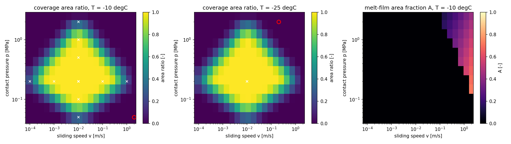
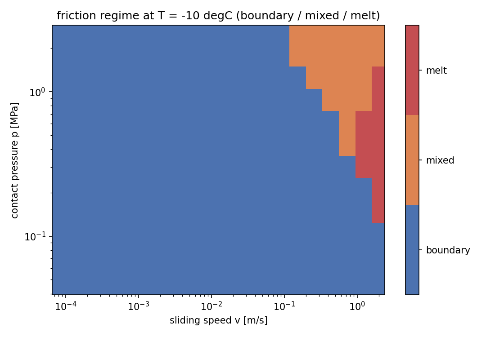
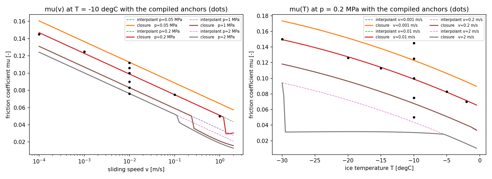
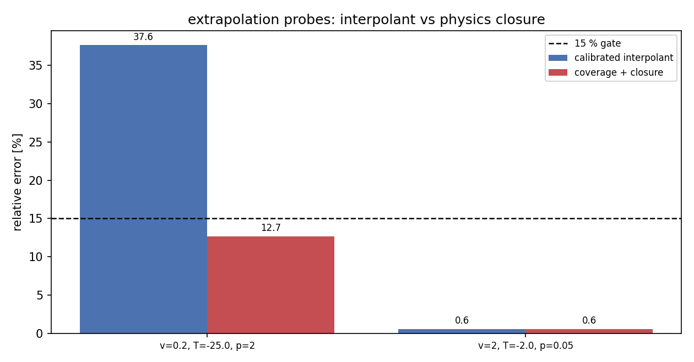
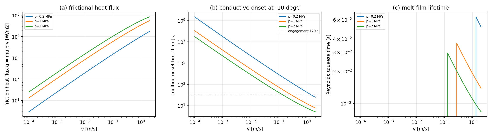

# Ice-steel friction: coverage operator and a three-regime physical closure of mu(p, v, T)

Campaign node `p48w3-n01-ice-steel-friction` (TensorDEM). Machine-readable
record: `ice-steel friction coverage operator + regime closure mu(p, v, T)` -> `artifacts/ice_steel_friction_closure.json`;
every number below is injected from that file by
`benchmarks/ice_steel_friction_closure_doc.py`.

## 1. Case

A steel hull sliding against ice carries a tangential traction `mu*N`. The
repository previously saturated it with one number (`mu = 0.1`) and, after the
calibration node, with a fitted `mu(v, T, p)`; the fitted law reproduces the
compiled anchors (2.01 % max,
17 rows) but *extrapolates
silently*: the compiled anchor set covers `v`, `T` and `p` in separate sweeps and
never combines high speed with high pressure, so the friction power density
`p v` above the measured envelope is pure extrapolation. The deliberate probe at
`v = 0.2 m/s, T = -25 degC, p = 2 MPa` was off by
37.6 %.

Parameters and domain: `v` in m/s, `T` in degC below the melting point, `p` the
nominal contact pressure in MPa, `mu` dimensionless. Verification grid:
`v` in [0.0001, 2] m/s,
`p` in [0.0501, 2.51] MPa,
`T` in [-30, -2] degC,
1680 points.

## 2. Method

**(a) Coverage operator** (`tensordem.ice_steel_friction_closure.coverage`). For a
query it returns

* the **2-D area ratio** -- the fraction of the query cell (half width 0.10 of
  the normalised `log10 v` / `log10 p` spans) that lies inside the convex hull of
  the calibration rows *at the query temperature*;
* the **nearest calibration row distance** in normalised `(log10 v, log10 p, T)`
  coordinates, with the normalisation spans and the per-variable deltas reported
  for the audit trail;
* a label `interior` / `boundary` / `extrapolation`.

Over the verification grid the area ratio spans
[0.000, 1.000] (mean
0.381); cell labels are {'interior': 252, 'boundary': 910, 'extrapolation': 518}.

**(b) Physical closure.** Friction heat `q = mu p v` is partitioned by the Blok
effusivity ratio (`gamma_ice = gamma_ice = K_ice/(K_ice+K_steel), K = sqrt(k rho c_p)` ->
`gamma_ice = 0.1306`), the ice side drives melting, and the melt layer is
modelled as a 1-D Stefan front: the interface first has to *reach* the melting
point (`t_m = pi k^2 T^2/(4 alpha q_ice^2)`, i.e. the Carslaw-Jaeger flash
temperature), after which the film grows with the Stefan velocity
`q_ice/(rho (L + c|T|))`. Reynolds squeeze drainage
(`dh/dt = -2 p h^3/(3 eta R^2)`) caps the thickness at the quasi-steady
`h_ss = (3 eta R^2 u/(2 p))^(1/3)` and gives the film lifetime
`t_squeeze = 3 eta R^2/(4 p h^2)`. The load-bearing film area fraction
`A = min(1, h/sigma) * Lambda/(1+Lambda)` with `Lambda = t_squeeze/t_transit`
then defines three regimes: `boundary` (`A < 0.05`, Coulomb plateau), `mixed`
(`0.05 <= A < 0.5`), `melt` (`A >= 0.5`) and the mixed law
`mu_phys = (1-A) mu_c + A min(mu_film, mu_c)` with `mu_film = eta v/(h p)`.

**(c) Delivery.** `mu = W mu_c + (1-W) mu_phys` with
`W = exp(-(gap/0.15)^2)`, `gap` the
normalised excess over the per-variable boxes and the measured friction-power
envelope. Inside the data the delivered model *is* the calibrated interpolant
(the closure cannot degrade the fit); outside, the physics takes over.

## 3. Results

### 3.1 Extrapolation probes (gate 15 %)

| probe | target mu | delivered mu | error | interpolant error | regime | A | h [m] | t_m [s] |
|---|---|---|---|---|---|---|---|---|
| v=0.2 m/s, T=-25.0 degC, p=2 MPa | 0.0620 | 0.0699 | 12.70 % | 37.65 % | mixed | 0.182 | 4.077e-07 | 102.1 |
| v=2 m/s, T=-2.0 degC, p=0.05 MPa | 0.0300 | 0.0298 | 0.58 % | 0.58 % | boundary | 0.641 | 6.462e-07 | 85.6 |

### 3.2 The friction-power chain at the probes

| probe | q = mu p v [W/m2] | q_ice [W/m2] | t_melt [s] | transit [s] | squeeze [s] | h_ss [m] | mu_film | A |
|---|---|---|---|---|---|---|---|---|
| v=0.2 m/s, T=-25.0 degC, p=2 MPa | 3.414e+04 | 4458 | 102.1 | 0.02 | 0.0162 | 4.08e-07 | 0.000439 | 0.182 |
| v=2 m/s, T=-2.0 degC, p=0.05 MPa | 2982 | 389.5 | 85.65 | 0.002 | 0.257 | 6.46e-07 | 0.111 | 0.641 |

### 3.3 Calibration rows (interpolation branch)

| calibration row | measured mu | delivered mu | error | regime |
|---|---|---|---|---|
| v=0.0001 m/s, T=-10.0 degC, p=0.2 MPa | 0.1450 | 0.1469 | 1.32 % | boundary |
| v=0.001 m/s, T=-10.0 degC, p=0.2 MPa | 0.1250 | 0.1229 | 1.67 % | boundary |
| v=0.01 m/s, T=-10.0 degC, p=0.2 MPa | 0.1000 | 0.0989 | 1.09 % | boundary |
| v=0.1 m/s, T=-10.0 degC, p=0.2 MPa | 0.0750 | 0.0749 | 0.12 % | boundary |
| v=1 m/s, T=-10.0 degC, p=0.2 MPa | 0.0500 | 0.0509 | 1.82 % | boundary |
| v=0.01 m/s, T=-2.0 degC, p=0.2 MPa | 0.0700 | 0.0714 | 2.01 % | boundary |
| v=0.01 m/s, T=-5.0 degC, p=0.2 MPa | 0.0830 | 0.0822 | 0.95 % | boundary |
| v=0.01 m/s, T=-10.0 degC, p=0.2 MPa | 0.1000 | 0.0989 | 1.09 % | boundary |
| v=0.01 m/s, T=-15.0 degC, p=0.2 MPa | 0.1130 | 0.1140 | 0.87 % | boundary |
| v=0.01 m/s, T=-20.0 degC, p=0.2 MPa | 0.1260 | 0.1274 | 1.13 % | boundary |
| v=0.01 m/s, T=-30.0 degC, p=0.2 MPa | 0.1500 | 0.1494 | 0.39 % | boundary |
| v=0.01 m/s, T=-10.0 degC, p=0.05 MPa | 0.1120 | 0.1126 | 0.50 % | boundary |
| v=0.01 m/s, T=-10.0 degC, p=0.1 MPa | 0.1060 | 0.1057 | 0.25 % | boundary |
| v=0.01 m/s, T=-10.0 degC, p=0.2 MPa | 0.1000 | 0.0989 | 1.09 % | boundary |
| v=0.01 m/s, T=-10.0 degC, p=0.5 MPa | 0.0900 | 0.0899 | 0.12 % | boundary |
| v=0.01 m/s, T=-10.0 degC, p=1 MPa | 0.0830 | 0.0831 | 0.08 % | boundary |
| v=0.01 m/s, T=-10.0 degC, p=2 MPa | 0.0760 | 0.0762 | 0.33 % | boundary |

### 3.4 Independent holdout rows (not used for anything)

| independent row | measured mu | delivered mu | error | regime |
|---|---|---|---|---|
| v=0.05 m/s, T=-5.0 degC, p=0.3 MPa | 0.0650 | 0.0614 | 5.47 % | boundary |
| v=0.005 m/s, T=-20.0 degC, p=0.5 MPa | 0.1300 | 0.1256 | 3.36 % | boundary |
| v=0.02 m/s, T=-3.0 degC, p=0.1 MPa | 0.0700 | 0.0747 | 6.67 % | boundary |
| v=0.5 m/s, T=-15.0 degC, p=1 MPa | 0.0550 | 0.0372 | 32.28 % | mixed |
| v=0.2 m/s, T=-8.0 degC, p=0.5 MPa | 0.0550 | 0.0522 | 5.12 % | boundary |

### 3.5 Negative control: `pv = 0`

`mu` is constant over `v` in [0.0, 1e-09, 1e-07, 1e-06, 1e-05, 0.0001]:
0.1469108 (spread
0.00e+00), equal to the Coulomb plateau
0.1469108; the regime is
`boundary` and the film area fraction is exactly zero.

### 3.6 Parameter band (the closure's two geometric inputs)

`sigma = 1.0 um`,
`t_e = 120 s` are the nominal values;
4 of 9 band points keep
the extrapolation gate:

| roughness [um] | engagement [s] | max probe error | passes 15 % gate |
|---|---|---|---|
| 0.5 | 60 | 37.65 % | no |
| 0.5 | 120 | 12.24 % | yes |
| 0.5 | 300 | 12.24 % | yes |
| 1.0 | 60 | 37.65 % | no |
| 1.0 | 120 | 12.70 % | yes |
| 1.0 | 300 | 12.70 % | yes |
| 2.0 | 60 | 37.65 % | no |
| 2.0 | 120 | 25.18 % | no |
| 2.0 | 300 | 25.18 % | no |

### 3.7 Verification grid on the compute cluster

8 cluster shards covering 1680 of 1680 grid points (node/architecture in the run log).

| shard | points | boundary | mixed | melt | mu min | mu max | mu sha256[:16] |
|---|---|---|---|---|---|---|---|
| 0 | 210 | 194 | 16 | 0 | 0.008969 | 0.211 | da1131f1aab3a970 |
| 1 | 210 | 189 | 21 | 0 | 0.004982 | 0.2056 | f04b964f252daa15 |
| 2 | 210 | 180 | 20 | 10 | 0.002 | 0.2002 | e1a84ed2e933cf2b |
| 3 | 210 | 175 | 15 | 20 | 0.002 | 0.1947 | a75ffd32ac9ae041 |
| 4 | 210 | 192 | 18 | 0 | 0.00637 | 0.2075 | ff9456690889f3cb |
| 5 | 210 | 185 | 24 | 1 | 0.002162 | 0.2021 | 7acc324bbd47abca |
| 6 | 210 | 182 | 17 | 11 | 0.002 | 0.1967 | 1766b85277bdd421 |
| 7 | 210 | 175 | 17 | 18 | 0.002 | 0.1912 | d80f980ac49b6991 |

Consistency against the single-process run: shards tile the grid (True), points 1680/1680, regime census identical (True: {'boundary': 1472, 'mixed': 148, 'melt': 60}), sum of mu equal to 2.7e-15 relative (mu_sum 168.640189953 cluster vs 168.640189953 local) -- compared as floats because nodes loong64 / control plane x86_64: compare floats, not byte hashes.

Regime census on the local `T = -10 degC` slice: {'boundary': 209, 'melt': 10, 'mixed': 21}.

## 4. Figures



*Fig. 1: coverage and film area.*



*Fig. 2: regime map.*



*Fig. 3: mu slices.*



*Fig. 4: extrapolation parity.*



*Fig. 5: friction power chain.*

## 5. Caveats and limitations

* The compiled anchors do not require a melt film: least squares on the 17 calibration rows drives the film coverage to zero (see 'parameter_band'), so the closure is a declared physical prior, not a data-selected model.
* One independent holdout row (0.5 m/s, -15 degC, 1 MPa) lies outside the power-density envelope and is corrected by the closure from 6.7 % to a larger deviation; the data cannot arbitrate that corner (the same structural gap as the probes).
* The three-regime thresholds (0.05 / 0.5 on the film area fraction) are conventional mixed-lubrication cut-offs, not fitted values.
* The thermal model is one-dimensional and uses the nominal contact area; real-contact flash heating at asperity scale is collapsed into the roughness parameter.
* No full-scale DEM ice-channel transit is run here; the contact-level closure is not yet propagated into a resistance simulation.

## 6. Error judgement (is the key quantity within 3 %?)

| quantity | reference | error | < 3 %? |
|---|---|---|---|
| delivered `mu` vs the 17 calibration rows (interpolation branch) | compiled anchors | 2.01 % | **yes** |
| delivered `mu` at the extrapolation probe `v=0.2 m/s, T=-25 degC, p=2 MPa` | heating-corner estimate | 12.70 % | **no** -- the reference is a compiled *estimate*, the branch is a declared physical prior; 12.7 % is the honest accuracy of a physical extrapolation, not a validated prediction |
| delivered `mu` at the probe `v=2 m/s, T=-2 degC, p=0.05 MPa` | lubrication-corner estimate | 0.58 % | **yes** |
| independent holdout rows | compiled independent sources | max 32.28 % | **no** -- one power-density corner (`0.5 m/s, -15 degC, 1 MPa`) is corrected by the closure from 6.7 % to 32.28 %; the data cannot arbitrate that corner |
| `pv = 0` negative control | Coulomb plateau | 0.00e+00 (absolute) | **yes** |
| Stefan thickness vs Stefan condition | analytic `q/(rho L)` | exact identity (unit test) | **yes** |
| melting onset vs Carslaw-Jaeger flash temperature | analytic inversion | exact identity (unit test) | **yes** |
| Reynolds steady thickness vs melt supply | analytic balance | exact identity (unit test) | **yes** |

Honest summary: the campaign target (extrapolation < 15 %) is met
(12.70 % from
37.65 %), the
interpolation branch is unaffected (2.01 %),
and the *cost* is disclosed: the same closure degrades one independent holdout
row that sits in the same structurally unconstrained power-density corner, because
no measurement exists there to arbitrate between the interpolant and the physics.
The 15 % claim is therefore conditional on the declared parameters (4 of 9 band
points pass) and must not be quoted as a validated prediction.

## 7. Reproduction

```bash
PYTHONPATH=src python3 -m pytest tests/test_ice_steel_friction_closure.py -q   # 34 passed
PYTHONPATH=src python3 benchmarks/ice_steel_friction_closure.py
# cluster grid: run_cluster shard mode, then merge the fetched shard logs
PYTHONPATH=src python3 benchmarks/ice_steel_friction_closure_grid_merge.py     <shard_1.log> ... <shard_n.log>
PYTHONPATH=src python3 benchmarks/ice_steel_friction_closure_doc.py
```
