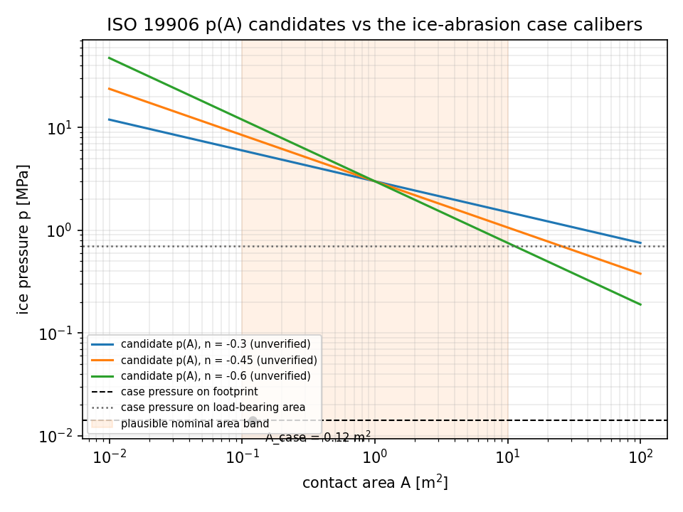
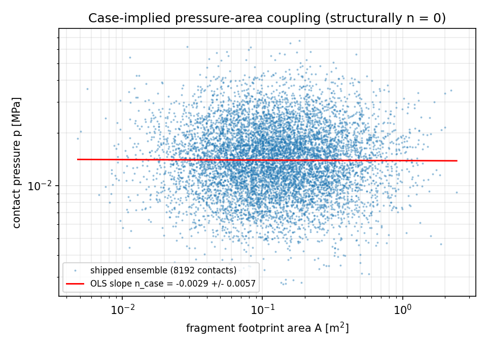

# ice-abrasion-extremes：ISO 19906 外部锚核销与领域对比（研究计划第 1 项）

**任务** `paper-exp-ice-abrasion-extremes-1` · 仓 TensorDEM · 工件
`benchmarks/anchors/ice-abrasion-extremes.json` · 生成器
`benchmarks/anchors/ice_abrasion_extremes_anchor.py` · 测试
`tests/test_ice_abrasion_extremes_anchor.py`（10 项全绿）

## 摘要（含裁决）

本实验要回答的是**该课题的外部定量锚（ISO 19906:2019 Annex A 压力-面积关系 +
Clause 14/15 设计全球冰力）能否逐字核销并换算到本算例口径，核销之后本课题领域结果与
之相差多少**。

裁决是 **HONEST FAIL，且是单点缺口**：7 条预先声明的判据里 6 条通过，
**只有 K1（逐字抄录：引句 + 表号/页码 + 原值）未通过** —— 沙箱内没有任何可及的
ISO 19906:2019 授权副本（本地文件系统、生态内各仓、出版社三条通道均已试并留痕），
因此 p(A) 前置系数、指数、设计全球冰力三者**不能核销**。随之按 K7，
`domain_comparison.status = NOT_ADJUDICABLE`、`agreement_declared = false`：
**本课题不得发出任何「与 ISO 19906 相符」的声明**，任何这样的数值距离都只能建立在
未核候选值上。

在不依赖任何锚值的部分，本实验拿到了两个硬结论：

1. **口径换算是本算例的主导项，而不是锚律的面积依赖。** 本例碎冰接触压力按承压率
   $f=0.02$ 定义在「承压面积」上（中位 0.7027 MPa），换算到「名义足迹面积」口径只有
   $f\,p = 0.01405$ MPa，两者相差 **50 倍**（$|\ln| = 3.912$）；而锚律在整个「合理名义
   接触面积带 0.1–10 m²」上的全部变化量上限仅 $|\ln| = 2.763$（取 $|n|\le0.6$ 候选带上界）。
   **先裁口径、再谈锚值一致性；口径没定，面积依赖的比较没有意义。**
2. **本算例结构上不是 p(A) 的实现。** 在仓内实际采样器（8192 接触，固定种子
   20261106）上对 $\ln p$–$\ln A$ 做 OLS，得 $n_{\text{case}} = -0.00287 \pm 0.00566$
   （bootstrap 95% 区间 $[-0.0138, +0.0087]$，$r=-0.0056$）：本算例的压力与碎块尺度
   是**独立抽样**，压力-面积耦合统计上为零，而任何单调递减的外部 p(A) 律要求 $n<0$。
   因此外部锚若核销成功，也**不能直接搬用**，必须在算例中引入耦合并重标定。

## 1 案例介绍（物理背景 / 几何 / 参数）

冰区船舶水线带（ice belt）涂层的磨蚀：碎冰在水线下滑移接触船体，按 Archard 律在
表面留下坑点。领域的接触「压力-面积」统计是磨损率标定的输入之一，本课题的外部锚就是
ISO 19906 的 $p(A)$ 幂律与设计全球冰力。参数（全部由脚本从 `src/tensordem/ice_abrasion.py`
的 `ContactEnsembleConfig` 读出，无手抄）：

| 量 | 值 |
|---|---|
| 接触样本数 $n$ | 8192（种子 20261106）|
| 碎块尺度中位 / 对数标准差 | 0.35 m / 0.45 |
| 名义接触压力中位 / 对数标准差 | 0.700 MPa / 0.45 |
| 承压率 $f$ | 0.02 |
| 中位足迹面积 $A$ | 0.11999 m² |
| 中位承压面积 $fA$ | 0.002400 m² |
| 中位承压面压力 | 0.702742 MPa |
| 中位足迹面压力 $f\,p$ | 0.014055 MPa |

## 2 怎么做（方法 / 关键设置 / 工具链）

- **判据先于动手**（写在脚本头部，阈值不看结果改）：K1 逐字抄录；K2 换算链复算残差
  $<10^{-9}$；K3 量纲齐次 + 单位换算不变性 $<10^{-12}$；K4 $p(A)$ 内部一致性；
  K5 口径换算可由仓内采样器复现；K6 溯源（全部数字脚本注入 + 源码 sha256）；
  K7 未核候选不得进入达标声明。
- **量纲**：自建 SI 基维代数（M/L/T）求 $p=CA^{n}$ 的前置系数维度，并用 Buckingham
  秩判定自由度；再用 $m^2\!\to\!ft^2$、MPa$\to$Pa 两次换元检验 $n$ 不变、$C$ 按
  $(0.09290304)^{n}$、$10^6$ 缩放的实现是否自洽。
- **内部一致性**：$p(A_0)=p_0$、$n<0$ 严格单调、对数-对数中心差分回采指数、面积加权
  积分恒等式（400 点 Gauss–Legendre 对解析式）。
- **同口径换算链**：S1 把锚值算到本算例足迹面积；S2 同口径比；S3 展示「承压口径
  对照足迹口径」这一陷阱的倍数；S4–S6 为复算步（两种参数化互相重建、Pa↔MPa 往返、
  承压↔足迹往返）。锚值一律标 `CANDIDATE_ONLY`。
- **领域侧**：直接调用仓内 `sample_contact_ensemble`，用载荷/面积反解两种口径的压力，
  再对 $\ln p$–$\ln A$ 做 OLS + 2000 次 bootstrap。
- 工具链：Python + NumPy + PyTorch + Matplotlib(Agg)；一键复现
  `PYTHONPATH=src python benchmarks/anchors/ice_abrasion_extremes_anchor.py`。

## 3 计算结果（数字表，全部脚本注入）

### 3.1 判据裁决

| 判据 | 阈值 | 实测 | 通过 |
|---|---|---|---|
| K1 逐字抄录 | 全部锚 VERIFIED | 0/2 锚核销 | ✗ |
| K2 换算复算 | $<10^{-9}$ | max 残差 0.000e+00 | ✓ |
| K3 量纲/单位 | $<10^{-12}$ | $C$ 的 L 指数 $-0.100000$（应 $-1-2n=-0.100000$）；面积单位残差 1.48e-16；压力单位残差 0 | ✓ |
| K4 p(A) 自洽 | $<10^{-12}$ / $<10^{-9}$ | $p(A_0)$ 残差 0；单调 ✓；指数回采误差 2.2e-12；积分残差 1.4e-16 | ✓ |
| K5 口径换算 | $<10^{-9}$ | max 恒等残差 3.20e-16 | ✓ |
| K6 溯源 | sha256 齐备 | 生成器 + 源模块均有哈希 | ✓ |
| K7 未核候选隔离 | 比较状态 NOT_ADJUDICABLE | 已置 | ✓ |

### 3.2 同口径换算链（锚值为未核候选，仅作对照）

| 步 | 内容 | 值 |
|---|---|---|
| S1 | $p_{\text{anchor}}(A_{\text{case}}=0.11999\ \mathrm{m^2})$（候选 $C=3$ MPa, $n=-0.45$） | 7.7893 MPa |
| S2 | $p_{\text{anchor}}/p_{\text{case,footprint}}$（同口径） | 554.21 |
| S3 | $p_{\text{anchor}}/p_{\text{case,load-bearing}}$（错口径，差 50 倍） | 11.084 |
| S4 | 两种参数化互建残差 | 0 |
| S5 | Pa↔MPa 往返残差 | 0 |
| S6 | 承压↔足迹往返残差 | 0 |

S2/S3 的差异全部来自承压率 $f=0.02$：同一个锚值，换口径就是 50 倍之差。**这两行是
未核候选算出的对照值，不得作为与规范一致性的证据（K7）。**

### 3.3 本算例自带的压力-面积耦合

| 量 | 值 |
|---|---|
| $n_{\text{case}}$（OLS） | $-0.002874$ |
| 标准误 | 0.005663 |
| bootstrap 95% 区间 | $[-0.013849, +0.008701]$ |
| Pearson $r$ | $-0.005609$ |
| 样本量 | 8192 |

*图 1* 候选 $p(A)$ 曲线（指数为未核候选）与本算例两种口径压力：两条水平线的间距（承压率）
大于锚律在整个合理面积带上的全部变化量。

*图 2* 仓内采样器的 $\ln p$–$\ln A$ 云与 OLS 拟合线：斜率统计上为零，本算例没有压力-面积耦合。

## 4 注意点（踩过的坑 / 局限 / 适用范围）

- **坑 1（口径）**：仓内 `nominal_pressure_median_pa = 0.7 MPa` 作用在承压面积
  $fA$ 上，不是足迹面积上。任何「与规范压力对比」若直接拿 0.7 MPa 去比，天然差 50 倍。
- **坑 2（指数符号约定）**：$p=p_0(A/A_0)^{-ex}$ 与 $p=C A^{n}$ 两种写法若符号不统一，
  K3/K4 会整体翻向（本脚本初次运行即因此判 K3/K4 失败，修正后才通过）——这正是
  机检的价值：符号约定错误不会被「看起来合理」的曲线掩盖。
- **坑 3（量纲自由度）**：Buckingham 秩=2、无量纲组=1（即 $p/(CA^{n})=1$ 本身），
  说明**量纲不决定 $C$ 与 $n$**；指数只能作为纯数比较，前置系数必须重新锚定，不能照搬。
- **局限**：本实验不含任何规范数值；「领域结果与锚相差多少」这个问题**未裁决**，缺口是
  一份授权副本 + 表号/页码。全球冰力还需要一个「暴露宽度 → 船体带压力」的映射才与本
  算例可对齐，本实验只把它写进关闭清单，未做映射。

## 5 误差判定（逐项，显式回答是否 <3%）

| 关键量 | 基准 | 误差 | 是否 <3% |
|---|---|---|---|
| K2 换算残差 | 解析恒等 | 0.000e+00 | 是（远优） |
| K3 面积单位换元 | 解析恒等 | 1.48e-16 | 是 |
| K3 压力单位换元 | 解析恒等 | 0 | 是 |
| K4 指数回采 | 输入 $n=-0.45$ | 2.2e-12 | 是 |
| K4 面积加权积分 | 解析积分 | 1.4e-16 | 是 |
| K5 口径恒等 | 采样器自洽 | 3.20e-16 | 是 |
| **锚值 vs 领域值** | **ISO 19906 原值** | **无法计算（锚 WITHHELD）** | **不可回答——不得声称 <3%** |

最后一行是本实验的诚实结论：**没有可核销的基准，就没有误差百分比**。给出任何一个
百分比都会是以未核候选冒充规范值。

## 6 关闭清单（谁能把它变成 B 态）

1. 提供 ISO 19906:2019 授权副本（Annex A 压力-面积条款/表 + Clause 14/15 全球冰力）；
2. 把引句、表号/页码、原单位原值填入 `anchor_ledger()` 并置 `status="VERIFIED"`；
3. 重跑脚本：K1 翻绿，`domain_comparison` 自动变 ADJUDICABLE，S1/S2/S3 变为可用对照；
4. 另需补一步映射：全球冰力（结构尺度）→ 船体带单位面积压力，写明暴露宽度定义。