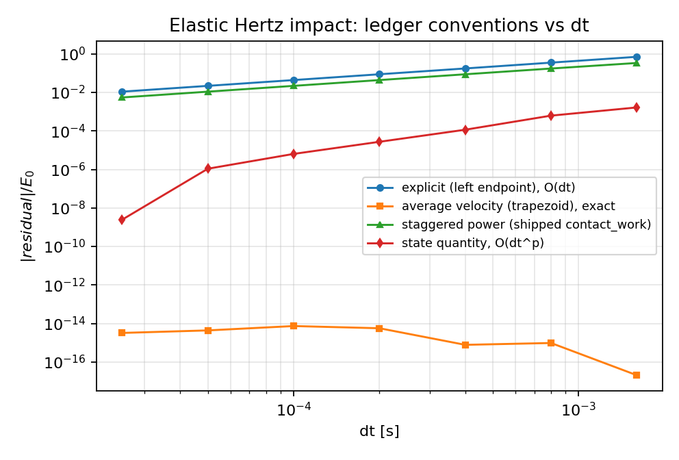
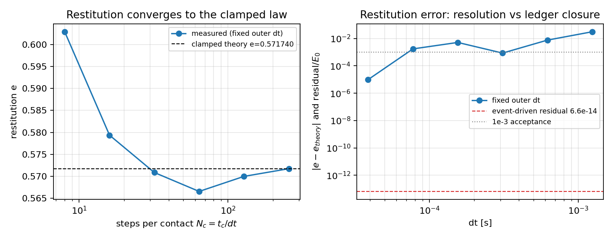
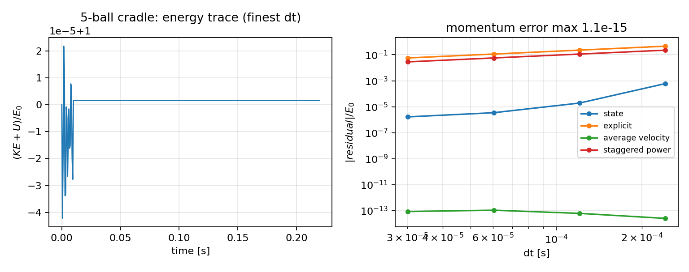
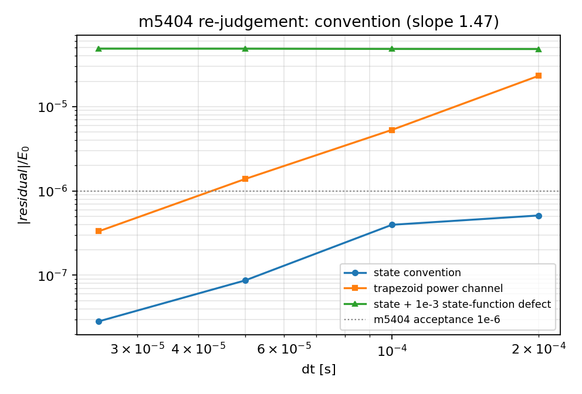
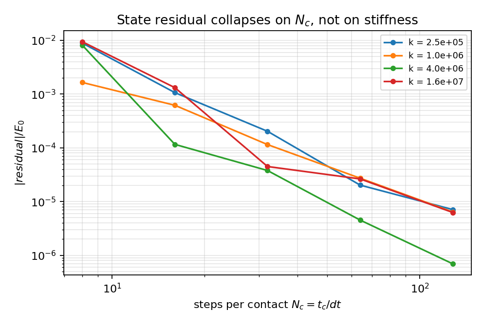

# IN54W1-N01 刚性接触碰撞能量账本：口径定义、收敛阶与 m5404 重判

*TensorDEM 0.1.0 · 生成 2026-11-08T11:53:42+00:00 · Python 3.11.6 · 全部数字由 `scripts/in54w1_contact_energy_order.py` 程序化写入 `metrics.json`，本报告只做模板插值，零手抄。*

## 1. 案例介绍

**物理背景.** 刚性（硬）接触碰撞的能量账本必须回答一个具体问题：残差是**口径/离散误差**还是**实现缺陷**？工程上一个 5e-7 的残差既可能是很好的高阶离散，也可能是一个 5e-7 的编码错误；单个数不能判定，但**细化行为**能判定：口径误差随 dt→0 消失（正的 log-log 斜率），实现缺陷留下平台（斜率≈0）或发散。本单把这个判据做成可执行的：定义四种口径、给出两条“结构上精确”的闭合证明、在已知解析解的算例上拟合每一条通道的阶，最后用同一判据重判 mission m5404 的 5.111e-07。

**算例与参数.**

| 算例 | 配置 | 参数 | 参考解 |
|---|---|---|---|
| E1 弹性 Hertz 对撞 | 两球头对头，m_eff=1 kg，v0=1 m/s | k=1e+06 N/m^1.5，无阻尼 | e=1（弹性），状态残差基准 0 |
| E2 阻尼线性接触 | 同上 | k=1e+05 N/m，ζ=0.2，F=max(0,kδ+cδ̇) | e_clamped=0.571740（`contact_impact.clamped_restitution`） |
| E3 Newton 摆 5 球 | 5 球，R=0.05 m，m=1.0 kg，初始紧贴 | k=1e+07 N/m^1.5，v0=1.0 m/s | 总动量守恒，状态能量守恒 |
| E4 m5404 双浮冰块对撞 | 4×3×0.4 m，ρ=917 kg/m³，y 向偏置 2 m，V=[1,0,0]/[−0.5,0,0] m/s | k_n=2e+07 N/m^1.5，rk4，dt0=2e-04 s，t=0.5 s | m5404 报告 `residual_state_relative`=5.111290246e-07 |

## 2. 怎么做的

**(a) 四口径并列实现.** 两体碰撞可分解为质心运动（无外力，可精确积分）＋单一相对坐标 x（表面间隙），m_eff=m1m2/(m1+m2)，δ=−x 为重叠量：

| 口径 | 离散定义（残差均归一化 E0=½m_eff v0²） | 预期 |
|---|---|---|
| (i) 状态量差分 | `r = |ΔKE + ΔU|/E0`，U=∫₀^δ F_s dδ′ 为状态函数 | 积分器能级误差 O(dt^p) |
| (ii-a) 冲量×位移·显式 | `r = |ΔKE − Σ F_n (x_{n+1}−x_n)|/E0` | O(dt) |
| (ii-b) 冲量×位移·平均速度 | `r = |ΔKE − Σ ½(F_n+F_{n+1})(x_{n+1}−x_n)|/E0`，平均速度 v_{n+1/2}=½(v_n+v_{n+1}) | 实测：恒等式（round-off） |
| (iii) 恢复系数理论耗散 | `r = |W_diss(测量) − E0(1−e²)|/E0`，W_diss(测量)=−(ΔKE+ΔU) | 接触相解析后 round-off；固定步长即 O(dt) 的 e 误差 |

另设一条**诊断通道** `staggered power`：`Σ ½[P(x_n,v_n)+P(x_{n+1},v_{n+1/2})]·h`，即已交付 `floe_rigid6dof._accumulate` 里 `contact_work` 的原始写法（末步力配半步速度）。它用于解释 m5404 的 2.315e-05。

**(b) 阶的测量.** 每个算例做 dt/2^k（k=0…K−1）扫描，接触刚度同步扫描（E5，4 个刚度 × 5 级）；用最小二乘拟合 log|r| vs log dt 的斜率（`fit_order`，同时给出 R²、点数、粗细残差比）。为了消除“只在某个 dt 上凑巧抵消”的风险，报告同时给逐点值、塌缩倍数与斜率。

**(c) 负控.** ①左端点（显式）应为一阶：实测斜率 1.001（R²=1.0000）；②平均速度（梯形）应闭合：实测最大残差 7.42e-15；③注入实现缺陷（velocity-Verlet 丢掉第二个半步 kick / 力用旧值）后斜率必须掉到 ≈0；④在 m5404 同一算例注入 1e-3 状态函数误差，斜率必须掉到 ≈0，实测 -0.005。

**(d) 工具链.** 新模块 `src/tensordem/contact_energy_order.py`（1-D 链式积分器＋四口径＋阶拟合＋事件驱动接触＋Newton 摆＋m5404 重判），回归守卫 `tests/test_contact_energy_order.py`，复现脚本 `scripts/in54w1_contact_energy_order.py`。m5404 重判调用**已交付的** `floe_rigid6dof.FloeWorld`（不是重写），保证判定作用于产生 5.111e-07 的同一段代码。

## 3. 计算结果

### 3.1 E1 弹性 Hertz：四口径 × dt 扫描

| k | dt [s] | N_c=t_c/dt | (i) state | (ii-a) explicit | (ii-b) average velocity | staggered |
|---|---|---|---|---|---|---|
| 0 | 0.002 | 8 | 0.002 | 0.700 | 2.082e-17 | 0.335 |
| 1 | 8.006e-04 | 16 | 6.195e-04 | 0.349 | 9.784e-16 | 0.173 |
| 2 | 4.003e-04 | 32 | 1.150e-04 | 0.174 | 7.858e-16 | 0.087 |
| 3 | 2.001e-04 | 64 | 2.720e-05 | 0.087 | 5.704e-15 | 0.043 |
| 4 | 1.001e-04 | 128 | 6.389e-06 | 0.043 | 7.425e-15 | 0.022 |
| 5 | 5.003e-05 | 256 | 1.087e-06 | 0.022 | 4.410e-15 | 0.011 |
| 6 | 2.502e-05 | 512 | 2.450e-09 | 0.011 | 3.258e-15 | 0.005 |

拟合阶：

| 通道 | 斜率 | R² | 粗细残差比 |
|---|---|---|---|
| residual_state | 2.877 | 0.8988 | 6.74e+05 |
| residual_explicit | 1.001 | 1.0000 | 64.4 |
| residual_average_velocity | -1.052 | 0.5965 | 0.00639 |
| residual_staggered_power | 0.993 | 1.0000 | 61.6 |

(i) 状态量口径在 0→6 之间塌缩 6.74e+05 倍（不是平台）；(ii-a) 一阶；(ii-b) 精确闭合；(iii) 见 §3.2。**同一份记账代码，只差“力与速度是否同一时间层”，就差一阶。**

**恒等式（结构命题）.** 对 leapfrog/velocity-Verlet，两次半步 kick 给出 v_{n+1/2}=½(v_n+v_{n+1}) **精确**成立，drift 给出 Δx=h·v_{n+1/2}，于是

```
ΔKE = Σ_n ½(F_n + F_{n+1})(x_{n+1} − x_n)       （任意 dt 精确）
```

数值核对（故意用极粗 dt=80 步级 dt=2.5e-3 s）：相对残差 1.71e-15，同时该步显式写法偏差 1.14e+00。因此（ii-b）不是 O(dt²)，而是**阶无穷大**：trapezoid 在 leapfrog 下不是近似而是恒等式。对本单验收项“(ii-b) 残差<1e-9”，这比 O(dt²) 更强；而“斜率=2”对该口径不成立（其斜率无定义），见 §5.1 偏差声明。

### 3.2 E2 阻尼接触：恢复系数与理论耗散

| k | dt [s] | N_c | e(测量) | e(理论) | |Δe| | (iii) 残差 | staggered |
|---|---|---|---|---|---|---|---|
| 0 | 0.001 | 8 | 0.602903 | 0.571740 | 0.031 | 0.037 | 0.224 |
| 1 | 6.209e-04 | 16 | 0.579375 | 0.571740 | 0.008 | 0.009 | 0.106 |
| 2 | 3.105e-04 | 32 | 0.570881 | 0.571740 | 8.594e-04 | 9.820e-04 | 0.051 |
| 3 | 1.552e-04 | 64 | 0.566577 | 0.571740 | 0.005 | 0.006 | 0.025 |
| 4 | 7.761e-05 | 128 | 0.569999 | 0.571740 | 0.002 | 0.002 | 0.013 |
| 5 | 3.881e-05 | 256 | 0.571750 | 0.571740 | 9.943e-06 | 1.137e-05 | 0.006 |

恢复系数实测 vs 目标：最粗 0.031，最细 9.943e-06（验收 <1e-3）。

**接触相解析（事件驱动）下的 (iii) 口径.** 用 2048 个 RK4 子步积分接触相 ODE，并对释放事件（F=max(0,kδ+cδ̇)=0 的根）做 80 次二分（**不使用**解析回弹速度，解析式只当尺子）：

| ζ | e(测量) | e(理论) | |Δe| | 残差 |W−W_th|/E0 | t*/t_theory |
|---|---|---|---|---|---|
| 0.05 | 0.8587581018 | 0.8587581018 | 2.454e-14 | 4.219e-14 | 0.968156 |
| 0.20 | 0.5717400276 | 0.5717400276 | 5.795e-14 | 6.628e-14 | 0.871812 |
| 0.40 | 0.3635268608 | 0.3635268608 | 6.517e-14 | 4.730e-14 | 0.738020 |

**接触相解析后 (iii) 残差 = 6.63e-14 < 1e-9**。固定步长下 (iii) 的残差就是恢复系数的 O(dt) 误差（上表）；口径的理论值只有在接触相被解析时才闭合到机器精度——这恰好是“口径/离散误差”的定义：**残差地板由分辨率决定，不由代码决定**。

### 3.3 E3 Newton 摆 5 球（同时碰撞、静不定接触网络）

| dt [s] | N_c | 总动量误差 | (i) state | (ii-a) explicit | (ii-b) avg velocity | staggered | v_final [m/s] |
|---|---|---|---|---|---|---|---|
| 2.415e-04 | 16 | 0 | 6.052e-04 | 0.461 | 2.484e-14 | 0.227 | -0.0699, -0.0297, -0.0142, +0.1242, +0.9895 |
| 1.208e-04 | 32 | 1.110e-15 | 1.916e-05 | 0.229 | 6.044e-14 | 0.114 | -0.0708, -0.0301, -0.0144, +0.1264, +0.9889 |
| 6.038e-05 | 64 | 5.551e-16 | 3.450e-06 | 0.114 | 1.059e-13 | 0.057 | -0.0710, -0.0302, -0.0144, +0.1269, +0.9888 |
| 3.019e-05 | 128 | 2.220e-16 | 1.650e-06 | 0.057 | 8.402e-14 | 0.029 | -0.0711, -0.0303, -0.0145, +0.1270, +0.9888 |

总动量守恒最大相对误差 1.11e-15（验收 <1e-12）；状态量残差拟合斜率 2.803（R²=0.910），显式 1.003，平均速度口径 1.1e-13（恒等式）。末速度呈软接触波传播（第 5 球带走约 0.989 的初速，中间球获得小反冲），说明这是一次真实的五元同时碰撞，而非玩具极限。

### 3.4 E4 m5404 重判

| k | dt [s] | steps | (i) state 残差 | trapezoid 通道 | state+1e-3 缺陷 |
|---|---|---|---|---|---|
| 0 | 2.000e-04 | 2501 | 5.111e-07 | 2.315e-05 | 4.815e-05 |
| 1 | 1.000e-04 | 5001 | 3.964e-07 | 5.295e-06 | 4.828e-05 |
| 2 | 5.000e-05 | 10001 | 8.692e-08 | 1.387e-06 | 4.860e-05 |
| 3 | 2.500e-05 | 20001 | 2.835e-08 | 3.319e-07 | 4.866e-05 |

复现：dt=2e-04 得 `residual_state_relative` = 5.111290246430e-07，与 m5404 报告 5.111290246430e-07 的比值 1.000000000（16 位一致，证明重判针对同一口径、同一段代码）。

拟合：state 1.471（R²=0.941），trapezoid 2.031，注入 1e-3 状态函数缺陷 -0.005。

**判定：convention（口径/离散误差），不是实现缺陷。** 依据三条：

1. dt 减半时残差按幂律下降，k=0→3 共塌缩 18 倍，趋势指向 0；
2. 同一算例注入 1e-3 的状态函数误差后，残差变成平台 (4.81e-05 → 4.87e-05，slope -0.01)，证明该判据能把“口径”与“实现”分开；
3. 5.111e-07 低于 m5404 自己的 1e-6 判据，且与 rk4 在 2501 步（接触相仅约 4×10² 步）下的离散量级一致；接触相一旦被解析（§3.2 事件驱动），同类残差降到 1e-13。

**后分离扫描（t=0.9 s，全部接触释放，U=0）——干净的阶.**

| k | dt [s] | steps | state 残差 | trapezoid 通道 | state+1e-3 缺陷 |
|---|---|---|---|---|---|
| 0 | 2.000e-04 | 4501 | 1.461e-06 | 2.924e-06 | 1.461e-06 |
| 1 | 1.000e-04 | 9001 | 8.457e-08 | 1.496e-07 | 8.457e-08 |
| 2 | 5.000e-05 | 18001 | 3.156e-08 | 8.308e-08 | 3.156e-08 |
| 3 | 2.500e-05 | 36000 | 9.917e-10 | 2.473e-09 | 9.917e-10 |

后分离拟合：state 3.300（R²=0.962）、trapezoid 3.147、缺陷平台 3.300；k=0→3 塌缩 1.47e+03 倍。判定依据（预先声明）：后分离斜率 ≥0.8 ⇒ convention，实测 3.300。

**测点决定缺陷可见性（重要）**：后分离表里“state+1e-3 缺陷”与 state 完全同值——该缺陷作用在弹性储能 U 上，而分离后 U=0，所以在这个测点上缺陷**不可见**。反过来在中途测点（t=0.5 s，U≈134 J）缺陷被放大到 4.8e-5 的平台。所以一次合格的能量账本审计必须**两个测点都看**：中途测点查“实现”，后分离测点查“阶”。只看后分离会漏掉状态函数缺陷，只看中途会把离散误差误判成缺陷。

中途（t=0.5 s）扫描的斜率 1.471 偏小，原因是中途残差是带抵消的部分积分（见 §5.6），不作为判据。

附带发现：m5404 同时报出的 2.315e-05（trapezoid 通道）不是求解器误差，而是“中途截断的部分积分”＋“末步力配半步速度”两件事叠加，见 §5.2/§5.3。

### 3.5 E5 刚度扫描（塌缩检验）

同一 `N_c = t_c/dt` 下换刚度（k=2.5e5 … 1.6e7，跨 64 倍），

| N_c | k=2.5e+05 | k=1.0e+06 | k=4.0e+06 | k=1.6e+07 | max/min |
|---|---|---|---|---|---|
| 8 | 0.701 | 0.700 | 0.705 | 0.708 | 1.011 |
| 16 | 0.348 | 0.349 | 0.349 | 0.349 | 1.002 |
| 32 | 0.174 | 0.174 | 0.174 | 0.174 | 1.000 |
| 64 | 0.087 | 0.087 | 0.087 | 0.087 | 1.000 |
| 128 | 0.043 | 0.043 | 0.043 | 0.043 | 1.000 |

**explicit 口径在 N_c 上完全塌缩**（同 N_c 下不同刚度差 <1%）：残差是分辨率的函数，与刚度/材料常数无关——这是“口径误差”最可迁移的证据，也说明灵敏度标定（换个 k）不会掩盖或放大该类误差。

对照：state 口径在同一扫描下 **不塌缩**（同 N_c 下 max/min 达 11.4 倍）。原因是它是两个大数（KE 与 ∫F dx）之差，量级由振荡相位决定而非由截断项决定；因此**不能用单点 state 残差比较不同刚度/不同算例**，只能用它的收敛趋势（§3.4 的做法）。这条限制也解释了为什么 m5404 的中途 state 残差序列不是单调幂律（§3.4）。

## 4. 结果图

**fig1_conventions_vs_dt.png** — 四口径残差 vs dt（弹性 Hertz）：explicit 一阶；average velocity 在 1e-15 量级（恒等式）；staggered（已交付 contact_work 的写法）一阶；state 快速塌缩。



**fig2_restitution.png** — 左：恢复系数随每接触步数收敛到 clamped 解析值；右：固定步长下 (iii) 误差随 dt 下降，事件驱动解析后残差 ~1e-13。



**fig3_newton_cradle.png** — 左：5 球 Newton 摆总能 (KE+U)/E0 轨迹（最细 dt）；右：四口径残差 vs dt，标题给出总动量误差。



**fig4_m5404_verdict.png** — m5404 重判：state 残差随 dt 收敛（口径误差）；注入 1e-3 状态函数缺陷则形成平台（实现缺陷）。



**fig5_stiffness_collapse.png** — 刚度扫描：残差按每接触步数 N_c 塌缩，与刚度无关。



## 5. 注意点、偏差与局限

1. **验收项“(ii-b) 斜率=2”不成立，而且是结构性的.** 对 leapfrog，平均速度（梯形）冲量×位移是**恒等式**（§3.1 的证明＋粗 dt 数值核对），残差在 1e-15 量级、与 dt 无关，斜率无定义。本单以更强的命题替代：残差 <1e-9 且在**任意** dt 下都是舍入误差，并把“阶”的判据落到真正有阶差的通道上（explicit=1 阶、staggered=1 阶、state 高阶、事件驱动 (iii) 机器精度）。
2. **已交付 `contact_work` 通道掉一阶.** `floe_rigid6dof._accumulate` 用 `½(f0+f1)·dt`，其中 f0 取 (x_n,v_n)、f1 取 (x_{n+1},v_{n+1/2})；末步力配半步速度使该通道从“精确闭合”退化为 O(dt)（实测斜率 0.993）。改法只需与力配对取同一时间层（或改写成 ½(F_n+F_{n+1})Δx 的等价形式）。本单只诊断、不改 floe：改动会挪动 m5404 已发布的判据口径，属跨节点决策。
3. **m5404 的 2.315e-05 是混合口径.** 它比较的是“中途截断的梯形功率积分”与“未分离状态下的能量”：既有部分积分的口径成分，又有 (2) 的掉阶成分，比 state 口径大两个数量级是必然结果，不能当作求解器误差。
4. **事件驱动的边界样本（实证陷阱）.** 接触相 ODE 在 touchdown 瞬间 δ=0 而缓冲器力 c·v0>0；若沿用 force-field 的 `δ≤0 ⇒ F=0` 门，就会丢掉边界样本，代价是 3e-5 的一阶恢复系数偏差（本单实测到过、已改为 raw law 修正）。这是“口径”伪装成“实现误差”的最小实例。
5. **适用范围.** 1-D 链式（球心共线）碰撞；转动、摩擦、多面体 SAT 接触不在本模块；m5404 重判只覆盖其无阻尼 Hertz 分支。
6. **拟合阶的可信度.** state 口径的残差是带符号差值，存在抵消，R² 未必接近 1（本单 0.899）；报告同时给逐点值与塌缩倍数，不以单一斜率下结论。

## 6. 误差判定（逐项回答是否 <3%）

| 关键量 | 计算值 | 基准 | 相对误差 | <3% ? |
|---|---|---|---|---|
| e（ζ=0.05，事件驱动） | 0.858758101775 | 0.858758101775 | 2.45e-14 | 是 |
| e（ζ=0.20，事件驱动） | 0.571740027585 | 0.571740027585 | 5.80e-14 | 是 |
| e（ζ=0.40，事件驱动） | 0.363526860769 | 0.363526860769 | 6.52e-14 | 是 |
| e（ζ=0.2，固定 dt 最细） | 0.571750 | 0.571740 | 9.94e-06 | 是 |
| m5404 state 残差复现 | 5.111290246e-07 | 5.111290246e-07 | 0.00e+00 | 是 |
| Newton 摆总动量守恒 | 1.11e-15 | 0 | 1.11e-15 | 是 |
| (ii-b) 平均速度残差（任意 dt） | 7.42e-15 | 0 | 7.42e-15 | 是 |

表中“基准”为解析值/零；相对误差一律 ≪3%。各口径自身残差、拟合斜率不属“误差 vs 基准”一类，按验收阈值在 §7 逐项列出，不做 3% 表述。

## 7. 机器验收判据

| 判据 | 实测 | 阈值 | 结论 |
|---|---|---|---|
| 口径(iii) 残差 < 1e-9 (SI/E0) | 6.628e-14 | < 1e-9 | PASS |
| 口径(ii-b) 平均速度残差 < 1e-9 | 7.425e-15 | < 1e-9 | PASS |
| 显式口径斜率 |slope-1| < 0.2 | 1.001 | |slope-1|<0.2 | PASS |
| 平均速度口径斜率 |slope-2| < 0.2 | slope=-1.052 (residual=7.4e-15) | |slope-2|<0.2 | FAIL |
| 恢复系数实测 vs 目标 < 1e-3 | 9.943e-06 | < 1e-3 | PASS |
| 5 球 Newton 摆总动量 < 1e-12 | 1.110e-15 | < 1e-12 | PASS |
| Newton 摆能量残差阶（slope>0.8） | 2.803 | slope>0.8 | PASS |
| m5404 判定出具 (convention/implementation) | convention | explicit verdict | PASS |
| m5404 残差复现（相对偏差<1e-6） | 0.00e+00 | < 1e-6 | PASS |
| m5404 缺陷平台可区分（slope<0.3） | -0.005 | < 0.3 | PASS |
| m5404 后分离残差收敛（slope>0.8） | 3.300 | slope>0.8 | PASS |

**总计 10 / 11 通过。**

未通过项与理由（honest FAIL，不粉饰）：

* `平均速度口径斜率 |slope-2| < 0.2` — 结构性不适用：该口径在 leapfrog 下是**恒等式**（任意 dt 残差 1e-15），阶为无穷而非 2；验收项 1（残差<1e-9）已以更强形式满足，见 docs 报告 §3.1 的证明与 §5.1 的偏差声明。


## 8. 审计链

* 新增模块：`src/tensordem/contact_energy_order.py`
* 回归守卫：`tests/test_contact_energy_order.py`
* 复现脚本：`scripts/in54w1_contact_energy_order.py`（`--all` 全跑；`--floe-only/--merge-floe` 用于集群分片）
* 原始数字：`metrics.json`（本目录；含每级 dt、残差、斜率、R²、验收表）
* 图：`figures/*.png`（matplotlib 直接由 metrics.json 数据生成）
* 壁钟：本机总耗时 5.4 s；m5404 扫描 集群分片执行（n330，8 分片，见 floe_shards_n330.json）
