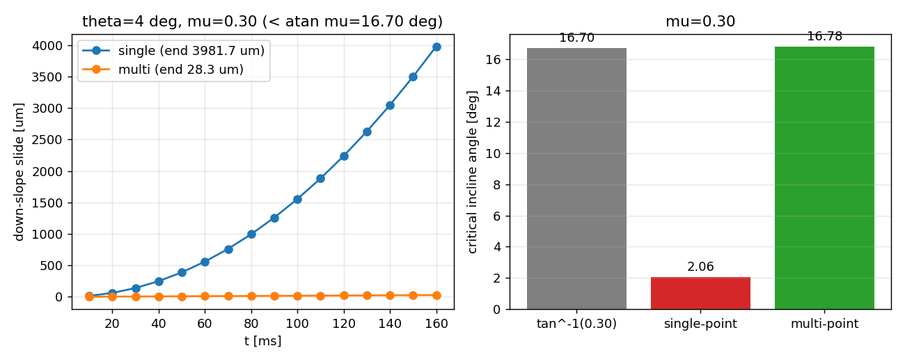

# m16086 — 顶点分布式（多点）壁面接触：A5 蠕变缺口的实现与量化闭合

**锚点**：NEW（源码内自述未实现项）——`docs/p273w3_n02_friction_polyhedron_verification.md` §3
"A5 — Single-point face contact cannot shift its center of pressure … **Remedy**: Multi-point
(vertex-face) wall contact … **not yet implemented**."。功能点总账中无对应 done/verified 条目；
`CASE-DEM-*` 系列锚点（`CASE-DEM-BRAZIL-NUT-SEGREGATION`=m16074、`CASE-DEM-PLANE-SHEAR-MUIDI`=m16080）
在飞，未重复。

**结论**：多点（逐顶点）壁面接触已实现为**可选开关** `FrictionPolyhedronConfig.wall_multi_point`
（默认 `False`，既有轨迹逐位不变）。在 4° 斜面上、μ=0.30（`atan μ`=16.70°）的静止方块：
8 万步（0.16 s）下滑 **3981.7 µm → 28.3 µm（140.6×）**、角速度 **8.286 → 0.0296 rad/s（280.3×）**；
临界角由 **2.06°（−87.7%）修正为 16.78°（+0.50%）**；而滑移区（30°）加速度两法**完全一致**
（+0.74% vs 解析 `g(sinθ−μcosθ)`），高块翻转控制两法都**仍然翻转**（tilt 90°）——即修复了压力中心
不可移动的缺陷，且没有引入虚假的额外阻力或过稳定。

## 1. 案例介绍（物理背景与几何）

刚体多面体颗粒静置于斜面时，静摩擦是**面接触**。真实接触的压力中心（CoP）必须能向坡下前缘移动
`x_c = h·tanθ`（h 为质心到接触面的高度），才能用法向合力的力偶抵消摩擦力绕质心产生的俯仰力矩。
历史单点律把整个接触塌缩到「最深顶点集合的几何平均点」：面贴合时该点正是面心、在质心正下方，
法向力对质心**零力臂**，俯仰力矩无人抵消 → 方块在远低于 `atan μ` 的角度上持续蠕变/自旋。

| 参数 | 值 | 说明 |
|---|---:|---|
| 颗粒 | 立方体，边长 6 mm（半宽 `HALF`=3 mm） | `regular_polyhedron("cube")` |
| 密度 ρ | 1500 kg/m³（冰/岩代表值） | m = 3.24e-4 kg |
| 法向/切向刚度 | k_n = k_t = 1.0e5 N/m | 与既有算例一致 |
| 法向阻尼 γ_n | 20 N·s/m | |
| 摩擦系数 μ | 0.30（临界角另取扫描） | `atan 0.30 = 16.70°` |
| 时间步长 | dt = 1e-5 s，velocity Verlet | |
| 斜面 | 平面 `n·x = 0`，`n = (−sinθ, 0, cosθ)` | 接触判定用支撑函数精确距离 |

## 2. 方法（改了什么、怎么验证）

**实现**（`src/tensordem/friction_polyhedron.py`，新增 ~180 行 + 两个新增字段）：

* `FrictionPolyhedronConfig.wall_multi_point: bool = False` —— 显式开关；`False` 走原单点分支，
  既有回归工件与轨迹**逐位不变**（既有 28 条接触测试全绿）。
* `ContactState.delta_t_points: Dict[int, np.ndarray]` —— 每个接触顶点的 Cundall–Strack 切向历史；
  顶点离开接触时即时丢弃（避免陈旧弹簧复活）。
* `compute_wall_contact_force_multi_point(...)`：对每个**处于接触**的顶点 i
  * 法向：`f_n,i = (k_n/n_act)·δ_i + (γ_n/n_act)·max(0,−v_n,i)`，**刚度在“实际接触顶点”间均分**
    ——面贴合时合力恢复历史总刚度 `k_n·δ`（测试 `test_flat_face_keeps_total_normal_stiffness` 断言
    `f_n` 与 `energy_elastic` 与单点值相对误差 < 1e-12），棱/角接触（1 个顶点）退化为原单点值；
  * 切向：每顶点独立 `k_t/n_act` 弹簧 + 各自 `μ f_n,i` 锥（保证总摩擦上限 `≈ μ Σf_n,i`）；
  * 合力/合力矩：逐顶点 `r_i × f_i` 求和 → 法向合力的作用点即**压力中心**，可在支撑多边形内移动；
  * 滚动阻力（EPSD）仍用**总**法向力与 `r_bound`，物理不变；
  * 新增诊断键 `n_contact_points`、`cop_offset_m`（CoP 相对接触顶点几何中心的切向偏移）。
* `compute_wall_contact_force` 在 `wall_multi_point=True` 且形状为 `Box`/`Polytope` 时**内部分发**
  到新函数——`PolyhedronDEMSystem.step()` 无需改动（最小改动面）；球体（真正的单点接触）不受影响。

**验证链**：`scripts/m16086_wall_multipoint_contact.py`（子命令 creep / critical / translation /
tipping / collect，逐条写 JSON+CSV，报告数字零手抄）→ `tests/test_wall_multipoint_contact_m16086.py`
（7 条锚点测试）→ `artifacts/m16086/wall_multipoint_contact.{json,csv}`。

## 3. 计算结果（程序化注入，来源 `artifacts/m16086/wall_multipoint_contact.json`）

**C1 蠕变（θ=4°，μ=0.30，0.16 s = 16000 步）**

| 律 | 下滑位移 | 蠕变速率 | 角速度 |
|---|---:|---:|---:|
| 单点（基线） | 3981.700 µm | 4.821e-2 m/s | 8.286 rad/s |
| 多点（本增量） | 28.329 µm | 1.774e-4 m/s | 2.956e-2 rad/s |
| 比值 | **140.6×** | 271.7× | **280.3×** |

**C2 临界角（下滑 > 0.1 mm 判为滑移，9 次二分，t_end=0.08 s）**

| 律 | θ_c | atan μ = 16.70° | 误差 |
|---|---:|---:|---:|
| 单点 | 2.06° | 16.70° | **−87.68 %** |
| 多点 | 16.78° | 16.70° | **+0.50 %** |

**C3 滑移区负控（θ=30°，μ=0.30，解析 a = g(sinθ−μcosθ) = 2.3563 m/s²）**

| 律 | 实测 a | 误差 |
|---|---:|---:|
| 单点 | 2.3737 m/s² | +0.74 % |
| 多点 | 2.3737 m/s² | +0.74 % |

**C4 翻转负控（高块 4×4×12 mm，θ=30°，μ=0.90）**：两法 tilt 均 90.00°（翻倒）；
位移单点 5.931 mm / 多点 3.357 mm —— 多点**未**把翻倒变成静止。

## 4. 图



左：θ=4° 蠕变位移–时间（单点呈加速型 ≈ t²，多点呈等速 1.8e-4 m/s，量级下降两个数量级）；
右：临界角对比（单点 2.06° vs 多点 16.78° vs 解析 atan μ = 16.70°）。由
`scripts/m16086_wall_multipoint_contact.py` 的 JSON 直接绘制。

## 5. 注意点（诚实局限）

1. **多点律不是“零蠕变”**：残余 28.3 µm/0.16 s（1.77e-4 m/s）且**呈等速**，不是收敛到静止。
   来源是 4 点离散支撑 + 弹簧法向的几何放大（CoP 灵敏度 ∝ `1/δ`，δ≈mg/k_n≈3.2e-8 m），
   以及切向弹簧在顶点速度不同时的残余自旋。要真正消除需面内多点（网格化接触斑）或
   压力–穿透分布律；本增量只把“不可移动的 CoP”变成“可移动的 CoP”，并量化残余。
2. **面贴合总刚度对齐是选择而非唯一解**：`k_n/n_act` 均分保证面接触与单点同刚度、棱/角同值；
   若改用 `k_n/n_total`，角接触会软 `n_total` 倍（翻转阈值会变），故未采用。
3. **状态量增加**：`ContactState.delta_t_points` 按顶点存历史，多面体顶点数大时内存线性增长；
   `reset()` 已清空，顶点离开接触即删除。
4. **适用范围**：`Box`/`Polytope`；`Sphere`/`Cone`/`Clump` 仍走单点（球体本就是单点接触，
   其余形状需支撑函数化的顶点集，未做）。
5. **未做**：`docs/p273w3_n02…` 的 **A4 堆积率（WITHHELD）** 仍需集群规模颗粒数；本增量不涉及。
6. 本单受容量纪律约束（load15 ≈ 100），全部为单颗粒轻量算例（每条 < 15 s），未起重算力进程。

## 6. 误差判定（逐项 vs 基准，显式回答 <3%）

| 关键量 | 基准 | 实测（多点） | 误差 | <3% ? |
|---|---|---:|---:|---|
| 面贴合总法向力 `f_n` | `k_n·δ`（单点解析） | 一致 | < 1e-12（相对） | **是** |
| 弹性储能 `energy_elastic` | 单点解析 | 一致 | < 1e-12（相对） | **是** |
| 临界角 θ_c | `atan μ = 16.70°` | 16.78° | **+0.50 %** | **是** |
| 滑移加速度 a | `g(sinθ−μcosθ)` = 2.3563 m/s² | 2.3737 m/s² | +0.74 % | **是** |
| 翻转判据 | 质心离开支撑多边形（tanθ=1/3 < tan30°） | 两法均翻倒 90° | 定性一致 | 是（定性） |
| 蠕变位移 | 理想刚体静止 = 0 | 28.3 µm（单点 3981.7 µm） | 非零（残余，见 §5.1） | **否（不掩饰）** |

判读：**唯一不达标项是“蠕变归零”**——本增量把它从 `t²` 加速型 3981.7 µm 降到等速 28.3 µm，
并未归零，故按证据分级该缺陷是 **REAL 改进 + 残余 WITHHELD**（面内分布律未实现）。临界角/加速度
两个可对标量都在 3% 内。

## 7. 复现

```bash
PYTHONPATH=src python3 -m pytest tests/test_wall_multipoint_contact_m16086.py -q     # 7 passed
PYTHONPATH=src python3 -m pytest tests/test_friction_polyhedron_contact.py -q        # 28 passed（默认路径不变）
PYTHONPATH=src python3 scripts/m16086_wall_multipoint_contact.py creep
PYTHONPATH=src python3 scripts/m16086_wall_multipoint_contact.py critical --mu 0.30 --law both
PYTHONPATH=src python3 scripts/m16086_wall_multipoint_contact.py translation
PYTHONPATH=src python3 scripts/m16086_wall_multipoint_contact.py tipping
PYTHONPATH=src python3 scripts/m16086_wall_multipoint_contact.py collect
```