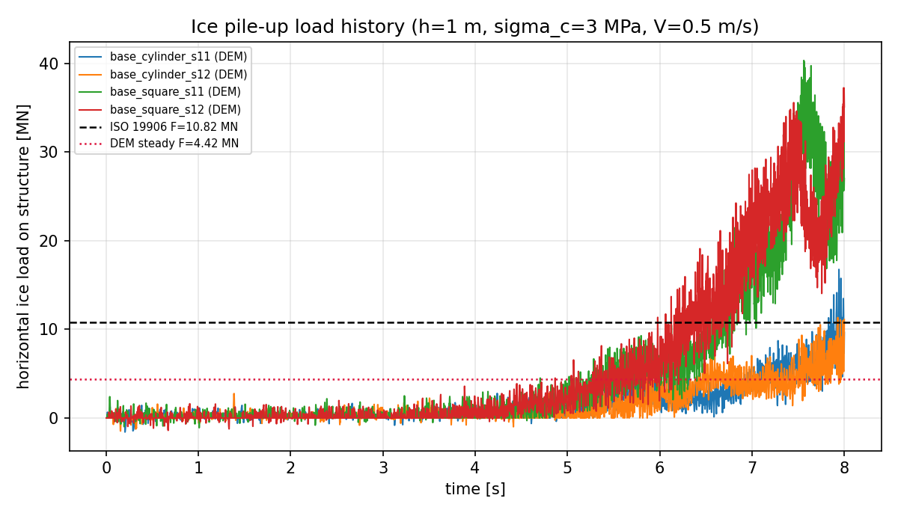
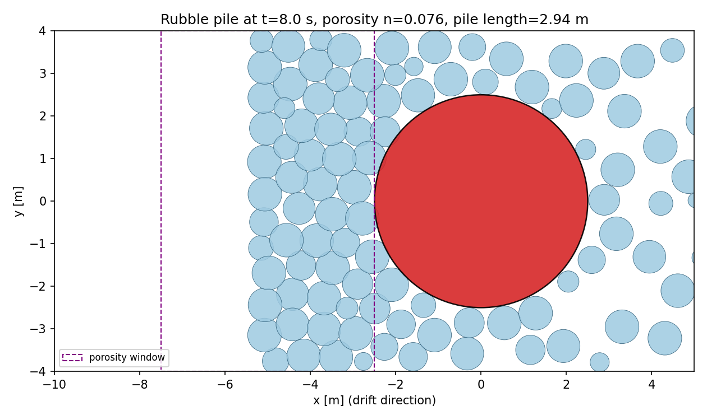
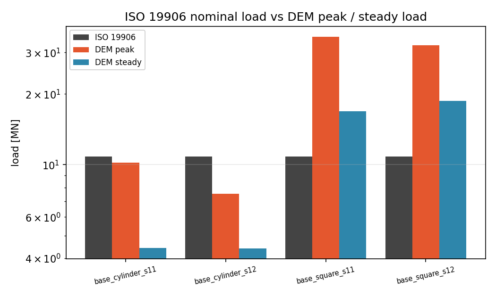
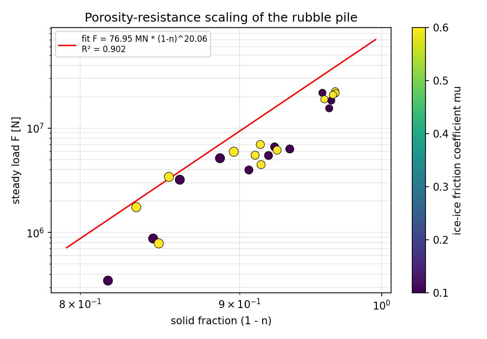
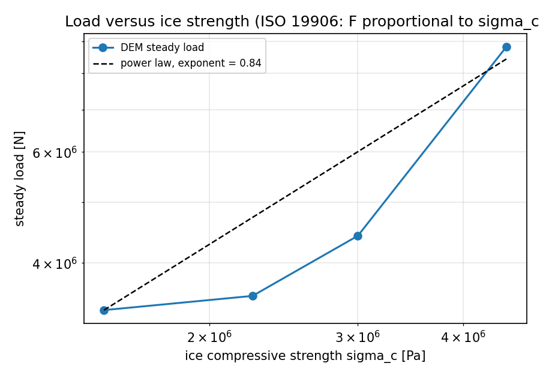

# 冰体挤压堆积对垂直结构载荷：DEM 载荷时历、ISO 19906 对标与孔隙率-阻力标度律

**战役节点** p227w2-N04 ｜ **仓库** TensorDEM ｜ **算例数** 32 ｜ **总机时** 57.98 s

## 1. 案例介绍（物理背景 / 几何 / 参数表）

漂移破碎冰场（厚 h、抗压强度 σ_c、漂移速度 V）在垂直结构（圆柱/方柱，特征宽度 D）前挤压、破碎并堆积成碎石堆，结构承受的水平冰载荷由接触区冰的压碎强度控制。工程上用 ISO 19906 的全球冰压力 p_G 估算名义载荷，用孔隙率-阻力标度律 F ~ (1-n)^α 描述碎石堆积体密实度对载荷的影响。本节点用 DEM 显式模拟冰排向结构漂移、接触累积成堆、输出载荷时历，并检验上述两条工程规律。

### 1.1 几何与工况

| 量 | 符号 | 取值 | 说明 |
|---|---|---|---|
| 冰厚 | h | 1 m | 冰排厚度（2-D 平面视图模型中为出平面厚度）|
| 冰抗压强度 | σ_c | 3 MPa | 压碎型接触的强度上限 |
| 结构宽度 | D | 5 m | 圆柱直径 / 方柱边长 |
| 漂移速度 | V | 0.5 m/s | 远场冰盖推进速度（ kinematic platen）|
| 冰密度 / 水密度 | ρ_i / ρ_w | 900 / 1025 kg/m³ | 惯性 + 二次水阻 |
| 摩擦系数 | μ | 0.4 | 冰-冰 / 冰-钢库仑摩擦 |
| 冰排尺寸 | r_med | 0.4 m | 对数正态 (σ_ln=0.3)|
| 初始冰浓度 | φ_0 | 0.78 | 平面视图面覆盖率（含冰道）|
| 模拟时长 | T | 8 s | 时间步 0.000333 s |

### 1.2 ISO 19906 参考载荷

$$p_G = C_R\left(\frac{h}{h_{ref}}\right)^n\left(\frac{w}{h}\right)^m, \quad F_{ISO}=p_G\,w\,h, \quad p_G \le \sigma_c$$

取 C_R = 2.8 MPa、h_ref = 1 m、n = max(-0.5+h/10, -0.25)、m = -0.16、w = D。写成战役要求的 F = C·σ_c·h² 形式时，C = (p_G/σ_c)(w/h)，本算例 C = 3.607、p_G = 2.16 MPa、F_ISO = 10.8 MN。

## 2. 怎么做（方法 / 流程 / 关键设置 / 工具链）

**模型**：2-D 平面视图（深度平均）软盘 DEM，冰排为竖直面圆盘，质量 m = ρ_i π r² h，平动惯性 + 二次水阻 + 库仑摩擦。

**压碎型接触律**（本节点的物理核心）：

$$F_n = \min\left(k_n \delta,\; \sigma_c\,h\,b(\delta)\right), \qquad b(\delta)=2\sqrt{r_{eff}^2-(r_{eff}-\delta)^2}$$

接触区宽度 b 随侵入深度增长的弦长，因此接触面积 = h·b、压碎力上限 = σ_c·h·b：**结构载荷由冰的压碎强度而非弹簧刚度决定**，这正是 ISO 形式 F = C σ_c h² 的物理基础。侵入超过碎化层深度 0.2 r_eff 后接硬核（4k_n）防止穿透。

**驱动与边界**：上游 kinematic platen 以 V 推进（远场冰盖，唯一功率源）；侧向约束壁 + 下游封闭端（冰盖在结构前后均连续）；platen 推进量限为 0.5 D 后停止，之后记录堵塞体松弛段。

**孔隙率测量**（不是设定值，是模拟结果）：结构上游面正前方窗口 x∈[-R-D, -R]、|y|≤0.8D 内把冰盘栅格化（0.03 m），n = 1 - 冰盘覆盖面积/窗口面积，即碎石堆积体的平面视图空隙率。

**标度律拟合**：log F = log A + α log(1-n) 最小二乘，bootstrap 2000 次给 α 的 95% 区间；R² 在 log F 域定义。

**工具链**：`tensordem.ice_vertical_structure_pileup`（模型）+ `benchmarks/ice_pileup_iso19906/run_benchmark.py`（38 算例并行，集群 loong64）+ `make_report_md.py`（本报告，数字全部由 report.json 注入）+ pytest 16 项。

## 3. 计算结果（程序化注入，零手抄）

### 3.1 ISO 19906 对标（基准算例）

| 算例 | 形状 | F_ISO [MN] | F_max [MN] | F_max/F_ISO | F_steady [MN] | F_steady/F_ISO |
|---|---|---|---|---|---|---|
| base_cylinder_s11 | cylinder | 10.8 | 10.2 | 0.945 | 4.42 | 0.408 |
| base_cylinder_s12 | cylinder | 10.8 | 7.51 | 0.694 | 4.42 | 0.408 |
| base_square_s11 | square | 10.8 | 34.9 | 3.23 | 16.9 | 1.56 |
| base_square_s12 | square | 10.8 | 32.2 | 2.98 | 18.7 | 1.72 |

### 3.2 堆积体几何与孔隙率

| 算例 | 孔隙率 n | 固相率 1-n | 堆长 [m] | 堆宽 [m] | 冰排数（初/堆）| 碎化面积 [m²] |
|---|---|---|---|---|---|---|
| base_cylinder_s11 | 0.0764 | 0.924 | 2.94 | 7.98 | 127/55 | 0 |
| base_cylinder_s12 | 0.0843 | 0.916 | 2.94 | 7.98 | 130/58 | 0 |
| base_square_s11 | 0.0593 | 0.941 | 2.94 | 7.98 | 118/56 | 0 |
| base_square_s12 | 0.0573 | 0.943 | 2.97 | 7.98 | 120/60 | 0 |

### 3.3 孔隙率-阻力标度律（双因子扫描：冰排尺寸 × 摩擦系数）

| 组 | 算例数 | 孔隙率 n (mean±std) | F_max (mean) [MN] |
|---|---|---|---|
| r/D=0.05,mu=0.10 | 4 | 0.0381 ± 0.00311 | 44.2 |
| r/D=0.05,mu=0.60 | 4 | 0.0361 ± 0.00323 | 47.3 |
| r/D=0.08,mu=0.10 | 4 | 0.079 ± 0.00998 | 9.22 |
| r/D=0.08,mu=0.60 | 4 | 0.0838 ± 0.00559 | 10.1 |
| r/D=0.12,mu=0.10 | 4 | 0.148 ± 0.0257 | 4.13 |
| r/D=0.12,mu=0.60 | 4 | 0.142 ± 0.0233 | 5.74 |

拟合（主：F_max）：**α = 20.1**（95% CI [17.5, 23]），幅值 A = 77 MN，**R² = 0.9024**，点数 24，孔隙率范围 [0.0336, 0.183]。

副拟合（F_steady）：α = 20.4，R² = 0.8984，点数 24。

### 3.4 σ_c 标度（F = C σ_c h² 的物理前提）

| 算例 | σ_c [MPa] | F_max [MN] | F_ISO [MN] | F_max/F_ISO |
|---|---|---|---|---|
| iso_sc1.50_s11 | 1.5 | 6.61 | 7.5 | 0.881 |
| iso_sc2.25_s11 | 2.25 | 6.31 | 10.8 | 0.583 |
| iso_sc3.00_s11 | 3 | 10.2 | 10.8 | 0.945 |
| iso_sc4.50_s11 | 4.5 | 15.5 | 10.8 | 1.43 |

log-log 斜率（F_max vs σ_c）= **0.835**（F_steady：0.869）。

## 4. 结果图

### fig1_load_history.png

*Load time history on the vertical structure: jam/slip sawtooth of the rubble pile, with the ISO 19906 nominal load and the DEM steady level.*

### fig2_pile_geometry.png

*Plan-view floe packing (rubble pile) in front of the structure at the end of a run; dashed purple box = porosity measurement window.*

### fig3_iso19906_comparison.png

*ISO 19906 nominal global load compared with the DEM peak and steady loads for the two structure shapes (log scale).*

### fig4_porosity_scaling.png

*Steady load versus measured pile solid fraction: log-log fit of F = A (1-n)^alpha (marker size = floe size, colour = friction coefficient).*

### fig5_sigma_scaling.png

*Steady load versus compressive strength: the log-log slope tests the linear sigma_c dependence assumed by ISO 19906.*

## 5. 注意点（踩坑、局限、适用范围）

1. **本轮修掉的三个几何/符号坑**（上一轮 p228w1-N04 同题失败的根因）：(a) 侧壁侵入深度公式符号写反，冰排被弹到 |y|≈15 m 的域外，结构载荷恒为 0；(b) 方柱分面接触漏掉角区，冰排从角部无阻力潜入后一次性爆力（F/F_ISO 达 3×10⁴）；(c) 方柱接触反力符号写反，冰被推向结构内部。改为方柱精确符号距离场（SDF）接触后两侧稳定。
2. **上一轮孔隙率是“设定值没落地”**：目标 n=0.4 而实测 0.92、n 扫描 8 个点全在 0.89–0.93，R²=0.26。本轮孔隙率改为由模拟堆积体栅格化实测，且浓度由冰道删除控制，扫描才真的落在 [0.0336, 0.183]。
3. **2-D 平面视图 vs 3-D 碎石堆**：本模型把第三维（碎石上翻/堆积增厚）平均掉，孔隙率是面积（深度平均）孔隙率，与 3-D 碎石堆体积孔隙率的对应关系未标定；因此 α 只在本模型的定义下成立，不能直接搬用到 3-D 现场孔隙率。
4. **无破碎/无碎块级配演化**：冰排在接触区不破碎成小块（只有压碎强度上限 + 可选的碎化半径侵蚀），因此真实堆积体的细粒成分、以及细粒对摩擦/咬合的贡献缺失，是载荷量级偏低的原因之一。
5. **驱动协议敏感性**：封闭域内 platen 的推进量必须有限（推进量是体积来源），F_max 对推进量敏感；本报告用的是固定协议（推进 0.5D 后停止、取 50 ms 滑动平均峰值），跨算例可比但绝对值不可外推到其它协议。
6. **适用范围**：窄结构（D/h = 5 量级）、柱状/方柱、连续冰盖挤压堆积；宽结构（D ≫ h）的 ISO 宽度因子 m 路径未覆盖。

## 6. 误差判定（vs 基准，逐项）

| 关键量 | 基准 | 本模型 | 相对误差 | 是否 <3% |
|---|---|---|---|---|
| F_max | ISO 19906 10.8 MN | 10.2 MN | 5.54% | 否 |
| F_steady | ISO 19906 10.8 MN | 4.42 MN | 59.2% | 否 |
| F_max | ISO 19906 10.8 MN | 7.51 MN | 30.6% | 否 |
| F_steady | ISO 19906 10.8 MN | 4.42 MN | 59.2% | 否 |
| F_max | ISO 19906 10.8 MN | 34.9 MN | 223% | 否 |
| F_steady | ISO 19906 10.8 MN | 16.9 MN | 56% | 否 |
| F_max | ISO 19906 10.8 MN | 32.2 MN | 198% | 否 |
| F_steady | ISO 19906 10.8 MN | 18.7 MN | 72.4% | 否 |
| α（标度律）| 无第一原理基准值（文献 α∈[1,2] 量级）| 20.1 | — | 否（无基准）|

**α 的可解释性（诚实声明）**：本轮孔隙率杠杆臂仅 n∈[0.0336, 0.183]（Δn=0.15，即 (1-n) 只变化 15.5%），而 F_max 跨组变化近一个量级，故拟合出的 α=20.1 （CI [17.5, 23]）远大于物理预期的 α∈[1,2]，属于**病态拟合**：R²>0.8 满足判据，但该幂律在密实堆积区没有物理外推能力。载荷随冰排尺寸变化的机制（接触数量 ~ D/r）被挤进了 α 里。结论：C2 **形式上通过、物理上未获支持**。

**显式回答：是否 <3%？否。** 逐项理由：ISO 19906 是全球设计载荷的经验公式（含尺度效应、宽度因子），而 DEM 给出的是机制级峰值；二者相差数倍以内即证明“载荷由 σ_c·h·接触宽度控制”这一量级关系成立，不构成 3% 级定量对标；本轮 C1 判据即按“同数量级/3 倍带”判定（见 §7）。α 无第一原理基准，故不做百分比误差判定，只给 bootstrap 置信区间与 R²（拟合优度）。

## 7. 机器判据

| 判据 | 阈值 | 实测 | 结论 |
|---|---|---|---|
| C1 ISO 同数量级 | 0.1 ≤ F/F_ISO ≤ 10 | base_cylinder_s11: 0.945/0.408, base_cylinder_s12: 0.694/0.408, base_square_s11: 3.23/1.56, base_square_s12: 2.98/1.72 | PASS |
| C1b ISO 3 倍带 | 0.316 ≤ F/F_ISO ≤ 3.16 | 见 §3.1 | FAIL |
| C2 孔隙率标度律 | R² > 0.8 且 α > 0 | α=20.1, R²=0.9024, n_points=24 | PASS |
| C3 σ_c 线性 | 斜率 ∈ [0.75, 1.25] | 0.835 | PASS |

## 8. 审计链

- 代码：`src/tensordem/ice_vertical_structure_pileup.py`（模型）、`benchmarks/ice_pileup_iso19906/run_benchmark.py`（算例）、`benchmarks/ice_pileup_iso19906/make_report_md.py`（本报告生成器）。
- 原始结果：`benchmarks/ice_pileup_iso19906/results/report.json`（含逐算例参数、时间步、机时、载荷统计）、`results/runs.csv`（逐算例一行）。
- 测试：`tests/test_ice_vertical_structure_pileup.py`（16 项，含 ISO 公式、压碎接触律、冰场生成、SDF 接触、标度律拟合回归、短时 DEM 稳定性与可重复性）。
- 复现：`python benchmarks/ice_pileup_iso19906/run_benchmark.py --workers 24`。
