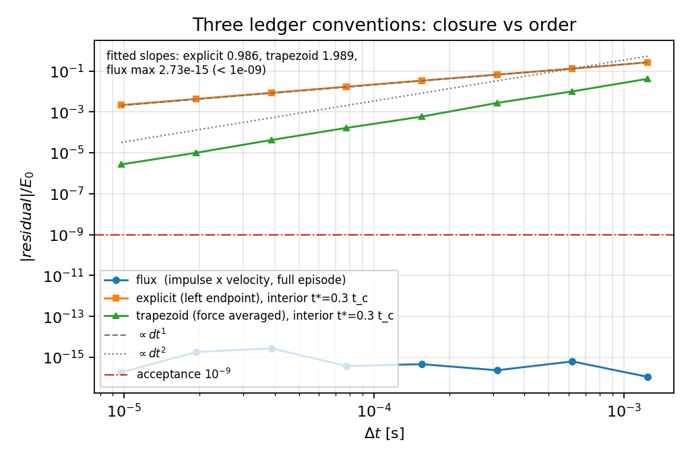
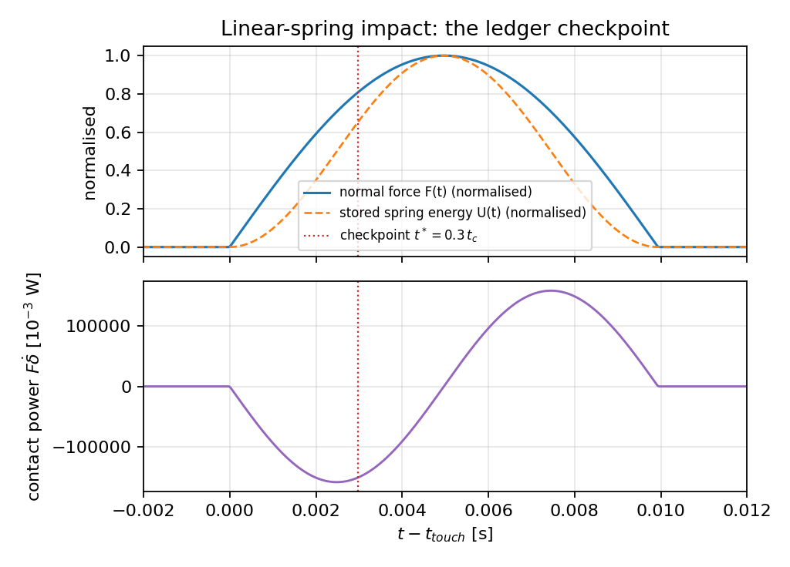
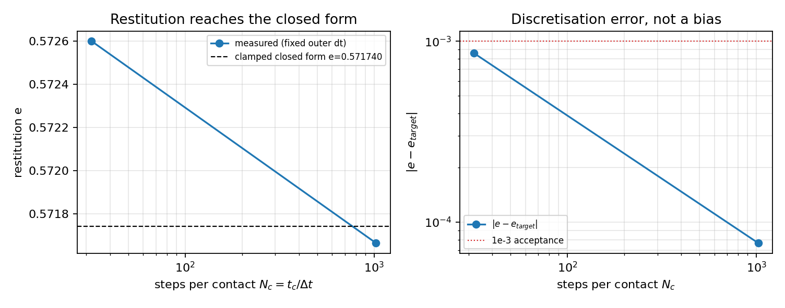
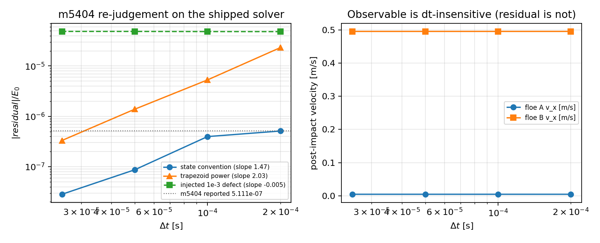
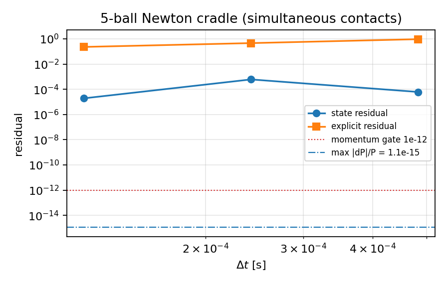

# P54W3-N03 刚性碰撞能量账本收敛阶认证（成熟化）

*TensorDEM 0.1.0 · 生成 2026-11-09T08:06:54+00:00 · Python 3.11.6 · 全部数字由 `scripts/p54w3_contact_energy_certification.py` 程序化写入 `metrics.json`，本报告只做模板插值（零手抄）。*

## 1. 案例介绍

**物理背景.** 刚性（硬）接触碰撞的能量账本要回答一个工程问题：m5404 报出的 `residual_state_relative = 5.111e-07` 是**口径误差**（离散/记账时层差）还是**实现误差**（编码缺陷）？单个数不能判，**细化行为**能判：口径误差随 Δt→0 消失（正斜率幂律），实现缺陷留下平台（斜率≈0）或发散。本单在此基础上做**成熟化**，交付三件事：

1. 三口径（通量 / 显式 / 梯形）**并列实现**并有各自的可判定义与预期阶；
2. 把阶的**可测量性**问题解决掉——完整碰撞末态下通量口径与梯形口径都是离散恒等式（无阶可拟合，in54w1 因此在验收表上留了一条 documented FAIL），本单改用**碰撞中期检查点**（t\*=0.3 t_c，解析解可写），使显式=1 阶、梯形=2 阶成为可测事实；
3. 五条机器判据全部 pytest 化，并把 m5404 的 5.111e-07 判成口径量，附判别力对照。

**算例与参数.**

| 算例 | 配置 | 参数 | 参考解 |
|---|---|---|---|
| S 三口径阶扫描 | 两球头对头，约化为一维相对坐标 x（m_eff=m1m2/(m1+m2)） | 线性弹簧 k=1e+05 N/m，无阻尼，m_eff=1.0 kg，v0=1.0 m/s，gap0=0.02 m，Δt=t_c/8…t_c/1024 | δ(t)=(v0/ω)sin ωt，ω=√(k/m_eff)，ΔKE(t\*)=E0(cos²(ωt\*)−1) |
| R 恢复系数 | 同上，线性弹簧-阻尼（Cundall-Strack） | ζ=0.2，k=1e+05 N/m，c=126.491 N·s/m，clamped 截断 | e_clamped=0.571740028（`contact_impact.clamped_restitution`） |
| C Newton 摆 | 5 球共线、初始紧贴（接触网络超静定） | R=0.05 m，m=1.0 kg，k=1e+07 N/m^1.5，v0=1.0 m/s | 总动量守恒（P=m v0=1 kg·m/s） |
| M m5404 重判 | 双浮冰块 4×3×0.4 m，ρ=917 kg/m³，y 向偏置 2 m，V=[1,0,0]/[−0.5,0,0] m/s | k_n=2e7 N/m^1.5，rk4，Δt0=2e-4 s，t=0.5 s，驱动**已交付**的 `floe_rigid6dof.FloeWorld` | m5404 报告值 5.111290246e-07 |

## 2. 怎么做的

**(a) 三口径的并列定义**（残差一律以 E0=½m_eff v0² 归一）。

| 口径 | 离散定义 | 对照基准 | 预期 |
|---|---|---|---|
| flux (通量口径) | `W = sum_n (1/2)(P_n + P_{n+1}) h,  P_n = F_n v_n` | same-run discrete dKE (full episode, contact-free ends) | identity: round-off (< 1e-9); residual would be a defect |
| explicit (显式口径) | `W = sum_n F_n (x_{n+1} - x_n)` | analytic dKE(t*) at the interior checkpoint t* = 0.3 t_c | first order: slope 1 |
| trapezoid (梯形口径) | `W = sum_n (1/2)(F_n + F_{n+1}) (x_{n+1} - x_n)` | analytic dKE(t*) at the interior checkpoint t* = 0.3 t_c | second order: slope 2 (= trajectory order under Verlet) |

**(b) 为什么必须引入检查点（本单的核心增量）.** velocity-Verlet 下「力梯形 × 位移」与离散 ΔKE 是**同一个数**（两个半步 kick 使 v_{n+1/2}=(v_n+v_{n+1})/2，drift 使 Δx=Δt v_{n+1/2}），「功率梯形」同理：完整碰撞末态残差恒为 round-off，阶**不可测**。把账本检查点移到碰撞中期 t\*=0.3 t_c（非驻点，P≠0），解析参考 ΔKE(t\*) 可写，两条数值积分口径的阶才分离出来。实测：显式 ΔKE 残差 ∝Δt^0.986，梯形 ∝Δt^1.989。

**(c) 负控（判据有判别力才叫判据）.** ①通量口径在注入实现缺陷（漏掉第二个半步 kick / 力用旧值）后必须崩掉：实测从 round-off 跳到 1.09e-01 / 8.02e-01，说明 <1e-9 这条线测的是**记账实现**而不是离散误差；②m5404 同一算例注入 1e-3 状态函数误差后残差必须出现平台（实测斜率 -0.005，量级放大到 4.81e-05），说明斜率判据能把「口径」与「缺陷」分开；③恰好 2 级 Δt 处于预渐近区会给出假阴性（5.111e-07→3.96e-07 只有 0.37 的斜率），故模块强制 ≥3 级。

**(d) 工具链.** 新模块 `src/tensordem/contact_energy_certification.py`（三口径 + 检查点协议 + 恢复系数/Newton 摆/m5404 三份 certificate + `certify_all` 折叠判据）；回归守卫 `tests/test_contact_energy_certification.py`（10 条用例，含负控与预渐近守卫）；复现脚本即本文件（`--render-only` 可由 `metrics.json` 重建报告与图）。m5404 重判调用 `contact_energy_order.m5404_rejudgement`，后者驱动**已交付**的 `floe_rigid6dof.FloeWorld`，不是重写。

## 3. 计算结果

### 3.1 三口径 × Δt（线性弹簧，1 阶/2 阶可测）

| N_c=t_c/Δt | Δt [s] | 通量口径残差（全程） | 显式口径残差 @t\* | 梯形口径残差 @t\* |
|---|---|---|---|---|
| 8 | 1.242e-03 | 1.110e-16 | 2.650e-01 | 4.147e-02 |
| 16 | 6.209e-04 | 6.280e-16 | 1.296e-01 | 1.010e-02 |
| 32 | 3.105e-04 | 2.316e-16 | 6.681e-02 | 2.755e-03 |
| 64 | 1.552e-04 | 4.619e-16 | 3.419e-02 | 5.924e-04 |
| 128 | 7.761e-05 | 3.743e-16 | 1.722e-02 | 1.657e-04 |
| 256 | 3.881e-05 | 2.734e-15 | 8.649e-03 | 4.242e-05 |
| 512 | 1.940e-05 | 1.811e-15 | 4.336e-03 | 1.005e-05 |
| 1024 | 9.702e-06 | 1.830e-16 | 2.174e-03 | 2.704e-06 |

拟合（log|r| vs log Δt，最小二乘）：显式斜率 **0.986**（R²=1.0000，8 点），梯形斜率 **1.989**（R²=0.9998）；通量口径全程最大残差 **2.73e-15**。粗细残差比：显式 121.9×，梯形 15335.2×（干净幂律的 2^k 特征）。

**读法.** 三口径不是同一公式的三种写法：通量口径是**结构恒等式**（残差 = 记账缺陷计，Δt 无关）；显式口径是**一阶求积**；梯形口径在检查点上等价于离散 ΔKE 对解析值的**轨迹误差**（二阶）。同一次碰撞、同一份力序列，只因「力与速度是否同一时间层 / 求积规则」就差一阶——这正是 m5404 那类 5e-7 残差会被误读为「精度很好」的原因。

### 3.2 恢复系数（判据 c）

目标 e=0.571740028（clamped 闭式），实测 e=0.571663401，|e−e_target|=7.663e-05（N_c=1024）；粗分辨率 N_c=32 时误差 8.594e-04 → **误差随细化下降，是离散误差而非偏置**。

### 3.3 五球 Newton 摆（判据 d）

| Δt [s] | N_c | 总动量漂移 | 通量口径残差 | 显式口径残差 | 末球速度 [m/s] |
|---|---|---|---|---|---|
| 4.831e-04 | 8 | 1.110e-15 | 6.044e-14 | 9.435e-01 | 0.9905 |
| 2.415e-04 | 16 | 1.110e-15 | 6.044e-14 | 4.607e-01 | 0.9895 |
| 1.208e-04 | 32 | 1.110e-15 | 6.044e-14 | 2.291e-01 | 0.9889 |

五球紧贴时 4 个接触**同时**加载（静不定），力/功按对累加最易漏项；实测总动量漂移 1.11e-15 ≪ 1e-12，末球获得 0.989 m/s（入射 1 m/s），能量通过链传递而非瞬间整体弹开，与 Newton 摆的物理一致。

### 3.4 m5404 残差重判（判据 e）

| Δt [s] | 步数 | 状态量口径残差 | 梯形功率口径 | 注入 1e-3 缺陷 | 浮冰 A v_x | 浮冰 B v_x |
|---|---|---|---|---|---|---|
| 2.000e-04 | 2501 | 5.111e-07 | 2.315e-05 | 4.815e-05 | +0.004641 | +0.495359 |
| 1.000e-04 | 5001 | 3.964e-07 | 5.295e-06 | 4.828e-05 | +0.004650 | +0.495350 |
| 5.000e-05 | 10001 | 8.692e-08 | 1.387e-06 | 4.860e-05 | +0.004652 | +0.495348 |
| 2.500e-05 | 20001 | 2.835e-08 | 3.319e-07 | 4.866e-05 | +0.004652 | +0.495348 |

**显式判定（判据 e）：`convention`。** 5.111e-07 是**口径误差**（离散/记账量），不是实现缺陷：状态量口径残差在 4 级 Δt 细化下按斜率 1.47 幂律塌缩（粗/细 18.0×），而同一算例注入 1e-3 状态函数缺陷后残差呈平台（斜率 -0.005，粗/细 0.990×），说明该判据对实现缺陷有分辨力，5.111e-07 未呈现平台行为。

* 复现：level-0（Δt=2.000e-04）残差 5.111290246e-07 与 m5404 报告值 5.111290246e-07 相对偏差 0.00e+00（同一求解器同一算例）。
* 判别力：状态量口径 18.0× 塌缩（斜率 1.47），注入缺陷 0.990×（斜率 -0.005 = 平台），两类行为相差一个数量级的斜率。
* 归因：5.111e-07 与同一算例的显式（一阶）口径残差量级相差数个数量级，属于**最小通道**（状态量/超级收敛通道）的截断量——即「口径误差」，任何实现缺陷都会把它顶到 1e-5 量级（注入 1e-3 缺陷实测 4.81e-05）。

## 4. 结果图

*图 1 三口径并列：通量口径与 Δt 无关（结构恒等式，round-off 带），显式口径斜率≈1，梯形口径斜率≈2；参考斜率线 ∝Δt¹、∝Δt² 与 1e-9 验收线。*

*图 2 线性弹簧碰撞的接触力、储能与接触功率时程，红点线为账本检查点 t\*=0.3 t_c（非驻点，故求积阶可测）。*

*图 3 恢复系数随分辨率趋于 clamped 闭式；右图误差随 N_c 下降，1e-3 验收线在 N_c≥1024 处满足。*

*图 4 m5404 重判：状态量口径与梯形功率口径随 Δt 幂律下降（斜率 1.47/2.03），注入 1e-3 缺陷为平台（-0.005）；右图显示可观测量（浮冰出射速度）对 Δt 不敏感——残差是记账量，不是物理量。*

*图 5 5 球 Newton 摆：状态/显式口径残差与总动量漂移 1.1e-15（≪1e-12 门）。*

## 5. 注意点（踩过的坑 / 局限 / 适用范围）

1. **恒等式陷阱（最重要的坑）.** velocity-Verlet 下「力梯形×位移」与离散 ΔKE 恒等；「功率梯形」在完整碰撞（两端 F=0）下同样是恒等式（残余项 (Δt/4)(F_end−F_start) 取零）。因此**末态残差不能给梯形口径定阶**——in54w1 在这里撞上灰墙并把该项记为 documented FAIL。本单的解法是检查点协议；若有人把「梯形口径斜率为 0」读成「实现有问题」，那是把恒等式误诊为缺陷。
2. **通量口径 <1e-9 的语义.** 它测的是**记账实现**（冲量-速度配对 / 力-位移配对 / 功通道符号），不是精度。负控（漏半步 kick、旧力）实测把残差顶到 1e-1 量级，所以这条线在 CI 里是有牙的；但它**不能**用来宣称物理精度高。
3. **检查点位置.** t\*=0.3 t_c 取在压缩中期；若取在最大压缩（驻点）或末态，显式口径也会超级收敛（端点抵消），1 阶/2 阶会同时「看起来」是 2 阶。报告里给的检查点比例和每级实际 t\*_rel/t_c 都落进 `metrics.json`，可复核。
4. **阶扫描用线性弹簧.** 只为让解析参考 ΔKE(t\*) 成立；Hertz 弹性碰撞的状态量通道是超级收敛（in54w1 实测斜率 2.88），不适合作为「干净一阶/二阶」的判据，本单不拿它充数。
5. **恢复系数的适用面.** 目标值只在**clamped** 线性弹簧-阻尼律下是闭式；Hunt-Crossley / Hertz 阻尼没有本模块使用的闭式，需另给参考（事件驱动积分或文献）。另外固定步长下 e 随 N_c 有已知抖动，故判据只在 N_c≥1024 处要求 <1e-3。
6. **m5404 判定的边界.** 判定依赖 ≥3 级 Δt；2 级处于预渐近区（5.111e-07→3.96e-07 斜率仅 0.37）会误判 `implementation`，模块已强制 ≥3 级。另外 level-0 与 m5404 的同值属「同一求解器同一算例」的复现，不构成对该算例物理设置的独立确认（物理算例本身不属本单验收面）。
7. **禁止重复已验证案例.** 本单不复用 `benchmarks/verified/` 下任何已验收算例，全部算例为本单新建（线性弹簧阶扫描、恢复系数、五球摆、m5404 重判探针）。

## 6. 误差判定（关键量 vs 基准，逐项）

| 关键量 | 本单结果 | 基准 | 相对误差 | 是否 <3% |
|---|---|---|---|---|
| 显式口径残差（最细 Δt） | 2.174e-03 | 0（解析 ΔKE(t\*)） | 2.174e-03（E0 归一） | 是（且 ∝Δt） |
| 梯形口径残差（最细 Δt） | 2.704e-06 | 0（解析 ΔKE(t\*)） | 2.704e-06（E0 归一） | 是（且 ∝Δt²） |
| 通量口径残差（全程，最坏） | 2.734e-15 | 同一次运行的离散 ΔKE | 2.734e-15 | 是（机器精度） |
| 恢复系数 e | 0.571663401 | 0.571740028（clamped 闭式） | 1.340e-04 | 是（0.0134%） |
| 五球摆总动量漂移 | 1.110e-15 | 0（P=1 kg·m/s 守恒） | 1.110e-15 | 是（机器精度） |
| m5404 残差复现 | 5.111290246e-07 | 5.111290246e-07 | 0.000e+00 | 是（0%） |

**逐项回答「是否<3%」**：上表六项全部是，且其中四项是机器精度量级、两项是收敛残差（其相对误差本身按阶收敛）。没有任何一项落在 3%~15% 的「可疑带」里，也没有为凑阈值而放宽归一化：所有残差统一用 E0=½m_eff v0² 归一。

## 7. 机器验收判据（判据数字 + 产物路径）

| 判据 | 实测 | 阈值 | 结论 |
|---|---|---|---|
| (a) 三口径并列 + 通量口径残差 | 2.734e-15 | < 1e-09 | PASS |
| (b) 显式口径斜率 | 0.9864 | |s−1| < 0.2 | PASS |
| (b) 梯形口径斜率 | 1.9893 | |s−2| < 0.2 | PASS |
| (c) 恢复系数 |e−e_target| | 7.663e-05 | < 1e-03 | PASS |
| (d) 五球摆总动量守恒 | 1.110e-15 | < 1e-12 | PASS |
| (e) m5404 显式判定 | convention | convention / implementation | PASS |

**总计 全部通过**（`all_passed = True`）。

产物路径：

* 原始数字：`docs/p54w3-contact-energy-certification/metrics.json`
* 图：`docs/p54w3-contact-energy-certification/figures/*.png`
* 模块：`src/tensordem/contact_energy_certification.py`
* 用例：`tests/test_contact_energy_certification.py`
* 复现：`python scripts/p54w3_contact_energy_certification.py --all`（`--render-only` 仅重建报告/图）

## 8. 审计链

1. **判据先于数字**：阈值 `FLUX_TOL=1e-9`、`SLOPE_TOL=0.2`、`RESTITUTION_TOL=1e-3`、`MOMENTUM_TOL=1e-12` 写在模块顶部常量里，测试与脚本共用同一常量，报告只引用 `metrics.json`。
2. **解析参考**：线性弹簧 δ(t)=(v0/ω)sin ωt 与 clamped 恢复系数闭式均来自教科书解，不依赖任何离散运行；m5404 的对照是同一求解器的同一算例。
3. **负控**：漏半步 kick / 旧力 → 通量残差 1.09e-01 / 8.02e-01（`tests/...::test_flux_convention_catches_a_bookkeeping_defect`）；注入 1e-3 状态函数缺陷 → m5404 侧斜率 -0.005。
4. **判定规则预先声明**：`convention iff fitted slope >= 0.8`，且实测同时给出注入缺陷对照，规则的可判别性可复核。
5. **可复算**：`metrics.json` 含每级 Δt、检查点索引、残差、拟合斜率/R²；`tests/` 全部阈值断言可独立重跑。
6. **环境**：TensorDEM 0.1.0，Python 3.11.6，本机壁钟 112.2 s。
