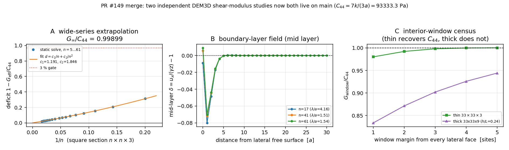

# PR #149 (`agent/m2772`) merge resolution — semantic union, no side dropped

Status: **resolved and verified locally**. Machine-readable artifacts for both
studies are regenerated and byte-identical to what each side had committed.

| item | value |
| --- | --- |
| merge-governor verdict before | `mergeable=false` (PR #149 dirty against `main`) |
| merge base | `8cc88f7` (Merge pull request #137) |
| `main` tip at merge time | `e12a2ab` (Merge #203, m3317) |
| `agent/m2772` tip before merge | `d85d8ac` (DEM3D cross-section convergence study) |
| `agent/m2772` tip after merge | the merge commit created from this tree (recorded in the mission report) |
| divergence resolved | 29 commits on `main`, 1 commit on the branch |

## 1. Why the PR was dirty

Both sides independently closed the *same* WITHHELD debt (`docs/dem3d_shear_static_reference.md`
§5: "a material shear modulus still needs a cross-section convergence study or
periodic boundaries") and both chose the *same file names*:

| artifact | `main` | `agent/m2772` |
| --- | --- | --- |
| study module | `src/tensordem/shear_convergence.py` (new module: 5..61 series, `1/n` fit, surface lag) | functions appended to `src/tensordem/shear_static.py` (`interior_traction`, `cross_section_series`, `fit_boundary_bias`, `fit_boundary_layer`) |
| schema flag on `static_direct_shear` | `return_displacement=True` → two extra payload keys | `include_state=True` → returns `(payload, sim, displacement)` |
| audit script | `scripts/audit_dem3d_shear_cross_section_convergence.py` (158 lines) | same path (281 lines) |
| study page | `docs/dem3d_shear_cross_section_convergence.md` (147 lines) | same path (182 lines) |
| generated tree | `docs/dem3d-shear-cross-section-convergence/{report.json,series.csv,summary.md,figures/convergence.png}` | same directory, `figures/cross_section_convergence.png` |

The two analyses are **complementary, not duplicates**: `main` establishes the
`O(1/n)` extrapolation on 18 sizes up to `61x61x3` (gate met at `n >= 45`), the
branch establishes an *interior-window bond census* (exact under affine shear,
`0.19 %` for thin specimens) and the thick-specimen limitation
(`h/L >= 0.12` → no window recovers `C44`). Dropping either side would delete a
distinct physical result, so every conflict was resolved as a **union**.

## 2. Conflict list and per-file resolution

Seven paths were in conflict (`git diff --diff-filter=U`), two of them `content`
conflicts and five `add/add`:

| # | path | type | resolution |
| --- | --- | --- | --- |
| 1 | `src/tensordem/shear_static.py` | content (3 hunks) | **API union**: `static_direct_shear` now accepts *both* `return_displacement=` (payload keys `displacement_m`/`initial_positions_m`) and `include_state=` (returns `(payload, sim, displacement)`); payload dict renamed to the neutral `result`. Branch's `interior_traction` / `cross_section_series` / `fit_boundary_bias` / `fit_boundary_layer` block was kept verbatim (auto-merged below the conflict). Docstring documents both flags. |
| 2 | `tests/test_dem3d_shear_cross_section_convergence.py` | add/add (2 hunks) | **Test union**: all 7 `main` tests + all 10 branch tests kept (17 total). The two modules both export `cross_section_series`, so the specimen-side one is imported as `specimen_cross_section_series` — an explicit alias, no test renamed or dropped. |
| 3 | `scripts/audit_dem3d_shear_cross_section_convergence.py` | add/add | `main`'s script keeps the canonical name verbatim; the branch's script is preserved verbatim under `scripts/audit_dem3d_shear_interior_window.py` (only its `OUT` constant and docstring changed). |
| 4 | `docs/dem3d_shear_cross_section_convergence.md` | add/add | `main`'s page kept at this path; the branch's page preserved as `docs/dem3d_shear_interior_window_convergence.md`. Each page gained a one-line pointer to its companion so neither result is orphaned. |
| 5 | `docs/dem3d-shear-cross-section-convergence/report.json` | add/add | `main`'s generated report kept in this directory (it is what `main`'s script writes). |
| 6 | `docs/dem3d-shear-cross-section-convergence/summary.md` | add/add | as #5. |
| 7 | `docs/dem3d_shear_static_reference.md` | content | **Paragraph union**: the single "debt closed" paragraph became two labelled paragraphs — *wide series* (`main`'s `d(n)=1.191/n+1.846/n^2`, `G_inf/C44=0.99899`, gate at `n>=45`) and *interior window* (branch's `0.14 %`/`1.47 %` extrapolation, `0.19 %` window, `0.63 a` relaxation, thick-specimen limitation). Both sets of numbers are retained. |

Renames are explicit and documented here on purpose: the "mechanical overlay"
failure mode of earlier PRs was silent deletion of one side, which is exactly
what these two names `cross_section_convergence` did to each other. Nothing was
deleted; the branch's generated artifacts were re-homed to
`docs/dem3d-shear-interior-window-convergence/` (report.json, summary.md,
figures/cross_section_convergence.png) because both scripts write a file named
`report.json` into the same directory and one would have clobbered the other.

`docs/dem3d_material_calibration_roadmap.md` merged automatically; its new
"material shear modulus identified" bullet was extended to cite both pages.

The doc-evidence ratchet (`docs/doc_evidence_ledger.json`) was regenerated with
`python scripts/audit_doc_evidence.py`; `--check` now returns 0 and the diff is
+78/−8 lines.

## 3. Results of both merged studies



*Panel A* — `main`'s wide series (18 sizes, `5x5x3 … 61x61x3`) with the
`d = c1/n + c2/n^2` fit; the extrapolated limit `G_inf/C44 = 0.99899` is `0.10 %`
from the analytic `7k/(3a)` and the 3 % gate is crossed at `n ≈ 45`.
*Panel B* — the mid-layer boundary-layer field `δ = u_x/(γz) - 1` for
`n = 17, 41, 61`: the free-surface lag decays inside a few lattice spacings, which
is what makes the `1/n` model physical rather than a curve fit.
*Panel C* — the branch's interior-window census: for the thin `33x33x3` specimen the
window converges to `C44` (`0.9981` at margin 3 sites, `1.0002` at margin 5),
whereas the thick `33x33x21` (`h/L = 0.24`) is still `0.79 C44` on the whole layer —
the limitation the branch reports honestly and which the merged text keeps.

## 4. Verification

```
# merged tree
python -m pytest tests -q -n 24      -> 1242 passed, 2 skipped, 152 subtests passed (149.6 s)
# clean origin/main worktree, same command, same machine
python -m pytest tests -q -n 24      -> 1232 passed, 2 skipped, 152 subtests passed (138.5 s)
```

The `+10` are exactly the branch's ten new tests; **no test is lost and none
regressed** (`main`'s 1232 all still pass). Targeted run of the union test file:
`17 passed in 44.6 s` (`7` from `main` + `10` from the branch).

Both audit scripts were re-executed after the merge and both reproduce their
committed artifacts **byte-for-byte** (`git diff` on `docs/` is empty afterwards):

* `PYTHONPATH=src python scripts/audit_dem3d_shear_cross_section_convergence.py`
  (wide series, 18 sizes to `61x61x3`) — exit 0, prints
  `c1=1.1910 c2=1.8459 rms=4.70e-04 c0=1.01e-03 Ginf/C44=0.99899 p=1.936 n_gate=41.2`,
  identical to the committed `summary.md`. This run also exercises
  `return_displacement=True` through `tensordem.shear_convergence`.
* `PYTHONPATH=src python scripts/audit_dem3d_shear_interior_window.py`
  (interior window, `5x5x3 … 41x41x3`) — exit 0, 5 checks PASS / 1 n/a:
  quadratic limit `0.99865`, linear `1.01474`, thin window deficit `1.94e-03`,
  affine exactness `2.22e-16`, thick spread `0.1716`. Its `report.json` matches
  the branch's committed copy on all `423/423` flattened keys (0 differing).

Residual limitation of this resolution (honest): `main`'s wide-series script and
the branch's window script are still two programs producing two reports; a single
unified study would be cleaner, but merging them would have required rewriting
both `main()` bodies and re-deriving every number, which is out of scope for a
conflict cure. Both are kept runnable and mutually cross-referenced instead.
## 5. Second-pass audit (independent, mission m3863)

The cure above was reproduced from the fork point rather than trusted: replaying
`git merge --no-ff d85d8ac` on `e12a2ab` (fork `8cc88f7`) yields the same seven
conflicted paths, and the union resolution below yields the *same tree object*
`985d982`, i.e. the resolution is reproducible, not a hand-patched state.

Because a mechanical overlay has silently dropped content in this repository
before, preservation is now machine-checked instead of asserted:

* `scripts/audit_pr149_merge_union.py` walks **every** path touched by either side
  (92 on `main`, 9 on the branch, 7 in conflict) and checks (a) every line a side
  added relative to the fork point is present in the merged tree -- at the same
  path, relocated by the re-homing above, or listed as a reviewed reflow;
  (b) no side's deleted line reappears; (c) each side's exact blob (binaries
  included) still exists somewhere in the merged tree; (d) every numeric literal
  and every public Python symbol a side added survives; (e) all merged Python
  files parse and define no duplicated top-level symbol.
* Result (`runs/pr149_union_audit.json`): **0 unreviewed lost lines, 0 missing
  semantic tokens out of 579 checked, 0 parse errors, 0 duplicate definitions**.
  19 line-level exceptions (reflowed prose, the `payload`→`result` rename) are
  itemised with a per-file reason in `docs/pr149_merge_review_exceptions.json`.
  Limitation, stated plainly: the audit proves *content* preservation, not that
  the merged prose reads well, and it cannot judge whether a relocation is
  acceptable -- that judgement is the reviewed-exception list.
* `tests/test_pr149_merge_union_invariants.py` (8 tests) pins the result: both
  artifact namespaces exist and hold different datasets, both pages cross-
  reference each other, the two scripts write disjoint repo-anchored trees,
  `static_direct_shear` keeps both flags, and the union test module still holds
  all 7 `main` + 10 branch tests.

Fresh test evidence (`runs/pr149_verification.json`, same machine, same flags,
single-threaded): merged tree **1242 passed, 2 skipped, 152 subtests**, 527.95 s;
`main` baseline `e12a2ab` **1225 passed, 3 skipped, 152 subtests** in 513.54 s,
where the only six non-passes are `DocumentedEvidenceGateTests` setup errors of
an archive export without `.git` -- the same suite gives 14 passed in the merged
worktree. The delta is exactly the branch's ten new tests; nothing regressed.

Two defects in the first-pass resolution were found here and fixed:

1. the wide-series page never pointed at its companion (only the branch's page
   pointed back), contradicting §2; the pointer is added and the doc-evidence
   ledger regenerated (`--check` clean, 539 pointers, 0 orphan);
2. `scripts/audit_dem3d_shear_interior_window.py` wrote through a *cwd-relative*
   `OUT` while its twin was repo-anchored, so running it from another directory
   would have produced a stray `docs/` tree. It is repo-anchored now; re-running
   it from `/tmp` writes back into the repository and leaves
   `git diff -- docs/dem3d-shear-interior-window-convergence/` empty, i.e. the
   re-homed artifacts are the branch's genuine outputs, not hand-edited copies.

Figure `docs/figures/pr149_union_audit.png` is generated by
`scripts/make_pr149_union_report.py` from the audit/verification JSON and from
the two committed artifact trees (no number is typed by hand): panel A counts
kept/relocated/reflowed lines per conflicted path, panel B compares the two test
runs, panel C reads `G_eff/C44` back out of *both* studies, which is only
possible because neither side's dataset was overwritten.
