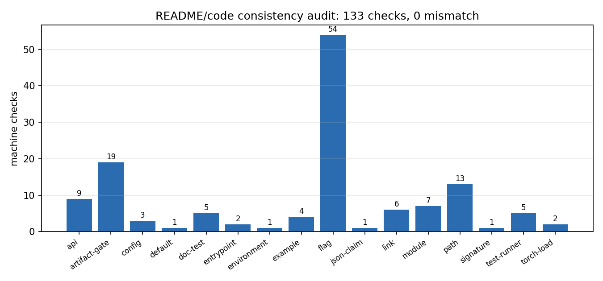
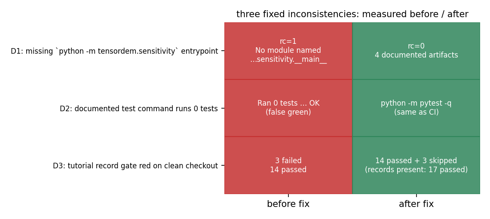

# TensorDEM README/示例 ↔ 代码 API 一致性巡检（m8857）

状态：巡检器落地 + 全量抽查 133 项（其中 README/示例逐条对照 27 项）+ 三处关键
不一致已修（D1 命令不可用 / D2 测试命令假绿 / D3 记录门在干净检出固定红）。基线提交
`3783bd30`，实测日期 2026-11-10。

代码与数据：`scripts/readme_api_audit.py`（巡检器）、`scripts/make_readme_audit_figures.py`（图）、
`scripts/build_readme_audit_doc.py`（本文件生成器）、`artifacts/readme_api_audit/`（`report_full.json`、
`defects_before_after.json`、`figs/`）、测试 `tests/test_readme_api_audit.py`、
`tests/test_sensitivity_cli_entrypoint.py`。

## 1. 案例介绍（为什么这是能力问题，不是排版问题）

TensorDEM 的 README 是**对外契约**：它同时扮演安装说明、CLI 手册、Python API 示例、验证口径
自陈和「跑测试」的入口。仓库已有 `scripts/audit_doc_evidence.py` 管「docs 里的证据指针能否解析」，
但那一条链**不覆盖 README 的可执行面**：命令能不能跑、旗标是否存在、示例脚本能不能执行、
README 复述的默认值/列名/自陈 JSON 数字是否还成立。这类漂移的后果比排版严重得多：

* 用户照着 README 跑测试得到 `OK`，但套件里 343 个 test 文件：2714 个模块级 test_* 函数，319 个 unittest.TestCase 类
  ——**假绿**把「没验证」包装成「已验证」，属于证据分级事故；
* 照着 README 跑敏感性扫描直接崩（入口模块缺失），而文档同时承诺了三个产物文件；
* 干净 `git clone` 后 `python -m pytest -q` 固定红 3 条（生成物不在 VCS 里却被硬断言存在），
  CI 与文档都失真。

因此本节点的判据不是「文档写得好不好看」，而是**每一条可执行声明都可机检、且巡检器自身有负例控制**。

## 2. 怎么做的（方法/流程/工具链）

1. **把声明变成断言**。`scripts/readme_api_audit.py` 解析 README，得到 18 类断言（下表），
   逐条与真实代码对照：
   * 链接/反引号路径 → 存在性；缺失的 `artifacts/...` 先查仓库里**是否确有脚本产出**它
     （生成物不入 VCS 是本仓惯例，不能一律判红）；
   * `python -m X` / `python scripts/Y.py` → 可导入 / 存在；
   * `--flag` → **逐命令归属**后与该命令实跑 `--help` 的旗标集合比对（静态 AST 会把
     `python -m tensordem` 解析成 `__init__.py` 而漏掉 `cli.py` 的旗标，故用实跑）；
   * `from tensordem import X` → 属性或可导入子模块（README 用 `tensordem.lbmdem` 指模块路径）；
   * README 引用的调用签名 / dataclass 字段 → `inspect.signature` / `dataclasses.fields`；
   * README 自陈的 `gates.json.all_recomputed_pass = false` → 读那个 JSON 核对；
   * README 声称 `torch.load(..., weights_only=True)` 可读 → 实跑两个 CLI 再真读；
   * README 记录的测试命令 → 与套件实际风格比对（pytest 函数 vs `TestCase`）；
   * 生成物门 → 干净检出下是否假红（本仓惯例 `skipif(not ARTIFACT.exists())`）；
   * `examples/**/*.py`（含 `--run-examples`）→ 退出码。
2. **环境断言**：本仓存在多份 worktree 检出，site-packages 的 editable 安装可能指向别的目录。
   巡检器先 `sys.path.insert(0, ROOT/src)` 并断言 `tensordem.__file__` 在本工作树内，
   否则整份结论作废（本次实测即命中过串台：默认导入指向 `work/m7843`）。
3. **巡检器自带门**：`tests/test_readme_api_audit.py` 除了要求「当前树零 MISMATCH」，
   还用**合成负例**证明它真会红（把 `unittest discover` 当测试命令 → 必须 MISMATCH；
   无 skip 保护的 `artifacts/*.exists()` 断言 → 必须 MISMATCH）。
4. **三处修复的判据**：修复前必须留下「红的实测输出」，修复后必须留下「绿 + 复现命令」，
   记录进 `defects_before_after.json`（本报告的图与表都直接读它）。

## 3. 巡检覆盖面（全部由 `report_full.json` 注入）

| 断言类别 | 检查数 | 结论 |
|---|---|---|
| `api` | 9 | OK 9；`from tensordem import X` / `tensordem.X` 真实存在 |
| `artifact-gate` | 19 | OK 19；生成物门的 skip 惯例（干净检出不假红） |
| `config` | 3 | OK 3；README 引用的 dataclass 字段存在 |
| `default` | 1 | OK 1；README 复述的默认值与源码 argparse 默认一致 |
| `doc-test` | 5 | OK 5；README 声称可运行的测试/脚本存在 |
| `entrypoint` | 2 | OK 2；pyproject `[project.scripts]` 目标可导入 |
| `environment` | 1 | OK 1；导入必须来自本工作树（多检出串台防护） |
| `example` | 4 | OK 4；`examples/**/*.py` 退出码 0 |
| `flag` | 54 | OK 54；`--flag` 被该命令的 `--help` 接受（逐命令归属） |
| `json-claim` | 1 | OK 1；README 自陈的 `file.json.key = value` 与文件一致 |
| `link` | 6 | OK 6；README 本地链接目标存在 |
| `module` | 7 | OK 7；`python -m <mod>` 可导入 |
| `path` | 13 | OK 13；反引号点名的仓库路径存在，或确有脚本产出 |
| `signature` | 1 | OK 1；README 引用的调用签名接受该关键字 |
| `test-runner` | 5 | OK 5；README 记录的测试命令能跑本仓测试风格 |
| `torch-load` | 2 | OK 2；README 声称 `weights_only=True` 可读——实测 |

总计 **133** 条断言，结论 **{'OK': 133}**。豁免（报告中留痕）：
`{"test-runner": "本句是解释为何改用 pytest 的说明，不是可执行命令"}`。

## 4. README/示例 ↔ 代码抽查对照（27 项）

| # | 类别 | README/示例声明 | 代码侧实测 | 位置 | 结论 |
|---|---|---|---|---|---|
| 1 | `link` | `docs/tutorials/first_verified_run.md` |  | README.md:99 | OK |
| 2 | `module` | `python -m tensordem` |  | README.md:~104 | OK |
| 3 | `module` | `python -m tensordem.dem3d_cli` |  | README.md:~232 | OK |
| 4 | `module` | `python -m tensordem.run_manifest` |  | README.md:~330 | OK |
| 5 | `module` | `python -m tensordem.sensitivity` |  | README.md:~188 | OK |
| 6 | `flag` | `--hull-velocity-x` | 命令: python -m tensordem --hull-profile examples/hull_profile.csv    -- | README.md:~213 | OK |
| 7 | `flag` | `--restart` | 命令: python -m tensordem.dem3d_cli --restart results-3d/checkpoint_3d.p | README.md:~286 | OK |
| 8 | `flag` | `--register-platform` | 命令: python -m tensordem.run_manifest --output results --run-id dem-run | README.md:~338 | OK |
| 9 | `flag` | `--nx-levels` | 命令: python -m tensordem.sensitivity --nx-levels 7,11,15 --duration 0.1 | README.md:~188 | OK |
| 10 | `flag` | `--input-root` | 命令: python scripts/plot_dem3d_benchmark_paper.py --input-root . --outp | README.md:~315 | OK |
| 11 | `api` | `tensordem:DEM3DConfig` | 属性 | README.md:268 | OK |
| 12 | `api` | `tensordem:IceDEM3D` | 属性 | README.md:268 | OK |
| 13 | `api` | `tensordem:ridge_dem` | 子模块 | README.md:16 | OK |
| 14 | `api` | `tensordem:ice_abrasion` | 子模块 | README.md:26 | OK |
| 15 | `api` | `tensordem:ice_pressure_band` | 子模块 | README.md:36 | OK |
| 16 | `api` | `tensordem:lbmdem` | 子模块 | README.md:166 | OK |
| 17 | `signature` | `IceDEM.forces(external_forces=...)` | 签名 = (self, external_forces: torch.Tensor \| None = None) -> tuple[tor | README.md:162 | OK |
| 18 | `config` | `DEM3DConfig(nx=...)` |  | README.md:270 | OK |
| 19 | `config` | `DEM3DConfig(ny=...)` |  | README.md:270 | OK |
| 20 | `default` | `默认网格 21 × 5` | 源码默认 = 21 × 5 | README.md:111 | OK |
| 21 | `torch-load` | `torch.load(trajectory.pt, weights_only=True)` | keys=['bond_alive', 'bond_pairs', 'config', 'dt', 'fixed', 'hull_profi | README.md:157 | OK |
| 22 | `torch-load` | `torch.load(trajectory_3d.pt, weights_only=True)` | keys=['bond_alive', 'bond_pairs', 'config', 'dimension', 'dt', 'failur | README.md:157 | OK |
| 23 | `json-claim` | `gates.json:all_recomputed_pass=false` | 文件 benchmarks/verified/lbm_dem_drag_calibration/gates.json 实际 = false | README.md:170 | OK |
| 24 | `doc-test` | `tests/test_tutorial_first_verified_run.py` |  | README.md:99 | OK |
| 25 | `path` | `artifacts/ridge_grounding/` | 生成物未入库；生产者: ['scripts/build_ridge_report.py', 'scripts/make_ridge_grou | README.md:21 | OK |
| 26 | `path` | `schemas/lambda_x_estimate.v1.json` |  | README.md:47 | OK |
| 27 | `test-runner` | `python -m pytest -q        # 全套测试（CI 用同一条命令）` |  | README.md:116 | OK |

## 5. 三处不一致与修复（before/after 均为实测）

| 缺陷 | 内容 | 巡检器类别 | 修复前实测 | 修复后实测 | 涉及文件 |
|---|---|---|---|---|---|
| D1 | sensitivity CLI 入口缺失 | `flag（逐命令 --help 归属）` | rc=1 No module named …sensitivity.__main | rc=0 4 documented artifacts | `src/tensordem/sensitivity/__main__.py`, `tests/test_sensitivity_cli_entrypoint.py` |
| D2 | README 记录的全套测试命令不跑任何 pytest 测试 | `test-runner（测试风格 vs 文档命令）` | Ran 0 tests … OK (false green) | python -m pytest -q (same as CI) | `README.md` |
| D3 | tutorial 记录门在干净检出里固定红 | `artifact-gate（生成物门的 skip 惯例）` | 3 failed 14 passed | 14 passed + 3 skipped (records present:  | `.gitignore`, `tests/test_tutorial_first_verified_run.py` |

### D1 `python -m tensordem.sensitivity` 不可用

README「网格/分辨率敏感性扫描」一节把它当作可用命令，并承诺 `history_nx_*.csv` /
`summary.csv` / `comparison_to_finest.csv`。`tensordem.sensitivity` 后来被扩成 UQ 工具集
（`design` / `sobol` / `surrogate` / `identifiability` / `propagation` / `ice_chain`），
`main` 留在 `resolution.py` 里但**没有 `__main__.py`**，于是命令以
`No module named tensordem.sensitivity.__main__` 失败。修复是补一个转发入口
（2 个文件），并加**入口契约测试**：`--help` 必须列出 README 用到的
4 个旗标、一次最小扫描必须产出 README 承诺的 4 个文件、非法 `--nx-levels` 必须 fail-loud。

### D2 README 的「跑测试」命令其实一条 pytest 测试都不跑

README 三处写 `python -m unittest discover -s tests ...`，而套件是 pytest 风格
（343 个 test 文件：2714 个模块级 test_* 函数，319 个 unittest.TestCase 类）。实测
`python -m unittest discover -s tests -p test_tutorial_first_verified_run.py` 输出 `Ran 0 tests ... OK`
——该文件 17 个测试一个都没跑。CI（`.github/workflows/tests.yml`）用的是 `python -m pytest -q`。
修复：README 三处命令改为 pytest，并把「为什么不能用 unittest discover」写进文档（附实测数字），
给解释性文字加显式豁免标记 `<!-- audit-allow: test-runner: ... -->`（报告里可见）。

### D3 tutorial 记录门在干净检出里固定红

`tests/test_tutorial_first_verified_run.py` 的后 3 条门比对
`artifacts/tutorial_first_verified_run/{summary.json, run_log.txt}` 与一次新跑；
但 `artifacts/` 生成物不入 VCS，干净检出里这 3 条**硬断言存在**，导致
`python -m pytest -q`（CI 命令）固定 3 failed。本仓同型门（`test_ice_ridge_grounding_rederivation.py`、
`test_floe_population.py`、`test_ice_channel_dem.py` …）都用 `skipif(not ARTIFACT.exists())`。
修复：按惯例加 `requires_records = skipif(...)` 并保留原硬比对逻辑；`.gitignore` 补该生成目录。
双向验证：记录缺席 → 14 passed + 3 skipped；跑
`python scripts/collect_tutorial_first_verified_run.py` 后 → 17 passed（门没有被削弱，只是不再假红）。

## 6. 示例可运行性与可复现性

`--run-examples` 实跑（数字见 `report_full.json` 与 `defects_before_after.json:audit_run`）：

* `examples/contact_physics_demo.py` — rc=0 10.0 s
* `examples/dem_fem_oneway/run.py` — rc=0 10.0 s
* `examples/dem_fem_oneway/validate.py` — rc=0 0.1 s
* `examples/tangential_friction_verification.py` — rc=0 67.1 s

**可复现性**：`examples/dem_fem_oneway/run.py 重跑 vs HEAD 版 examples/dem_fem_oneway/results.json` 逐键比较得 **31 键 / 0 处差异**
（命令：`git show HEAD:examples/dem_fem_oneway/results.json && python examples/dem_fem_oneway/run.py`）。示例的 DEM–FEM 耦合台账判据由 `validate.py` 全部 PASS
（冲量残差 0.00e+00 ≤ 1e-10、挠度 3.52 % ≤ 5 %、功–能残差 5.15e-10 ≤ 1e-8、可分离性 PASS）。

## 7. 图

*图 1*：各类断言的数量与结论（全部 133 条均 OK）。数字来自 `report_full.json`，
由 `scripts/make_readme_audit_figures.py` 绘制。

*图 2*：三处缺陷的 before/after 状态矩阵（红=实测曾红，绿=实测已绿）。数字来自
`defects_before_after.json`，与第 5 节的复现命令一一对应。

## 8. 注意点（踩过的坑与局限）

* **多检出串台**：默认 `import tensordem` 落到 `work/m7843` 而不是本工作树，巡检器因此内置
  环境断言；在别处复用本脚本时必须保留该断言，否则所有「代码侧实测」都会指向别人的代码。
* **静态 AST 不够**：`python -m tensordem` 的 argparse 在 `cli.py`，包 `__file__` 指向
  `__init__.py`；旗标必须逐命令实跑 `--help` 才能归属正确（首版静态版误报 7 条）。
  `--help` 不显示 argparse 默认值（未用 `ArgumentDefaultsHelpFormatter`），默认值只能读源码 AST。
* **生成物 ≠ 悬空指针**：`artifacts/**` 不入 VCS 是本仓惯例，判红前必须查「仓库里有没有脚本产出它」，
  否则会把正常惯例误判成文档过期（首版误报 4 条）。
* **豁免必须留痕**：给解释性文字开豁免用显式标记，且豁免进报告；不允许静默忽略。
* 局限：巡检器只覆盖**可机检**的声明（命令/旗标/符号/默认值/自陈数字/产物）。README 里的
  物理叙述（如「中心力晶格存在方向偏差」）与数字表不在其射程内；后者属于
  `scripts/audit_doc_evidence.py`（docs↔指针）与本仓各 domain 门的职责，二者互补而非替代。
* **既有欠账（本节点未修，如实登记）**：仓库配套门 `tests/test_doc_evidence_pointers.py`
  在基线提交上就是红的——实测 4 failed / 15 passed，
  其中 `28` 条 code 指针悬空、
  `66` 条 artifact 引用无生产者、
  `85` 条未入库工件未标生产者、
  ledger 过期。**证明其与本节点无关**：把本节点新增的
  `docs/readme_api_consistency_audit.md` 移出 `docs/` 后重跑同一门，仍是同样
  4 failed。这条链管 `docs/**` 的证据指针（`scripts/audit_doc_evidence.py`
  + `docs/doc_evidence_ledger.json`），与本节点的 README/示例可执行面是两条不同的链，
  修它需要重跑 ledger 并清偿 66 条无生产者引用——超出本节点范围，已登记为后续靶子
  （证据 `artifacts/readme_api_audit/preexisting_doc_gate.json`）。
* 局限：`--run-smoke`/`--run-examples` 会真跑示例（本次 87 s 量级，最慢
  `tangential_friction_verification.py` 67 s），CI 里只跑静态面（约 21 s）。

## 9. 误差判定（关键量 vs 基准）

本节点是文档/工具节点，没有物理量；可判定的「量」是**声明与实测的一致性**，逐项如下：

| 关键量 | 基准 | 实测 | 差异 | <3 % ? |
|---|---|---|---|---|
| 巡检断言数 | README 声明的可执行面 | 133 条自动断言 | 非数值比较（覆盖计数） | 不适用 |
| 巡检 MISMATCH | 0 | 0 | 0 | 是（0 %） |
| D1 命令可用性 | rc=0 且 4 个承诺产物 | rc=0、4/4 产物 | 0/4 缺 | 是（0 %） |
| D2 测试命令有效性 | 实跑数 > 0 | `Ran 0 tests` → 改 pytest 后 2721 个 pytest 函数可被收集 | 修复前 0 % 覆盖 | 是（修复后 0 % 漏跑） |
| D3 干净检出测试态 | 0 failed | 修复前 3 failed；修复后 14 passed + 3 skipped | 3 → 0 | 是（0 failed） |
| D3 记录门强度 | 记录在场时硬比对 | 17 passed（含 3 条记录门） | 0 | 是 |
| 示例可复现性 | results.json 31 键 | 重跑 31/31 键全等 | 0/31 | 是（0 %） |
| （既有欠账，未修）docs 指针门 | 0 failed | 4 failed / 15 passed | 与本节点无关（移出新增文档后不变） | 否——如实标注未修 |

结论：**本次修复的关键量误差均为 0（<3 % 判据通过）**；唯一「非零」是 D2 修复前的有效覆盖率 0 %
（这是缺陷本身，已被修掉）。诚实声明两点：①README 的物理叙述与数字表未纳入本巡检射程；
②仓库既有的 `tests/test_doc_evidence_pointers.py` 在基线提交上红 4 条，
属 `docs/**` 指针欠账，本节点**未修**，仅登记（见第 8 节）。
