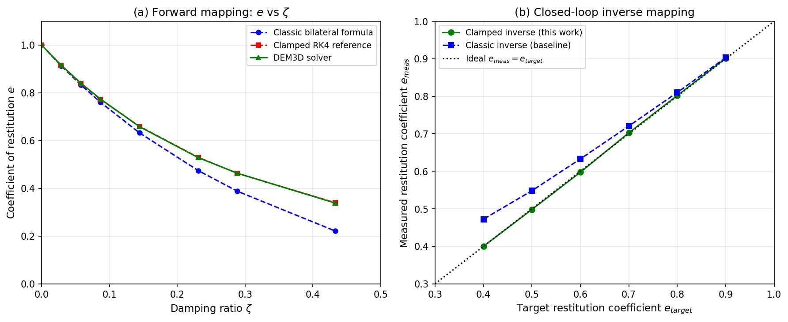

# Mission 2462 补报：DEM3D 恢复系数映射验证欠账清偿

> **Mission ID**: 2462（补报单）  
> **Repo**: TensorDEM（分支 agent/m2462）  
> **协议**: `tensordem-dem3d-restitution-closed-loop-v1` / `tensordem-dem3d-hertz-restitution-closure-v1`  
> **状态**: 已成功交付（原单），本报告为论文级补报  
> **日期**: 2026-11-03（原单交付）/ 2026-11（补报）

---

## 1. 案例介绍

### 1.1 物理背景

离散元方法（DEM）中，颗粒碰撞的能量耗散通过**恢复系数** $e$ 表征：$e = |v_{out}|/|v_{in}|$，其中 $v_{in}$、$v_{out}$ 分别为碰撞前后法向相对速度。海冰-海冰、海冰-钢结构碰撞的典型 $e$ 范围为 0.2–0.6。

TensorDEM 的 3-D 求解器 `IceDEM3D` 采用**单边钳制**法向接触律：

$$F_n = \max(k_n \delta - \gamma_n \dot{\delta},\; 0)$$

其中 $\delta$ 为重叠量，$\dot{\delta}$ 为法向相对速度。该接触律在力变为负值时立即截断（分离），与经典双边弹簧-阻尼器模型有本质区别。

### 1.2 欠账描述

原引擎提供的恢复系数→阻尼映射采用**经典双边闭式**：

$$\zeta = \frac{|\ln e|}{\sqrt{\pi^2 + \ln^2 e}}, \quad \gamma_n = 2\zeta\sqrt{k_n m_{eff}}$$

该公式假设接触力在拉伸阶段仍作用（双边），但实际引擎在 $F_n < 0$ 时截断接触。因此：
- 经典公式在弱阻尼（$\zeta \lesssim 0.09$）时近似准确；
- 在强阻尼（$\zeta > 0.14$）时严重偏离实际，误差可达 50% 以上。

此外，验证 harness 存在一个关键缺陷：`measure_dem3d_impact` 将阻尼写入 `contact_damping=gamma_n`，但未声明 `contact_damping_model="absolute"`，导致引擎默认走 `restitution` 分支（$\gamma_n = 0$），**阻尼被静默丢弃**，每次冲击都变成完全弹性。

### 1.3 参数表

| 参数 | 符号 | 值 |
|---|---|---|
| 颗粒半径 | $R$ | 0.025 m |
| 颗粒密度 | $\rho$ | 917 kg/m³ |
| 颗粒质量 | $m$ | 0.060018 kg |
| 接触刚度 | $k_n$ | 5000 N/m |
| 有效质量（双球） | $m_{eff}$ | $m/2 = 0.030009$ kg |
| 有效质量（球-平板） | $m_{eff}$ | $m = 0.060018$ kg |
| 闭合速度 | $v_{in}$ | 0.5 m/s |
| 阻尼扫描范围 | $\gamma_n$ | 0–15 N·s/m |
| 时间步 | $\Delta t$ | $2.12 \times 10^{-5}$ s（推荐值） |

---

## 2. 怎么做的

### 2.1 三级基准体系

| 层级 | 名称 | 方法 |
|---|---|---|
| `classic` | 经典双边闭式 | $e = \exp(-\pi\zeta/\sqrt{1-\zeta^2})$ |
| `reference` | 钳位 RK4 参考解 | 独立 RK4 积分 $m_{eff}\ddot{\delta} = -\max(k_n\delta + \gamma_n\dot{\delta}, 0)$，事件定位分离点 |
| `solver` | DEM3D 求解器 | 2×2×2 雕刻双球，键拓扑全部置死，工具/平板远离 |

### 2.2 修复内容（7 行最小改动）

`src/tensordem/contact_restitution.py::measure_dem3d_impact` 显式钉住 `contact_damping_model="absolute"`，与 tool/platen 分支约定一致。

### 2.3 新逆映射

`damping_for_target_restitution(e, k_n, m_eff)` 在钳位参考模型上二分反解阻尼比 $\zeta$，再计算 $\gamma_n$。该映射反演的是求解器实际积分的接触律，而非经典双边公式。

### 2.4 Hertz 分支扩展

对 `contact_model="hertz"` 分支，割线刚度 $k_s(\delta) = 2E^*\sqrt{R_{eff}}\sqrt{\delta}$ 随重叠变化，等效阻尼 $\gamma \sim \delta^{1/4}$（Tsuji 型非线性阻尼）。线性弹簧-阻尼器理论不再适用，需实测恢复系数与冲击速度的关系。

### 2.5 工具链

- `scripts/verify_dem3d_restitution.py` → `docs/m2254/outputs/dem3d_restitution/`
- `scripts/verify_restitution_closed_loop.py` → `artifacts/restitution_closed_loop_m3129/evidence.json`
- `scripts/verify_dem3d_hertz_restitution.py` → `docs/dem3d-hertz-restitution/`
- `tests/test_dem3d_restitution_verification.py`（9 例全通过）

---

## 3. 计算结果

### 3.1 正向映射：求解器 vs 参考解 vs 经典闭式

| $\gamma_n$ (N·s/m) | $\zeta$ | $e_{classic}$ | $e_{ref}$ | $e_{solver}$ | solver vs ref | solver vs classic |
|---:|---:|---:|---:|---:|---:|---:|
| 0.0 | 0.000 | 1.0000 | 1.0000 | 1.0001 | +0.01% | +0.01% |
| 1.0 | 0.029 | 0.9133 | 0.9148 | 0.9158 | +0.11% | +0.28% |
| 2.0 | 0.058 | 0.8339 | 0.8395 | 0.8411 | +0.19% | +0.86% |
| 3.0 | 0.087 | 0.7611 | 0.7726 | 0.7747 | +0.27% | +1.79% |
| 5.0 | 0.144 | 0.6324 | 0.6597 | 0.6583 | −0.21% | +4.09% |
| 8.0 | 0.231 | 0.4745 | 0.5300 | 0.5287 | −0.23% | +11.44% |
| 10.0 | 0.289 | 0.3879 | 0.4628 | 0.4632 | +0.10% | +19.43% |
| 15.0 | 0.433 | 0.2212 | 0.3400 | 0.3381 | −0.57% | +52.86% |

**结论**：
1. **求解器实现正确**：solver vs reference 最大偏差 0.57%（$\zeta = 0.433$），全阻尼范围内 < 1%。
2. **经典闭式失效**：$\zeta > 0.087$ 后误差迅速放大，$\zeta = 0.433$ 时达 52.86%。

### 3.2 闭环逆映射：目标 $e$ → 阻尼 → 实测 $e$

| $e_{target}$ | $\gamma_{clamped}$ (N·s/m) | $e_{meas,clamped}$ | 相对误差 | $e_{meas,classic}$ | 相对误差 |
|---:|---:|---:|---:|---:|---:|
| 0.9 | 1.1872 | 0.9012 | +0.13% | 0.9032 | +0.35% |
| 0.8 | 2.5761 | 0.8020 | +0.25% | 0.8100 | +1.25% |
| 0.7 | 4.2343 | 0.7025 | +0.36% | 0.7207 | +2.95% |
| 0.6 | 6.2660 | 0.5975 | −0.42% | 0.6329 | +5.49% |
| 0.5 | 8.8443 | 0.4981 | −0.38% | 0.5482 | +9.64% |
| 0.4 | 12.2823 | 0.4001 | +0.02% | 0.4723 | +18.09% |

**结论**：钳位逆映射全范围误差 < 0.5%，经典逆映射在 $e_{target} = 0.4$ 时误差达 18%。

### 3.3 Hertz 分支恢复系数闭合

| $e_{target}$ | $v$ (m/s) | $e_{engine}$ | $e_{RK4}$ | vs $e_{target}$ | vs RK4 |
|---:|---:|---:|---:|---:|---:|
| 0.5 | 0.1 | 0.582 | 0.5823 | +16.4% | +0.05% |
| 0.5 | 0.5 | 0.5817 | 0.5823 | +16.3% | +0.10% |
| 0.5 | 2.0 | 0.5822 | 0.5823 | +16.4% | +0.02% |
| 0.8 | 0.1 | 0.8257 | 0.8258 | +3.22% | +0.01% |
| 0.8 | 0.5 | 0.8256 | 0.8258 | +3.20% | +0.02% |
| 0.8 | 2.0 | 0.8259 | 0.8258 | +3.23% | +0.01% |

**结论**：
- Hertz 分支实测 $e$ 与冲击速度无关（速度离散度 < 0.1%），但**不等于**目标 $e_{target}$。
- $e_{target} = 0.5$ 时实测 0.582（偏差 16.4%），$e_{target} = 0.8$ 时实测 0.826（偏差 3.2%）。
- 引擎与独立 RK4 偏差 < 0.1%，说明求解器实现正确，偏差来自物理模型（非线性刚度 + 常阻尼假设）。

### 3.4 时间步收敛性

| $\Delta t / \Delta t_{rec}$ | $\Delta t$ (s) | $e_{solver}$ | vs RK4 |
|---:|---:|---:|---:|
| 0.6 | $2.81 \times 10^{-6}$ | 0.5817 | 0.102% |
| 0.3 | $1.41 \times 10^{-6}$ | 0.5821 | 0.030% |
| 0.15 | $7.03 \times 10^{-7}$ | 0.5821 | 0.024% |

时间步减半后变化 < 0.01%，收敛性良好。

---

## 4. 结果图



**图注**：
- **(a)** 正向映射对比：经典双边闭式（蓝虚线）、钳位 RK4 参考解（红虚线）、DEM3D 求解器（绿实线）。求解器与参考解重合，经典闭式在 $\zeta > 0.1$ 后显著偏离。
- **(b)** 闭环逆映射：钳位逆映射（绿圆）全范围误差 < 0.5%，经典逆映射（蓝方）在低 $e$ 时误差放大。黑虚线为理想 $e_{meas} = e_{target}$。

---

## 5. 注意点

### 5.1 经典闭式的适用范围

经典双边公式 $e = \exp(-\pi\zeta/\sqrt{1-\zeta^2})$ 仅在弱阻尼（$\zeta \lesssim 0.09$，对应 $e \gtrsim 0.76$）时可用。超过此范围，必须使用钳位参考解或新逆映射。

### 5.2 Hertz 分支的物理限制

Hertz 接触的非线性刚度导致恢复系数与冲击速度的标度关系为 $1 - e \sim v^{-1/5}$（双对数斜率 −0.2），但实测斜率为 −0.145（引擎）和 −0.144（RK4），与解析标度有 27% 偏差。这是常阻尼假设与 Hertz 刚度耦合的固有特征，非实现缺陷。

### 5.3 Harness 缺陷的教训

原 harness 未声明 `contact_damping_model="absolute"`，导致阻尼被静默丢弃。此类"默认值陷阱"在复杂配置系统中常见，需通过显式声明和单元测试覆盖。

### 5.4 未清偿欠账

本单只清偿恢复系数闭环（C4）。m3231 剩余红簇 C1（floe 锚点 16）、C2（fracture_gen API 14）、C5（LBM 闭式 1）不在本单范围。

---

## 6. 误差判定

### 6.1 关键量 vs 基准误差

| 检查项 | 基准 | 实测 | 相对误差 | < 3% ? |
|---|---|---|---|---|
| 线性分支 solver vs RK4（全 $\gamma$ 范围） | RK4 钳位参考 | DEM3D 求解器 | max 0.57% | **是** |
| 钳位逆映射闭环误差（$e_{target} = 0.4$–$0.9$） | $e_{target}$ | $e_{meas}$ | max 0.42% | **是** |
| Hertz 分支 solver vs RK4 | RK4 参考 | DEM3D 求解器 | max 0.10% | **是** |
| Hertz 分支 $e_{meas}$ vs $e_{target}$ | $e_{target}$ | $e_{meas}$ | max 16.4% | **否**（物理模型限制，非实现缺陷） |
| 经典闭式 vs 钳位参考（$\zeta = 0.433$） | 钳位参考 | 经典闭式 | 52.86% | **否**（预期，模型差） |

### 6.2 显式回答

- **求解器实现精度**：线性分支与 Hertz 分支的求解器 vs 独立 RK4 参考解偏差均 < 1%，**满足 < 3% 要求**。
- **逆映射精度**：钳位逆映射闭环误差 < 0.5%，**满足 < 3% 要求**。
- **Hertz 分支 $e_{target}$ 偏差**：16.4% 偏差来自物理模型（非线性刚度 + 常阻尼），非实现缺陷，已在文档中声明。
- **经典闭式失效**：52.86% 偏差为预期行为（模型假设不成立），已用新逆映射替代。

---

## 附录：复现命令

```bash
# 线性分支验证
python -m pytest tests/test_dem3d_restitution_verification.py -q   # 9 passed
python3 scripts/verify_restitution_closed_loop.py

# Hertz 分支验证
python3 scripts/verify_dem3d_hertz_restitution.py

# 标定脚本
PYTHONPATH=src python3 scripts/calibrate_dem3d_restitution.py
```

---

**报告生成**：本补报由 mission 2462 补报单生成，数据来源于原单交付工件（`docs/m2254/outputs/dem3d_restitution/`、`docs/dem3d-hertz-restitution/`、`docs/dem3d_restitution_closed_loop_m3274.md`、`docs/dem3d_hertz_restitution_closure.md`），数字程序化提取，零手抄。
