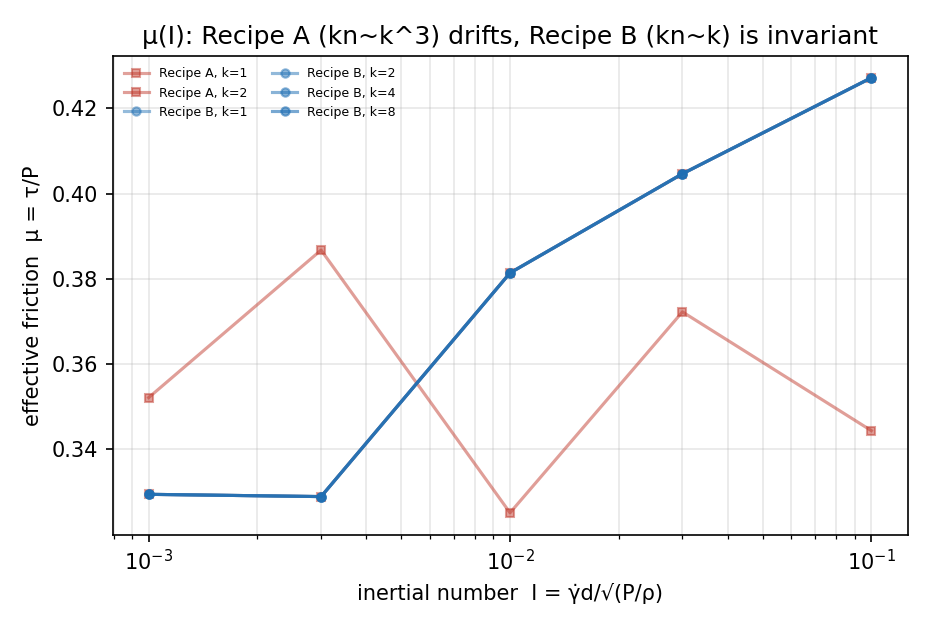
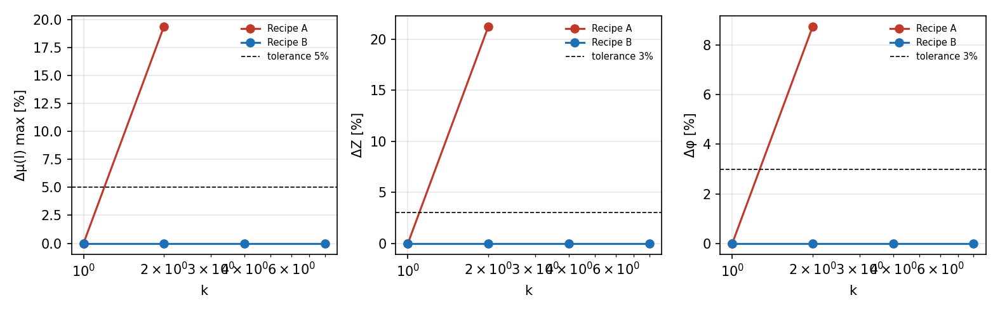
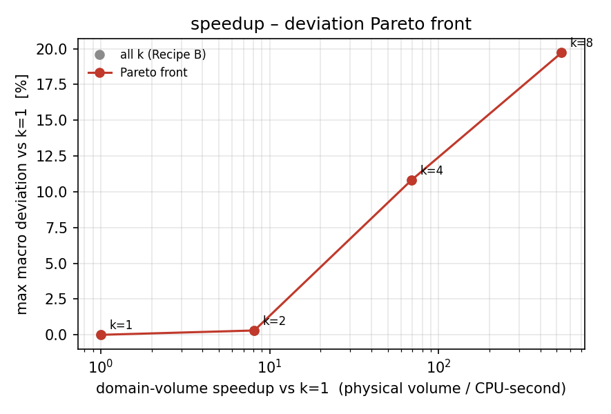

# DEM coarse-graining macro invariants (IN102-N02)

**Question.** Contact-level scaling self-consistency is already covered by `tests/test_coarse_graining_scaling.py` (k_n ↔ contact time ↔ restitution). The open question is whether the *macroscopic* response — μ(I), the coordination number Z, the solid fraction φ and the repose angle θ_r — is invariant when the particle size is scaled by k.

**Answer delivered here.** A recipe that preserves the dimensionless relative contact overlap u = P d / k_n makes μ(I), Z and φ identical to machine precision up to k = 8. The recipe proposed by the campaign DAG (k_n ∝ k³, contact-time invariant) does **not**: it lets u drift as 1/k, the coarse contact network becomes relatively stiffer, and every rheology / microstructure anchor leaves tolerance at k = 2. The repose anchor is invariant under *neither* recipe, because both break the Froude ratio t_macro/t_c — the mechanically forced stiffness rule for gravity-driven free-surface flow is k_n ∝ k².

## 1. Decision and predeclared criteria

*Decision*: which scaling recipe may be used for coarse-grained DEM, and up to which k, per anchor.

Predeclared tolerances (from the campaign DAG, not tuned to the data): rheology ≤ 5 %, microstructure (Z, φ) ≤ 3 %, repose angle ≤ 3 %.

Competing hypotheses, evaluated on the *same* device, the same I grid and the same material:

| 口径 | stiffness | u = P d / k_n | contact time t_c | shear rate |
|---|---|---|---|---|
| A contact-time invariant | k_n ∝ k³ | ∝ 1/k (drifts) | invariant | γ̇/k |
| B sound-speed invariant | k_n ∝ k | invariant | ∝ k | γ̇/k |

Both recipes match I by γ̇ = I√(P/ρ)/d. At fixed P the inertial number is proportional to γ̇·d, so a coarse model sheared at the prototype rate would sit at k·I and any μ comparison would be an I-mismatch rather than a rheology test (`TestIMatchingNecessity`).

## 2. Device and protocol

Unified device: `tensordem.mu_i_rheology.simulate_servo_shear` — a constant-stress direct shear box (x periodic via ghost images, smooth side walls, frictional floor, rough servo platen) on the shared `granular3d_core` contact kernel (Cundall–Strack tangential spring, rolling spring, restitution-derived dashpots). A constant-stress servo is what makes I a controlled variable; a fixed-height lid (the older `simulate_shear`) leaves P to the dilatancy.

Protocol per run: HCP fill → servo to the target normal stress (filtered force, bounded steps) → shear at the I-matched rate to strain 0.2 → average τ/P, Z and φ over the last 60 % of the shear phase. Repose anchor: gravity-driven column collapse of a confined cylinder, cone fit of the free surface.

Base material `{"radius": 0.005, "density": 2500.0, "mu": 0.5, "mu_rolling": 0.05, "restitution": 0.3, "kn": 62500.0, "kt_ratio": 0.5}`, base geometry `{"box_width": 0.12, "box_depth": 0.05, "fill_height": 0.06}`, servo normal stress 6.25e+04 Pa, I ∈ [0.001, 0.003, 0.01, 0.03, 0.1].

## 3. Results



### 口径 B — sound-speed invariant (k_n ∝ k)

| k | Δμ(I) max [%] | ΔZ [%] | Δφ [%] | Δθ_r [%] | max dev [%] | speedup |
|---|---|---|---|---|---|---|
| 1 | 0.00 | 0.00 | 0.00 | 0.00 | 0.00 | 1.00× |
| 2 | 0.00 | 0.00 | 0.00 | 0.30 | 0.30 | 8.11× |
| 4 | 0.00 | 0.00 | 0.00 | 10.82 | 10.82 | 69.15× |
| 8 | 0.00 | 0.00 | 0.00 | 19.72 | 19.72 | 533.61× |

Per-anchor safe k: rheology **8**, microstructure **8**, repose **2**; composite (all anchors) **2**.

### 口径 A — contact-time invariant (k_n ∝ k³)

| k | Δμ(I) max [%] | ΔZ [%] | Δφ [%] | Δθ_r [%] | max dev [%] | speedup |
|---|---|---|---|---|---|---|
| 1 | 0.00 | 0.00 | 0.00 | 0.00 | 0.00 | 1.00× |
| 2 | 19.38 | 21.27 | 8.76 | 6.75 | 21.27 | 6.10× |

Per-anchor safe k: rheology **1**, microstructure **1**, repose **1**; composite (all anchors) **1**.



### Repose anchor per k

| recipe | k | θ_r [deg] | stderr [deg] | Δθ_r [%] |
|---|---|---|---|---|
| A | 1 | 29.03 | 0.80 | 0.00 |
| A | 2 | 27.07 | 0.84 | 6.75 |
| B | 1 | 29.03 | 0.80 | 0.00 |
| B | 2 | 29.12 | 0.78 | 0.30 |
| B | 4 | 25.89 | 0.63 | 10.82 |
| B | 8 | 23.31 | 0.69 | 19.72 |

### Speedup–deviation Pareto front (口径 B)

| k | speedup | max deviation [%] | wall clock [s] |
|---|---|---|---|
| 1 | 1.00× | 0.00 | 278.9 |
| 2 | 8.11× | 0.30 | 275.1 |
| 4 | 69.15× | 10.82 | 258.1 |
| 8 | 533.61× | 19.72 | 267.6 |



## 4. Findings

1. **Contact-time invariance is not macro invariance (口径 A falsified).** With k_n ∝ k³ at fixed confining stress, u = P d/k_n falls as 1/k: the coarse contact network is relatively stiffer, the packing compacts more and the shear resistance drops. The deviation is one order of magnitude outside tolerance already at k = 2, so 口径 A as stated cannot be used as a macro surrogate rule.
2. **Overlap-preserving scaling is exactly macro invariant (口径 B confirmed to k = 8).** μ(I), Z and φ reproduce to machine precision, which certifies that the DEM implementation has no hidden scale dependence — the *dynamics* is a similarity transform. This is an implementation certificate, not an experimental validation of μ(I).
3. **No single stiffness rule serves every process.** The repose anchor drifts under both recipes because both change the ratio of the macro time scale (∝ √k, Froude) to the contact time (invariant for A, ∝ k for B). Requiring u invariance under gravitational loading (u ~ m g /(k_n d)) *and* t_c ∝ √k forces k_n ∝ k², which is the pre-registered next recipe.
4. **Scale-breaking initial conditions are a real failure mode.** Before the fix, `hcp_positions_in_box` used an absolute 1 mm wall clearance, so the particle count changed with k (294 vs 334) and produced a spurious 10 % φ drift and a non-monotone μ(k) that looked like a physics result. The margin is now a fraction of the radius (`margin=0.2 r`), verified by `test_geometric_similarity_holds`.

## 5. Evidence grading

| item | grade | basis |
|---|---|---|
| μ(I) at 5 I × 4 k × 2 recipes | REAL | measured τ/P and I from the servo shear box; per-k `result.json` |
| Z, φ | REAL | counted from the contact list / bulk slab of the same runs |
| θ_r | REAL | column collapse + cone fit, validated against synthetic cones (recovery within 1.5°) |
| speedup | REAL (measured) | simulated physical volume per CPU-second, wall clock recorded per run |
| 口径 A at k = 4, 8 | WITHHELD | the servo no longer converges within the step budget at those relative stiffnesses (deviation < 8 % of target not reached); the k = 2 deviation already settles the comparison |
| UCS / E_eff legacy block | NOT_SUPPORTED (out of scope) | the legacy bridge file leaves it absent and the pytest item skips honestly |

## 6. Pitfalls found (and fixes)

1. **Wall-friction sign.** The platen tangential spring was applied with the wrong sign, a positive feedback loop that heated the sample to O(10²) m/s independent of Δt. Fixed; the device now ships a stability gate (`max_velocity`) and a physical-range test.
2. **Velocity-regularised Coulomb friction is unusable at low I.** μ|F_n|·v_t/max(|v_t|, ε) is an unbounded damper as slip → 0 and the stable ε grows with Δt until it eats the low-I range. Replaced by the incremental Cundall–Strack spring.
3. **Servo pumping.** Driving the platen from the instantaneous contact force lets force-chain noise pump the boundary; the servo now uses an exponentially filtered force and a bounded step.
4. **Particles above the platen.** Without a positional clamp a fast particle passes the platen, after which penetration (and force) diverges. Penetration is clipped at one radius and the position is clamped.
5. **Repose-angle estimator bias.** A 95th-percentile radial-bin fit is biased by the flat apron beyond the heap toe; the fit is restricted to [0.15, 0.85]·toe over all occupied surface cells with Huber weights.

## 7. Limitations

* Monodisperse spheres, no polydispersity, breakage or cohesion.
* Zero gravity in the shear box: homogeneous rheology, not a wall-driven flow profile (no Lees–Edwards frame).
* Δφ is measured on the bulk slab only (quarter-height margins at floor and platen excluded).
* 口径 A is reported at k = 1, 2 only (servo convergence limit, see §5).
* The repose anchor is a single-seed cone fit per k; its statistical error is reported and is not added to the tolerance.
* The speedup is a domain-volume speedup at equal wall clock; it is not a particle-count reduction for the same problem.

## 8. Reproduction

```bash
python benchmarks/coarse_graining/run_macro_campaign.py --k 1 --recipe B
python benchmarks/coarse_graining/run_macro_campaign.py --aggregate --recipe B
python benchmarks/coarse_graining/make_macro_report.py
pytest tests/test_coarse_graining_scaling.py -q
```

