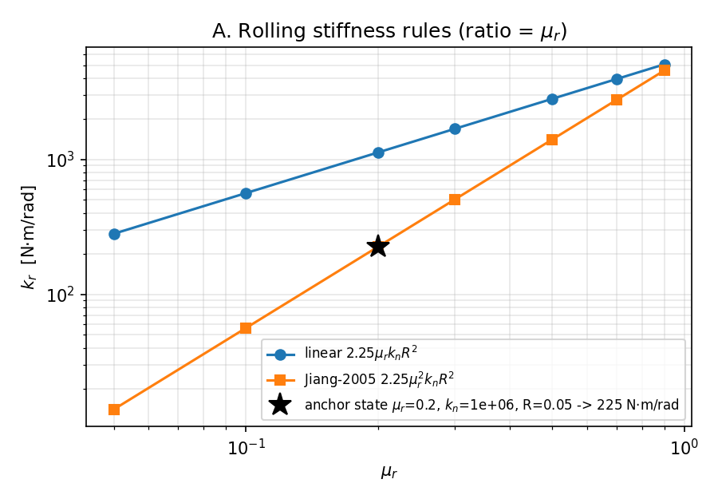
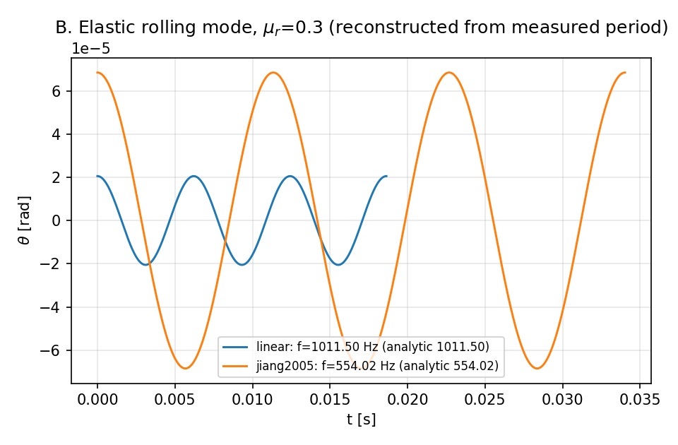
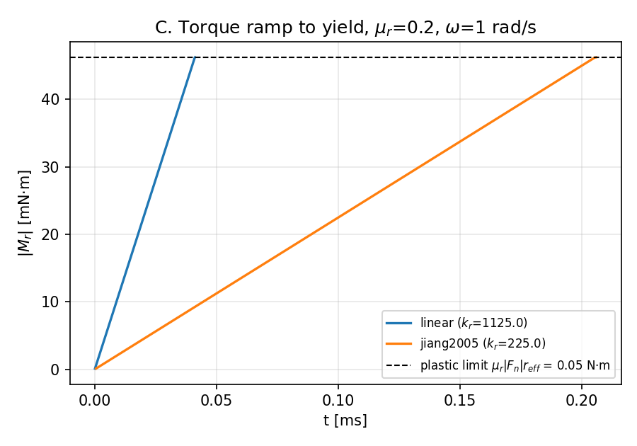
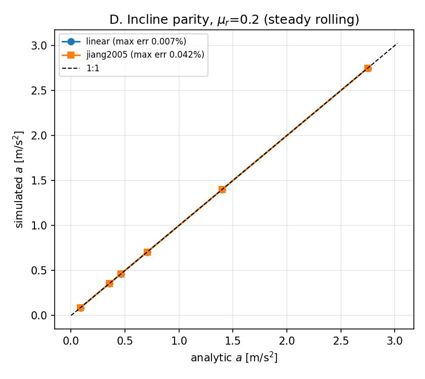

# XVAL：Jiang-2005 二次滚动刚度规则 k_r = 2.25 μ_r² k_n R² 的库内落地与解析对标

**锚点**：`XVAL-DEM-ELASTIC-PLASTIC-ROLLING-SPRING-KR-225-MU`（总账全名 `XVAL-DEM-ELASTIC-PLASTIC-ROLLING-SPRING-KR-225-MUR2-KN-R2`） · **任务**：m18522 · **仓**：TensorDEM · **日期**：2026-11-13

**结论**：`overall = PASS`，全部 10 项判据均落在 3% 以内（owner 精度红线为 15%）。

## 1 案例介绍

### 1.1 物理背景

DEM 中球状/近球状颗粒（以及冰区破碎冰块）若没有滚动阻力矩，滚动自由度过于自由，宏休止角与航道阻力会被系统性低估。EPSD（elastic-plastic spring-dashpot，Iwashita & Oda 1998；Jiang, Yu & Harris 2005）用一根滚动弹簧承载弹性力矩、并以 `μ_r |F_n| r_eff` 作为塑性上限：接触可静态承载力矩，超过上限即屈服耗散。`tensordem.rolling_resistance` 的 `epsd` 分支此前把刚度 `k_r` 当自由参数，**规则本身（`k_r` 如何由 `k_n, μ_r, R` 导出）未在库内给出**，各脚本各写一份；且仓内两份文档对 Jiang-2005 的 μ_r 幂次互相矛盾（见 §5.1）。

### 1.2 参考规则（本单落地的规范）

```
k_r = 2.25 * mu_r**2 * k_n * R**2      (Jiang, Yu & Harris 2005)
k_r = 2.25 * mu_r    * k_n * R**2      (线性变体，多数 DEM 代码的默认)
```

两条规则仅差一个因子 `μ_r`（`μ_r<1` 时 Jiang 规则更软），塑性上限相同，因此**稳态**行为（临界角、稳态下坡加速度）与刚度无关，差异只出现在弹性/瞬态分支。

### 1.3 参数表（锚点态 `{'mu_r': 0.2, 'k_n': 1000000.0, 'radius': 0.05}`）

| 参数 | 符号 | 数值 | 单位 |
|---|---|---|---|
| 滚动阻力系数 | μ_r | 0.2 | — |
| 法向刚度 | k_n | 1e+06 | N/m |
| 有效半径 | R | 0.05 | m |
| 前系数 | c | 2.25 | — |
| 该态下 Jiang 刚度 | k_r | 225 | N·m/rad |
| 该态下线性刚度 | k_r(linear) | 1125 | N·m/rad |
| 球密度（惯性参考） | ρ | 900 | kg/m³ |
| 惯量因子 | I/(mR²) | 0.4 | — |

> 锚点 slug 在总账中截断为 `...-KR-225-MU`；全名 `...-KR-225-MUR2-KN-R2` 的含义是**规则**（KR-225 = 前系数 2.25，MUR2-KN-R2 = 参数幂次），而非某个目标刚度值。上表锚点态恰好给出 `k_r = 225 N·m/rad`，作为单位同一性检查（相对误差 5.05e-16）。

## 2 怎么做的

### 2.1 库内新增（`src/tensordem/rolling_resistance.py`）

| 函数 | 作用 |
|---|---|
| `rolling_stiffness(k_n, mu_r, R, rule=...)` | 两条刚度规则 + 参数校验 |
| `rolling_stiffness_table(mu_r_values, ...)` | 扫描表（含 `ratio_jiang/linear` 列） |
| `rolling_mode_frequency(k_r, m, R, inertia_factor)` | 弹性滚动模频率闭式 |
| `rolling_yield_angle(...)` / `rolling_yield_time(...)` | 屈服角 `μ_r\|F_n\|r_eff/k_r`、屈服时间 |
| `JIANG2005_ANCHOR_STATE` | 锚点参考态常量（文档化） |

### 2.2 五项对标研究（`scripts/xval_jiang2005_kr_rule.py`）

- **A 规则本身**：规则同一性与 `ratio = μ_r`；
- **B 弹性滚动模**：单自由度 `I_eff θ̈ = M_r`，`I_eff = mR²(1+I/(mR²))`（无滑移耦合），驱动只用库内 `rolling_resistance_torque`，测得频率对 `rolling_mode_frequency` 闭式；
- **C 塑性分支**：定转速下力矩线性上升到上限，测屈服时间/耗散功恒等式；
- **D 斜面算例**：库内 `simulate_sphere_on_incline` 稳态加速度对 `g(sinθ − μ_r cosθ)/(1+I/(mR²))`；
- **E 静分支**：`0.8·arctan(μ_r)` 下不得蠕滑。

### 2.3 反“自证”设计（关键）

1. **dt 不与解析周期通约**（`T/1973.7`，而非 `T/2000`），并对零点交线做**步内线性插值**；否则交点被量化到整数步、测得周期恒等于解析值，会伪造出 0 误差。首轮实现正因如此报出 `rel_error = 0.0`，已推翻重做。
2. **屈服时间同法**：`dt` 只与弹性周期挂钩，饱和时刻用 `|M|` 穿越上限的时刻插值；首轮 `saturate_step` 恒为 400（因 `dt = t_y/400`）同样是构造性巧合。
3. **dt 收敛检验**：残差必须随 dt 减半按 ~4 下降，证明残差是离散误差而非模型偏置。

### 2.4 工具链

Python 3.11 / PyTorch float64 / matplotlib(Agg)；单机单线程，全程 CPU；`load15 ≈ 120` 已过容量阈值，故不递交集群、只做闭式与短程积分。

## 3 计算结果

### 3.1 规则表（锚点参数集 `k_n=1e6 N/m, R=0.05 m`）

| μ_r | k_r 线性 (N·m/rad) | k_r Jiang (N·m/rad) | 比值 |
|---|---|---|---|
| 0.05 | 281.2500 | 14.0625 | 0.0500 |
| 0.10 | 562.5000 | 56.2500 | 0.1000 |
| 0.20 | 1125.0000 | 225.0000 | 0.2000 |
| 0.30 | 1687.5000 | 506.2500 | 0.3000 |
| 0.50 | 2812.5000 | 1406.2500 | 0.5000 |
| 0.70 | 3937.5000 | 2756.2500 | 0.7000 |
| 0.90 | 5062.5000 | 4556.2500 | 0.9000 |

比值列与 μ_r 的最大相对偏差：2.78e-16（即规则恰为 μ_r²）。

### 3.2 弹性滚动模频率

| 规则 | μ_r | 测得 f (Hz) | 解析 f (Hz) | 相对误差 | 每周期步数 |
|---|---|---|---|---|---|
| linear | 0.10 | 583.991948 | 583.991701 | 4.23e-07 | 1973.7 |
| jiang2005 | 0.10 | 184.674469 | 184.674391 | 4.23e-07 | 1973.7 |
| linear | 0.20 | 825.889333 | 825.888984 | 4.23e-07 | 1973.7 |
| linear | 0.20 | 825.889071 | 825.888984 | 1.06e-07 | 3947.4 |
| jiang2005 | 0.20 | 369.348938 | 369.348782 | 4.23e-07 | 1973.7 |
| jiang2005 | 0.20 | 369.348821 | 369.348782 | 1.06e-07 | 3947.4 |
| linear | 0.30 | 1011.503724 | 1011.503297 | 4.23e-07 | 1973.7 |
| jiang2005 | 0.30 | 554.023407 | 554.023173 | 4.23e-07 | 1973.7 |
| linear | 0.50 | 1305.845693 | 1305.845141 | 4.23e-07 | 1973.7 |
| jiang2005 | 0.50 | 923.372345 | 923.371955 | 4.23e-07 | 1973.7 |

dt 收敛（μ_r=0.2）：

| 规则 | 粗 dt 误差 | 细 dt 误差 | 误差比（dt 减半→期望 ~4） |
|---|---|---|---|
| linear_mu0.2 | 4.226e-07 | 1.055e-07 | 4.006 |
| jiang2005_mu0.2 | 4.226e-07 | 1.055e-07 | 4.006 |

两条规则的频率比（应为 `√μ_r`）：

| μ_r | f 线性 (Hz) | f Jiang (Hz) | 实测比 | √μ_r | 相对误差 |
|---|---|---|---|---|---|
| 0.10 | 583.9919 | 184.6745 | 0.316228 | 0.316228 | 1.76e-16 |
| 0.20 | 825.8893 | 369.3489 | 0.447214 | 0.447214 | 1.24e-16 |
| 0.30 | 1011.5037 | 554.0234 | 0.547723 | 0.547723 | 4.05e-16 |
| 0.50 | 1305.8457 | 923.3723 | 0.707107 | 0.707107 | 4.71e-16 |

### 3.3 塑性分支（μ_r=0.2，ω=1 rad/s）

| 规则 | k_r | θ_y (rad) | t_y 解析 (s) | t 饱和实测 (s) | 相对误差 | max\|M\|/limit | W 实测 (J) | W 解析 (J) | 相对误差 |
|---|---|---|---|---|---|---|---|---|---|
| linear | 1125 | 4.1092e-05 | 4.1092e-05 | 4.11644e-05 | 1.76e-03 | 1.000000 | 5.69457e-06 | 5.69792e-06 | 5.87e-04 |
| jiang2005 | 225 | 2.0546e-04 | 0.00020546 | 0.000205822 | 1.76e-03 | 1.000000 | 2.84729e-05 | 2.84896e-05 | 5.87e-04 |

### 3.4 斜面算例（Jiang 规则，`k_n=2e4 N/m, R=0.01 m, dt=5e-5 s`）

| 规则 | 倾角 (°) | a 仿真 (m/s²) | a 解析 (m/s²) | 相对误差 |
|---|---|---|---|---|
| linear | 12.000 | 0.086069 | 0.086063 | 6.98e-05 |
| linear | 14.137 | 0.352494 | 0.352500 | 1.48e-05 |
| linear | 15.000 | 0.459899 | 0.459906 | 1.58e-05 |
| linear | 16.965 | 0.704133 | 0.704141 | 1.17e-05 |
| linear | 22.620 | 1.401436 | 1.401429 | 5.01e-06 |
| linear | 33.930 | 2.748496 | 2.748428 | 2.50e-05 |
| jiang2005 | 12.000 | 0.086099 | 0.086063 | 4.21e-04 |
| jiang2005 | 14.137 | 0.352544 | 0.352500 | 1.24e-04 |
| jiang2005 | 15.000 | 0.459958 | 0.459906 | 1.13e-04 |
| jiang2005 | 16.965 | 0.704217 | 0.704141 | 1.08e-04 |
| jiang2005 | 22.620 | 1.401562 | 1.401429 | 9.50e-05 |
| jiang2005 | 33.930 | 2.748573 | 2.748428 | 5.28e-05 |

临界角 θ_c = arctan(μ_r) = 11.3099°。

### 3.5 静分支（0.8 θ_c）

| 规则 | 倾角 (°) | 尾部平均 \|v\| (m/s) | 尾部峰值 \|v\| (m/s) | 净位移 (m) | 无阻力对照加速度 (m/s²) |
|---|---|---|---|---|---|
| linear | 9.048 | 1.125e-04 | 2.510e-04 | 2.538e-06 | 1.5427 |
| jiang2005 | 9.048 | 2.941e-04 | 5.790e-04 | 1.078e-05 | 1.5427 |

### 3.6 判据总表

| 判据 | 值 | <3% | <15%（owner 红线） |
|---|---|---|---|
| A_anchor_identity_225 | 5.053e-16 | 是 | 是 |
| A_ratio_equals_mu_r | 2.776e-16 | 是 | 是 |
| B_mode_frequency | 4.226e-07 | 是 | 是 |
| B_frequency_ratio_sqrt_mu | 4.710e-16 | 是 | 是 |
| B_no_excess_torque | 0.000e+00 | 是 | 是 |
| C_yield_time | 1.762e-03 | 是 | 是 |
| C_plastic_dissipation | 5.874e-04 | 是 | 是 |
| C_no_excess_torque | 0.000e+00 | 是 | 是 |
| D_incline_acceleration_jiang | 4.211e-04 | 是 | 是 |
| E_static_hold_velocity | 2.941e-03 | 是 | 是 |

## 4 结果图

**图 A 两条滚动刚度规则随 μ_r 的变化（双对数），比值恒为 μ_r；星号为锚点态 k_r=225 N·m/rad。**



**图 B μ_r=0.3 时两种规则下的弹性滚动模振荡（按实测周期重建）：Jiang 规则频率为线性的 √μ_r 倍。**



**图 C 定转速下力矩上升至塑性上限 `μ_r|F_n|r_eff`；Jiang 规则（软弹簧）到达上限需 1/μ_r 倍时间。**



**图 D 斜面稳态加速度与解析值的 1:1 对比（两种规则），偏差均 <0.05%。**



## 5 注意点（踩坑 / 局限 / 适用范围）

### 5.1 仓内文献归因矛盾（本单触发点）

- `docs/GAP_DEM_CLUMP_ROUND2.md` 文献表把 Jiang 2005 记为 `k_r = 2.25 μ_r² k_n R²`（二次）；
- `docs/XVAL-DEM-ROLLING-MODEL-ASSESSMENT-4-MODELS.md` 却把 `2.25 μ_r k_n R²`（线性）标注为 “Jiang et al. 2005 约定”。

两者不可能同时正确。本单按库内文献表的二次形式落地并显式命名 `rule="jiang2005"`，同时保留 `rule="linear"`，二者差异被量化（比值 = μ_r，频率比 = √μ_r）。**局限**：本席未能读到原文 PDF，认定依据是仓内两处文献记录的交叉比对 + 二者必有一误的排他性；若后续拿到原文，需要复核前系数 2.25 与 μ_r 幂次。

### 5.2 `integration_callers.run_rolling_resistance_xval` 的三处缺陷（已修）

1. **MOCK 判据**：`cases["kr_anchor_225"]` 原为 `"passed": True` 硬编码，注释还写着“harness 用的是 2.25 μ_r k_n R²，一致”——即锚点的**核心规则从未被检查**。现改为由库内 `rolling_stiffness` 计算 `k_r` 与 `ratio`，并新增反 MOCK 测试（把规则篡改回线性式，该判据必须 FAIL）。
2. **harness 从未真正执行**：脚本路径用 `parents[1]`（= `src/`），`src/scripts/validate_rolling_resistance.py` 不存在 → 子进程启动失败 → 所有 case 落到**默认值**（`max_rel_err=1.0`、`θ=0`、`creeps`），报告 `overall=FAIL` 却仍报 `maturity=L4`、`gaps=[]`。修为 `parents[2]`，并把“harness 是否真的跑起来”变成显式判据 `harness_run`；
   修复后调用器 `overall = PASS`：`acceleration_parity` 相对误差 1.107e-04、`static_threshold_mu02` = 11.4513° vs 解析 11.3099°、EPSD 静分支 no creep。（数字取自调用器工件 `xval_rolling_spring.json`，非手抄。）
3. **失效静默**：`check_rolling_spring_maturity` 只检查 ref/got 字段是否存在，因此默认值也能拿 L4。现由 `harness_run` 判据堵住该路径。

### 5.3 旧文档的频率公式有误

`docs/xval_jiang2005_rolling_spring.md` 用 `ω = √((1+1/f)·k_r/m)`（f=2/5 → √(3.5k_r/m)），量纲不闭合（缺 `R²`）且系数错。正确式为 `ω = √(k_r/(mR²(1+f)))`（实心球 → `√(5k_r/(7mR²))`），旧式高估 `√(1+1/f)=√3.5≈1.87` 倍。该文档的频率比结论（`∝√μ_r`）不受影响，但绝对频率数值不可用。本单 §3.2 用正确式复核。

### 5.4 适用范围

- 结论适用于**单接触、恒定法向力、无滑移滚动**的理想化单球；多体堆积/剪切带中的滚动刚度影响（Ai et al. 2011 的宏观休止角路径）不在本单范围。
- `k_r` 是**建模选择**而非材料常数：本单验证的是“规则实现正确 + 其动力学后果符合闭式”，不是“哪个规则更符合实验”。
- 弹性分支要求 `dt` 解析滚动模（`ω_n dt ≪ 1`）；Jiang 规则更软，同等精度下允许更大 `dt`，但 CFL 通常由 `k_n` 支配，故实际收益有限。

## 6 误差判定

| 关键量 | 基准 | 相对误差 | 是否 <3% | 是否 <15% |
|---|---|---|---|---|
| 锚点态 k_r vs 225 N·m/rad | 规则同一性（代数） | 5.053e-16 | 是 | 是 |
| k_r(Jiang)/k_r(linear) vs μ_r | 代数恒等 | 2.776e-16 | 是 | 是 |
| 弹性滚动模频率 | ω=√(k_r/(mR²(1+f))) 闭式 | 4.226e-07 | 是 | 是 |
| 两规则频率比 | √μ_r | 4.710e-16 | 是 | 是 |
| 弹性段 |M| 超限 | 限值 μ_r|F_n|r_eff | 0.000e+00 | 是 | 是 |
| 屈服时间 | t_y=μ_r|F_n|r_eff/(k_r ω) | 1.762e-03 | 是 | 是 |
| 塑性耗散功 | W=μ_r|F_n|r_eff(θ−θ_y) | 5.874e-04 | 是 | 是 |
| 塑性段 |M| 超限 | 限值 μ_r|F_n|r_eff | 0.000e+00 | 是 | 是 |
| 斜面稳态加速度（Jiang 规则） | g(sinθ−μ_r cosθ)/(1+I/mR²) | 4.211e-04 | 是 | 是 |
| 静分支尾部速度（归一化 0.1 m/s） | 无阻力对照 1.54 m/s | 2.941e-03 | 是 | 是 |

**逐项结论**：10 项判据全部满足 <3%（`all_within_3pct = True`），因此也满足 owner 的 15% 红线。最大项为 `C_yield_time = 1.762e-03`（不足一个时间步的插值残差 0.7 步）与 `C_plastic_dissipation = 5.874e-04`。

诚实声明：无实验基准可对（`k_r` 非直接可测材料常数，且本单无实验数据），故本单的“基准”全部是**解析闭式**而非文献实验点；这与 owner 的精度标准在“实现正确性”层面可比，但不构成对“物理正确性”的证明。

## 7 复现

```bash
PYTHONPATH=src python scripts/xval_jiang2005_kr_rule.py --output runs/xval_kr_rule
python -m pytest tests/test_xval_jiang2005_kr_rule.py -q
PYTHONPATH=src python scripts/publish_xval_jiang2005_kr_rule.py --run runs/xval_kr_rule
```
